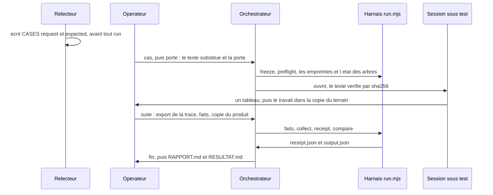
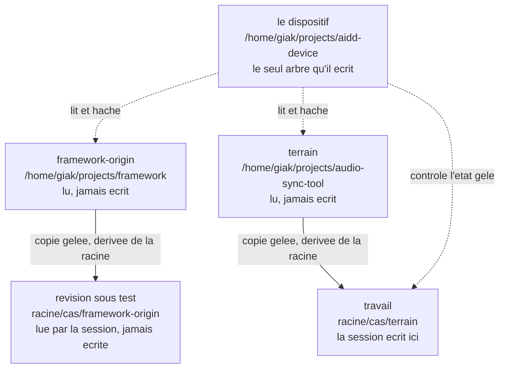
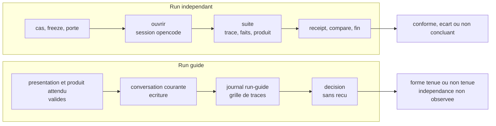
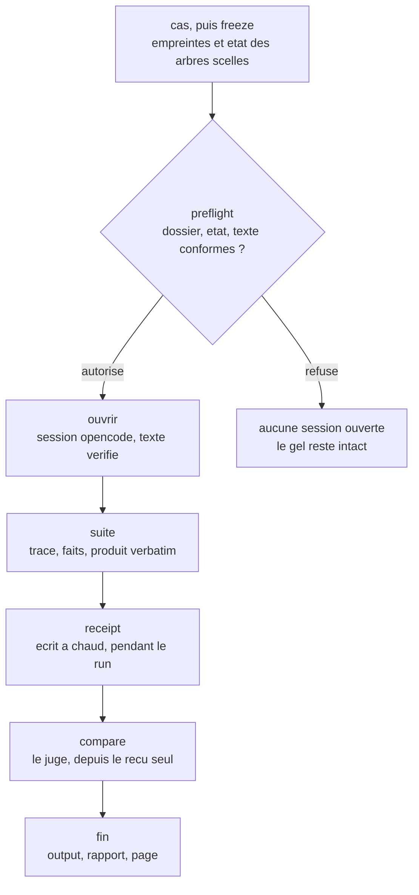
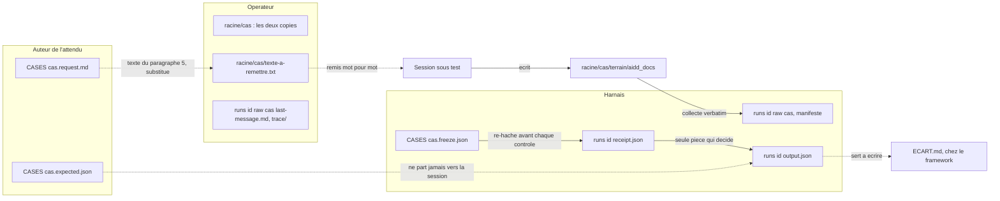
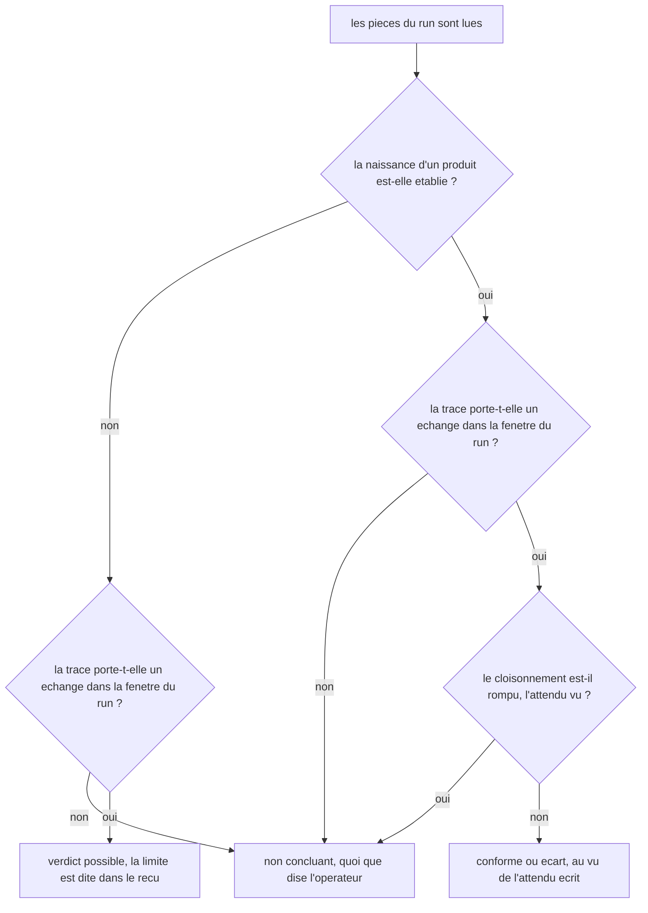

# ARCHITECTURE — le protocole de test, de bout en bout

> **Ce que cette page possède** : ce que le dispositif fait et ne fait pas, les acteurs et leur séparation
> de contexte, les quatre arbres et les preuves qu'aucun fichier ne fuit, le trajet des fichiers, les deux
> couches d'exécution, les falsificateurs, le plafond du verdict, et les limites structurelles.
> **Ce que possèdent les autres pages** : [PROTOCOLE](PROTOCOLE.md) dit comment conduire un test, dans
> quel ordre, avec quels refus ; [BANC](BANC.md) dit quels contrôles éprouvent le harnais ;
> [REPLAY](REPLAY.md) rejoue le gel depuis un clone neuf ; la
> [spec](tasks/2026_10/2026-10-15-130103-run-par-session-operateur/2026-10-15-130103-spec.md) porte les
> exigences, la [conduite](tasks/2026_10/2026-10-15-130103-run-par-session-operateur/2026-10-15-154303-run.md)
> l'ordre exact du run, et le [guide](guide/explication.md) raconte le même projet sans jargon.
> L'historique des rectifications et les comptes datés vivent dans [trace.md](trace.md) : cette page
> décrit le présent, elle ne le raconte pas.

**En une phrase.** Le dispositif fait exécuter une modification du framework par une session ouverte par
l'opérateur, et nomme l'écart entre ce qu'elle annonce et ce qu'elle produit, en gardant de quoi refaire le
départ, jamais la réponse.

## 1. Le problème, et la seule ruse de l'architecture

On veut savoir si une modification du framework AIDD tient sa promesse quand un modèle la lit. Le piège
est là, nommé dans la [VISION](VISION.md) : un attendu écrit **après** avoir vu le produit n'est pas un
attendu. Toute l'architecture découle d'une seule contrainte, le **gel antérieur au run** : ce qui est
attendu est haché et daté avant qu'aucune session ne soit ouverte, et un fichier du cas qui bouge après
le gel fait refuser le reçu comme le jugement (`run.mjs`, en-tête).

Ce que le dispositif produit au bout du compte, c'est **un écart nommé** et une phrase qui compare,
relisible par quelqu'un qui n'a pas assisté au run ([spec](tasks/2026_10/2026-10-15-130103-run-par-session-operateur/2026-10-15-130103-spec.md) §1).

## 2. Les acteurs, et la séparation de contexte

Sept positions, définies par ce qu'elles ne doivent pas voir (ce tableau, et le [guide](guide/explication.md)
§4). Le mode guidé en fait tenir deux par le même agent, et paie ce prix ([ADR-074](DECISIONS.md)).

| Position | Qui la tient | Ce qu'elle fait | Ce qu'elle ne voit jamais |
| --- | --- | --- | --- |
| auteur de l'attendu | le relecteur | écrit `CASES/<cas>.request.md` et `.expected.json`, fait geler l'empreinte | le produit |
| opérateur | le relecteur | déclare la racine, gèle, passe la porte, ouvre la session, remet le texte, collecte, écrit le reçu, exporte la trace | rien : il tient le cas. Ce qu'il en dit reste **déclaré** (`faits.json`), jamais une preuve : la **conduite** du run, agent ou humain, en fait partie ([ADR-071](DECISIONS.md)) |
| session sous test | la session IA ouverte par l'opérateur ; en mode guidé, la conversation courante ([ADR-074](DECISIONS.md)) | lit la révision sous test, écrit dans `terrain/` | en run indépendant : `CASES/*.expected.json`, cette page, le journal ; en mode guidé : elle voit tout, et c'est la limite dite |
| harnais | `docs/device/harness/run.mjs`, 3 169 lignes, aucune dépendance (il appelle `git`, `date`, `sqlite3` pour Freebuff et `opencode` pour l'autre client) ; `clients.mjs` est la frontière des deux | gèle, contrôle, copie, reçoit, compare | aucune session : il n'en ouvre pas, il ne décide rien seul |
| rapport | `docs/device/harness/rapport.mjs`, 562 lignes, aucune dépendance | lit le reçu, l'output et la trace, écrit `RAPPORT.md` | aucun verdict : il recopie celui du reçu et ne relit pas les falsificateurs ([ADR-050](DECISIONS.md)) |
| page utilisateur | `docs/device/harness/resultat.mjs`, 637 lignes, aucune dépendance | lit le reçu, l'output, la trace, l'attendu et la lecture déclarée du cas, écrit `RESULTAT.md` | aucun verdict : il range chaque geste sous l'un des trois états déclarés, et une mesure absente reste « non observé » ([ADR-061](DECISIONS.md)) |
| juge | l'agent | lit le **reçu seul** et re-hache les pièces qu'il cite, écrit `output.json` | la session ([spec](tasks/2026_10/2026-10-15-130103-run-par-session-operateur/2026-10-15-130103-spec.md) §8) |

L'orchestrateur n'est pas une position de plus : c'est la **main de l'opérateur**, un exécutable qui
appelle le harnais et recopie ses refus. Il ne voit ni l'attendu, ni la session, et n'écrit que les pièces
qu'on lui nomme (§4, et [PROTOCOLE](PROTOCOLE.md)).

La séparation est **de contexte, pas de personne** : relecteur, opérateur et juge peuvent être la même
main, mais chacune travaille sur des pièces différentes. C'est ce qui rend la question 4 du v6 §11
répondable.

**Le mode guidé défait cette séparation, et le dit** ([ADR-074](DECISIONS.md)). Quand le test d'un skill
se joue dans la conversation courante, l'opérateur et la session sous test sont le même agent : il a lu
l'attendu, cette page et le journal avant de produire. Le run reste mesurable — forme, chemins, écritures,
traces — mais il ne prouve pas que le skill seul produit le geste. Ce n'est pas une position de plus :
c'est une position qui en tient deux, avec la limite écrite. Depuis la Séance 126, ce mode s'ouvre par une
présentation en six champs, validée avant toute demande (§4.1).



## 3. Les arbres, et qui écrit où

**Attention, deux ensembles portent le nom « les quatre arbres »**, et les confondre fait perdre le fil :
la [skill `03-boundaries`](../.agents/skills/03-boundaries/SKILL.md) liste ce que le dispositif sépare, le
gel enregistre quatre **labels**
(`arbres[]`). Pour le cas `2026-10-22-092005-spike-annees` (gel `0052c168`, lu le 2026-10-22) :
`framework-origin` `fe48de12`, `terrain` `416ec1f`, `revision-sous-test` `fe48de12`, `travail`
`416ec1f`. Chaque cas a son instantané : `revision-sous-test` suit la révision du skill sous test, ce
n'est pas une tête fixe.

| Arbre | Chemin | Rôle | Écrit par |
| --- | --- | --- | --- |
| framework-origin | `/home/giak/projects/framework` | la source à l'épreuve | personne, lu seul |
| terrain | `/home/giak/projects/audio-sync-tool` | le vrai projet, un vrai dépôt | personne, lu seul |
| révision sous test | `<racine>/<cas>/framework-origin` | la source copiée pour le run | le gel, qui la dérive de `--racine` ([ADR-019](DECISIONS.md)) |
| travail | `<racine>/<cas>/terrain` | la copie du terrain, **c'est ici que la session écrit** | le gel, puis la session, et Freebuff qui y marque `.freebuff/project-id` (37 o, mesuré le 2026-10-16, [conduite](tasks/2026_10/2026-10-15-130103-run-par-session-operateur/2026-10-15-154303-run.md) §1.7) ; `collect` ne copie que le produit nommé par l'attendu ou par le `porcelain`, jamais l'arbre entier |
| le dispositif | `/home/giak/projects/aidd-device` | les preuves, le harnais, les cas | le dispositif, et lui seul |

`<racine>` est `racine_espace_de_travail`, déclarée **une seule fois** au gel : c'est un fait de la
machine, pas une propriété du cas. Un déplacement, ou une autre machine, redéclarent la racine au lieu
de réécrire un cas gelé ([ADR-019](DECISIONS.md), [REPLAY](REPLAY.md) §5).



### 3.1 Ce que la frontière prouve

Deux relevés identiques, **avant et après** chaque run, sont la preuve que l'origine n'a pas bougé :

```text
git -C /home/giak/projects/framework rev-parse --short HEAD
git -C /home/giak/projects/framework status --porcelain
```

Depuis l'[ADR-021](DECISIONS.md) (variante A), la même paire se relève **en clôture de toute séance
capable d'écrire**, et son écart va au `Vérifié` de la séance : c'est le seul contrôle qui attrape une
dérive née hors run. Il constate, il ne prévient pas : une dérive réparée avant le relevé ne laisse rien à
lire.

**Aucun fichier du dispositif n'appartient au framework.** La clause se mesure en **paires chemin +
contenu** ([ADR-014](DECISIONS.md)), ni par le chemin seul, ni par le contenu seul : deux dépôts portent
chacun un `AGENTS.md` et un `README.md` par convention, et l'intersection des seuls chemins n'est jamais
vide. La commande qui décide :

```text
cd /tmp
git -C <origine>    ls-files -s | awk -F'\t' '{split($1,a," "); print a[2]"\t"$2}' | LC_ALL=C sort > f.pairs
git -C <dispositif> ls-files -s | awk -F'\t' '{split($1,a," "); print a[2]"\t"$2}' | LC_ALL=C sort > d.pairs
LC_ALL=C comm -12 f.pairs d.pairs | wc -l        → 0
```

Les relevés datés, les trois tentatives qui l'ont fait trancher et les arbres publiés sont au
[journal](trace.md), Séances 2, 10 et 131. Un même contenu n'est pas le même fichier, et un même chemin non
plus : seule la paire tranche.

La variante qui hashe l'**arbre de travail** entier ne décide pas : elle ramasse ce que le client dépose
lui-même (`.freebuff/.gitignore`), et l'intersection cesse d'être vide sans qu'un fichier du dispositif
appartienne au framework. La mesure qui tranche lit l'**index** (`git ls-files -s`).

**Ce que la paire ne prouve pas** : elle porte sur les fichiers **suivis**, pas sur les artefacts non
commités ; l'intégrité **pendant** un run n'est établie que par la paire relevée à ce moment-là ; et un
artefact peut atterrir dans l'arbre de l'origine sans que le dispositif l'ait écrit là, quand un outil du
client résout un **chemin relatif** contre la racine du projet ouvert. La parade tenue est d'écrire en
chemin absolu ; la dérive est lue, jamais empêchée.

## 4. Deux couches d'exécution, et le cycle d'un run

Deux exécutables, deux responsabilités. L'**orchestrateur** (`harness/orchestrer.mjs`) dit ce qui se dit
et dans quel ordre : il n'ouvre aucun contrôle, appelle le harnais et recopie son refus tel quel
([ADR-038](DECISIONS.md)). Le **harnais** (`harness/run.mjs`) mesure et écrit les pièces. Une étape qui
refuse arrête l'orchestrateur, et la commande qui a refusé n'est pas relancée. L'orchestrateur est aussi
le seul endroit du dispositif qui ouvre une session et parle par le réseau, en local (`ouvrir`,
[ADR-059](DECISIONS.md)).

Les huit commandes de l'orchestrateur, leurs options, leurs refus et les quatre blocs qu'elles impriment
sont au [PROTOCOLE](PROTOCOLE.md) §2 à §5 : cette page dit de quoi les deux couches sont faites, pas
comment on s'en sert.

### 4.1 Les deux modes, et ce qui les distingue

Le run indépendant suit le cycle complet : gel, porte, session ouverte, collecte, reçu à chaud,
comparaison. Le run guidé n'a ni gel, ni porte, ni reçu, et il paie son indépendance
([ADR-074](DECISIONS.md)) : sa conduite, sa présentation en six champs et son gabarit sont au
[PROTOCOLE](PROTOCOLE.md) §1.

Les deux modes ne laissent pas les mêmes pièces :



Le harnais est l'instrument du run, pas un contrôle mécanique du dépôt : aucune dépendance, aucun hook,
aucun CI ([ADR-004](DECISIONS.md)). Ses refus et ses acceptations sont éprouvés par un banc qui vit dans
le dépôt, `docs/device/harness/banc-harnais.sh` : ses contrôles, sans ouvrir de session ni écrire dans le dépôt
([BANC](BANC.md), [ADR-022](DECISIONS.md)). À côté de lui, `liens.mjs` éprouve les liens des documents :
compte strict hors code, compte naïf imprimé à côté, refus d'un lien mort en prose ([ADR-027](DECISIONS.md)). Ses outils hors de Node — `git`, `date` GNU,
`sqlite3` pour la base Freebuff, `opencode` pour l'export de l'autre client — sont déclarés au `--help` et
sondés au démarrage, avec un refus qui nomme l'outil, la commande, l'usage et le remède ([ADR-026](DECISIONS.md)). Le banc n'est pas un automatisme pour autant : rien ne
le déclenche seul, et il n'éprouve que le harnais, jamais le dépôt. Son code de sortie est toujours le
même trio : `0` fait, `1` refus (imprimé, jamais compté), `2` usage.

Les deux clients sont derrière une **frontière d'adaptation** (`harness/clients.mjs`,
[ADR-043](DECISIONS.md)) : `faits`,
`receipt` et `suite` parlent à une interface normalisée — `session`, `exportTrace`, `replayTrace`,
`budget`, `commandeAttendue` — jamais à un schéma de client. Freebuff lit `desktop-v2.db` en `-readonly` et
normalise une ligne JSONL par part ; opencode lit `opencode session export`, normalise le même JSONL, et
conserve l'export brut. Le client est un fait du run (`session.outil`, `trace.client`,
[ADR-044](DECISIONS.md)) ; l'ordre des lignes est celui des parts, et `tableau.index` /
`ecriture_avant_tableau[].index` le portent ([ADR-045](DECISIONS.md)) ; le brut opencode qui change est
une limite (`export_brut_instable`), pas un refus ([ADR-046](DECISIONS.md)).

Les six commandes du harnais :

| Commande | Quand | Ce qu'elle lit | Ce qu'elle écrit | Ce qu'elle refuse |
| --- | --- | --- | --- | --- |
| `freeze` | avant d'ouvrir | les fichiers du cas, les références du framework, l'état des quatre arbres | `CASES/<cas>.freeze.json` | un gel qui existe déjà (sans `--refreeze`), un `--arbre` sur un label dérivé, une racine dans le dépôt ou inexistante, un cas qui écrit la racine en clair |
| `preflight` | juste avant d'ouvrir | le gel, le dossier examiné, le texte remis (`--texte`) | `runs/<id>/gate.json` : l'instant en secondes, le dossier autorisé, l'empreinte du gel, l'arbre qu'elle vient de mesurer et le texte remis ([ADR-034](DECISIONS.md)) | un dossier qui n'est pas l'arbre `travail` du gel, un arbre qui n'est plus dans l'état gelé, un cas dont un fichier a bougé, un texte qui n'est pas le §5 substitué ([ADR-018](DECISIONS.md)), un `--run` absent, une porte déjà là, un `--run` qui n'est pas un répertoire ([ADR-034](DECISIONS.md)) |
| `collect` | le produit revenu | le gel, `--from` résolu (`realpath`) | `runs/<id>/raw/<cas>/` et son manifeste : `sha256`, taille, `birth`, source absolue de chaque fichier ([ADR-020](DECISIONS.md)) | un `--from` hors de l'arbre `travail`, un lien symbolique, un dossier déjà collecté, une copie dont le `sha256` diffère, `--from` vide |
| `collect --sans-produit` | un run qui ne rend rien | le gel seul | le même manifeste, avec `fichiers: []` et `produit_absent: true` | `--sans-produit` **avec** `--from` (spec §9) |
| `collect --annexe` | le scratch déclaré, après le produit | le gel, `--annexe` résolu (`realpath`) | `runs/<id>/annexe/<cas>/` et son manifeste `role: annexe` : la preuve citée par le produit reste exécutable sans devenir le produit ([ADR-067](DECISIONS.md)) | un `--annexe` hors de l'arbre `travail`, un dossier déjà collecté, `--annexe` avec `--from` ou `--sans-produit` |
| `faits` | entre l'export et le reçu | la base du client (`threads`, `messages`), le gel, `--trace` | `faits.json` : `session` (dont `outil`), `horodatage_debut`, `repertoire_de_travail`, `trace` (dont `client`, puis `base` pour Freebuff ou `store`, `cwd`, `export_brut` pour opencode), `conduite{mode: agent|humain, qui, quand}` ([ADR-071](DECISIONS.md)) ; `suite` y ajoute `dernier_message{chemin, sha256, seq, ts}` après avoir écrit `last-message.md` ([ADR-065](DECISIONS.md)) | un fil absent, un modèle vide, un chemin qui ne résout pas, un fil hors de l'arbre `travail`, un fil en worktree, une fin antérieure au début, un `faits.json` déjà écrit, une `conduite` absente ou hors de `agent | humain` ([ADR-024](DECISIONS.md), [ADR-031](DECISIONS.md), [ADR-071](DECISIONS.md)) |
| `receipt` | pendant le run, à chaud | le gel re-haché, le manifeste, `faits.json`, la **copie sous `raw/`**, la **base** qu'il nomme, qu'il rejoue, le **budget d'échanges** du cas, la **porte du run**, la **forme du tableau** dans la trace exportée (H6), le bloc `cloisonnement` du cas et les **effets littéraux des commandes `shell`** ([ADR-051](DECISIONS.md)) | `runs/<id>/receipt.json` : les champs du §6, les falsificateurs, `recu_ecrit_le`, `gel_verifie`, `produit.verifie`, `session_verifiee` (dont `outil`), `conduite{mode, qui, quand}` recopiée de `faits.json` avec sa limite de déclaration ([ADR-071](DECISIONS.md)), `trace_verifiee` (`sha256` et `rejoue_le` pour Freebuff ; `outil`, `commande`, `cwd`, `sha256`, `brut_sha256` pour opencode), `trace_lue.sha256` et `rejoue_le`, `echanges{budget, utilises, epuise_par}`, `porte{chemin, sha256, …}`, `tableau{forme, present, index, seq, ts, lignes, colonnes, requis}`, `pause{requise, mesuree, seq_reponse, seq_ecriture, outil_ecriture}`, `annexe{fichiers, manifeste_sha256, verifie}`, `cloisonnement{attendu_vu, lecture{autorisees, resolues, racine_du_cas}, ecriture{autorisees, resolues, scratch, scratch_resolu}, reseau, fichiers_de_contexte}`, `falsificateurs.lecture_hors_dossier`, `falsificateurs.ecriture_hors_dossier` | un reçu déjà écrit, un cas qui ne concorde plus avec le gel, un manifeste venu d'un autre arbre, une source de fichier hors de l'arbre du run, un `faits.json` dont les chemins ne se situent pas (répertoire de travail absent, dossier de la trace absent), un `session.identifiant` que la commande d'export ne lit pas, une `trace.commande` qui n'est pas celle que le reçu reconstruit, une trace exportée qui ne rend pas les octets de la base, une trace exportée sans échange dans la fenêtre du run, un fil qui porte plus de messages `user` que le budget de son cas ou un attendu sans budget lisible, une copie absente, réécrite ou grossie depuis `collect`, un fil que la base ne porte pas ou qu'elle contredit, une porte absente, d'un autre cas, d'un autre gel, d'un autre arbre, d'un autre dossier que celui du run, antérieure au gel, d'un HEAD bougé depuis elle ou d'un texte remis qui n'est pas le §5, un verdict que la preuve ne porte pas, aucune forme de tableau dans la trace exportée, une écriture avant ce tableau, un produit né avant lui, un attendu sans bloc `cloisonnement`, un produit hors de ses racines d'écriture, une lecture hors du cadre déclaré, une écriture d'outil hors des racines d'écriture, un dernier message attesté qui ne rend plus son empreinte ou son texte, une annexe retouchée après sa collecte ([ADR-049](DECISIONS.md), [ADR-052](DECISIONS.md), [ADR-063](DECISIONS.md), [ADR-065](DECISIONS.md), [ADR-067](DECISIONS.md)) ([ADR-030](DECISIONS.md), [ADR-031](DECISIONS.md), [ADR-032](DECISIONS.md), [ADR-033](DECISIONS.md), [ADR-034](DECISIONS.md), [ADR-035](DECISIONS.md)) |
| `compare` | après, par le juge | le **reçu seul**, le gel re-haché, la **trace** et la **porte** que le reçu cite, re-hachées | `runs/<id>/output.json` : `cas`, `attendu`, `produit_brut`, `difference`, `verdict`, `limites`, `ecarte_comme_non_testable`, `phrase`, `gel_verifie`, `juge_le`, `depuis_le_recu` | un cas qui ne concorde plus avec le gel, un reçu qui cite une empreinte que le gel sur disque ne porte plus, une trace ou une porte réécrite entre le reçu et le jugement ([ADR-032](DECISIONS.md), [ADR-034](DECISIONS.md)) |



## 5. La vie d'un artefact, du cas jusqu'à l'écart

Chaque pièce a **un seul écrivain**, et c'est ce qui rend le cloisonnement vérifiable.



Le schéma suit la chaîne du cas au produit ; les pièces d'exécution nées depuis (porte, faits, rapport,
page utilisateur, lecture) sont dans la table qui suit.

**Ce qui part, et ce qui ne part jamais.** La demande (`CASES/<cas>.request.md`) porte huit champs :
identifiant ; révision du framework sous test et commande d'installation en répertoire jetable ; révision
du terrain et commande de copie de travail ; chemin du répertoire de travail, situé par la racine déclarée
au gel (`$RACINE/<cas>/`, [ADR-019](DECISIONS.md)) ; **le texte remis, verbatim, entre deux lignes de
garde** ; ce que la session doit produire, chemin et nom exacts ; les interdits (écrire dans
`framework-origin`, écrire dans le terrain, lire `CASES/`, sortir du répertoire de travail) ; le budget
d'échanges. Seul son §5 part, substitué, et `preflight` le re-hache contre la porte. L'attendu ne part
**jamais** : relayé, il se lit dans le reçu (`attendu_vu: oui`).

| Pièce | Écrite par | Lue par | Où | Durée de vie |
| --- | --- | --- | --- | --- |
| `CASES/<cas>.request.md` | l'auteur de l'attendu | la porte et le reçu (re-hachage) ; son §5 part substitué | `docs/device/CASES/` | versionnée, rectifiée par note datée, jamais en silence |
| `CASES/<cas>.expected.json` | l'auteur de l'attendu | le juge, par `compare`, qui en tire `attendu` | `docs/device/CASES/` | versionnée, **ne part jamais** vers la session |
| `CASES/<cas>.freeze.json` | `freeze` | `preflight`, `collect`, `receipt`, `compare` | `docs/device/CASES/` | un re-gel **détruit** le précédent (six fois le 2026-10-15) |
| `<racine>/<cas>/framework-origin`, `terrain` | `freeze`, par dérivation | la session, le harnais | hors des arbres, sous `~/projects/` | une par **cas**, jamais par run |
| `<racine>/<cas>/texte-a-remettre.txt` | l'opérateur | `preflight --texte` | hors des arbres | regénérée à chaque rectification du cas |
| `raw/<cas>/` et son manifeste | `collect` | le reçu | `docs/device/runs/<id>/` | versionnée avec le run |
| `raw/<cas>/last-message.md` | `suite`, depuis la dernière part `text` d'un assistant, et haché dans `faits.json` ([ADR-065](DECISIONS.md)) | le juge ; `receipt` re-hache et reconfronte le texte à la trace | `docs/device/runs/<id>/raw/<cas>/` | versionnée ; un fichier déjà là est refusé, jamais remplacé en silence |
| `trace/` (export et commande) | l'opérateur, ou `suite` | le juge, et quiconque doute | `docs/device/runs/<id>/` | versionnée : c'est la pièce la plus forte du run |
| `runs/<id>/gate.json` | `preflight` | `receipt` et `fin` (re-hachage), et l'orchestrateur qui le cite | `docs/device/runs/<id>/` | versionnée, **une par run** : un dossier qui en porte une est refusé ([ADR-034](DECISIONS.md)) |
| `runs/<id>/faits.json` | `faits` | `receipt`, `fin`, `rapport` | `docs/device/runs/<id>/` | versionnée : des faits écrits ne se réécrivent pas, ils se relisent |
| `receipt.json` | `receipt`, à chaud | le juge | `docs/device/runs/<id>/` | **jamais reconstruit après coup** : un reçu du lendemain est un témoignage |
| `output.json` | `compare` | le relecteur de la pull request | `docs/device/runs/<id>/` | versionnée : c'est l'écart |
| `RAPPORT.md` | `rapport`, ou `fin` juste après | le relecteur | `docs/device/runs/<id>/` | régénérable, jamais écrasé sans `--remplacer` ([ADR-050](DECISIONS.md)) |
| `RESULTAT.md` | `resultat.mjs`, par `fin` ou `rapport` | la personne qui a demandé le test | `docs/device/runs/<id>/` | ne se réécrit pas ; exige `CASES/<cas>.lecture.json` ([ADR-061](DECISIONS.md)) |
| `CASES/<cas>.lecture.json` | l'auteur de l'attendu | `resultat.mjs`, et `verifierLecture` avant toute écriture | `docs/device/CASES/` | **hors du gel** : ce fichier ne change ni l'attendu ni l'empreinte, donc un reçu reste re-jugeable ([ADR-032](DECISIONS.md)) |
| `ECART.md` | l'opérateur, après le run | le relecteur de la pull request framework | chez le framework, `aidd_docs/tasks/<année_mois>/<date_slug>/` | écrit le 2026-10-17 ([ECART](device/runs/2026-10-15-171559-4c39e5c5-1d471a5/ECART.md)), jamais poussé au framework |

Le nom du dossier d'un run porte ce qui l'a produit : `cas` crée aujourd'hui
`runs/<horodatage>-<empreinte du gel, 8>-<aléa de 7>/` (`orchestrer.mjs`, `runParDefaut`), d'où
`runs/2026-10-22-092354-0052c168-496fbe8/` ; les premiers dossiers portaient
`<révision du framework>-<révision du dispositif>`, d'où `runs/2026-10-15-171559-4c39e5c5-1d471a5/`, et le
premier run opencode réel suit déjà la forme actuelle, `runs/2026-10-20-202333-50664060-1028c8b/`. Des
tirets, donc : la forme du v6 porte un `@` (`framework@rev`), c'est une notation, et
[ADR-023](DECISIONS.md) a tranché ce point le 2026-10-16.

Le run opencode du 2026-10-20 est le premier à porter un `receipt.json` et un `output.json` réels ; le
dépôt en porte **dix-neuf** au 2026-10-23, pour **cinq** cas gelés et **vingt-neuf** dossiers de run
(`ls docs/device/runs/*/receipt.json`). Son reçu
nomme `session_verifiee.outil = "opencode"`, deux échanges sur deux et un produit collecté
(`terrain/aidldocs/NOTES.md`, hors du chemin attendu) ; son verdict est `non concluant`, avec une seule
limite, `tableau_absent`, car le tableau rendu n'a qu'une colonne et la forme H6 en exigeait deux à
l'époque. Depuis l'ADR-047, la même trace rend `tableau.present = true` (`colonnes: 1`) ; le reçu du
dépôt reste le reçu écrit à chaud, il n'est pas réécrit. Le reçu atteste le run, pas la justesse du
produit.

## 6. Ce que le gel scelle, et ce qu'il ne peut pas sceller

| Le gel porte | Ce qu'il établit | Qui le relit |
| --- | --- | --- |
| `fichiers[]` (rôle, chemin relatif, `sha256`) | les deux fichiers du cas, tels qu'ils étaient **avant** l'ouverture | le reçu et le juge, qui re-hachent sur disque |
| `references[]` (arbre, chemin, `sha256`) | les fichiers de la révision sous test dont l'attendu dépend (**11** pour `spike-annees` ; le nombre est celui du cas) | le rejeu tiers ([REPLAY](REPLAY.md) §1) |
| `empreinte` | une ligne par fichier et référence, hachée globalement | `REPLAY` §2, et `run.mjs` |
| `arbres[]` : `head`, `head_complet`, `porcelain`, `remotes`, `refs_distants` | l'état des quatre arbres avant le run | `preflight` (état `travail`), `receipt` (avant et après) |
| `racine_espace_de_travail` | la racine des espaces de travail, une fois pour toutes machines | la dérivation des deux copies |
| `gele_le`, `gele_le_epoch` | l'instant du scellé, **déclaré** | personne ne peut l'opposer : un tiers borne par la date d'entrée au dépôt |

Ce qu'aucun gel ne peut sceller, et qu'il faut donc dire à chaque fois ([REPLAY](REPLAY.md) §5, §3.1) : le `porcelain` liste des fichiers non suivis que git ne transporte
pas ; la **date de naissance** d'un fichier ne voyage pas, donc la condition 1 ne se vérifie que sur la
machine qui a produit ; `gele_le` est déclaré par le gel lui-même.

## 7. Les falsificateurs, et le plafond du verdict

Un seul falsificateur suffit à faire tomber le run, et le verdict suit la preuve, jamais l'inverse
([spec](tasks/2026_10/2026-10-15-130103-run-par-session-operateur/2026-10-15-130103-spec.md) §7). Deux
couches se lisent séparément : les **seize mesures** que `receipt` calcule pour tout run, et les
falsificateurs **du cas**, écrits dans `CASES/<cas>.expected.json`, qui disent ce que sa promesse
attendait. Une troisième, **lue par `resultat.mjs`** dans `lecture.json`, rend les traces vérifiables (§7.3).

### 7.1 Ce que le reçu mesure

| Mesure | Ce qui la fait mordre | Plafond |
| --- | --- | --- |
| `tableau_absent` | la trace ne porte aucun tableau rendu par la session (§5, F2) | `non concluant` |
| `ecriture_avant_tableau` | une écriture précède le tableau | `non concluant` |
| `produit_ne_avant_le_tableau` | un fichier du produit est né avant le tableau (F1) | `non concluant` |
| `question_sans_reponse` | la session pose une question puis écrit sans qu'aucune ligne `user` les sépare ([ADR-058](DECISIONS.md)) | `non concluant` |
| `pause_non_tenue` | le cas exige une pause et la première écriture nommée n'est précédée d'aucun tour `user` ([ADR-069](DECISIONS.md)) | `non concluant` |
| `trace_sans_echange_dans_la_fenetre` | aucun échange dans la fenêtre du run (§5, condition 2) | `non concluant` |
| `birth_anterieur_au_gel` | un fichier produit est né avant le gel (§5, condition 1) | `non concluant` |
| `arbre_de_travail_inchange` | le produit existe et l'arbre de travail n'a pas bougé (F6) | `non concluant` |
| `produit_identique_a_une_empreinte_anterieure` | un fichier produit est identique à une empreinte du gel, ou à un fichier lu avant sa naissance (F7, [ADR-054](DECISIONS.md)) | `non concluant` |
| `lecture_hors_dossier` | une lecture nommée sort des racines du bloc `cloisonnement` ([ADR-049](DECISIONS.md)) | `non concluant` |
| `shell_hors_dossier` | une cible littérale d'une commande `shell` sort de ces racines | `non concluant` |
| `shell_ecriture_hors_produit` | une commande `shell` écrit hors de la racine du produit | `non concluant` |
| `shell_invalide` | la commande est mal formée et le shell l'aurait refusée (motif nommé, [ADR-070](DECISIONS.md)) | `non concluant` |
| `shell_non_interpretable` | la commande est valide et le lecteur d'effets ne la suit pas (motif nommé, [ADR-051](DECISIONS.md), [ADR-070](DECISIONS.md)) | `non concluant` |
| `reseau` | un client réseau déclaré apparaît dans une commande, alors que le cas l'interdit | `non concluant` |
| `hors_produit` | un chemin nouveau du `porcelain` tombe hors du produit | `conforme` seul, si la nature est `produit` |

Un produit absent n'est pas une ligne de cette table : un manifeste vide force `non concluant` et le reçu
porte `produit.absent` (spec §9). Deux autres morsures ne sont pas des clés de `falsificateurs` :
`cloisonnement.attendu_vu: oui` (l'attendu a été vu) et un fichier de contexte écrit hors du produit
forcent `non concluant` ([ADR-051](DECISIONS.md)).

### 7.2 Ce que le cas attend, à titre d'exemple

Les neuf falsificateurs du premier cas (`2026-10-15-133423-promesse-memoire-avant-ecriture`), tels que son
`expected.json` les déclare :

| # | Ce qui le fait mordre | Ce qu'il tue |
| --- | --- | --- |
| `F1` | un `birth` sous `terrain/aidd_docs/` antérieur au message qui porte le tableau (lu depuis H6, [ADR-035](DECISIONS.md)) | l'ordre promis : montrer avant d'écrire |
| `F2` | la trace ne porte aucun tableau, ou porte des écritures avant le tableau (lu depuis H6, [ADR-035](DECISIONS.md)) | le cas entier, donc `non concluant` |
| `F3` | un chemin produit hors de la table `Write to` | la conformité : le produit dépasse la révision sous test |
| `F4` | `aidd_docs/memory/backlog.md` existe | la réponse figée « do not write the backlog memory » |
| `F5` | une écriture hors du répertoire de travail | les interdits du §7 de la demande |
| `F6` | le produit existe alors que la copie du terrain n'a pas bougé | la condition 3 : l'arbre n'a pas bougé, donc rien ne s'y est produit |
| `F7` | un fichier produit identique à un fichier présent avant le run | la condition 4 : un produit recopié n'est pas un produit né |
| `F8` | aucun fichier sous `terrain/aidd_docs/` | la production attendue |
| `F9` | la trace ne montre **aucun accès** à un fichier de la révision sous test | la prémisse du cas : la session a lu autre chose ([bilan](brainstorm/2026-10-15-201458-bilan-premier-run.md) §6.1) |

Quatre falsificateurs de l'écart, lus dans l'attendu du même cas :

| # | Ce qui le fait mordre | Verdict |
| --- | --- | --- |
| `E1` | un `TODO` ou un `<placeholder>` subsiste sous `memory/` | `écart` |
| `E2` | aucun rapport final ne nomme ce qui a changé | `écart` |
| `E3` | `memory/` imbriqué, ou `internal/` et `external/` manquants | `écart` |
| `E4` | un fichier du tableau n'est pas écrit alors que l'opérateur a confirmé | `écart` |

Le plafond, tel que la [conduite](tasks/2026_10/2026-10-15-130103-run-par-session-operateur/2026-10-15-154303-run.md) §3.3 l'énonce :



Un run qui n'a rien produit n'est pas un échec de la mesure : avec `collect --sans-produit`, il laisse un
manifeste, un reçu où `produit.absent: true` dit ce qui manque, et un `output.json` dont `produit_brut`
nomme le dossier `raw/<cas>/`, vide ; le verdict tombe à `non concluant` ([spec](tasks/2026_10/2026-10-15-130103-run-par-session-operateur/2026-10-15-130103-spec.md) §9, [bilan](brainstorm/2026-10-15-201458-bilan-premier-run.md) §6.2).

### 7.3 Les traces vérifiables, seul objet jugeable du raisonnement

Un cas ne juge pas ce que la session a pensé : il juge ce qu'elle a laissé ([ADR-073](DECISIONS.md)). Le
raisonnement caché n'est ni lisible ni falsifiable ; une trace absente ne prouve pas une pensée absente,
elle prouve une mesure absente. Quatre familles peuvent être observées dans la trace exportée et les
pièces :

| Famille | Ce qui compte comme trace | Où le lire |
| --- | --- | --- |
| question | une question posée à la personne, avec son texte, et le tour qui suit | part `assistant`, puis part `user` |
| décision | un choix énoncé avec son motif et, s'il y est, l'alternative écartée | part `text` |
| accès | un fichier lu, une commande lancée, un document cité, avec son chemin ou son URL | part `tool`, nom d'outil et cible |
| production | un fichier écrit, avec son chemin et son empreinte | manifeste et pièce collectée |

Le protocole ne crée pas de bloc `traces[]` dans l'attendu ([ADR-075](DECISIONS.md)). `attendu_details.ordre`
reste la **promesse gelée**, en prose ; `lecture.json` reste la **lecture déclarée**, hors du gel, et porte
les assertions que `resultat.mjs` confronte au fil. Deux assertions génériques suffisent : `trace_texte`
(`role` `assistant | user`, `contient` ou `finit_par` exclusifs, `a_partir_du_tour` entier positif
facultatif) et `trace_outil.commande_contient` ; `lireParts` expose `textes` à côté de `parts`. Une trace
absente, ou sans partie examinable, rend `non observé` ; une partie examinable qui contredit rend `violé` ;
une partie qui satisfait rend `tenu`, jamais sans preuve citée. La page cite le tour et la valeur bornée.
Une part `reasoning` n'est jamais lue : une décision doit être énoncée en texte.

**Aujourd'hui**, la lecture est **mesurée** dans `RESULTAT.md` pour les cas qui déclarent une
`lecture.json` ; le reçu et l'output ne changent pas, et un run sans lecture reste sans page. La grille du
run guidé ([ADR-074](DECISIONS.md)) se remplit à la main, avec la même règle de trois états, dans le
gabarit de la spec
[`2026-10-22-221207-spec-run-guide.md`](tasks/2026_10/2026-10-22-221207-traces-et-run-guide/2026-10-22-221207-spec-run-guide.md)
§3 ; sa conduite et sa présentation sont au [PROTOCOLE](PROTOCOLE.md) §1. Le harnais ne juge pas le
raisonnement, et cette page ne doit pas le laisser croire.

## 8. Ce qui est structurellement vrai, et ce qui reste une limite

- **Les interdits du cas ne sont pas dits à la session, ils sont rendus vrais** ([ADR-015](DECISIONS.md)) :
  la porte refuse l'ouverture hors de l'espace gelé, la copie du terrain ne porte aucun `aidd_docs`, et
  `collect` refuse un produit venu d'ailleurs. Les interdits non structurels mesurés sont « ne pas lire
  `CASES/` » (`cloisonnement.attendu_vu`) et « rester dans le cadre déclaré » : le cas écrit ses racines
  de lecture et d'écriture dans le bloc `cloisonnement` de son attendu, et toute lecture nommée hors des
  racines de lecture devient `lecture_hors_dossier` et force `non concluant` ([ADR-049](DECISIONS.md),
  [ADR-052](DECISIONS.md)). La racine du cas, elle, se lit par égalité : c'est le répertoire de travail que
  la demande nomme, et ses sous-arbres restent soumis au cadre ([ADR-064](DECISIONS.md)). Un attendu sans bloc est refusé : le harnais ne retombe pas sur une constante.
  Depuis l'ADR-051, la commande `shell` est lue et ses effets mesurés : cibles littérales, `xargs` et
  `find -exec`, substitution de commande bornée ([ADR-056](DECISIONS.md), [ADR-057](DECISIONS.md)). Ce
  lecteur ne voit pas un binaire opaque, un client réseau hors de la liste déclarée, ni un nom de fichier
  de contexte hors liste, et le reçu le dit en limite. Depuis l'ADR-063, le chemin nommé par un outil
  d'écriture est mesuré comme celui d'une lecture : le run `spike-annees` du 2026-10-22 a écrit deux
  scripts et les a édités quatre fois sous `/tmp/opencode/`, et ces six parts mordent maintenant
  (`ecriture_hors_dossier`). Le cadre de lecture inclut la racine du cas par égalité, jamais par
  contenance : lister `$RACINE/<cas>/` n'est pas en sortir, y lire un fichier reste mesuré (ADR-064).
  Le même run a montré la limite du cadre : un skill d'investigation écrit ses scripts quelque part, et
  `/tmp` était interdit. Un cas peut désormais déclarer un **scratch** sous son propre arbre
  (`cloisonnement.ecriture.scratch`), lisible, scriptible, collecté en annexe et jamais compté comme
  produit ([ADR-067](DECISIONS.md)) : la preuve reste dans le run, et l'écriture hors de l'arbre mord
  toujours. Le **tableau** n'est plus une convention universelle : un cas qui n'en demande pas écrit
  `attendu_details.tableau.requis: false`, et l'absence cesse alors de mordre ([ADR-068](DECISIONS.md)).
  La **pause** entre la qualification et la première écriture se mesure sur un tour `user`, pas sur
  l'outil `question` : le run `spike-annees` avait montré, attendu et écrit, et le reçu disait
  « non observé » ([ADR-069](DECISIONS.md)). Enfin, la commande `shell` que le lecteur refuse porte
  désormais deux noms : mal formée pour le shell (`shell_invalide`, faute de session) ou valide mais
  aveugle pour le lecteur (`shell_non_interpretable`, limite d'instrument qui plafonne encore), chacune
  avec une limite par entrée ([ADR-070](DECISIONS.md)).
- **Un espace de travail par cas, jamais par run** : le texte remis et le gel portent des chemins
  absolus, deux runs du même cas se distinguent par leurs pièces.
- **`run.mjs` n'ouvre aucune session et n'écrit que les chemins qu'on lui donne.** Il résout sa propre
  racine de dépôt depuis son chemin, jamais depuis le répertoire courant de l'appelant. `ouvrir` en ouvre
  une, par l'API locale d'opencode, et n'écrit rien dans le dossier du run : le fil qu'elle imprime est ce
  que `suite` reçoit.
- **Le cas ne nomme aucune machine** : il écrit `$RACINE`, le gel déclare ce qu'elle vaut
  ([ADR-019](DECISIONS.md)).
- **Aucune pensée n'est jugée.** Ce qui n'est pas dans la trace n'est pas une faute : c'est une mesure
  absente ([ADR-073](DECISIONS.md)). Le dispositif ne lit ni l'intention, ni le raisonnement interne ; il
  lit des questions, des décisions, des sources et des fichiers, et il dit lesquels manquent.
- **Un run guidé n'est pas un run indépendant.** Dans la conversation courante, l'agent qui produit a lu
  l'attendu ([ADR-074](DECISIONS.md)). Un `conforme` obtenu ainsi prouve la forme, les chemins et les
  écritures, jamais que le skill seul fait le geste ; il **doit** porter `session_non_independante`,
  déclaré.
- **Limites nommées, non corrigées** : rien ne force l'opérateur à passer `--texte` (le contrôle du
  texte n'existe que si on lui donne) ; un manifeste recollé à la main après coup reste indiscernable
  d'un manifeste né ainsi ; un artefact peut atterrir dans l'arbre de l'origine par la résolution d'un
  chemin relatif côté client (§3.1).
- **Le client, mesuré le 2026-10-16** ([conduite](tasks/2026_10/2026-10-15-130103-run-par-session-operateur/2026-10-15-154303-run.md) §1.7) : ses
  **lectures** ne sont pas cloisonnées à l'arbre ouvert (un `..` qui en sort résout, un chemin absolu
  aussi), donc la prémisse du cas (aller lire la révision sous test) tient ; ses **écritures** hors
  racine, elles, sont mesurées depuis l'[ADR-051](DECISIONS.md) sur les cibles littérales des commandes,
  et le run `spike-annees` du 2026-10-22 en a attrapé cinq sous `/tmp/opencode/`
  ([reçu](device/runs/2026-10-22-092354-0052c168-496fbe8/receipt.json)). Il peut aussi vivre en
  *worktree* : ouvert ainsi sur la copie du terrain, il y créerait une branche et déplacerait le `HEAD`
  gelé : à refuser avant d'ouvrir. Et le texte qu'il stocke est **identique à celui qu'il reçoit**
  (`cmp`, deux échantillons, aucun guillemet ajouté).

## 9. Où lire quoi

| Question | Page |
| --- | --- |
| comment conduire un test, dans quel ordre, avec quels refus | [PROTOCOLE](PROTOCOLE.md) |
| récupérer le dépôt et lancer le harnais | [README](../README.md) |
| rejouer le gel depuis un clone neuf, sans réécrire un chemin | [REPLAY](REPLAY.md) |
| le banc qui éprouve le harnais, ses contrôles, ce qu'il ne prouve pas | [BANC](BANC.md) |
| l'ordre exact à suivre pour un run, ce qui se remet mot pour mot, et ce que le client écrit (§1.7) | [conduite](tasks/2026_10/2026-10-15-130103-run-par-session-operateur/2026-10-15-154303-run.md) |
| les exigences, et le critère qui les rendrait fausses | [spec](tasks/2026_10/2026-10-15-130103-run-par-session-operateur/2026-10-15-130103-spec.md) |
| le même projet raconté sans jargon | [guide](guide/explication.md) |
| prendre en main sans taper une commande | [guide utilisateur](guide/guide-utilisateur.md) |
| le même test, chapitre par chapitre, sorties observées | [guide du test](guide/guide-du-test-de-bout-en-bout.md) |
| ce qui a eu lieu, et ce qu'un run a laissé | `docs/device/runs/`, son `PV.md` |
| le protocole de test d'un skill, ses étapes et ses traces | [brainstorm du 22 octobre](brainstorm/2026-10-22-210512-processus-de-test-skill-10-task.md) |
| le déroulé guidé, ses validations et sa grille | [journal du run](device/runs/2026-10-23-033645-guide-10-task/run-guide.md) et [présentation de l'épreuve](tasks/2026_10/2026-10-23-034641-presentation-de-l-epreuve/2026-10-23-034641-spec.md) |
| où en est le projet aujourd'hui | [DASHBOARD](DASHBOARD.md) |
| ce qui a été décidé, et quand | [DECISIONS](DECISIONS.md) |
