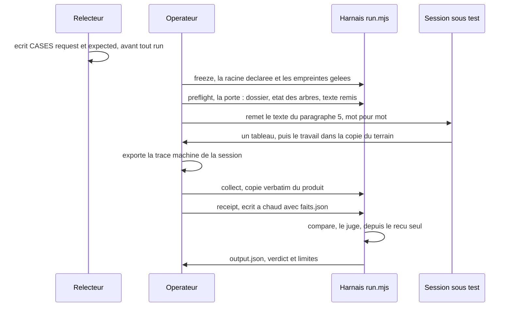
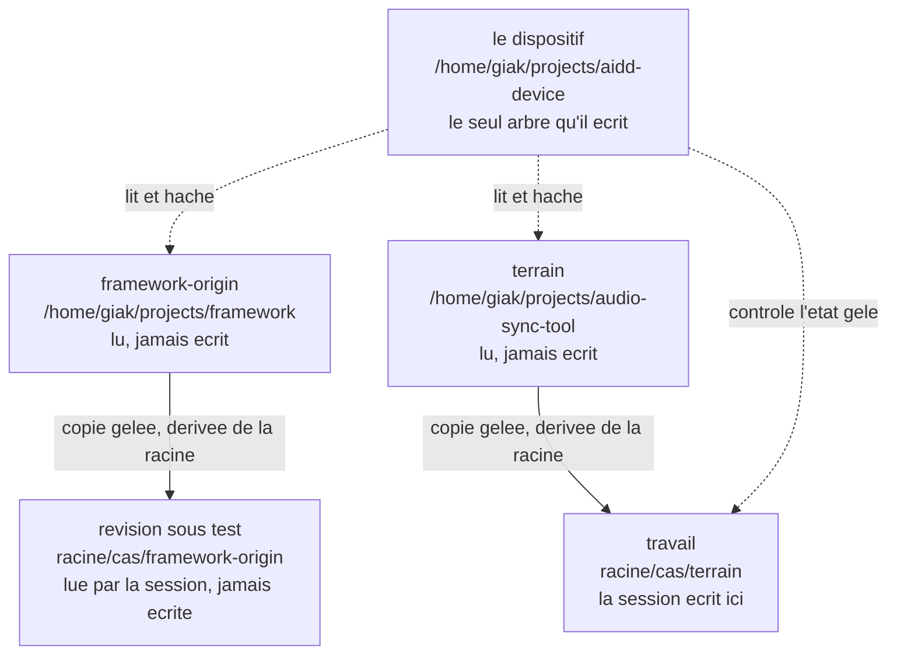
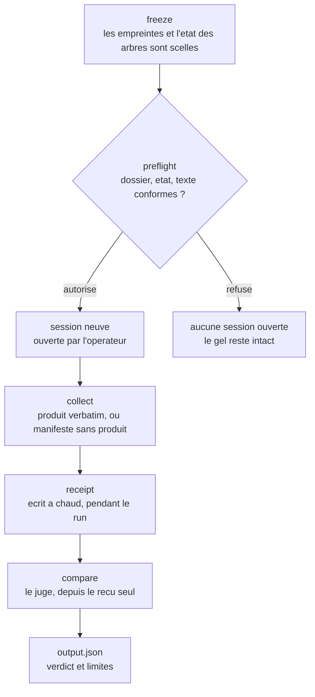
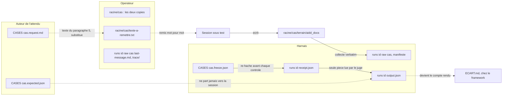
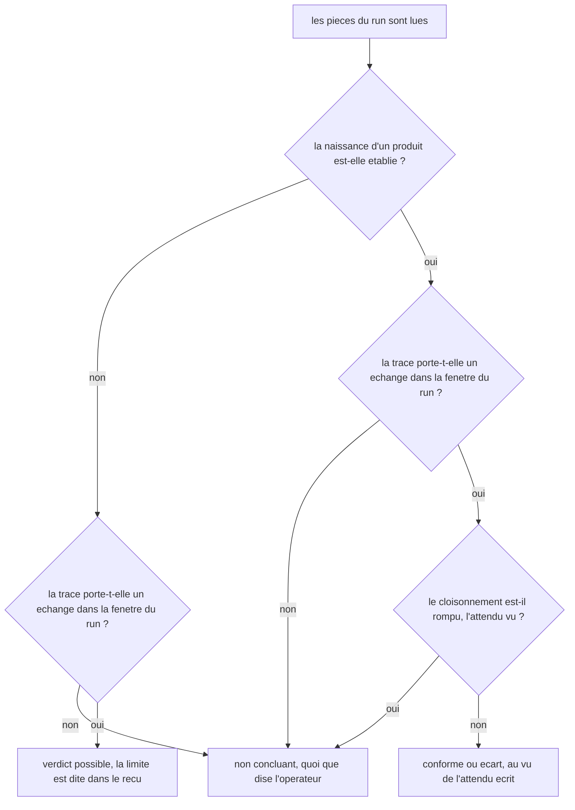

# ARCHITECTURE — le protocole de test, de bout en bout

> V0.1 — 2026-10-16. Cette page **assemble** ce que le dispositif est câblé pour faire. Elle n'invente
> aucun chiffre : chaque valeur vient d'une pièce du dépôt, nommée sur sa ligne. Chaque schéma a été
> rendu par mermaid-cli 11.4.2 le jour de l'écriture, et le libellé attendu relu dans le SVG produit
> (un `exit 0` ne prouve pas un rendu, le [bilan du premier run](brainstorm/2026-10-15-201458-bilan-premier-run.md) §9 l'a mesuré).
>
> **Rectifié le 2026-10-16 (Séance 16)**, après relecture de chaque chiffre contre sa pièce : le gabarit
> du nom de dossier d'un run portait un `@` que le seul nom réel n'a pas ; le marqueur `.freebuff/project-id`
> que le client écrit dans l'arbre ouvert entre au tableau des arbres ; et ce que la sonde du client a
> mesuré le même jour (lectures hors racine libres, mode worktree à refuser) entre aux limites.
>
> **Complété le 2026-10-16 (Séance 17)**, second contrôle, chaque référence reportée sur sa pièce, trois
> réparations. Le **banc du harnais**, entré au dépôt le jour même (`harness/banc-harnais.sh`,
> [BANC](device/BANC.md), [ADR-022](DECISIONS.md)), n'était nommé nulle part ici ; `last-message.md` était
> rangé un cran au-dessus de son foyer, que la [spec](tasks/2026_10/2026-10-15-130103-run-par-session-operateur/2026-10-15-130103-spec.md)
> §4 place sous `raw/<cas>/` ; et `produit.absent` était attribué à `output.json`, qui ne le porte pas, le
> reçu le porte.
>
> **Ce que cette page possède** : les acteurs et leur séparation de contexte, le trajet des fichiers,
> les six commandes et leurs entrées et sorties, les falsificateurs, le plafond du verdict.
> **Ce que possèdent les autres pages** : [DEVICE](device/DEVICE.md) dit ce qu'il fait, ne fait pas, et
> comment le lancer ; [BOUNDARY](device/BOUNDARY.md) tient les quatre arbres et les preuves
> d'intégrité ; [REPLAY](device/REPLAY.md) rejoue le gel depuis un clone neuf ; la
> [spec](tasks/2026_10/2026-10-15-130103-run-par-session-operateur/2026-10-15-130103-spec.md) porte les
> exigences, la [conduite](tasks/2026_10/2026-10-15-130103-run-par-session-operateur/2026-10-15-154303-run.md)
> l'ordre exact du run, et [EXPLICATION](EXPLICATION.md) raconte le même projet sans jargon.

## 1. Le problème, et la seule ruse de l'architecture

On veut savoir si une modification du framework AIDD tient sa promesse quand un modèle la lit. Le piège
est là, nommé dans la [VISION](VISION.md) : un attendu écrit **après** avoir vu le produit n'est pas un
attendu. Toute l'architecture découle d'une seule contrainte, le **gel antérieur au run** : ce qui est
attendu est haché et daté avant qu'aucune session ne soit ouverte, et un fichier du cas qui bouge après
le gel fait refuser le reçu comme le jugement (`run.mjs`, en-tête).

Ce que le dispositif produit au bout du compte, c'est **un écart nommé** et une phrase qui compare,
relisible par quelqu'un qui n'a pas assisté au run ([spec](tasks/2026_10/2026-10-15-130103-run-par-session-operateur/2026-10-15-130103-spec.md) §1).

## 2. Les acteurs, et la séparation de contexte

Cinq positions, jamais fusionnées, parce qu'aucune ne doit voir l'objet qui la contredit le plus
([DEVICE](device/DEVICE.md), [EXPLICATION](EXPLICATION.md) §4).

| Position | Qui la tient | Ce qu'elle fait | Ce qu'elle ne voit jamais |
| --- | --- | --- | --- |
| auteur de l'attendu | le relecteur | écrit `CASES/<cas>.request.md` et `.expected.json`, fait geler l'empreinte | le produit |
| opérateur | le relecteur | déclare la racine, gèle, passe la porte, ouvre la session, remet le texte, collecte, écrit le reçu, exporte la trace | rien : il tient le cas. Ce qu'il en dit reste un **témoignage** (`faits.json`), jamais une preuve |
| session sous test | la session IA ouverte par l'opérateur | lit la révision sous test, écrit dans `terrain/` | `CASES/*.expected.json`, cette page, le journal |
| harnais | `docs/device/harness/run.mjs`, 1 006 lignes, aucune dépendance (il appelle `git`, `date` et `sqlite3`) | gèle, contrôle, copie, reçoit, compare | aucune session : il n'en ouvre pas, il ne décide rien seul |
| juge | l'agent | lit le **reçu seul**, écrit `output.json` | la session ([spec](tasks/2026_10/2026-10-15-130103-run-par-session-operateur/2026-10-15-130103-spec.md) §8) |

La séparation est **de contexte, pas de personne** : relecteur, opérateur et juge peuvent être la même
main, mais chacune travaille sur des pièces différentes. C'est ce qui rend la question 4 du v6 §11
répondable.

## 3. Les arbres, et qui écrit où

**Attention, deux ensembles portent le nom « les quatre arbres »**, et les confondre fait perdre le fil :
[BOUNDARY](device/BOUNDARY.md) §1 liste ce que le dispositif sépare, le gel enregistre quatre **labels**
(`arbres[]`, lus ce jour : `framework-origin` `fe48de12`, `terrain` `416ec1f`, `revision-sous-test`
`4c39e5c5`, `travail` `416ec1f`).

| Arbre | Chemin | Rôle | Écrit par |
| --- | --- | --- | --- |
| framework-origin | `/home/giak/projects/framework` | la source à l'épreuve | personne, lu seul |
| terrain | `/home/giak/projects/audio-sync-tool` | le vrai projet, un vrai dépôt | personne, lu seul |
| révision sous test | `<racine>/<cas>/framework-origin` | la source copiée pour le run | le gel, qui la dérive de `--racine` ([ADR-019](DECISIONS.md)) |
| travail | `<racine>/<cas>/terrain` | la copie du terrain, **c'est ici que la session écrit** | le gel, puis la session, et le **client** qui y marque `.freebuff/project-id` (37 o, mesuré le 2026-10-16, [conduite](tasks/2026_10/2026-10-15-130103-run-par-session-operateur/2026-10-15-154303-run.md) §1.7) : hors produit, `collect` ne copie que `aidd_docs` |
| le dispositif | `/home/giak/projects/aidd-device` | les preuves, le harnais, les cas | le dispositif, et lui seul |

`<racine>` est `racine_espace_de_travail`, déclarée **une seule fois** au gel : c'est un fait de la
machine, pas une propriété du cas. Un déplacement, ou une autre machine, redéclarent la racine au lieu
de réécrire un cas gelé ([ADR-019](DECISIONS.md), [REPLAY](device/REPLAY.md) §5).

## 4. Les six commandes, et le cycle d'un run

`run.mjs` est l'instrument du run, pas un contrôle mécanique du dépôt : aucune dépendance, aucun hook,
aucun CI ([ADR-004](DECISIONS.md)). Ses refus et ses acceptations sont éprouvés par un banc qui vit dans
le dépôt, `docs/device/harness/banc-harnais.sh` : 50 contrôles, sans ouvrir de session ni écrire dans le dépôt
([BANC](device/BANC.md), [ADR-022](DECISIONS.md)). Le banc n'est pas un automatisme pour autant : rien ne
le déclenche seul, et il n'éprouve que le harnais, jamais le dépôt. Son code de sortie est toujours le
même trio : `0` fait, `1` refus (imprimé, jamais compté), `2` usage.

| Commande | Quand | Ce qu'elle lit | Ce qu'elle écrit | Ce qu'elle refuse |
| --- | --- | --- | --- | --- |
| `freeze` | avant d'ouvrir | les fichiers du cas, les références du framework, l'état des quatre arbres | `CASES/<cas>.freeze.json` | un gel qui existe déjà (sans `--refreeze`), un `--arbre` sur un label dérivé, une racine dans le dépôt ou inexistante, un cas qui écrit la racine en clair |
| `preflight` | juste avant d'ouvrir | le gel, le dossier examiné, le texte remis (`--texte`) | rien : il autorise ou il refuse | un dossier qui n'est pas l'arbre `travail` du gel, un arbre qui n'est plus dans l'état gelé, un cas dont un fichier a bougé, un texte qui n'est pas le §5 substitué ([ADR-018](DECISIONS.md)) |
| `collect` | le produit revenu | le gel, `--from` résolu (`realpath`) | `runs/<id>/raw/<cas>/` et son manifeste : `sha256`, taille, `birth`, source absolue de chaque fichier ([ADR-020](DECISIONS.md)) | un `--from` hors de l'arbre `travail`, un lien symbolique, un dossier déjà collecté, une copie dont le `sha256` diffère, `--from` vide |
| `collect --sans-produit` | un run qui ne rend rien | le gel seul | le même manifeste, avec `fichiers: []` et `produit_absent: true` | `--sans-produit` **avec** `--from` (spec §9) |
| `faits` | entre l'export et le reçu | la base du client (`threads`, `messages`), le gel, `--trace` | `faits.json` : `session`, `horodatage_debut` (premier message utilisateur), `repertoire_de_travail`, `trace`, `temoignage` | un fil absent, un modèle vide, un chemin qui ne résout pas, un fil hors de l'arbre `travail`, un fil en worktree, une fin antérieure au début, un `faits.json` déjà écrit ([ADR-024](DECISIONS.md)) |
| `receipt` | pendant le run, à chaud | le gel re-haché, le manifeste, `faits.json` | `runs/<id>/receipt.json` : les champs du §6, les falsificateurs, `recu_ecrit_le`, `gel_verifie` | un reçu déjà écrit, un cas qui ne concorde plus avec le gel, un manifeste venu d'un autre arbre, une source de fichier hors de l'arbre du run, un verdict que la preuve ne porte pas |
| `compare` | après, par le juge | le **reçu seul** et le gel, re-haché | `runs/<id>/output.json` : `cas`, `attendu`, `produit_brut`, `difference`, `verdict`, `limites`, `ecarte_comme_non_testable`, `phrase`, `gel_verifie`, `juge_le`, `depuis_le_recu` | un cas qui ne concorde plus avec le gel, un reçu qui cite une empreinte que le gel sur disque ne porte plus |

## 5. La vie d'un artefact, du cas jusqu'à l'écart

Chaque pièce a **un seul écrivain**, et c'est ce qui rend le cloisonnement vérifiable.

| Pièce | Écrite par | Lue par | Où | Durée de vie |
| --- | --- | --- | --- | --- |
| `CASES/<cas>.request.md` | l'auteur de l'attendu | la porte et le reçu (re-hachage) ; son §5 part substitué | `docs/device/CASES/` | versionnée, rectifiée par note datée, jamais en silence |
| `CASES/<cas>.expected.json` | l'auteur de l'attendu | le juge seul | `docs/device/CASES/` | versionnée, **ne part jamais** vers la session |
| `CASES/<cas>.freeze.json` | `freeze` | `preflight`, `collect`, `receipt`, `compare` | `docs/device/CASES/` | un re-gel **détruit** le précédent (six fois le 2026-10-15) |
| `<racine>/<cas>/framework-origin`, `terrain` | `freeze`, par dérivation | la session, le harnais | hors des arbres, sous `~/projects/` | une par **cas**, jamais par run |
| `<racine>/<cas>/texte-a-remettre.txt` | l'opérateur | `preflight --texte` | hors des arbres | regénérée à chaque rectification du cas |
| `raw/<cas>/` et son manifeste | `collect` | le reçu | `docs/device/runs/<id>/` | versionnée avec le run |
| `raw/<cas>/last-message.md` | l'opérateur, à la main, verbatim | le juge | `docs/device/runs/<id>/raw/<cas>/` | versionnée |
| `trace/` (export et commande) | l'opérateur | le juge, et quiconque doute | `docs/device/runs/<id>/` | versionnée : c'est la pièce la plus forte du run |
| `receipt.json` | `receipt`, à chaud | le juge | `docs/device/runs/<id>/` | **jamais reconstruit après coup** : un reçu du lendemain est un témoignage |
| `output.json` | `compare` | le relecteur de la pull request | `docs/device/runs/<id>/` | versionnée : c'est l'écart |
| `ECART.md` | à écrire | le relecteur de la pull request framework | chez le framework, `aidd_docs/tasks/<année_mois>/<date_slug>/` | pas ouvert à ce jour |

Le nom du dossier d'un run porte ce qui l'a produit : `runs/<horodatage>-<révision du framework>-<révision du dispositif>/`,
soit, pour le premier run (le seul à ce jour, et la source de ce gabarit),
`runs/2026-10-15-171559-4c39e5c5-1d471a5/`. Des tirets, donc : la forme du v6 porte un `@`
(`framework@rev`), c'est une notation, et [ADR-023](DECISIONS.md) a tranché ce point le 2026-10-16.

## 6. Ce que le gel scelle, et ce qu'il ne peut pas sceller

| Le gel porte | Ce qu'il établit | Qui le relit |
| --- | --- | --- |
| `fichiers[]` (rôle, chemin relatif, `sha256`) | les deux fichiers du cas, tels qu'ils étaient **avant** l'ouverture | le reçu et le juge, qui re-hachent sur disque |
| `references[]` (arbre, chemin, `sha256`) | les 8 fichiers de la révision sous test dont l'attendu dépend | le rejeu tiers ([REPLAY](device/REPLAY.md) §1) |
| `empreinte` | une ligne par fichier et référence, hachée globalement | `REPLAY` §2, et `run.mjs` |
| `arbres[]` : `head`, `head_complet`, `porcelain`, `remotes`, `refs_distants` | l'état des quatre arbres avant le run | `preflight` (état `travail`), `receipt` (avant et après) |
| `racine_espace_de_travail` | la racine des espaces de travail, une fois pour toutes machines | la dérivation des deux copies |
| `gele_le`, `gele_le_epoch` | l'instant du scellé, **déclaré** | personne ne peut l'opposer : un tiers borne par la date d'entrée au dépôt |

Ce qu'aucun gel ne peut sceller, et qu'il faut donc dire à chaque fois ([REPLAY](device/REPLAY.md) §5,
[BOUNDARY](device/BOUNDARY.md) §8) : le `porcelain` liste des fichiers non suivis que git ne transporte
pas ; la **date de naissance** d'un fichier ne voyage pas, donc la condition 1 ne se vérifie que sur la
machine qui a produit ; `gele_le` est déclaré par le gel lui-même.

## 7. Les falsificateurs, et le plafond du verdict

Un seul falsificateur suffit à faire tomber le run, et le verdict suit la preuve, jamais l'inverse
([spec](tasks/2026_10/2026-10-15-130103-run-par-session-operateur/2026-10-15-130103-spec.md) §7). Les
neuf falsificateurs du run, ceux de l'attendu, et leurs mesures, vivent dans
`CASES/<cas>.expected.json` ; en voici la carte.

| # | Ce qui le fait mordre | Ce qu'il tue |
| --- | --- | --- |
| `F1` | un `birth` sous `terrain/aidd_docs/` antérieur au message qui porte le tableau | l'ordre promis : montrer avant d'écrire |
| `F2` | la trace ne porte aucun tableau, ou porte des écritures avant le tableau | le cas entier, donc `non concluant` |
| `F3` | un chemin produit hors de la table `Write to` | la conformité : le produit dépasse la révision sous test |
| `F4` | `aidd_docs/memory/backlog.md` existe | la réponse figée « do not write the backlog memory » |
| `F5` | une écriture hors du répertoire de travail | les interdits du §7 de la demande |
| `F6` | le produit existe alors que la copie du terrain n'a pas bougé | la condition 3 : l'arbre n'a pas bougé, donc rien ne s'y est produit |
| `F7` | un fichier produit identique à un fichier présent avant le run | la condition 4 : un produit recopié n'est pas un produit né |
| `F8` | aucun fichier sous `terrain/aidd_docs/` | la production attendue |
| `F9` | la trace ne montre **aucun accès** à un fichier de la révision sous test | la prémisse du cas : la session a lu autre chose ([bilan](brainstorm/2026-10-15-201458-bilan-premier-run.md) §6.1) |

| # | Ce qui le fait mordre | Verdict |
| --- | --- | --- |
| `E1` | un `TODO` ou un `<placeholder>` subsiste sous `memory/` | `écart` |
| `E2` | aucun rapport final ne nomme ce qui a changé | `écart` |
| `E3` | `memory/` imbriqué, ou `internal/` et `external/` manquants | `écart` |
| `E4` | un fichier du tableau n'est pas écrit alors que l'opérateur a confirmé | `écart` |

Le plafond, tel que la [conduite](tasks/2026_10/2026-10-15-130103-run-par-session-operateur/2026-10-15-154303-run.md) §3.3 l'énonce :

Un run qui n'a rien produit n'est pas un échec de la mesure : avec `collect --sans-produit`, il laisse un
manifeste, un reçu où `produit.absent: true` dit ce qui manque, et un `output.json` dont `produit_brut`
nomme le dossier `raw/<cas>/`, vide ; le verdict tombe à `non concluant` ([spec](tasks/2026_10/2026-10-15-130103-run-par-session-operateur/2026-10-15-130103-spec.md) §9, [bilan](brainstorm/2026-10-15-201458-bilan-premier-run.md) §6.2).

## 8. Ce qui est structurellement vrai, et ce qui reste une limite

- **Les interdits du cas ne sont pas dits à la session, ils sont rendus vrais** ([ADR-015](DECISIONS.md)) :
  la porte refuse l'ouverture hors de l'espace gelé, la copie du terrain ne porte aucun `aidd_docs`, et
  `collect` refuse un produit venu d'ailleurs. Le seul interdit non structurel est « ne pas lire
  `CASES/` », et le reçu le mesure (`cloisonnement.attendu_vu`).
- **Un espace de travail par cas, jamais par run** : le texte remis et le gel portent des chemins
  absolus, deux runs du même cas se distinguent par leurs pièces.
- **Le harnais n'ouvre aucune session et n'écrit que les chemins qu'on lui donne.** Il résout sa propre
  racine de dépôt depuis son chemin, jamais depuis le répertoire courant de l'appelant.
- **Le cas ne nomme aucune machine** : il écrit `$RACINE`, le gel déclare ce qu'elle vaut
  ([ADR-019](DECISIONS.md)).
- **Limites nommées, non corrigées** : rien ne force l'opérateur à passer `--texte` (le contrôle du
  texte n'existe que si on lui donne) ; un manifeste recollé à la main après coup reste indiscernable
  d'un manifeste né ainsi ; un artefact peut atterrir dans l'arbre de l'origine par la résolution d'un
  chemin relatif côté client ([BOUNDARY](device/BOUNDARY.md) §8).
- **Le client, mesuré le 2026-10-16** ([conduite](tasks/2026_10/2026-10-15-130103-run-par-session-operateur/2026-10-15-154303-run.md) §1.7) : ses
  **lectures** ne sont pas cloisonnées à l'arbre ouvert (un `..` qui en sort résout, un chemin absolu
  aussi), donc la prémisse du cas (aller lire la révision sous test) tient ; ses **écritures** hors
  racine, elles, n'ont pas été éprouvées, et la limite ci-dessus porte là. Il peut aussi vivre en
  *worktree* : ouvert ainsi sur la copie du terrain, il y créerait une branche et déplacerait le `HEAD`
  gelé : à refuser avant d'ouvrir. Et le texte qu'il stocke est **identique à celui qu'il reçoit**
  (`cmp`, deux échantillons, aucun guillemet ajouté).

## 9. Où lire quoi

| Question | Page |
| --- | --- |
| ce que le dispositif fait, ne fait pas, et comment le lancer | [DEVICE](device/DEVICE.md) |
| les quatre arbres, et la preuve que le framework est intact | [BOUNDARY](device/BOUNDARY.md) |
| rejouer le gel depuis un clone neuf, sans réécrire un chemin | [REPLAY](device/REPLAY.md) |
| le banc qui éprouve le harnais, ses 50 contrôles, ce qu'il ne prouve pas | [BANC](device/BANC.md) |
| l'ordre exact à suivre pour un run, ce qui se remet mot pour mot, et ce que le client écrit (§1.7) | [conduite](tasks/2026_10/2026-10-15-130103-run-par-session-operateur/2026-10-15-154303-run.md) |
| les exigences, et le critère qui les rendrait fausses | [spec](tasks/2026_10/2026-10-15-130103-run-par-session-operateur/2026-10-15-130103-spec.md) |
| le même projet raconté sans jargon | [EXPLICATION](EXPLICATION.md) |
| ce qui a eu lieu, et ce qu'un run a laissé | `docs/device/runs/`, son `PV.md` |
| où en est le projet aujourd'hui | [DASHBOARD](DASHBOARD.md) |
| ce qui a été décidé, et quand | [DECISIONS](DECISIONS.md) |
