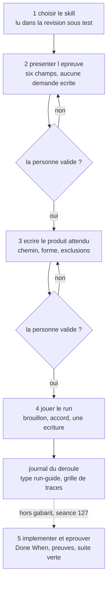

# PROTOCOLE — conduire un test de bout en bout

**Ce que cette page possède** : la conduite d'un test, ses deux modes, l'ordre des gestes, ce que chaque
commande dérive, écrit et refuse, et ce que le protocole n'atteste pas.
**Ce que possèdent les autres pages** : [ARCHITECTURE](ARCHITECTURE.md) dit comment le dispositif est
fait ; [BANC](BANC.md) dit quels contrôles éprouvent le harnais ; [REPLAY](REPLAY.md) rejoue
un gel depuis un clone neuf ; le [guide utilisateur](guide/guide-utilisateur.md) s'adresse à qui ne tape
aucune commande ; le [guide du test](guide/guide-du-test-de-bout-en-bout.md) l'apprend geste par geste.
Les refus ne sont pas recopiés ici depuis le code : le texte d'un refus vient du harnais, tel quel, et il
change là où il est écrit ([ADR-038](DECISIONS.md)).

**En une phrase.** Une personne dit « test ça » sur un skill, et l'orchestrateur la conduit jusqu'à un
reçu, un verdict, et la phrase qui dit ce que le verdict atteste, ou jusqu'à un journal de run guidé quand
le test se joue dans la conversation courante.

## 1. Deux modes, et ce que chacun prouve

| Mode | Ce qu'il laisse | Ce qu'il prouve | Ce qu'il ne prouve pas |
| --- | --- | --- | --- |
| **indépendant** | gel, porte, trace, produit, reçu, verdict | la chaîne complète, sur une session qui n'a pas lu l'attendu | la justesse du skill, ni celle du produit |
| **guidé** | présentation validée, produit attendu validé, `run.json` et son `run-guide.md` sous `docs/device/runs/`, trace machine | la forme, les chemins, les écritures, les traces | l'indépendance : l'agent qui produit a lu l'attendu ([ADR-074](DECISIONS.md)) |

Le mode guidé est le défaut depuis le 2026-10-22 : le test se joue dans la **conversation courante**, sans
headless, sans second fil, sans modèle à choisir. Il ne passe ni par `cas`, ni par `porte`, ni par `fin` :
il n'a pas de reçu, et son journal porte toujours `session_non_independante` quand l'agent a vu l'attendu.
Le dossier vit sous `docs/device/runs/` avec un `run.json` qui porte ses limites ; `runs.mjs` le vérifie et
l'indexe. `run.json` nomme facultativement son fil (`"fil": "<identifiant>"`, ou `null`) : `tracer` refuse
un `--fil` différent de celui que le run déclare, et `runs.mjs` refuse une `trace/fil.json` qui nomme un
autre fil que `run.json`. Un run sans `fil` reste valide, et `tracer` n'écrit jamais dans `run.json` : le
fichier est la déclaration de l'auteur, la trace est sa pièce.

Deux règles tiennent sa grille ([ADR-082](DECISIONS.md)). Elle porte une ligne par action déclarée par le
`SKILL.md` lu sous la révision sous test, puis les quatre familles de l'[ADR-073](DECISIONS.md) et la borne du
terrain ; un cas peut préciser une ligne, jamais la remplacer. Et ses trois validations ne comptent que sur un
tour `user` : une réponse rendue par un outil de question n'est pas un tour, et la ligne est `non observé`,
avec sa raison, jamais `tenu`.

| Étape du run guidé | Ce qui est produit | Ce qui la clôt |
| --- | --- | --- |
| 1 choisir le skill | le skill lu dans la révision sous test, ses actions et ses références ; le fil de la conversation relevé par `tracer --liste`, et son identifiant inscrit dans `run.json` comme `fil` | la lecture est faite, pas annoncée |
| 2 présenter l'épreuve | ce qui est testé, pourquoi, comment, le but, ce qui sera observé, ce qui ne sera pas prouvé | un tour `user` valide, sinon l'étape reste ouverte |
| 3 écrire le produit attendu | le chemin, la forme, le contenu et les exclusions | un tour `user` valide |
| 4 jouer le run | le brouillon montré, l'accord sur un tour `user`, une seule écriture, la grille dérivée des actions du skill | le journal `type: run-guide` est écrit |
| 5 retour d'expérience, hors gabarit | l'implémentation du produit et ses preuves | la Task est éprouvée, ou la forme est dite non tenue |

L'étape 5 n'est pas une clause du gabarit : la Séance 127 l'a jouée après coup, et rien ne l'exige. Le
gabarit du journal est le §3 de la [spec du run guidé](tasks/2026_10/2026-10-22-221207-traces-et-run-guide/2026-10-22-221207-spec-run-guide.md),
et sa présentation en six champs vient de la [spec du 2026-10-23](tasks/2026_10/2026-10-23-034641-presentation-de-l-epreuve/2026-10-23-034641-spec.md).
La trace machine d'un run guidé s'attache par `tracer` ([ADR-076](DECISIONS.md)) : le §5 bis du gabarit
porte le fichier, son empreinte, ses lignes, sa source, et les preuves citent un `seq`. Quand le client ne
rend pas la trace, le §5 bis dit `absente`, et la ligne reste `non observé`, jamais supposée.



## 2. Le run indépendant : les huit commandes, dans l'ordre

Chaque commande imprime son bloc d'étape avant de passer à la suivante ; une étape qui refuse arrête
l'orchestrateur (`exit 1`), une commande mal formée sort en `2` sans rien écrire.

```text
node docs/device/harness/orchestrer.mjs cas --skill <chemin-du-skill> [--terrain <dépôt>] [--id <slug>]
node docs/device/harness/orchestrer.mjs porte --cas <id> --run <dossier>
node docs/device/harness/orchestrer.mjs ouvrir --cas <id> --run <dossier> [--cases <dir>] [--api <url>] [--modele <fournisseur/modèle>] [--delai <minutes>]
node docs/device/harness/orchestrer.mjs suite --cas <id> --fil <id> [--client auto|freebuff|opencode] [--store <dir>] --par <qui> --conduite agent|humain --produit <chemin> | --sans-produit
node docs/device/harness/orchestrer.mjs fin --cas <id> --run <dossier> --difference <texte> --phrase <texte> [--verdict <v>]
node docs/device/harness/orchestrer.mjs rapport --cas <id> --run <dossier> [--remplacer] [--cases <dir>]
node docs/device/harness/orchestrer.mjs lire --cas <id> --run <dossier>
node docs/device/harness/orchestrer.mjs tracer --run <dossier> --fil <id> [--client auto|freebuff|opencode] [--store <dir>] [--depuis <iso>] [--jusqu <iso>]
node docs/device/harness/orchestrer.mjs tracer --run <dossier> --liste --depuis <iso>
```

| Commande | Ce qu'elle dérive, jamais de la personne | Ce qu'elle écrit |
| --- | --- | --- |
| `cas` | la demande, le squelette d'attendu, les deux origines et leurs clones | `--cases` (deux pièces et le gel), `<racine>/<cas>/` |
| `porte` | le texte substitué, l'empreinte du gel, le dossier autorisé | `gate.json`, `texte-a-remettre.txt` dans `--run` |
| `ouvrir` | le fil de la session, la réponse figée de chaque question, l'option marquée Recommandé | rien : elle imprime le fil |
| `suite` | les faits, l'export de la trace par l'adaptateur du client, le dernier message haché, la copie du produit, et l'annexe du scratch quand le cas le déclare | `faits.json`, `trace/`, `raw/<cas>/last-message.md`, `raw/<cas>/manifest.json`, `annexe/<cas>/` |
| `fin` | le verdict que la preuve autorise, l'output du juge, le rapport technique, et la page utilisateur quand le cas déclare sa lecture | `receipt.json`, `output.json`, `RAPPORT.md`, et `RESULTAT.md` si `CASES/<cas>.lecture.json` existe |
| `rapport` | le rapport et la page utilisateur, depuis le reçu, l'output, la trace et la lecture du cas, vérifiée avant toute écriture | `RAPPORT.md` et `RESULTAT.md`, avec `--remplacer` |
| `lire` | rien : elle relit | rien |
| `tracer` | le client du fil, la session normalisée, le compte des lignes et le `sha256` de l'export | `trace/echange.jsonl` et `trace/fil.json` dans un dossier de run guidé, et rien d'autre |

`tracer` lit `run.json` : le dossier doit être un run guidé dont `pieces` cite `run-guide.md`, et le
fichier doit être présent. Un run-guide d'avant la centralisation, sans `run.json`, est refusé ; les trois
guides existants ont été migrés sous `docs/device/runs/`.

**Trois gestes restent humains**, et aucun n'est attesté par une pièce :

1. **ouvrir le fil** dans l'application, au répertoire que `porte` imprime, ou laisser `ouvrir` le faire
   pour opencode ;
2. **coller** le texte que `porte` imprime, sans le retaper, ou laisser `ouvrir` l'envoyer ;
3. **répondre** par une des deux phrases figées du cas, jamais par une autre : `ouvrir` les envoie dans
   l'ordre, répond aux formulaires par l'option marquée Recommandé, et joue une question posée en texte
   quand sa dernière ligne hors bloc de code finit par `?`.

`ouvrir` est la seule commande qui parle à un client au lieu de lire ses pièces ([ADR-059](DECISIONS.md)).
Elle lance `opencode serve` sur un port libre de `127.0.0.1`, ou se branche sur `--api` dont le mot de
passe vient de `OPENCODE_SERVER_PASSWORD`, crée la session dans l'arbre `travail` du gel, puis envoie
`texte-a-remettre.txt` **verbatim** après avoir vérifié le `sha256` de `gate.json`. Elle attend ensuite la
question, répond par la phrase figée suivante, et s'arrête quand la session devient inactive ; au délai
elle refuse sans conclure. Elle n'écrit **rien** dans le dossier du run : le fil qu'elle imprime est le
`--fil` de `suite`. Ce qu'elle n'atteste pas, le choix des options et la conduite, se dit dans
`faits.json` : `suite` exige `--conduite agent|humain` et `--par`, et le reçu recopie ce bloc avec la
limite qui dit qu'il est déclaré, jamais vérifié ([ADR-071](DECISIONS.md)). Une personne qui a conduit le
run écrit `humain` ; `ouvrir` a conduit, donc `agent`.

`tracer` est la commande du run guidé ([ADR-076](DECISIONS.md)) : elle exporte le fil et écrit
`trace/echange.jsonl` plus `trace/fil.json`, sans reçu ni verdict. Elle refuse un dossier dont `run.json`
n'est pas un guidé, un fil inconnu, un client ambigu et une trace déjà écrite.

`--depuis` et `--jusqu` bornent l'export à la fenêtre du run : `messages.ts >= depuis`, `messages.ts <
jusqu`, la borne haute exclusive pour que deux fenêtres voisines ne se recouvrent pas. Sans borne, l'export
couvre le fil entier et la commande reste celle des reçus existants. `fil.json` porte la fenêtre sous
`fenetre` (`depuis`, `jusqu`, `premier` et `dernier` `seq`/`ts`), et `.lignes` compte les lignes
exportées : le fichier ne s'appelle plus `messages`, parce qu'une ligne n'est pas un message. Une fenêtre
qui ne couvre aucune part tombe sur le refus d'export vide, sans second refus.
`--liste --depuis <iso>` rend les fils **actifs depuis** cette date, identifiant, modèle, nombre de
messages, dernière activité et date de création, sans aucun contenu, parce qu'un identifiant ne se
devine pas. L'activité est le dernier message écrit, jamais la création : une conversation reprise garde
sa date de création d'origine, et une borne sur elle la rendait invisible.

`runs.mjs` tient le dossier des runs ([spec du 08:22](tasks/2026_10/2026-10-23-082232-runs-centralises/2026-10-23-082232-spec-centralisation.md),
§4) : `--verifier` refuse les défauts du §4, dont un dossier qui ne se classifie pas, un guidé qui porte
`receipt.json`, `gate.json` ou `output.json`, un guidé sans limite, une `pertinence` vraie quand
`session_non_independante` est déclarée, une `revision: null` sans `revision_non_consignee`, une pièce citée
et absente, et un `INDEX.md` qui diverge de la génération. `--index` écrit `docs/device/runs/INDEX.md` : la
ligne des comptes par mode, puis une ligne par dossier avec ses limites et ses pièces ; `--runs <dossier>`
lit un autre dossier, pour le banc. L'index est une vue : le reçu et le `run.json` restent les sources, et un
compte de runs se cite de l'index, jamais d'une page qui le recopie.

`cas` fabrique un **squelette** : le falsificateur de la promesse reste marqué `a_remplir`, et tant qu'il
l'est, le reçu porte `attendu_incomplet` et le verdict plafonne à `non concluant` ([ADR-039](DECISIONS.md)).
**L'agent remplit ce squelette, la personne le confirme** ([ADR-041](DECISIONS.md)) : il lit le skill, propose
la promesse, le produit attendu, le §6 de la demande, la marque `P` de l'attendu et la première réponse
figée ; la personne corrige ou confirme, puis l'agent écrit et re-gèle. Le squelette porte le bloc
`cloisonnement` par défaut, que la personne corrige si son cas demande autre chose, et le **scratch**
(`terrain/.scratch`), collecté en annexe et jamais compté comme produit ([ADR-067](DECISIONS.md)). Le
gabarit demande le **tableau** de qualification et la **pause** qui le suit ([ADR-068](DECISIONS.md),
[ADR-069](DECISIONS.md)). `freeze --refreeze` est la seule commande qui re-gèle, et l'orchestrateur ne
l'appelle jamais.

`porte` ajoute au bloc `▸ FIN` la durée observée du cas et la taille de l'échantillon, lues dans les runs
passés du même cas, avec leurs réserves ; un cas jamais mesuré reçoit « aucune mesure pour ce cas ».
`fin` écrit aussi `RAPPORT.md`, déterministe, sans appel réseau ; il refuse de commencer si le rapport est
déjà là, pour qu'un rapport ne reste pas à côté d'un reçu neuf, et `rapport` refuse d'écraser sans
`--remplacer`.

## 3. Les quatre blocs

Le contrat est exact ([ADR-040](DECISIONS.md)) : quatre formes, six lignes au plus chacune, `▸` compris,
une ligne vide entre deux blocs, et rien entre elles.

```text
▸ ÉTAPE n/N — <titre court>
  on fait             : <une ligne, à l'infinitif>
  commande            : <la commande exacte, copiable>
  attendu             : <ce qui doit sortir>
  obtenu              : <ce qui est sorti, recopié de la console>
  ce que ça veut dire : <une ligne, adossée à la pièce écrite>
```

```text
▸ REFUS — <le texte du harnais, recopié>
  ce qu'il empêche    : <une ligne>
  le geste qui suit   : <une ligne, ou « rien : cette étape s'arrête ici »>
```

```text
▸ VERDICT — <conforme|ecart|non concluant>
  plafonné par        : <les falsificateurs qui mordent, ou l'attendu incomplet, ou « aucun »>
  ce que le reçu porte: <porte, échanges, produit, limites>
  ce qu'il n'atteste pas : le reçu atteste qu'un run a eu lieu, jamais que le travail vaut
```

```text
▸ FIN — <état en une ligne>
  pièces              : <les chemins écrits>
  durée estimée       : <optionnel, porte : la fourchette lue dans les reçus du cas et ce qu'elle comprend>
  échantillon         : <optionnel, porte : n, la mesure et les réserves>
  à lire ensuite      : <une ligne, ou rien>
```

La commande précède sa sortie : le bloc dit ce qui a été lancé avant de dire ce qui en est sorti, et
`obtenu` recopie la console, il ne la résume pas.

## 4. Qui décide

- **Le gel décide** du dossier autorisé et de l'état des arbres ; `porte` le re-hache avant d'autoriser.
  **L'attendu décide du cadre** : `cloisonnement.lecture.autorisees` fixe les seules racines dont une
  lecture est dans le cadre, recopiées dans le reçu avec leurs chemins résolus. Une lecture hors de ces
  racines mord, même dans le dossier du cas ; seule `$RACINE/<cas>/` elle-même est lue par égalité
  ([ADR-064](DECISIONS.md)). Le scratch déclaré est lu et écrit comme une racine d'écriture, sans jamais
  compter comme produit ([ADR-067](DECISIONS.md)). Une écriture d'outil hors des racines mord de même
  ([ADR-063](DECISIONS.md)) ; relire un fichier que la session a écrit ne mord pas deux fois
  ([ADR-066](DECISIONS.md)).
- **Le reçu décide** du verdict : `fin` demande d'abord, à blanc (`--sans-ecrire`), la valeur que les
  falsificateurs imposent. Sans `--verdict`, l'orchestrateur l'imprime avec sa raison et n'écrit rien :
  c'est la personne qui tranche, et la même commande avec `--verdict` écrit le reçu une seule fois.
- **La personne décide** de `--difference`, `--phrase` et `--limites` : trois faits qu'aucune commande ne
  dérive, et que `compare` refuse vides. L'agent les propose, elle les tranche. `compare` refuse aussi une
  phrase qui nomme un nombre de colonnes différent de `tableau.colonnes` du reçu ([ADR-048](DECISIONS.md)).
- **L'orchestrateur ne décide de rien.** Il ne contourne pas un refus, ne relance pas une commande qui a
  refusé, et ne réécrit jamais un reçu existant.

## 5. Les refus

Les douze conditions sont celles du [§7 de la spec](tasks/2026_10/2026-10-18-070820-orchestrateur-interactif-du-test/2026-10-18-071018-spec.md),
chacune éprouvée par un contrôle du [banc](BANC.md). Cette page ne les recopie pas : un refus se lit
dans la console, avec le code de sortie, et il nomme la pièce qui manque. Trois se lèvent sans aide : une
porte déjà là (un nouveau `--run`), un fil introuvable (ouvrir le fil d'abord), un verdict interdit
(`--verdict` absent pour lire la valeur imposée).

Cinq refus sont propres à l'orchestrateur : **l'ambiguïté du fil** (les deux clients le connaissent,
`--client` le tranche), **`--store` avec `--client freebuff`**, **`suite` sans produit nommé** (ni
`--produit`, ni `attendu_details.produit.racine`, ni fichier changé sous l'arbre de travail), **`suite` sur
un produit qui sort de l'arbre travail**, et **un dépôt de skill ou un terrain sale** : les fichiers sont
nommés, parce qu'un clone ne porte que les commits et que la copie sous test serait le dernier commit sans
le dire. `--tel-quel` lève ce dernier refus en portant l'arbre de travail dans la copie, et le porcelain que
le gel enregistre le dit ([ADR-042](DECISIONS.md)).

`ouvrir` a ses propres refus : aucune porte, un texte dont le `sha256` n'est plus celui de la porte, un gel
sans arbre `travail`, un attendu sans réponse figée, `opencode` introuvable, un serveur muet ou qui rend
`401`, une session ou un message refusés, un champ de formulaire que la règle du §2 ne remplit pas, une
question de plus que le cas n'en fige, formulaire ou texte, une session arrêtée sur un texte qui ne demande
rien alors qu'une réponse reste à jouer ([ADR-077](DECISIONS.md)), et le délai dépassé. Chacun sort en `1`
et nomme la pièce, le fil compris pour les deux derniers.

Le client est un fait du run, jamais un paramètre du cas ([ADR-044](DECISIONS.md)). `suite` sans `--client`
essaie Freebuff puis opencode : deux clients qui connaissent le fil sont un refus qui nomme `--client`,
aucun est le refus qui nomme les deux sources. `--client freebuff` lit
`~/.config/freebuff-desktop/projects/*/desktop-v2.db` en `-readonly` ; `--client opencode` exporte la
session par `opencode session export` dans le répertoire `travail` du gel, et `--store` nomme sa racine
(`~/.local/share/opencode` par défaut).

## 6. Ce que le protocole n'atteste pas

- **La qualité du skill**, ni la justesse du produit : l'ordre des gestes et les destinations, jamais le
  texte. Un cas fabriqué le dit deux fois (attendu incomplet, verdict plafonné).
- **Que la porte n'a pas été sautée** : elle est forgeable, et le reçu ne mesure pas l'ordre porte/session.
- **Un run sans session** : les contrôles du banc traversent la chaîne sur des fixtures ; un `conforme` de
  banc prouve que le harnais l'accepte, jamais qu'un run le mériterait.
- **Le cadre est déclaré, pas mesuré** : le reçu lit les racines de lecture et ajoute une limite pour
  l'écriture hors du cadre, le réseau et les fichiers de contexte ; il ne prouve pas leur respect.
- **La pause n'est pas une attente humaine** : `pause.mesuree` dit qu'un tour `user` s'est placé entre
  l'ouverture et la première écriture nommée, et `attente_ms` porte l'intervalle, jamais une personne qui a
  attendu ([ADR-078](DECISIONS.md)). Une question posée sans tour `user` reste `question_sans_reponse`.
- **Le contenu d'une commande dynamique** : le reçu lit le texte littéral des commandes `shell` ; une
  variable non résolue, une substitution non bornée ou des backticks refusent `conforme` et disent leurs
  effets non mesurés. Une substitution `$(…)` bornée est lue, sa valeur reste inconnue ([ADR-056](DECISIONS.md)) ;
  la commande interne d'un `xargs` ou d'un `find -exec` est lue, `{}` restant inconnu ([ADR-057](DECISIONS.md)).
  Un `eval` reste refusé. Une commande mal formée est une faute de session (`shell_invalide`) ; une
  commande valide que le lecteur ne suit pas est une limite (`shell_non_interpretable`), plafonnée et dite
  par entrée ([ADR-070](DECISIONS.md)). Un binaire opaque qui écrit sans nommer un chemin dans sa ligne de
  commande n'est pas vu : le reçu ajoute une limite, il ne prouve pas l'absence d'écriture ni de réseau.
- **Le puits `/dev/null` n'est pas un chemin** : une redirection ou un argument qui le cible ne compte ni
  en lecture ni en écriture ([ADR-053](DECISIONS.md)) ; un binaire opaque qui y écrirait sans le nommer
  n'est pas vu, et la limite le dit.
- **F7 ne lit que ce que la trace nomme** : le produit est comparé par `sha256` aux fichiers lus avant sa
  naissance ([ADR-054](DECISIONS.md)), pas à tout le disque. Une copie faite par un binaire opaque, un
  fichier lu modifié ou supprimé avant le reçu, et un contenu identique par coïncidence lui échappent ou le
  font mordre à tort ; la limite et l'ADR le disent.

## 7. Où lire la suite

| Question | Page |
| --- | --- |
| comment le dispositif est fait, ses acteurs, ses arbres, ses falsificateurs | [ARCHITECTURE](ARCHITECTURE.md) |
| quels contrôles, et ce qu'ils prouvent | [BANC](BANC.md) |
| rejouer un gel depuis un clone neuf | [REPLAY](REPLAY.md) |
| ce qu'une personne fait, sans taper une commande | [guide utilisateur](guide/guide-utilisateur.md) |
| le même test, chapitre par chapitre, sorties observées | [guide du test](guide/guide-du-test-de-bout-en-bout.md) |
| ce qui a eu lieu, et ce qu'un run a laissé | [trace](trace.md), [runs](device/runs/), leur [index](device/runs/INDEX.md) |
