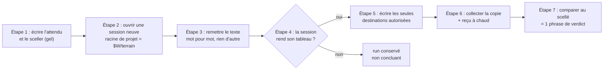
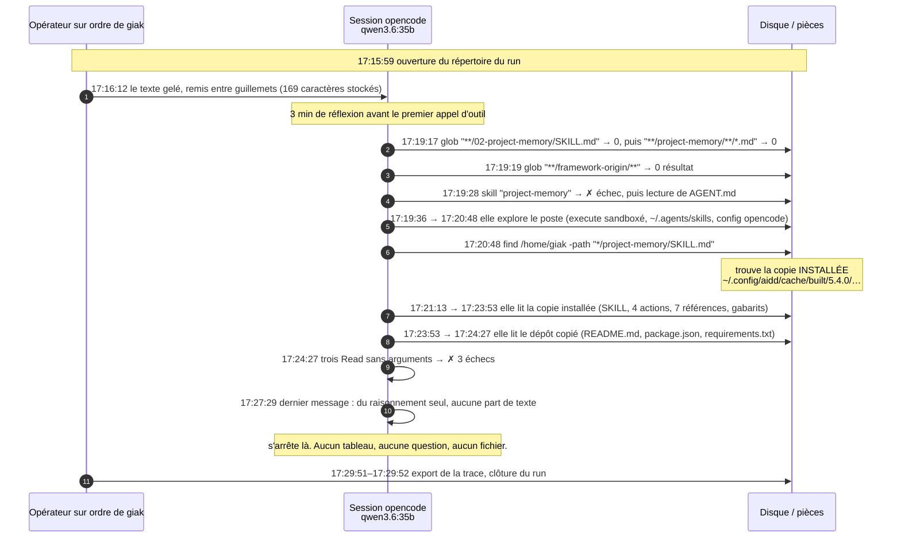
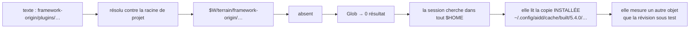
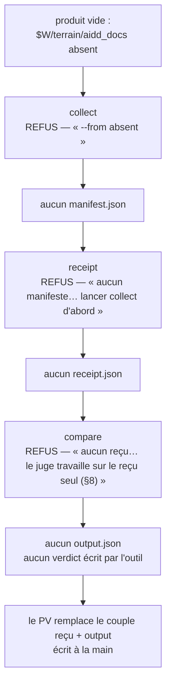
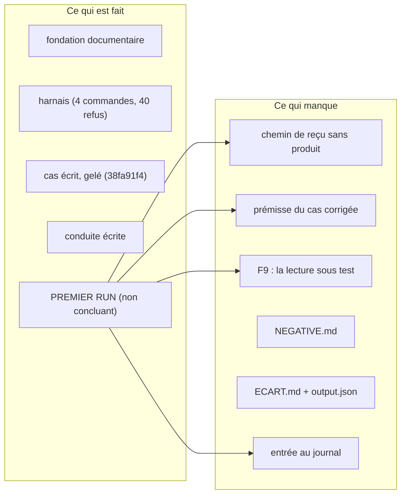
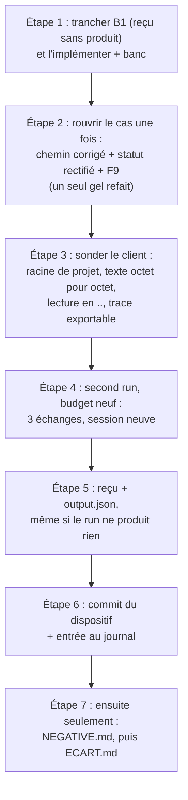

# Bilan — le premier run

> V0.1 — 2026-10-15, écrit après le run, depuis ses pièces seules :
> [docs/device/runs/2026-10-15-171559-4c39e5c5-1d471a5/](../device/runs/2026-10-15-171559-4c39e5c5-1d471a5/PV.md).
> Chaque chiffre porte sa source. Ce document est une **aide à la décision** : il raconte, il nomme
> les trous, il propose des options avec leur coût. Il ne décide rien à la place du relecteur.
>
> **V0.2 — même jour, après vérification et après les décisions du relecteur.** Le §4.2 est réécrit sur
> mesure : la cause n'est pas la faiblesse du modèle mais **le plafond de contexte**, mesuré à
> 32 768 jetons avec troncature silencieuse au-delà. Le §6.4 (candidat) et le §7 (brainstorm) suivent,
> le §9 porte les contrôles du soir. Trois décisions ont été prises et exécutées depuis : chemin
> **absolu** dans le texte du §5, falsificateur **F9** ajouté, cas **re-gelé** (`bc126fe6` → `38fa91f4`) ;
> le harnais sait désormais écrire un reçu et un `output.json` pour un run **sans produit**
> (`collect --sans-produit`, banc passé le 2026-10-15 à 20:49).

## 0. En une page, pour décider vite

**Le run a eu lieu. Il s'est conclu `non concluant`. Rien n'a été produit.**

| Question | Réponse, mesurée |
| --- | --- |
| Un run a-t-il eu lieu ? | **Oui** — session `opencode 2.0.26`, `ses_ebfdd6595ffentQru7gA9UPLSc`, modèle `ollama/qwen3.6:35b`, `17:16:12` → `17:29:51`, trace exportée (161 022 octets) |
| Le dispositif a-t-il tenu son cadre ? | **Oui** — les 4 arbres identiques au gel après le run, le gel rejoué `exit 0`, rien d'écrit hors du répertoire de travail |
| La session a-t-elle produit quelque chose ? | **Non** — 0 fichier sous `aidd_docs/` pendant et après (52 relevés, `veille-etat.txt`) |
| A-t-elle seulement rendu le tableau promis ? | **Non** — la trace ne porte aucun tableau, ni question à l'opérateur |
| Le produit a-t-il été mesuré contre l'attendu ? | **Non** — F2 (aucun tableau) et F8 (aucun fichier) mordent, le reste des falsificateurs est non évaluable |
| Reste-t-il un reçu et un verdict écrit ? | **Non** — `collect`, puis `receipt`, puis `compare` ont tous refusé : le harnais n'a pas de chemin pour un run **sans produit** |
| Pourquoi la session s'est-elle arrêtée ? | **Le plafond de contexte**, pas le modèle : contexte alloué **32 768** (`ollama ps`), et le run meurt à l'unité près (`32 528 + 240 = 32 768`), avec troncature **silencieuse** au-delà (40 000 jetons envoyés → 16 386 évalués). Les 4 modèles locaux testés appellent correctement les outils (§4.2) |
| Que faut-il faire ? | **Régler et mesurer le contexte avant d'ouvrir** (§6.4), **re-geler le cas** avec le chemin absolu et F9 (§6.1, **fait**), et **donner au harnais un chemin de reçu sans produit** (§6.2, **fait**) |

Ce que ce bilan propose de retenir en trois lignes :

1. **Le dispositif n'a pas failli** : le gel, la frontière, la trace et les refus ont tenu. Ce qui a
   failli, c'est **la prémisse du cas** (un chemin qui ne résout pas), **une maille du filet** (aucune
   pièce ne dit « la session a lu autre chose que la révision sous test ») et **l'environnement du
   candidat** (un plafond de contexte à 32 768 jetons, mesuré, avec troncature silencieuse au-delà).
2. **Le harnais a refusé au lieu d'inventer** — c'est son métier — mais il refuse aussi l'issue que
   la spec §9 prévoit explicitement. Un run raté ne laisse donc aujourd'hui **aucune trace écrite du
   verdict** : le PV a remplacé le couple `receipt.json` + `output.json` à la main.
3. **Le budget reste à 1 échange sur 3** : il n'a pas été épuisé, il n'a même pas pu servir — les
   deux réponses figées attendaient un déclencheur qui n'est jamais venu.

## 1. Ce qu'on cherchait à mesurer

Le dispositif ne teste pas une qualité, il teste **une promesse**. La modification du framework mise
à l'épreuve est le commit `4c39e5c59` — « project memory shows what it would change before writing » —
dont l'asset créé pour ça dit, en première ligne : « Here is what I read. Correct me before I write. »

Le cas mesure donc **trois choses**, dans cet ordre :

- **l'ordre des gestes** : montrer, attendre, écrire — jamais écrire avant d'avoir montré (c'est la
  promesse du commit, et c'est le falsificateur F1) ;
- **la conformité du produit** : chaque fichier écrit est une ligne de la colonne `Write to` de
  `references/memory-destinations.md`, à son chemin exact (F3, F4) ;
- **l'attribution du produit au run** : né après le gel, dans un arbre qui a bougé, différent de tout
  fichier antérieur (F6, F7).

Rien de ceci ne juge la **justesse** du contenu : le dispositif compare, il n'attribue pas (v6 §8).

## 2. Ce qui s'est passé, minute par minute

Le détail qui décide, tel que la trace le porte :

Tous ces horodatages se relisent dans `trace/session-ses_ebfdd6595ffentQru7gA9UPLSc.json` : l'export
porte, message par message et appel par appel, un `time.created` en millisecondes. Les voici, extraits
le 2026-10-15 à 20:2x, avec l'appel d'outil qu'ils portent :

| Moment | Fait | Preuve (dans l'export) |
| --- | --- | --- |
| `17:16:12` | le texte gelé est remis, **guillemeté par le client** : 169 caractères stockés, contre 167 gelés | `messages[0].text` ; `sha256` de l'ancien gel `4f7c189c…` |
| `17:19:17` | premier appel d'outil, après 3 min de réflexion : `glob "**/02-project-memory/SKILL.md"` → 0, puis `glob "**/project-memory/**/*.md"` → 0 | `name: glob`, `state.status: completed` |
| `17:19:19` | `glob "**/framework-origin/**"` → 0 ; le raisonnement écrit « The file doesn't exist anywhere in the repo » | idem |
| `17:19:28` | elle tente la skill **par son nom** : `skill "project-memory"` → ✗ échec, et lit `AGENT.md` | `name: skill`, `status: error` |
| `17:19:36`→`17:20:48` | elle explore le poste : `execute` (sandboxé, refusé), `~/.agents/skills`, la config d'opencode | `name: execute`, `shell` |
| `17:20:48` | `find /home/giak -path "*/project-memory/SKILL.md"` → **trouve la copie installée** | `shell`, chemin `~/.config/aidd/cache/built/5.4.0/…` |
| `17:21:13`→`17:23:53` | **20 appels visant la copie installée** : SKILL.md, les 4 actions, les 7 références, les gabarits | 20/36 appels dont l'argument porte ce chemin |
| `17:23:53`→`17:24:27` | elle lit le dépôt copié : `README.md`, `package.json`, `requirements.txt` | 5 appels portant ces noms |
| `17:24:27` | **trois `Read` sans arguments** : `✗ Tool call arguments were not completed` | trois parts `status: error` |
| `17:27:29` | dernier message : **du raisonnement seul**, aucune part de texte | `messages[17].content = [reasoning]` |
| `17:27:36` | le client passe `idle`. Aucun tableau, aucune question, aucun fichier | `messages[18].type = idle` |
| `17:29:51`–`17:29:52` | fin du run, puis export de la trace | `horodatage_fin.txt`, `trace/commande.txt` |

> **Rectifié le 2026-10-15 au soir.** Cette ligne citait `a3121f7f…` comme empreinte du texte du gel
> refait. Vérification faite : cette empreinte ne correspond à **aucun** état du cas — ni le texte gelé
> (`110132fd…`, 245 octets, ou `2ddc2451…` avec son saut de ligne), ni ses variantes guillemetées,
> gardées, en `LF` ou `CRLF`, ni le `demande.texte_verbatim` du JSON, ni l'ancien texte relatif
> (`48dad721…`, 167 octets), ni aucun blob versionné des deux fichiers du cas. **28 candidats essayés,
> aucune correspondance.** Ce que le cas porte réellement : les empreintes de ses **fichiers** —
> `0558be18…` pour la demande, `ae3f7cd4…` pour l'attendu — et l'empreinte du gel, `38fa91f4…`. Le
> reçu, lui, ne porte **jamais** d'empreinte de texte : `demande.sha256` est celle du fichier de la
> demande.

> **Rectifié le 2026-10-15 au soir, après le déplacement.** Les trois empreintes ci-dessus sont celles
> du re-gel de `20:51:44`. Le même jour, l'espace de travail quitte `~/runs/aidd-device/<cas>/` pour
> `~/projects/aidd-device-work/<cas>/` : les deux fichiers du cas ayant bougé, le gel est **refait une
> cinquième fois** — empreinte `07246039`, `gele_le` `21:57:31`, `38fa91f4` détruit — et les valeurs du
> cas deviennent `dce9e131…` (demande), `e32e420c…` (attendu), `832036f7…` (texte nu, 254 octets).
> Aucune mesure de ce bilan n'est touchée : le run a eu lieu avant.

**Bilan machine du run :** 19 messages ; **36 appels d'outil** (18 `shell`, 12 `read`, 3 `glob`,
2 `execute`, 1 `skill`) ; 4 en erreur ; 3 messages porteurs de texte visible ; **0 écriture**.
Durée 13 min 39 s, dont ~3 min de réflexion avant le premier appel d'outil. Coût : 1 échange sur 3.

## 3. Ce qui a marché

Ce sont des faits mesurés, pas des impressions :

| Élément du dispositif | Ce qui l'établit |
| --- | --- |
| **Le gel tient après le run** | 10 `sha256` + empreinte recalculés sur disque, `exit 0` ; **rejoué après** le run, encore `exit 0` |
| **Les 4 arbres n'ont pas bougé** | `HEAD` et `porcelain` identiques au gel, avant et après, pour `framework-origin`, `terrain`, `revision-sous-test`, `travail` |
| **La frontière a tenu** | rien d'écrit dans `framework-origin/`, dans le terrain d'origine, dans `CASES/`, ni hors du répertoire de travail ; le cache du framework lu par la session n'a pas été modifié (`find -newermt`) |
| **La trace machine existe** | `opencode session export`, 161 022 octets, copiée dans le run avec la commande qui l'a produite — c'est la pièce que l'opérateur n'écrit pas |
| **La veille d'état a fonctionné** | 52 relevés à 15 s (`17:16:52` → `17:29:38`) : `porcelain=[]` et `fichiers sous aidd_docs=0` à chaque fois — le « rien produit » est **mesuré en continu**, pas constaté à la fin |
| **Le run est intégralement relisible** | l'export porte 19 messages, 36 appels d'outil et un horodatage par appel : tout ce que ce bilan raconte du run vient de là, aucun témoignage |
| **Le harnais a refusé au lieu de deviner** | les 3 refus sont conservés (`collect-refus.txt`, `receipt-refus.txt`, `compare-refus.txt`) |
| **La prémisse du cas était vraie** | la copie du terrain n'a effectivement pas d'`aidd_docs/` (mesuré : `ls` rend « Aucun fichier ou dossier de ce nom ») |
| **F5 n'a pas mordu** | aucun fichier touché hors du répertoire de travail |

Autrement dit : **l'instrument n'est pas en cause**. Ce qui a échoué est en amont et en aval de lui.

## 4. Ce qui n'a pas marché — quatre causes, pas une

### 4.1 La prémisse du texte ne résout pas (cause première, mesurée)

Le §5 de la demande dit la skill à `framework-origin/plugins/…` — chemin **relatif au répertoire de
travail `$W`**. La conduite §2.1 ouvre la session **dans `$W/terrain`**, avec sa racine de projet là
aussi (exigence ADR-015 : c'est la racine qui décide où tombent les écritures relatives de la skill).

Or le client résout les chemins relatifs contre **un point d'ancrage qui ne contient pas `$W`** — sa
racine de projet, ou le répertoire courant, l'un et l'autre valant `$W/terrain` ici (les lectures
relatives qui ont réussi, `AGENT.md`, `README.md`, `package.json`, le prouvent). Donc :

**Conséquence dure :** le cas n'a **pas** mesuré la révision `4c39e5c5`. Et la nuance que le [PV](../device/runs/2026-10-15-171559-4c39e5c5-1d471a5/PV.md) §5 donnait (« les sept références
gelées y sont identiques octet pour octet ») est **vraie mais incomplète** : la comparaison complète des
deux arbres, faite le 2026-10-15 à 20:19, rend **40 fichiers identiques sur 44 et 4 différents** :

| Fichier | Révision sous test | Copie installée | Ce qui diffère |
| --- | --- | --- | --- |
| `SKILL.md` | `149f0f19…` | `775ebe32…` | front-matter seulement (nom, description, `argument-hint` guillemetés par l'installation) ; corps identique à partir de la ligne 6 |
| `assets/templates/AGENTS.md` | marqueurs `<aidd_project_memory>` | marqueurs `<!-- aidd_project_memory:start -->` | la convention de bloc a changé après la révision sous test |
| `assets/templates/README.md` | « The `<aidd_project_memory>` block… » | « The project memory block… » | idem, dans le texte |
| `assets/templates/memory/README.md` | « the `<aidd_project_memory>` block » | « the project memory block » | idem, dans le texte |

Ces quatre écarts ont une cause datée : le commit `87304fbca` de l'upstream
(« fix(aidd-context): load the project memory block in Claude Code », 2026-08-28) a remplacé ces
marqueurs **après** la révision sous test, et la copie installée (`5.4.0`, construite le 2026-10-11)
le porte ; l'origine elle-même (`fe48de12`) le porte aussi. La conséquence n'est pas cosmétique :
**deux des quatre fichiers divergents alimentent des destinations attendues du produit**
(`templates/README.md` → `aidd_docs/README.md`, `templates/memory/README.md` → `aidd_docs/memory/README.md`,
colonne `Write to` de `memory-destinations.md`). Une session qui aurait écrit aurait donc pu écrire les
mots de la version 5.4.0 dans un cas qui prétend mesurer `4c39e5c5`. Le troisième
(`templates/AGENTS.md`) ne sert qu'à `sync`, hors du cas.

**Aucune pièce ne l'a signalé** : c'est la maille manquante du §4.3, et elle justifie F9 autant que le
chemin cassé du §6.1.

### 4.2 Le plafond de contexte a coupé la session à 32 768 jetons, et rien ne l'a dit

La première lecture de ce run accusait le modèle. **Faux, et maintenant mesuré** (2026-10-15, 20:20–20:45,
serveur ollama de cette machine) :

| Mesure | Résultat | Comment |
| --- | --- | --- |
| le modèle du run | `qwen35moe`, 36,0 B, Q4_K_M, contexte **annoncé** 262 144 | `POST /api/show` |
| le contexte **alloué** | **32 768** | `ollama ps`, colonne `CONTEXT` |
| où il tourne | **100% GPU** : l'APU AMD (aucun GPU NVIDIA requis) | `ollama ps` |
| débit de préremplissage | 271–295 jetons/s | `prompt_eval_duration` sur ~9 000 jetons |
| appel d'outil | **OUI** sur `qwen3.6:35b`, `gemma4:26b`, `qwen3.5:9b`, `hermes3`, `qwen3:8b` ; **non** sur `granite3.2:2b` | `/api/chat` avec un schéma d'outil |
| un prompt de ~40 000 jetons | **tronqué en silence à 16 386 jetons évalués** | `prompt_eval_count` de la réponse |

Deux conséquences, et la seconde est la plus grave :

1. **Le run est mort au plafond, à l'unité près** : `32 528 + 240 = 32 768`, `32 709 + 59 = 32 768`.
   `finish=length` sur les deux derniers messages, avec une sortie minuscule : c'est la génération qui
   a été coupée, pas le raisonnement. Les trois `Read` aux arguments vides sont des appels d'outil
   **tronqués en cours d'émission** par ce plafond, et les ~3 min avant le premier appel d'outil
   ressemblent au chargement à froid d'un modèle de 22 Go sur l'APU, pas à une hésitation.
2. **Au-delà du contexte alloué, le serveur tronque sans le dire** et ne rapporte que ce qu'il a
   réellement évalué : une session qui accumule 32 k de contexte peut perdre **la tête** de sa fenêtre
   — la demande, les règles de la skill — tout en croyant les avoir envoyées. **Aucune pièce du
   dispositif ne mesure ce plafond** : ni le harnais, ni le reçu, ni la conduite.

Ce que ça change : la première action n'est pas de télécharger un modèle, c'est **de régler le contexte
et de le mesurer avant d'ouvrir**. Un candidat neuf ne répare pas un plafond mal réglé. Le budget, lui,
n'a toujours pas pu servir : les deux réponses figées attendent un déclencheur (un tableau à confirmer,
ou une question à répondre) qui n'est jamais venu.

### 4.3 Aucune pièce ne dit « la session a lu autre chose que la révision sous test »

C'est le trou le plus important du cas, et il n'est pas dans le harnais : il est dans **l'attendu**.
Les 8 falsificateurs mesurent le produit et le cadre ; **aucun ne mesure la lecture**. Cette
observation fonde le nouveau falsificateur **F9** proposé en §6.1.

### 4.4 Le harnais n'a pas de chemin de reçu pour un run sans produit

La spec §9 le prévoit noir sur blanc : « la session ne produit rien → `non concluant`, produit = sa
sortie brute ». Le code, lui, exige un produit :

Deux refus sont légitimes (`collect` sur une source absente, `compare` sans reçu). Le troisième est
une **maille manquante** : entre les deux, rien ne sait écrire « ce run a eu lieu et n'a rien
produit ». Les trois refus sont conservés comme pièces, ce qui sauve la traçabilité — mais un tiers
qui clone le dépôt ne lit pas le verdict dans une pièce de format connu, il le lit dans une page
écrite à la main.

## 5. Où en est le dispositif

L'état du v6 §7 ne suffit plus : « état A » (un runner fonctionne) et « état B » (la session est
demandée, rien n'est revenu) ne décrivent pas **un run qui a eu lieu sans produit**. Proposition de
vocabulaire, à arbitrer :

| État | Ce qu'il dit | Ici |
| --- | --- | --- |
| A | le runner fonctionne, il reste à faire tourner | dépassé |
| B | aucune session n'a reçu de demande | dépassé |
| **C** *(proposé)* | **un run a eu lieu, il n'a rien produit : le cas est instruit, pas conclu** | **c'est ici** |

Ce qui reste **exactement** à faire pour clore la boucle 2 du dispositif (v6 §10) :

| Artefact attendu | État |
| --- | --- |
| `DEVICE.md`, `BOUNDARY.md`, `CASES/`, `runs/` | écrits ; `runs/` porte maintenant **un** run |
| `output.json` (l'écart) | **absent** — bloqué par §6.2 |
| `NEGATIVE.md` (le contrôle négatif) | **rien** — jamais ouvert |
| `ECART.md` (le compte-rendu pour la PR du framework) | **rien** — jamais ouvert |
| entrée de séance au journal (`trace.md`) | **en attente**, ancrée à un commit (aucun commit n'a été fait depuis le run) |

## 6. Ce qu'il faut faire

### 6.1 Le geste central proposé : rouvrir le cas **une fois**, pour trois raisons mesurées

Le cas est périmé en trois endroits, et les trois se réparent dans **un seul gel refait** :

| Ce qui est périmé | Pourquoi | Ce qui le répare |
| --- | --- | --- |
| **le texte du §5** ne résout pas (§4.1) | mesuré par la session elle-même : `Glob "**/framework-origin/**"` → 0 | le texte porte un chemin qui résout — **absolu**, ou relatif depuis la racine de projet (les options ci-dessous, et l'avis donné plus bas) |
| **le statut déclaré** « aucune session n'a reçu la demande, les trois échanges du budget sont intacts » | faux depuis `17:16:12` | une **rectification datée** dans `request.md` et `expected.json` (le fichier ne se réécrit pas en silence) |
| **aucune pièce ne mesure la lecture** (§4.3) | mesuré : le run a lu la copie installée | le falsificateur **F9** : « la trace ne montre aucun accès à la révision sous test → `non concluant` » |

**Les options pour le chemin, et leur coût :**

| Option | Effet | Coût | Avis |
| --- | --- | --- | --- |
| **A. le texte porte `../framework-origin/…`** | résout depuis la racine `$W/terrain` ; rien d'autre ne bouge | re-gel ; **reste à mesurer** que le client accepte un `..` en lecture | recommandé **si le cas doit mesurer aussi la découverte** (voir ci-dessous), avec sonde préalable |
| B. la session s'ouvre dans `$W` (racine `$W`) | résout sans toucher au texte | le produit attendu quitte `terrain/aidd_docs/` ; surtout le **scan lit `$W`** (pas de manifeste, pas de README) : le cas ne mesure plus le terrain | rejeté |
| C. le framework est copié **dans** la racine de projet (`$W/terrain/framework-origin`) | résout sans toucher au texte | 2 599 fichiers dans la copie du terrain, `porcelain` pollué, le scan lit le framework comme s'il était le projet | rejeté |
| D. le texte porte un **chemin absolu** | résout dans tous les cas | le texte devient machine-spécifique ; §4 porte déjà un chemin absolu, donc ce n'est pas interdit | recommandé **si le cas ne doit pas mesurer la découverte** : la variable disparaît au lieu d'être réparée |

**Le critère qui tranche entre A et D, et que ce bilan n'avait pas posé :** *le cas mesure-t-il la
découverte de la skill ?* La promesse du commit `4c39e5c5` porte sur l'ordre des gestes, pas sur la
capacité du modèle à trouver un fichier. Si la découverte est hors sujet, D est plus honnête : on
supprime la variable au lieu de la rendre « juste assez difficile ». Si la découverte est dans le cas
(alors elle doit être mesurée, donc F9 — et le texte de A est ce qu'un humain écrirait), A tient.
**Mon avis : D + F9.** Réparer le chemin en A sans mesurer la découverte laisse une variable active
que personne ne mesure ; c'est exactement le défaut qui a produit ce run.

Deux points à ne pas cacher :

- **L'objection honnête à A** : on corrige le texte **après avoir vu le premier run**. Réponse :
  c'est une **prémisse** qui est corrigée (un chemin qui ne résout pas), pas l'**attendu** (l'ordre des
  gestes, les destinations) ; la session avait elle-même rendu la mesure ; et le cas n'a **jamais
  produit** — aucune attente n'a été validée contre un produit. Le prix est dit et payé : le gel est
  refait le 2026-10-15 (`bc126fe6` → `38fa91f4`), l'ancien détruit, et le journal portera pourquoi.
  **Fait, en trois passes** — et c'est instructif : la première avait manqué le `texte_verbatim` de
  l'attendu lui-même, qui citait encore l'ancien texte ; la seconde, deux liens morts de la nouvelle
  rectification. Trois fichiers du cas touchés, trois gels, chacun détruisant le précédent (`a74dacbd`,
  puis `54aad0b0`, puis `38fa91f4`) : c'est exactement ce que l'ADR-016 et la conduite §1.1 disent —
  un gel ne survit pas à une rectification de son texte. Voir le §9 pour le rejeu.
- **La règle durable à écrire dans le cas** (elle vaut pour tous les cas suivants) : *les chemins
  relatifs du §5 se lisent depuis la **racine de projet de la session**, et le cas dit laquelle*.
  C'est la leçon des deux incidents d'écriture du 2026-10-15 (BOUNDARY §8) et de ce run.

**Une alternative plus radicale, à mettre en face : un cas neuf plutôt qu'un gel refait.** Le gel est
la pièce sacrée du dispositif ; le rouvrir *après* avoir vu une copie est le geste que tout le projet
existe pour éviter. On peut donc laisser le cas № 1 intact (avec son texte cassé, son gel intact et son
run consigné) et écrire un **second cas** au texte corrigé, même terrain, même révision sous test. Ce
que ça coûte : deux cas pour une même modification, et une question de nommage (le cas est nommé par la
modification, pas par son texte). Ce que ça protège : **aucun scellé n'est jamais rouvert après un
run**, et la règle reste dite sans exception. À l'inverse, re-geler garde un cas par modification et
suit la pratique du 2026-10-15 (quatre gels refaits, l'ancien détruit à chaque fois) — mais les quatre
l'ont été **avant tout run**, ce qui n'est plus le cas ici. **Mon avis : re-geler, et dire pourquoi** —
un cas par modification sous test, un seul document à relire, et une rectification datée qui porte sa
raison ; l'alternative « cas neuf » reste la bonne si un troisième incident de prémisse survient, car
elle seule empêcherait la dérive « on ajuste l'examen à la copie » de s'installer.

### 6.2 Donner au harnais un chemin de reçu pour un run sans produit

| Option | Ce qu'elle fait | Coût | Avis |
| --- | --- | --- | --- |
| **R1. `collect` accepte un produit vide** (`--sans-produit` ou `--from` absent) et écrit le manifeste avec `fichiers: []` et `produit_absent: true` ; `receipt` l'accepte, force `non concluant` (spec §7 : pas de naissance, pas de verdict plein) | garde l'invariant « `collect` écrit toujours son manifeste » ; `compare` devient exécutable → **un `output.json` même pour un run raté** | ~30 lignes de harnais + banc ; le champ vide dit explicitement ce qui manque | **recommandé** |
| R2. `receipt` sait s'écrire **sans** manifeste, en nommant le produit absent | plus court | casse l'invariant : le reçu ne peut plus dire « ce manifeste-là » | acceptable |
| R3. le produit **est** la sortie brute (`last-message.md` + `trace/`), que l'on collecte | c'est ce que dit **littéralement** la spec §9 (« produit = sa sortie brute ») | le produit collecté est un texte écrit par l'opérateur → à ne pas confondre avec un produit de session | à trancher : **que veut dire §9 ?** |

C'est le seul point du dispositif qui a **refusé un cas prévu par la spec** : à traiter avant le
second run, sans quoi le second run raté ne laissera rien non plus.

### 6.3 Trancher : un agent peut-il chercher hors du cadre quand un chemin ne résout pas ?

Mesuré : la session a lu `~/.agents/skills`, `~/.config/opencode/skills`, puis a lancé
`find /home/giak -path "*/project-memory/SKILL.md"` — donc **hors du répertoire de travail**. Le §7 de
la demande interdit de « sortir du répertoire de travail », mais **F5 ne mesure que les écritures**.

| Option | Conséquence |
| --- | --- |
| **(i) l'interdit porte sur les écritures, et on le dit** | la recherche hors cadre est légale ; ce qui manque devient **F9** (a-t-elle lu la révision sous test ?) → **recommandé** |
| (ii) l'interdit porte aussi sur les lectures | toute recherche devient une violation de cadre ; le premier run se conclurait `non concluant` **pour un défaut du dispositif**, et le cas ne pourrait plus distinguer « la skill n'a pas montré avant d'écrire » de « le dispositif l'a envoyée vers un fichier absent » |

### 6.4 Le candidat : le contexte d'abord, le modèle ensuite

Quatre exigences, dans cet ordre, toutes mesurables hors run :

1. **la fenêtre effective** : `ollama ps` doit montrer le `CONTEXT` que le cas exige (≥ 65 536 pour un
   scénario qui lit une vingtaine de fichiers) et un prompt de ~40 000 jetons doit rendre un
   `prompt_eval_count` proche de ce qui a été envoyé, jamais un chiffre tronqué (§4.2). Réglages :
   `OLLAMA_CONTEXT_LENGTH` côté serveur, `options.num_ctx` par requête, `PARAMETER num_ctx` au Modelfile ;
   la documentation ollama recommande ≥ 64 000 pour un usage agentique, et son défaut documenté **n'est
   pas** le maximum du modèle (4 096 dans la FAQ, 2 048 dans la référence Modelfile, une règle liée à
   la mémoire dans la page « context length » — les trois pages ne concordent pas, d'où la mesure) ;
2. **poser la racine de projet sur `$W/terrain`** (sinon les écritures relatives tombent ailleurs ;
   `opencode <directory>` le permet) ;
3. **remettre le texte octet pour octet** (ici : 2 guillemets ajoutés par le client, mesurés dans la
   trace — 169 caractères stockés contre 167 gelés) ;
4. **exporter une trace machine dans la fenêtre du run** (fait, par `opencode session export`).

Le classement des modèles **déjà présents**, mesuré le 2026-10-15 :

| Modèle | contexte annoncé | appel d'outil | préremplissage | génération |
| --- | --- | --- | --- | --- |
| `gemma4:26b` | 262 144 | OUI | 294 j/s | 23,5 j/s |
| `qwen3.6:35b` (celui du run) | 262 144 | OUI | 271–295 j/s | — |
| `hermes3` | 131 072 | OUI | 252 j/s | 28,2 j/s |
| `qwen3.5:9b` | 262 144 | OUI | 197 j/s | 14,3 j/s |
| `qwen3:8b` | **40 960** | OUI | 238 j/s | 14,9 j/s |
| `granite3.2:2b` | 131 072 | **AUCUN** | 601 j/s | 48,8 j/s |

Ce qu'une recherche web du même jour (sources ollama et éditeurs, citées par le chercheur) ajoute :
les téléchargements utiles sur cette machine sont les **MoE à peu de paramètres actifs** —
`qwen3-coder:30b-a3b` (30,5 B / 3,3 B actifs, ~19 Go, 256 k, Apache 2.0) et `gpt-oss:20b`
(20,9 B / 3,6 B actifs, 14 Go, 131 k, Apache 2.0) — et **aucun benchmark primaire CPU pour cette
configuration n'a été trouvé** : le choix se fait donc sur les chiffres mesurés ci-dessus, pas sur un
classement publié. Pistes de client : `opencode` comme au premier run (connu ; `opencode <directory>`
pose la racine) ; **Freebuff Desktop**, que la spec §5.1 nomme en premier et qui a une notion explicite
 de **projet** (une racine par base) — au prix d'un `?? .freebuff/` dans la copie du terrain, à déclarer
ou à exclure par `.git/info/exclude`.

**Rectification datée du 2026-10-15 (soir) : le client du second run est Freebuff**, à modèle hébergé.
Trois choses en découlent, mesurées dans la base de Freebuff elle-même
(`~/.config/freebuff-desktop/projects/<projet>-<uuid>/desktop-v2.db`) :

| Ce que le §6.4 exigeait | Ce que la mesure donne sous Freebuff |
| --- | --- |
| la fenêtre effective | lisible **après** le run, par message : `metrics_json.context.windowTokens` — relevé 1 048 576, 1 000 000, 500 000, 262 144 ou 131 072 **pour un même modèle selon le moment**, avec des seuils de compaction de 320 000, 160 000 ou 88 000. Aucune constante à citer : la fenêtre du run se lit dans les messages du run (§1.6 de la [conduite](../tasks/2026_10/2026-10-15-130103-run-par-session-operateur/2026-10-15-154303-run.md)) |
| la racine de projet sur `$W/terrain` | un **projet** Freebuff nomme une racine ; le `.freebuff/` déposé dans la copie du terrain reste à traiter (déclarer ou exclure) |
| la trace machine | l'export change de source : `desktop-v2.db` (tables `threads`, `messages`), une ligne JSON par part de `parts_json` — genres relevés `text`, `reasoning`, `tool`, `changes`, `compaction`, `ad` ; la requête du §1.5 de la conduite est éprouvée (533 lignes pour une session d'audit) |

Le plafond de contexte qui a tué le premier run (32 768, troncature silencieuse au-delà) **n'est plus
celui du run** : il appartenait au serveur ollama local. Le remède éprouvé (`PARAMETER num_ctx`,
modèle dérivé des mêmes poids, sans duplication) reste valable pour un run local, mais il est sans objet
ici. Ce qui reste à surveiller sous Freebuff est l'inverse : **la compaction**. Sur ce poste, 124 messages
portent une compaction et `parts_json` en contient 158 parts ; au seuil, le client réécrit son propre
contexte, donc **B9** change de forme — il ne s'agit plus de sonder avant d'ouvrir, mais de **lire dans
la trace** ce que la session avait sous les yeux, et de dire en limite toute compaction survenue dans la
fenêtre du run.

## 7. Les brainstorm à conduire

Par ordre de rendement décroissant, chacun avec sa question et ce qu'il produirait.

| # | Question | Pourquoi maintenant | Ce que ça produit |
| --- | --- | --- | --- |
| **B1** | Que veut dire exactement « le produit est sa sortie brute » (spec §9) ? | c'est le trou qui a mangé le reçu du premier run | une règle claire : `fichiers: []` ou sortie brute collectée |
| **B2** | Le harnais peut-il **lire la trace** au lieu de la déclarer illisible ? | c'est la **pièce la plus forte** du dispositif, elle est **mesurable** (l'export d'opencode porte un horodatage par appel, vérifié le 2026-10-15 : 36 appels, `time.created` partout), et la condition 2 du §5 reste aujourd'hui une limite écrite plutôt qu'un contrôle | une 5ᵉ commande (`trace`) : accusé d'échanges dans la fenêtre, lectures/écritures horodatées, **et F9**. **Coût à ne pas cacher** : la spec §5.1 a explicitement refusé au harnais de lire les trois sources ; parser un format d'export, c'est le coupler à **un client** (ici `opencode`), et F9 reste évaluable par le juge sans le harnais |
| **B3** | Le cadre : lecture libre, écriture bornée ? | §6.3 | une clause du cas, applicable à tous les cas |
| **B4** | Que faire quand la session s'arrête sans rien rendre ? | le budget n'a pas de déclencheur pour ce cas ; les 3 échanges sont figés d'avance | soit une 4ᵉ réponse figée, soit la règle « le run s'arrête et se conclut » (ce que le PV a fait, à la main) |
| **B5** | Modèle et client comme **variables déclarées** du run | la trace est un événement unique ; un second run avec un autre modèle est une autre observation, pas une répétition | une colonne `modele` dans le reçu (elle existe) et une règle de lecture : comparer ce qui est comparable |
| **B6** | Le contrôle négatif (`NEGATIVE.md`) | prévu par le v6 §10, jamais ouvert ; on sait déjà ce qu'il doit sortir | la preuve que le dispositif **sait dire non** quand la casse est connue |
| **B7** | `ECART.md` : à quoi ressemble le compte-rendu qu'un relecteur de PR lit ? | c'est le **produit final** du projet, et il n'existe pas | un gabarit, et la première PR du framework à instruire |
| **B8** | Le cas doit-il être mesuré **plusieurs fois** (3 runs, 3 modèles) pour valoir ? | « un modèle n'est pas un autre » (EXPLICATION §12) | une règle de répétition : combien de runs avant de conclure quoi |
| **B9** | Le plafond de contexte est-il une **condition du run** ? | mesuré le 2026-10-15 : 32 768 alloués, troncature silencieuse au-delà, et le run mort à l'unité près sur ce plafond (§4.2) ; rien ne le mesure aujourd'hui | une sonde de contexte obligatoire avant l'ouverture, et un champ du reçu (`contexte_effectif`) qui dit ce que le modèle pouvait voir |

## 8. Ce que ce run ne prouve pas — les limites, dites

1. **Un run n'est pas une loi** : un modèle, un jour, un client. Ni la promesse du commit n'est
   infirmée, ni le dispositif validé.
2. **Le texte n'a pas été remis à l'octet près** (2 guillemets ajoutés par le client ; mesuré hors run).
3. **Session pilotée en ligne de commande** (`opencode run`, `--auto`) : permissions pré-approuvées,
   aucun geste confirmé par un humain, geste différent de celui d'un opérateur à la main.
4. **Le modèle a été substitué** : le défaut configuré était absent du serveur ollama.
5. **Le client a ajouté son contexte** : règles globales, skills globales, serveurs MCP — donc la
   session n'a pas reçu **seulement** le texte. C'est ce qui lui a permis de trouver la copie
   installée hors du cadre.
6. **Opérateur et juge = le même contexte** : la séparation du §8 de la spec n'est pas tenue ; le
   verdict a été écrit par la main qui a ouvert la session.
7. **Le dispositif n'était pas commité** au moment du run : `1d471a5` ne nomme pas les fichiers
   modifiés dans l'arbre de travail.
8. **Rien de ceci ne juge le contenu de la mémoire** : le cas mesure l'ordre des gestes, jamais la
   justesse du texte écrit (aucune vérité de référence n'existe ici).

## 9. Vérifié à l'écriture de cette page (2026-10-15, 20:15–20:30)

Chaque ligne a été **rejouée** ce soir, pas recopiée d'un document antérieur :

| Contrôle | Commande | Résultat |
| --- | --- | --- |
| le gel tient encore | la formule du §1.1 de la conduite, `RACINE_FRAMEWORK=$W/framework-origin` | 10/10 `True`, empreinte `bc126fe6`, **`exit 0`** (avant le re-gel) |
| le **re-gel** après les décisions | `run.mjs freeze … --refreeze`, puis la même formule | empreinte **`38fa91f4`**, `gele_le` `2026-10-15T20:51:44`, 10/10 `True`, **`exit 0`** ; l'attendu porte **F9**, le texte du §5 un chemin absolu, et `a74dacbd` puis `54aad0b0` sont détruits |
| le **harnais**, chemin sans produit | banc jetable sous `/tmp` : `collect --sans-produit`, `receipt`, `compare` | `exit 0` aux trois ; `output.json` écrit avec `verdict: non concluant`, `produit.absent: true`, la limite du §9 au reçu ; `--sans-produit` + `--from` refusé (`exit 1`) ; les deux refus d'origine intacts (produit déjà collecté, `--from` absent) |
| le **plafond de contexte** | `ollama ps`, `/api/chat` avec schéma d'outil, prompt de ~40 000 jetons | `CONTEXT 32768`, `100% GPU`, appel d'outil correct sur 5 modèles sur 6, prompt tronqué à 16 386 jetons évalués (§4.2) |
| le **remède de contexte**, éprouvé | `ollama create qwen3.6-131k` (`FROM qwen3.6:35b`, `PARAMETER num_ctx 131072`), puis le même prompt | `ollama ps` → **`CONTEXT 131072`** ; `prompt_eval_count` **44 018** = plus de troncature ; aucun service touché, aucun poids dupliqué |
| les **modèles à télécharger** | agent chercheur, sources ollama et éditeurs | 2 candidats MoE utiles (`qwen3-coder:30b-a3b`, `gpt-oss:20b`), aucun benchmark CPU pour cette machine (§6.4) |
| les 4 arbres | `git rev-parse --short HEAD` + `status --porcelain` sur les quatre | `4c39e5c5`/vide, `416ec1f`/vide, `fe48de12`/2 lignes, `416ec1f`/1 ligne — identiques au gel |
| le cache lu par la session | `find ~/.config/aidd/cache -newermt "2026-10-15 17:15"` | **rien** : lectures seules |
| la copie installée vs la révision sous test | `find` + `cmp` sur les 44 fichiers, puis `diff` des 4 divergents | 40 identiques, 4 différents (§4.1) ; la cause datée `87304fbca` |
| l'horodatage des faits du run | parsing de `trace/session-….json` (`time.created` par part) | 19 messages, 36 appels, 4 erreurs (§2) |
| les 6 schémas mermaid | `mmdc` (mermaid-cli 11.4.2, `PUPPETEER_EXECUTABLE_PATH=/usr/bin/google-chrome`) sur chaque bloc extrait | 6/6 `exit 0`, **0 nœud d'erreur**, libellés attendus présents dans les 6 SVG |

**Un défaut trouvé et corrigé par ce contrôle, digne d'être dit :** les deux diagrammes qui numérotaient
leurs étapes (« `1.` écrire l'attendu… ») ne rendaient **pas** leurs libellés — mermaid lit les
étiquettes de nœud comme du markdown, et `1. ` en tête de ligne devient une *liste*, que le moteur
refuse (« Unsupported markdown: list ») tout en sortant en `0`. Les étiquettes ont été réécrites en
« Étape 1 : … » et le rendu revérifié. Un `exit 0` n'est donc pas une preuve de rendu : c'est le
libellé présent dans le SVG qui l'est.

## 10. Où lire quoi

| Pièce | Fichier |
| --- | --- |
| le compte-rendu du run, et ses deux trous | [PV.md](../device/runs/2026-10-15-171559-4c39e5c5-1d471a5/PV.md) |
| les trois refus, tels quels | `collect-refus.txt`, `receipt-refus.txt`, `compare-refus.txt` (même dossier) |
| ce que la session a fait (journal client) | `trace/echange-1.txt` |
| la trace machine (export `opencode`) | `trace/session-ses_ebfdd6595ffentQru7gA9UPLSc.json` |
| le « rien produit » mesuré en continu | `veille-etat.txt` |
| les faits du run (session, horodatages, témoignage) | `faits.json` |
| le cas : demande, attendu, gel | [CASES/](../device/CASES/) |
| l'ordre du run, à corriger sur deux points | [la conduite](../tasks/2026_10/2026-10-15-130103-run-par-session-operateur/2026-10-15-154303-run.md) |
| la spec du run (dont §9, non tenue par le code) | [la spec](../tasks/2026_10/2026-10-15-130103-run-par-session-operateur/2026-10-15-130103-spec.md) |
| le projet raconté simplement | [EXPLICATION.md](../EXPLICATION.md) |

## 11. La suite, en un seul enchaînement

