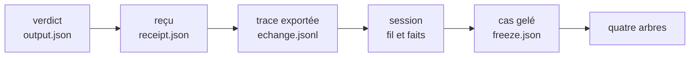
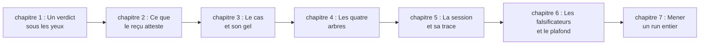
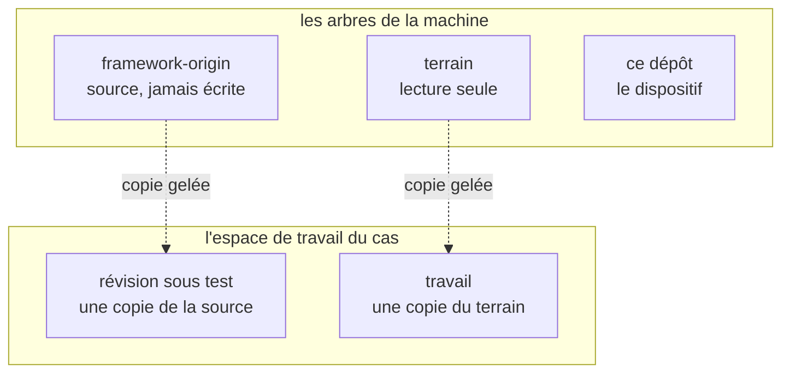
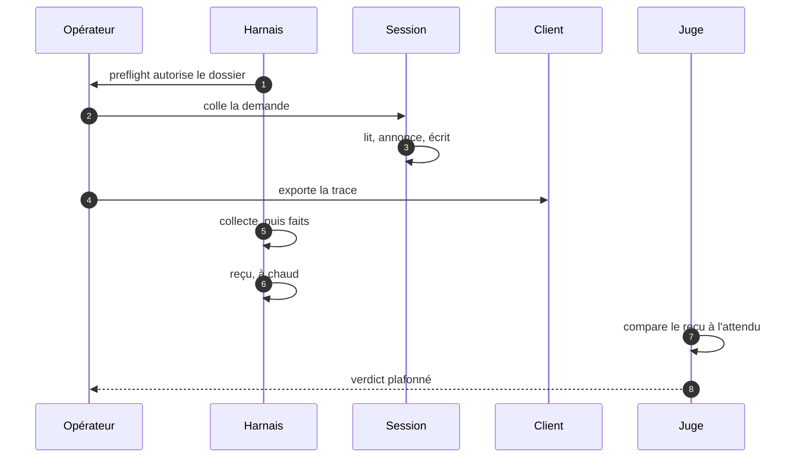
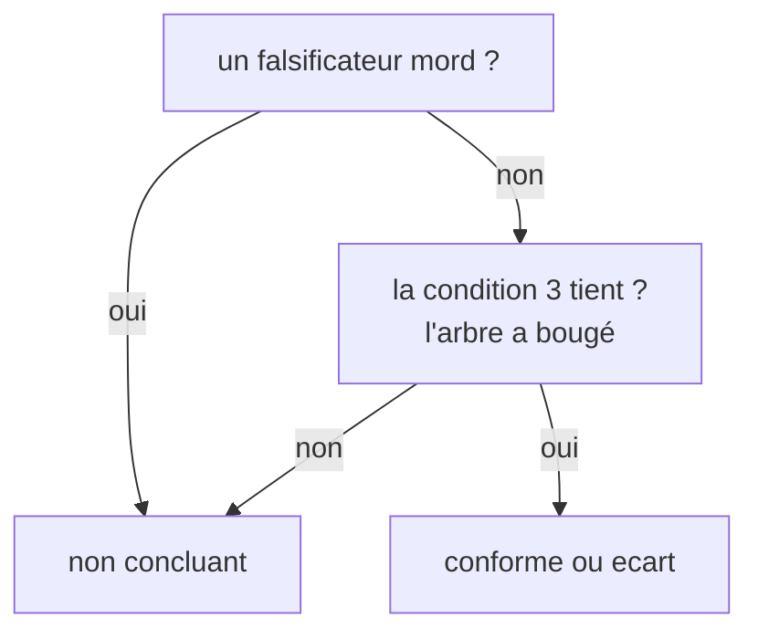

# Guide pédagogique du test de bout en bout

> 2026-10-17, né à 13:43:47 (`stat -c %w`). Ceci est un **brainstorm**, pas le guide : il dit à qui parler,
> dans quel ordre, avec quelles figures et quelles preuves, ce que le guide refusera de faire, et comment
> savoir qu'il a échoué. Rien n'est écrit du guide lui-même. Les faits sur le dispositif sont lus dans ce
> dépôt, et la section 12 dit ce qui n'a pas été mesuré.

## 1. La commande, et les trois guides qu'elle peut désigner

« Un test de bout en bout » ne désigne pas un objet unique ici, et le guide change entièrement selon celui
qu'on choisit. Trois lectures tiennent debout :

| # | Lecteur | Ce qu'il veut savoir faire à la fin | Ce que le guide devient |
| --- | --- | --- | --- |
| A | **l'opérateur** qui veut mener un run | ouvrir une session, la clore, produire un reçu et un verdict | une procédure expliquée, du gel au jugement |
| B | **le curieux** qui veut comprendre l'idée | dire pourquoi un test de bout en bout sur une session d'assistant n'est pas un test unitaire | un essai pédagogique, avec un run comme fil rouge |
| C | **le contributeur** qui veut écrire un cas | rédiger une demande, un attendu, des falsificateurs, un gel | un atelier d'écriture de cas |

**Ce que je devine** : A, avec B dans les trois premiers chapitres. La raison est dans le dépôt : la
[relecture à froid des entrées](2026-10-16-133942-relecture-a-froid-des-entrees.md) §3 constate qu'aucune
page ne répond à « je viens d'arriver, que puis-je vérifier en cinq minutes ? », alors que la réponse
existe et qu'elle est mesurée. Un guide qui prend par la main comble exactement ce trou-là. C est un autre
livre.

**La question qui commande tout le reste** : le guide apprend-il à *faire un run* (A), à *comprendre
pourquoi c'est fait ainsi* (B), ou à *écrire un cas* (C) ? Tant qu'elle n'est pas tranchée, chaque
paragraphe hésite entre trois voix.

## 2. Le vrai obstacle n'est pas la longueur, c'est l'ordre

Le dispositif est un méta-test : il ne teste pas du code, il teste ce qu'une session promet et ce qu'elle
produit. Un lecteur qui arrive doit tenir quatre arbres, un gel, un reçu, un plafond de verdict, **avant
qu'aucune de ces pièces n'ait rendu un résultat**. Expliquer dans cet ordre, c'est demander de croire avant
de voir ; c'est ce que la relecture à froid reproche déjà au README.

Le renversement proposé : **partir du verdict et remonter**. Le lecteur tient d'abord un objet fini
(`output.json` du premier run, `non concluant`), et chaque chapitre arrière répond à une seule question :
« pourquoi cette pièce ne peut-elle pas dire autre chose ? »



Ce sens de lecture a trois vertus : chaque étape est déjà un artefact réel, donc rien n'est hypothétique ;
la question de chaque chapitre est une question de preuve, pas de définition ; et le lecteur découvre le
vocabulaire au moment où il en a besoin, jamais avant.

## 3. Les cinq seuils, et l'erreur qui montre qu'un seuil n'est pas franchi

Un guide qui prend par la main se juge à ceci : à chaque seuil, le lecteur **fait** quelque chose et **voit**
quelque chose. Voici les cinq, avec la preuve exécutable et le signe qui dit que le seuil est encore devant.

| # | Seuil | Ce que le lecteur sait faire | Preuve exécutable | L'erreur qui trahit le seuil non franchi |
| --- | --- | --- | --- | --- |
| 1 | **nommer** | distinguer cas, run, gel, reçu, verdict | retrouver ces cinq mots dans un `receipt.json` réel | il appelle « test » le run entier, ou « résultat » le produit |
| 2 | **lire un reçu** | dire ce qu'un champ atteste, et ce qu'il n'atteste pas | trois affirmations vraies et une fausse sur un reçu | il lit `verdict: conforme` comme « le code est bon » |
| 3 | **geler** | refaire un gel et le vérifier sans le harnais | deux empreintes identiques, calculées à la main | il croit le fichier de gel sur parole |
| 4 | **tenir la fenêtre** | ouvrir une session, l'exporter, rattacher le fil | l'export porte des échanges dans la fenêtre du run | il oublie l'export et découvre la limite au reçu |
| 5 | **juger** | rendre un verdict plafonné par les falsificateurs | un falsificateur mordu, donc `non concluant` assumé | il « corrige » le verdict pour qu'il plaise |

Les seuils 1 et 2 se franchissent en une heure. Les seuils 3 à 5 demandent une machine avec les quatre
arbres : c'est là que le guide doit dire franchement « à partir d'ici, il faut un clone et vingt minutes ».

## 4. La règle pédagogique unique

**On ne nomme qu'après avoir fait, et on ne promet rien sans refus.** Chaque chapitre tient donc en quatre
temps, toujours les mêmes :

1. **un geste** : une commande copiable, sans variable à deviner ;
2. **une sortie attendue** : le bloc exact, pas une capture d'écran ;
3. **un refus provoqué** : la même commande, mal conduite, et le message du harnais ;
4. **un nom** : le mot que le geste vient d'illustrer, posé une seule fois.

Le refus est le vrai professeur : le harnais refuse un dossier qui n'est pas celui du gel, un fil absent, un
worktree, un `faits.json` déjà écrit, une trace qui est un dossier. Chacun de ces refus est un chapitre qui
s'écrit tout seul.

**Les cinq anti-patterns à éviter**, tous déjà observés dans ce dépôt ou dans sa relecture :

| Anti-pattern | Pourquoi il rate | Remplacement |
| --- | --- | --- |
| le mur de définitions en tête | le lecteur retient des mots sans référent | une définition par chapitre, après le geste |
| la démo du cas réel d'abord | la session verrait l'attendu ; et le lecteur croit que tout run réussit | un cas jouet, puis le cas réel |
| le guide qui réussit toujours | aucun refus rencontré, donc aucun apprentissage du plafond | un refus obligatoire par chapitre |
| la capture d'écran | elle vieillit sans date et ment en silence | bloc de sortie daté, rejouable |
| le schéma décoratif | il illustre ce que le texte dit déjà | une figure par quiproquo réel (section 6) |

## 5. Le parcours proposé, en sept chapitres



| Ch. | Titre de travail | Ce que le lecteur fait | Ce qu'il voit | Ce qu'il ne peut pas encore faire |
| --- | --- | --- | --- | --- |
| 1 | Un verdict sous les yeux | lit `output.json` du premier run | une phrase et un verdict, sans jargon | dire d'où vient ce verdict |
| 2 | Ce que le reçu atteste | ouvre `receipt.json`, coche cinq champs | la différence entre « a eu lieu » et « s'est bien passé » | refaire un reçu |
| 3 | Le cas et son gel | rejoue le gel sur un clone neuf | deux empreintes identiques, à la main | ouvrir une session |
| 4 | Les quatre arbres | nomme chaque arbre et ce qu'il peut recevoir | le piège du nom `framework-origin` | écrire dans le bon arbre |
| 5 | La session et sa trace | exporte un fil, compte les échanges de la fenêtre | une trace muette ou bavarde, et ce que ça change | juger |
| 6 | Les falsificateurs et le plafond | provoque trois refus, dont un falsificateur mordu | `non concluant` comme résultat, non comme échec | mener un run complet |
| 7 | Mener un run entier | enchaîne gel, session, collecte, reçu, jugement | le verdict de son propre run | recommencer sans la liste |

Le chapitre 7 est la récompense ; il ne s'écrit qu'une fois les six autres stables, et il se termine par une
liste de contrôle d'une page. La
[liste de contrôle d'ouverture](../tasks/2026_10/2026-10-15-130103-run-par-session-operateur/2026-10-17-095643-liste-de-controle-ouverture-second-run.md)
en est déjà une, à réutiliser plutôt qu'à réécrire.

## 6. Les figures, et le quiproquo que chacune empêche

Une figure ne vaut que si elle empêche une confusion nommable. Huit figures suffisent ; trois sont montrées
ici, les cinq autres sont décrites avec leur quiproquo.

### Figure 1 : deux arbres portent le même nom



**Quiproquo empêché** : `framework-origin` désigne la source *et* le dossier de sa copie. Sans cette
figure, un lecteur écrit un jour dans la source en croyant écrire dans la copie.

### Figure 2 : la séquence d'un run, et qui tient chaque pièce



**Quiproquo empêché** : croire que le harnais observe la session. Il ne l'observe pas : il lit ce que le
client a écrit, et il le dit dans chaque refus.

### Figure 3 : le plafond du verdict



**Quiproquo empêché** : « un run non concluant est un run raté ». C'est l'inverse : c'est le dispositif qui
fonctionne, en refusant de conclure sur une preuve incomplète.

### Les cinq autres

| # | Figure | Quiproquo empêché |
| --- | --- | --- |
| 4 | l'arborescence d'un dossier de run, en ASCII | croire que `raw/` contient le produit jugé, alors qu'il contient la copie verbatim |
| 5 | la chronologie d'une fenêtre : début, échanges, fin, export | croire que la trace peut être exportée après coup, à froid |
| 6 | le tableau des quatre arbres et de leurs `porcelain` | croire qu'une ligne non suivie est une écriture du run |
| 7 | le chemin d'une demande : §5, texte substitué, empreinte | croire qu'un texte peut être « à peu près » celui du cas |
| 8 | la boussole du vocabulaire, en ASCII, une page | chercher un mot dans le journal au lieu de le lire ici |

```text
        ce qui est écrit          ce qui est mesuré          ce qui est jugé
        ─────────────────         ─────────────────          ────────────────
cas ──▶ gel ──▶ demande ──▶ session ──▶ trace ──▶ reçu ──▶ verdict
                                  └──▶ produit ──▶ collecte ──┘
```

## 7. Cinq exercices jalonnés

Chaque exercice a une réussite mesurable, et **le refus compte comme réussite** quand c'est lui qui est
demandé.

| # | Geste | Sortie attendue | Ce qui compte comme réussite |
| --- | --- | --- | --- |
| 1 | rejouer le gel sur un clone neuf | mêmes empreintes que le gel du dépôt | deux empreintes égales, calculées hors du harnais |
| 2 | lancer `preflight` depuis le mauvais dossier | un refus nommé, sortie 1 | le refus est expliqué par le lecteur avant d'être lu |
| 3 | demander `faits` avec un fil absent | `aucun fil … dans …desktop-v2.db` | le lecteur dit pourquoi le harnais ne devine pas |
| 4 | lire un reçu réel, distinguer trois faits d'une interprétation | trois vraies, une fausse | la fausse est reconnue sans aide |
| 5 | provoquer un falsificateur, rendre `non concluant` | verdict plafonné, limite nommée | le lecteur ne « répare » pas le verdict |

L'exercice 4 est le seul qui demande un reçu réel : le premier run en fournit un, et son verdict
`non concluant` est justement le cas le plus instructif.

## 8. Les falsificateurs du guide

Un guide pédagogique se falsifie comme un run. Cinq manières de montrer qu'il a échoué :

| # | Ce qui le fait mordre | Ce que ça tue |
| --- | --- | --- |
| G1 | après le chapitre 4, le lecteur ne nomme pas les quatre arbres | le chapitre 4 n'enseigne pas |
| G2 | il exporte la trace après avoir fermé la session, et s'étonne | le chapitre 5 arrive trop tard |
| G3 | il conclut `conforme` alors qu'un falsificateur mord | le chapitre 6 n'a pas posé le plafond |
| G4 | il lit `receipt.json` comme une preuve de qualité du code | le chapitre 2 n'a pas séparé « a eu lieu » de « s'est bien passé » |
| G5 | aucun refus n'a été provoqué pendant la lecture | le guide n'a rien fait éprouver |

**Protocole de mesure, à faire une fois** : trois lecteurs, dont un qui ne connaît pas le dépôt, 90 minutes
chronométrées, verbalisation à voix haute, et l'on compte trois choses : le temps jusqu'au premier `exit 0`,
le nombre de refus provoqués, et le nombre de mots que le lecteur emploie sans les avoir vus dans un
artefact.

## 9. Format, ton, longueur

- **Sept chapitres, 500 à 700 mots chacun**, une figure, un exercice. En dessous, le geste manque ; au-dessus,
  le lecteur lit au lieu de faire.
- **Deuxième personne, présent, phrases courtes.** Pas de « nous », pas de préambule, pas de « dans ce
  chapitre nous allons voir ».
- **Chaque commande est copiable telle quelle**, sans variable à remplacer, sauf celles que le lecteur vient
  de créer lui-même. La sortie attendue est un bloc daté, pas une capture.
- **les figures sont du texte** : Mermaid pour les flux, ASCII pour les arborescences. Elles se relisent dans
  un diff, et se vérifient (`mmdc` 11.4.2 : 5 blocs, 5 `exit 0`, 0 nœud d'erreur, aucun libellé remplacé par
  « Unsupported markdown »).
- **Le guide ne cite pas l'attendu du cas réel** quand il fait mener un run : sinon il contamine la session
  qu'il prétend enseigner.

## 10. La plus petite version livrable

Trois chapitres suffisent à éprouver la promesse « prendre par la main » : **lire un reçu** (seuil 2),
**rejouer un gel** (seuil 3), **provoquer trois refus** (seuil 6 en miniature). Environ 40 minutes de
lecture active, aucun run à ouvrir, aucune machine préparée au-delà d'un clone.

Si ces trois chapitres ne tiennent pas un lecteur qui ne connaît pas le dépôt, les quatre autres ne le
feront pas davantage : c'est là qu'il faut mesurer, pas à la fin.

## 11. Ce que je devine, et ce qui reste ouvert

- **Le lecteur** : A (l'opérateur), avec B en amorce. C'est une devinette, et c'est la première chose à
  corriger si elle est fausse.
- **Le foyer** : `docs/` dans ce dépôt, ou une page hors dépôt pour l'opérateur, comme le kit d'ouverture ?
  Le dépôt donne un guide versionné et relisible ; l'extérieur donne un guide qu'on imprime. La réponse
  change les liens et le ton, pas le contenu.
- **Le cas jouet** : à écrire, ou à extraire du cas réel en retirant l'attendu ? Extraire coûte moins cher,
  mais un cas retouché n'est plus gelé, donc ne s'exerce plus sur les mêmes refus.
- **Un document ou une série** : sept chapitres dans un fichier de 4 000 mots, ou sept pages liées ? Le
  dépôt préfère les pages courtes ; le lecteur préfère un seul fichier à imprimer.
- **Ce que le guide ne couvrira pas** : l'écriture d'un cas (lecture C), les trois sources de trace autres
  que Freebuff, et la mesure du contexte de la session.

## 12. Ce sur quoi je m'appuie, et ce que je n'ai pas mesuré

**Lu dans ce dépôt** : `README.md`, `ARCHITECTURE.md`, `EXPLICATION.md`, `DEVICE.md`, `BOUNDARY.md`,
`REPLAY.md`, `DASHBOARD.md`, la [spec du run](../tasks/2026_10/2026-10-15-130103-run-par-session-operateur/2026-10-15-130103-spec.md),
le `--help` du harnais, la
[relecture à froid des entrées](2026-10-16-133942-relecture-a-froid-des-entrees.md) et le
[bilan du premier run](2026-10-15-201458-bilan-premier-run.md).

**Non mesuré, et qui compte** :

- **aucun lecteur** n'a été observé : les cinq seuils, le protocole de la section 8 et les 40 minutes de la
  section 10 sont des hypothèses de travail, pas des mesures ;
- **le second run n'a pas eu lieu** : `threads` compte 0 dans le projet du cas, donc le chapitre 7 ne peut pas
  être écrit ni éprouvé aujourd'hui, et le premier run reste le seul reçu réel disponible ;
- **le rendu Mermaid** a été vérifié **après** écriture, pas pendant : les cinq blocs extraits se rendent
  (`mmdc` 11.4.2, `PUPPETEER_EXECUTABLE_PATH=/usr/bin/google-chrome`) en 5/5 `exit 0`, 0 nœud d'erreur,
  aucun `Syntax error` ; ce que le rendu ne prouve pas, c'est qu'une figure soit *utile* : seule la lecture
  par un tiers le dira ;
- **une erreur de rendu que l'exit code cachait** : au premier passage, les sept libellés du parcours
  commençaient par « 1. », « 2. » … et Mermaid les a lus comme des listes : `mmdc` rendait `exit 0` avec
  sept « Unsupported markdown: list » dans le SVG. Les libellés disent maintenant « chapitre 1 : … », et le
  contrôle lit le texte du SVG au lieu du seul code de sortie.
