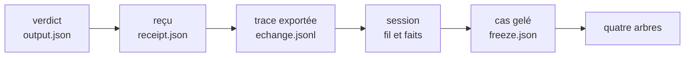
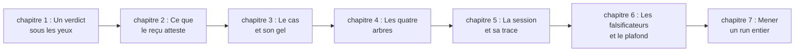
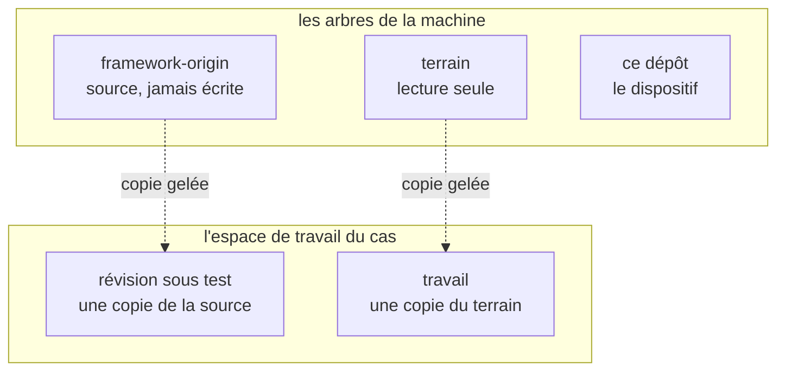
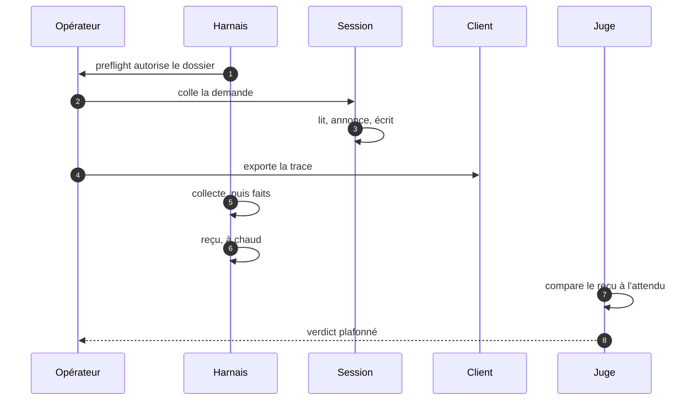
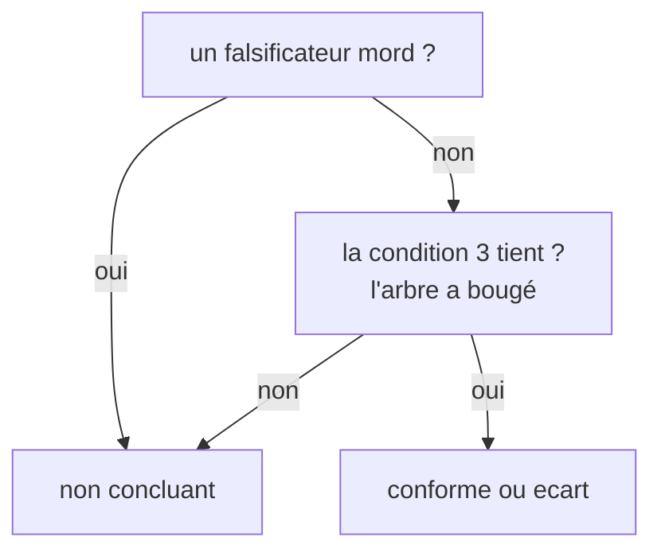

# Guide pédagogique du test de bout en bout

> 2026-10-17, né à 13:43:47 (`stat -c %w`). Ceci est un **brainstorm**, pas le guide : il dit à qui parler,
> dans quel ordre, avec quelles figures et quelles preuves, ce que le guide refusera de faire, et comment
> savoir qu'il a échoué. Rien n'est écrit du guide lui-même. Les faits sur le dispositif sont lus dans ce
> dépôt, et la section 12 dit ce qui n'a pas été mesuré.
>
> **Relu et mis à jour le 2026-10-17 à 21:38**, sur le commit `a60f2e5` : H1 à H5 sont appliqués, le harnais
> fait **1 636 lignes et 148 refus**, le banc **112 contrôles** (`112/112 PASS`, `exit 0`), et la porte
> `preflight` écrit désormais `gate.json`, sans lequel le reçu refuse. Les chapitres, les exercices et les
> falsificateurs qui parlaient d'une porte qui ne laissait rien sont corrigés ; les mesures d'origine de la
> section 12 sont reprises et datées, jamais effacées.
>
> **Complété le 2026-10-18** : la section 13 donne le parcours de la personne, geste par geste, et la
> section 14 la liste de ce qui manque encore ; la section 12 corrige une affirmation fausse du 2026-10-17,
> **aucun `receipt.json` n'existe dans ce dépôt**, et les pages qui parlaient d'un « reçu réel » parlaient
> d'un reçu qui reste à écrire. Les trois chapitres minimaux de la section 10 sont écrits depuis, hors de ce
> plan : [le guide](../guide-du-test-de-bout-en-bout.md), 256 lignes, né à 06:55:09.

## 1. La commande, et les trois guides qu'elle peut désigner

« Un test de bout en bout » ne désigne pas un objet unique ici, et le guide change entièrement selon celui
qu'on choisit. Trois lectures tiennent debout :

| # | Lecteur | Ce qu'il veut savoir faire à la fin | Ce que le guide devient |
| --- | --- | --- | --- |
| A | **l'opérateur** qui veut mener un run | ouvrir une session, la clore, produire un reçu et un verdict | une procédure expliquée, du gel au jugement |
| B | **le curieux** qui veut comprendre l'idée | dire pourquoi un test de bout en bout sur une session d'assistant n'est pas un test unitaire | un essai pédagogique, avec un run comme fil rouge |
| C | **le contributeur** qui veut écrire un cas | rédiger une demande, un attendu, des falsificateurs, un gel | un atelier d'écriture de cas |

**Ce que je devine** : A, avec B dans les trois premiers chapitres. La raison est dans le dépôt : la
[relecture à froid des entrées](2026-10-16-133942-relecture-a-froid-des-entrees.md) §3 constate qu'aucune
page ne répond à « je viens d'arriver, que puis-je vérifier en cinq minutes ? », alors que la réponse
existe et qu'elle est mesurée. Un guide qui prend par la main comble exactement ce trou-là. C est un autre
livre.

**La question qui commande tout le reste** : le guide apprend-il à *faire un run* (A), à *comprendre
pourquoi c'est fait ainsi* (B), ou à *écrire un cas* (C) ? Tant qu'elle n'est pas tranchée, chaque
paragraphe hésite entre trois voix.

## 2. Le vrai obstacle n'est pas la longueur, c'est l'ordre

Le dispositif est un méta-test : il ne teste pas du code, il teste ce qu'une session promet et ce qu'elle
produit. Un lecteur qui arrive doit tenir quatre arbres, un gel, un reçu, un plafond de verdict, **avant
qu'aucune de ces pièces n'ait rendu un résultat**. Expliquer dans cet ordre, c'est demander de croire avant
de voir ; c'est ce que la relecture à froid reproche déjà au README.

Le renversement proposé : **partir du verdict et remonter**. Le lecteur tient d'abord un objet fini
(`output.json` du premier run, `non concluant`), et chaque chapitre arrière répond à une seule question :
« pourquoi cette pièce ne peut-elle pas dire autre chose ? »



Ce sens de lecture a trois vertus : chaque étape est déjà un artefact réel, donc rien n'est hypothétique ;
la question de chaque chapitre est une question de preuve, pas de définition ; et le lecteur découvre le
vocabulaire au moment où il en a besoin, jamais avant.

## 3. Les cinq seuils, et l'erreur qui montre qu'un seuil n'est pas franchi

Un guide qui prend par la main se juge à ceci : à chaque seuil, le lecteur **fait** quelque chose et **voit**
quelque chose. Voici les cinq, avec la preuve exécutable et le signe qui dit que le seuil est encore devant.

| # | Seuil | Ce que le lecteur sait faire | Preuve exécutable | L'erreur qui trahit le seuil non franchi |
| --- | --- | --- | --- | --- |
| 1 | **nommer** | distinguer cas, run, gel, reçu, verdict | retrouver ces cinq mots dans un `receipt.json` réel | il appelle « test » le run entier, ou « résultat » le produit |
| 2 | **lire un reçu** | dire ce qu'un champ atteste, et ce qu'il n'atteste pas | trois affirmations vraies et une fausse sur un reçu | il lit `verdict: conforme` comme « le code est bon » |
| 3 | **geler** | refaire un gel et le vérifier sans le harnais | deux empreintes identiques, calculées à la main | il croit le fichier de gel sur parole |
| 4 | **tenir la fenêtre** | passer la porte, ouvrir une session, l'exporter, rattacher le fil | `gate.json` daté avant le premier message, et l'export porte des échanges dans la fenêtre du run | il saute `preflight` ; le reçu refuse alors un run sans porte (`aucune porte`), ce qui est le refus le plus facile à provoquer sans session |
| 5 | **juger** | rendre un verdict plafonné par les falsificateurs | un falsificateur mordu, donc `non concluant` assumé | il « corrige » le verdict pour qu'il plaise |

Les seuils 1 et 2 se franchissent en une heure. Les seuils 3 à 5 demandent une machine avec les quatre
arbres : c'est là que le guide doit dire franchement « à partir d'ici, il faut un clone et vingt minutes ».

## 4. La règle pédagogique unique

**On ne nomme qu'après avoir fait, et on ne promet rien sans refus.** Chaque chapitre tient donc en quatre
temps, toujours les mêmes :

1. **un geste** : une commande copiable, sans variable à deviner ;
2. **une sortie attendue** : le bloc exact, pas une capture d'écran ;
3. **un refus provoqué** : la même commande, mal conduite, et le message du harnais ;
4. **un nom** : le mot que le geste vient d'illustrer, posé une seule fois.

Le refus est le vrai professeur : le harnais refuse un dossier qui n'est pas celui du gel, un fil absent, un
worktree, un `faits.json` déjà écrit, une trace qui est un dossier, une copie réécrite après `collect`, une
trace qui ne rend pas les octets de la base, un fil qui porte plus de messages que le budget du cas, et un
dossier de run qui n'a pas de `gate.json` ou dont la porte vient d'un autre arbre. Chacun de ces refus est un
chapitre qui s'écrit tout seul.

**Les cinq anti-patterns à éviter**, tous déjà observés dans ce dépôt ou dans sa relecture :

| Anti-pattern | Pourquoi il rate | Remplacement |
| --- | --- | --- |
| le mur de définitions en tête | le lecteur retient des mots sans référent | une définition par chapitre, après le geste |
| la démo du cas réel d'abord | la session verrait l'attendu ; et le lecteur croit que tout run réussit | un cas jouet, puis le cas réel |
| le guide qui réussit toujours | aucun refus rencontré, donc aucun apprentissage du plafond | un refus obligatoire par chapitre |
| la capture d'écran | elle vieillit sans date et ment en silence | bloc de sortie daté, rejouable |
| le schéma décoratif | il illustre ce que le texte dit déjà | une figure par quiproquo réel (section 6) |

## 5. Le parcours proposé, en sept chapitres



| Ch. | Titre de travail | Ce que le lecteur fait | Ce qu'il voit | Ce qu'il ne peut pas encore faire |
| --- | --- | --- | --- | --- |
| 1 | Un verdict sous les yeux | lit l'`output.json` du prochain run, aucun n'existe encore (§12) | une phrase et un verdict, sans jargon | dire d'où vient ce verdict |
| 2 | Ce que le reçu atteste | ouvre un `receipt.json` (le second run écrira le premier), coche cinq champs, dont `porte` | la différence entre « a eu lieu » et « s'est bien passé », et ce que `porte` atteste (le passage), pas ce qu'il prouve (l'honnêteté) | refaire un reçu |
| 3 | Le cas et son gel | rejoue le gel sur un clone neuf | deux empreintes identiques, à la main | ouvrir une session |
| 4 | Les quatre arbres | nomme chaque arbre et ce qu'il peut recevoir | le piège du nom `framework-origin` | écrire dans le bon arbre |
| 5 | La session et sa trace | exporte un fil, compte les échanges de la fenêtre | une trace muette ou bavarde, et ce que ça change | juger |
| 6 | Les falsificateurs et le plafond | provoque trois refus, dont un falsificateur mordu | `non concluant` comme résultat, non comme échec | mener un run complet |
| 7 | Mener un run entier | crée le dossier de run, passe la porte, ouvre, exporte, collecte, reçoit, juge | le verdict de son propre run, et un `gate.json` daté avant le premier message | recommencer sans la liste |

Le chapitre 7 est la récompense ; il ne s'écrit qu'une fois les six autres stables, et il se termine par une
liste de contrôle d'une page. La
[liste de contrôle d'ouverture](../tasks/2026_10/2026-10-15-130103-run-par-session-operateur/2026-10-17-095643-liste-de-controle-ouverture-second-run.md)
en est déjà une, à réutiliser plutôt qu'à réécrire ; depuis l'ADR-034 elle porte une étape 4.0, créer le
dossier de run et passer la porte **avant** d'ouvrir, et sa chaîne reçoit `RUN` en refusant un dossier sans
`gate.json` (mise à jour du 2026-10-17).

## 6. Les figures, et le quiproquo que chacune empêche

Une figure ne vaut que si elle empêche une confusion nommable. Neuf figures suffisent ; trois sont montrées
ici, les six autres sont décrites avec leur quiproquo.

### Figure 1 : deux arbres portent le même nom



**Quiproquo empêché** : `framework-origin` désigne la source *et* le dossier de sa copie. Sans cette
figure, un lecteur écrit un jour dans la source en croyant écrire dans la copie.

### Figure 2 : la séquence d'un run, et qui tient chaque pièce



**Quiproquo empêché** : croire que le harnais observe la session. Il ne l'observe pas : il lit ce que le
client a écrit, et il le dit dans chaque refus.

### Figure 3 : le plafond du verdict



**Quiproquo empêché** : « un run non concluant est un run raté ». C'est l'inverse : c'est le dispositif qui
fonctionne, en refusant de conclure sur une preuve incomplète.

### Les six autres

| # | Figure | Quiproquo empêché |
| --- | --- | --- |
| 4 | l'arborescence d'un dossier de run, en ASCII | croire que `raw/` contient le produit jugé, alors qu'il contient la copie verbatim |
| 5 | la chronologie d'une fenêtre : début, échanges, fin, export | croire que la trace peut être exportée après coup, à froid |
| 6 | le tableau des quatre arbres et de leurs `porcelain` | croire qu'une ligne non suivie est une écriture du run |
| 7 | le chemin d'une demande : §5, texte substitué, empreinte | croire qu'un texte peut être « à peu près » celui du cas |
| 8 | la boussole du vocabulaire, en ASCII, une page | chercher un mot dans le journal au lieu de le lire ici |
| 9 | la porte et ce qu'elle laisse : dossier de run, `gate.json`, huit champs, et la session qui s'ouvre après | croire qu'un reçu sans `gate.json` atteste un run, ou qu'une porte prouve qu'on n'a pas triché : elle est forgeable, et la figure le dit |

```text
        ce qui est écrit          ce qui est mesuré          ce qui est jugé
        ─────────────────         ─────────────────          ────────────────
cas ──▶ gel ──▶ demande ──▶ session ──▶ trace ──▶ reçu ──▶ verdict
                                  └──▶ produit ──▶ collecte ──┘
```

## 7. Cinq exercices jalonnés

Chaque exercice a une réussite mesurable, et **le refus compte comme réussite** quand c'est lui qui est
demandé.

| # | Geste | Sortie attendue | Ce qui compte comme réussite |
| --- | --- | --- | --- |
| 1 | rejouer le gel sur un clone neuf | mêmes empreintes que le gel du dépôt | deux empreintes égales, calculées hors du harnais |
| 2 | lancer `preflight --run <dossier>` depuis le mauvais dossier | un refus nommé, sortie 1 | le refus est expliqué par le lecteur avant d'être lu, et le dossier de run ne porte aucun `gate.json` après coup |
| 3 | demander `faits` avec un fil absent | `aucun fil … dans …desktop-v2.db` | le lecteur dit pourquoi le harnais ne devine pas |
| 4 | lire un reçu réel, distinguer trois faits d'une interprétation | trois vraies, une fausse | la fausse est reconnue sans aide |
| 5 | provoquer un falsificateur, rendre `non concluant` | verdict plafonné, limite nommée | le lecteur ne « répare » pas le verdict |
| 6 | monter un dossier de run avec ses pièces mais **sans** `gate.json`, puis recevoir | `aucune porte …/gate.json` | le lecteur dit pourquoi une session ouverte sans porte n'est plus un run, et ne fabrique pas le fichier à la main |

L'exercice 4 est le seul qui demande un reçu réel : **aucun n'existe dans le dépôt au 2026-10-18** (section
12), donc il attend le second run, et son verdict `non concluant` sera le cas le plus instructif.

## 8. Les falsificateurs du guide

Un guide pédagogique se falsifie comme un run. Cinq manières de montrer qu'il a échoué :

| # | Ce qui le fait mordre | Ce que ça tue |
| --- | --- | --- |
| G1 | après le chapitre 4, le lecteur ne nomme pas les quatre arbres | le chapitre 4 n'enseigne pas |
| G2 | il exporte la trace après avoir fermé la session, et s'étonne | le chapitre 5 arrive trop tard |
| G3 | il conclut `conforme` alors qu'un falsificateur mord | le chapitre 6 n'a pas posé le plafond |
| G4 | il lit `receipt.json` comme une preuve de qualité du code | le chapitre 2 n'a pas séparé « a eu lieu » de « s'est bien passé » |
| G5 | aucun refus n'a été provoqué pendant la lecture | le guide n'a rien fait éprouver |
| G6 | il écrit un reçu dans un dossier sans `gate.json` et s'étonne du refus | le chapitre 7 a sauté la porte, donc l'ordre du run |
| G7 | il lit `gate.json` comme une preuve que la porte a été passée honnêtement | le chapitre 7 n'a pas dit que la porte est forgeable |

**Protocole de mesure, à faire une fois** : trois lecteurs, dont un qui ne connaît pas le dépôt, 90 minutes
chronométrées, verbalisation à voix haute, et l'on compte trois choses : le temps jusqu'au premier `exit 0`,
le nombre de refus provoqués, et le nombre de mots que le lecteur emploie sans les avoir vus dans un
artefact.

## 9. Format, ton, longueur

- **Sept chapitres, 500 à 700 mots chacun**, une figure, un exercice. En dessous, le geste manque ; au-dessus,
  le lecteur lit au lieu de faire.
- **Deuxième personne, présent, phrases courtes.** Pas de « nous », pas de préambule, pas de « dans ce
  chapitre nous allons voir ».
- **Chaque commande est copiable telle quelle**, sans variable à remplacer, sauf celles que le lecteur vient
  de créer lui-même. La sortie attendue est un bloc daté, pas une capture.
- **les figures sont du texte** : Mermaid pour les flux, ASCII pour les arborescences. Elles se relisent dans
  un diff, et se vérifient (`mmdc` 11.4.2 : 5 blocs, 5 `exit 0`, 0 nœud d'erreur, aucun libellé remplacé par
  « Unsupported markdown »).
- **Le guide ne cite pas l'attendu du cas réel** quand il fait mener un run : sinon il contamine la session
  qu'il prétend enseigner.

## 10. La plus petite version livrable

Trois chapitres suffisent à éprouver la promesse « prendre par la main » : **lire un reçu** (seuil 2, sur le
reçu que le second run écrira ou sur un reçu monté depuis le banc, aucun n'existant aujourd'hui), **rejouer
un gel** (seuil 3), **provoquer trois refus** (seuil 6 en miniature). Les trois refus les plus
rentables ne demandent aucune session : un dossier qui n'est pas celui du gel, un dossier de run sans
`gate.json`, un `--run` absent (sortie 2). Environ 40 minutes de lecture active, aucun run à ouvrir, aucune
machine préparée au-delà d'un clone.

Si ces trois chapitres ne tiennent pas un lecteur qui ne connaît pas le dépôt, les quatre autres ne le
feront pas davantage : c'est là qu'il faut mesurer, pas à la fin.

## 11. Ce que je devine, et ce qui reste ouvert

- **Le lecteur** : A (l'opérateur), avec B en amorce. C'est une devinette, et c'est la première chose à
  corriger si elle est fausse.
- **Le foyer** : `docs/` dans ce dépôt, ou une page hors dépôt pour l'opérateur, comme le kit d'ouverture ?
  Le dépôt donne un guide versionné et relisible ; l'extérieur donne un guide qu'on imprime. La réponse
  change les liens et le ton, pas le contenu.
- **Le cas jouet** : à écrire, ou à extraire du cas réel en retirant l'attendu ? Extraire coûte moins cher,
  mais un cas retouché n'est plus gelé, donc ne s'exerce plus sur les mêmes refus.
- **Un document ou une série** : sept chapitres dans un fichier de 4 000 mots, ou sept pages liées ? Le
  dépôt préfère les pages courtes ; le lecteur préfère un seul fichier à imprimer.
- **Ce que le guide ne couvrira pas** : l'écriture d'un cas (lecture C), les trois sources de trace autres
  que Freebuff, et la mesure du contexte de la session.

## 12. Ce sur quoi je m'appuie, et ce que je n'ai pas mesuré

**Lu dans ce dépôt** : `README.md`, `ARCHITECTURE.md`, `EXPLICATION.md`, `DEVICE.md`, `BOUNDARY.md`,
`REPLAY.md`, `DASHBOARD.md`, la [spec du run](../tasks/2026_10/2026-10-15-130103-run-par-session-operateur/2026-10-15-130103-spec.md),
le `--help` du harnais, la
[relecture à froid des entrées](2026-10-16-133942-relecture-a-froid-des-entrees.md) et le
[bilan du premier run](2026-10-15-201458-bilan-premier-run.md).

**Non mesuré, et qui compte** :

- **aucun lecteur** n'a été observé : les cinq seuils, le protocole de la section 8 et les 40 minutes de la
  section 10 sont des hypothèses de travail, pas des mesures ;
- **aucun reçu n'existe**, mesuré le 2026-10-18 : `find . -name receipt.json -o -name output.json` rend
  **0** ligne sur `a60f2e5`, et le seul dossier de `docs/device/runs/` (`2026-10-15-171559-…`) ne contient
  que `faits.json`, un `PV.md`, un `ECART.md`, une trace partielle (`trace/`) et **trois** fichiers de refus
  (`receipt-refus.txt`, `collect-refus.txt`, `compare-refus.txt`). Le 2026-10-17 cette page disait que le premier run était « le seul reçu réel, et le
  seul sans `porte` » : c'était une inférence, pas une lecture, et la mesure la contredit. Les chapitres 1,
  2 et l'exercice 4 n'ont donc aucun artefact à montrer avant le second run ;
- **le second run n'a pas eu lieu** : `threads` compte **0** dans le projet du cas (mesuré le 2026-10-18),
  donc le chapitre 7 ne peut être ni écrit ni éprouvé aujourd'hui ;
- **l'état du harnais au 2026-10-17 à 21:38, commit `a60f2e5`**, relevé et non estimé : `wc -l` → 1 636
  lignes, `grep -c 'refuse('` → 148, `banc-harnais.sh` → 112/112 `PASS`, `exit 0`. H1 à H5 sont appliqués,
  et `preflight` exige `--run` : un guide écrit avant ce commit donnerait des commandes qui sortent en
  `exit 2`. C'est la raison de cette relecture ;
- **le guide est écrit pour sa version minimale** : les trois chapitres de la section 10 vivent depuis le
  2026-10-18 dans [le guide](../guide-du-test-de-bout-en-bout.md) (256 lignes, sorties observées, `liens.mjs`
  35 fichiers et 0 lien mort) ; ce document reste le plan des quatre autres chapitres ;
- **le rendu Mermaid** a été vérifié **après** écriture, pas pendant : les cinq blocs extraits se rendent
  (`mmdc` 11.4.2, `PUPPETEER_EXECUTABLE_PATH=/usr/bin/google-chrome`) en 5/5 `exit 0`, 0 nœud d'erreur,
  aucun `Syntax error` ; ce que le rendu ne prouve pas, c'est qu'une figure soit *utile* : seule la lecture
  par un tiers le dira ;
- **une erreur de rendu que l'exit code cachait** : au premier passage, les sept libellés du parcours
  commençaient par « 1. », « 2. » … et Mermaid les a lus comme des listes : `mmdc` rendait `exit 0` avec
  sept « Unsupported markdown: list » dans le SVG. Les libellés disent maintenant « chapitre 1 : … », et le
  contrôle lit le texte du SVG au lieu du seul code de sortie.

## 13. Le parcours de la personne, geste par geste

Ce que les sections 5 et 7 ne disaient pas : qui agit, à quel instant, et ce qui arrête le geste. Les
commandes sont celles du dépôt au 2026-10-18 (`a60f2e5`) ; `$W`, `$DB` et le nom du dossier de run sont
ceux de la
[liste de contrôle](../tasks/2026_10/2026-10-15-130103-run-par-session-operateur/2026-10-17-095643-liste-de-controle-ouverture-second-run.md),
sections 1 et 4.0. Aucune étape ne s'anticipe : celle qui suit attend le `exit 0` de celle qui précède.

| # | Quand | Qui | Le geste | Ce qu'on voit | Chapitre |
| --- | --- | --- | --- | --- | --- |
| 1 | avant toute session | l'opérateur | crée le dossier de run, puis `preflight --run "$RUN"` | `preflight ok … porte …/gate.json`, `exit 0` | 7 |
| 2 | dans la foulée | l'opérateur | ouvre un fil neuf, vide, en mode direct, sur `$W/terrain` | un fil, sans branche, sans worktree | 5 |
| 3 | avant le collage | l'opérateur | lit `threads` dans `$DB` | une ligne, `local`, `branch` vide | 5 |
| 4 | T+0 | l'opérateur | colle le §1 de `kit-ouverture.md`, mot pour mot, trois messages au plus | la session lit, annonce, écrit | 5 |
| 5 | juste après | l'opérateur | compare le message stocké à `texte-a-remettre.txt` | deux fois `832036f7…`, 255 et 254 octets | 5 |
| 6 | à la fin | l'opérateur | `date -Is`, puis exporte la trace **avant** tout autre geste | `trace … N ligne(s)` | 5 |
| 7 | même minute | le harnais | `faits`, puis `collect --sans-produit` | `faits ok`, `collect ok … 0 fichier` | 7 |
| 8 | entre 7 et 9 | l'opérateur | écrit `last-message.md` à la main sous `raw/<cas>/` | un fichier de plus, que le reçu nommera s'il le voit | 7 |
| 9 | après 8 | le harnais | `receipt --verdict` | `receipt ok …`, un `porte` dans le JSON | 2 |
| 10 | après 9 | le juge | `compare --difference --phrase --verdict` | `compare ok …`, `output.json` | 6 |
| 11 | le lendemain | l'opérateur | clôt les quatre arbres | `terrain` 0 → 0 | 4 |

**La chaîne du §4.7 ne couvre pas l'étape 8, et c'est un écart connu.** Elle enchaîne `faits`, `collect`,
`receipt`, `compare` en un seul geste ; or `collect` refuse un `raw/<cas>/` déjà présent (`run.mjs:696`),
le dossier n'existe donc qu'après `collect`, et le reçu n'accepte `last-message.md` que s'il le voit à
l'instant où il s'écrit (`verifierCopie`, `run.mjs:930`). Un opérateur qui lance la chaîne écrit le dernier
message **après** le reçu, qui ne le nomme alors pas : `copie.last_message_sha256` reste absent. Deux
issues, à trancher avant le run et non pendant : mener les cinq commandes à la main dans l'ordre de la
liste, ou lancer la chaîne et déclarer au reçu une pièce non attestée.

## 14. Ce qui manque encore, et ce que ça bloque

Rien de ce qui suit n'est du code : ce sont des pièces et des décisions. Tant qu'elles manquent, les
chapitres correspondants ne s'écrivent pas, même en brouillon.

| # | Ce qui manque | Ce que ça bloque | Qui tranche |
| --- | --- | --- | --- |
| 1 | un reçu réel : `find . -name receipt.json` rend **0** au 2026-10-18 | le guide lit un reçu de banc et le dit ; un reçu réel donnerait au chapitre 1 sa pièce vraie et fermerait l'exercice 4 | le second run (§13) |
| 2 | la forme mécanique du tableau de F1 (des lignes de tableau ? au moins deux ? dans un message `assistant` ?) | H6, donc la seconde moitié de la fenêtre | l'auteur de la spec H6 |
| 3 | un cas jouet, à écrire ou à extraire du cas réel | l'amorce des chapitres, qui n'a aucun exemple montrable | l'auteur du guide |
| 4 | le chapitre 7 : `threads` compte **0** dans le projet du cas | la récompense du parcours | le second run |
| 5 | les deux décisions du §11 : lecteur A ou C, un fichier ou sept pages, `docs/` ou hors dépôt | le ton et les liens, pas le contenu | l'auteur du guide |
| 6 | un lecteur observé, ne serait-ce qu'un | les seuils du §3, le protocole du §8, les 40 minutes du §10 restent des hypothèses | une session de 90 minutes |
| 7 | la place de `last-message.md` dans la chaîne (§13) | l'attestation de la pièce (2) sur un run mené par la chaîne | l'opérateur, au premier run |
| 8 | les sorties attendues, versées telles quelles | les blocs du §4 sont décrits, jamais cités depuis une exécution datée | le second run |

Les points 1, 4, 7 et 8 tombent ensemble : **un seul run les ferme**. Les points 2, 3 et 5 ne demandent
qu'une décision, et le point 6 une heure de quelqu'un qui n'a pas écrit le guide.
