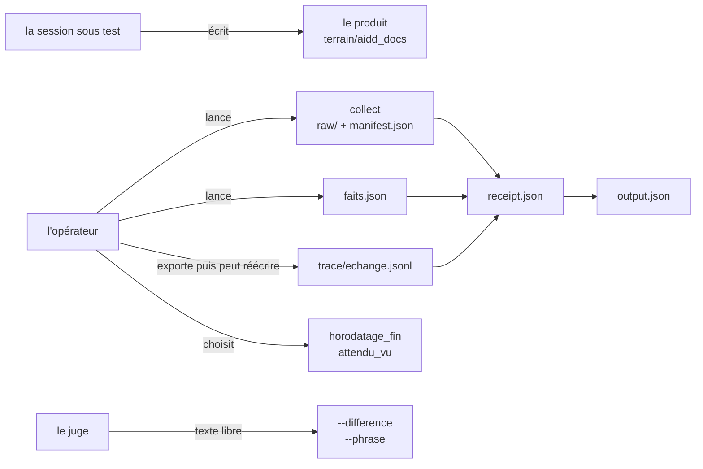

# Étude antagoniste du protocole de test

> 2026-10-17, né à 13:56:19 (`stat -c %w`). Étude demandée en adverse : on cherche ce qui casse, pas ce qui
> marche. Sept expériences ont été **exécutées** dans des clones sous `/tmp`, jamais dans les quatre arbres :
> `terrain` porte après l'étude la **même** `porcelain` qu'au gel du 2026-10-15 (`arbres[terrain]`) : **1 ligne**,
> `?? .freebuff/`, dossier daté du 2026-10-14 15:49, donc antérieur et inchangé. Les faits sur le code sont cités par ligne
> (`docs/device/harness/run.mjs`), les faits sur le protocole par paragraphe
> ([spec](../tasks/2026_10/2026-10-15-130103-run-par-session-operateur/2026-10-15-130103-spec.md)).

## En une page

**Le protocole ne prouve pas qu'une session a eu lieu. Il prouve que des pièces existent, se situent et se
ressemblent.** L'expérience A le montre : un produit écrit dans un clone, un `faits.json` tapé à la main, un
`echange.jsonl` de deux lignes inventées, et le reçu sort en `conforme`, `exit 0`, sans qu'aucun fil n'existe
dans aucune base. La condition 2 du §1 de la spec (« si un produit rendu pouvait avoir été écrit sans
qu'aucune session n'ait reçu la demande, la chaîne de preuve est insuffisante ») n'est donc **pas** remplie
par la chaîne telle qu'elle tourne.

| # | Expérience | Résultat | Ce qu'elle établit |
| --- | --- | --- | --- |
| A | trace inventée, `faits.json` à la main, aucun fil | `receipt` **`exit 0`**, `conforme` | la chaîne atteste un run sans session |
| B | idem, plus `memory/backlog.md` (falsificateur F4) | **`exit 0`**, `conforme` | F4 n'est pas implémenté |
| C | produit sous un chemin ignoré par git | **`exit 1`**, condition 3 mord | la condition 3 dépend d'un réglage de git |
| D | aucune trace exportée | **`exit 1`**, condition 2 mord | le trou de la pièce (1) interdit `conforme` |
| E | échanges hors de la fenêtre | **`exit 1`** | la fenêtre discrimine |
| F | copie sous `raw/` réécrite après collect (28 → 34 o) | **`exit 0`**, `conforme`, reçu cite l'ancien `sha256` | le reçu cite le manifeste, jamais la copie |
| G | copie sous `raw/` supprimée, manifeste gardé | **`exit 0`**, `conforme` | le produit cité n'existe plus |

Les loups sont dans la revendication, pas dans les détails : le reçu est un **fichier sur des fichiers**, et
la seule pièce qu'il ne peut pas recalculer, il ne la recalcule pas.

## 1. La promesse, et ce qui la rendrait fausse

La spec pose deux critères écrits avant le dispositif (§1) :

1. une personne qui n'a pas assisté au run peut répondre oui ou non à « le run a-t-il eu lieu ? » en
   désignant la pièce ;
2. si un produit pouvait avoir été écrit sans qu'aucune session n'ait reçu la demande, la chaîne est
   insuffisante.

Le premier critère est tenu : on désigne `receipt.json`, puis `trace/echange.jsonl`. Le second ne l'est pas,
et c'est mesuré (A), pas supposé. Ce n'est pas une contradiction avec ce que les ADR disent : l'ADR-024
écrit noir sur blanc que `receipt` « lit ses champs, pas leur vérité ». Ce que cette étude ajoute, c'est que
la phrase a une conséquence pratique : **un run entièrement fabriqué passe le reçu avec la mention
`conforme`**, et rien dans le reçu ne signale qu'aucune section de conversation n'existe.

## 2. Le modèle de menace, par qui peut écrire quoi

Ce que la figure dit et que le texte du protocole dit moins nettement : **presque tout ce que le reçu lit est
écrit par l'opérateur ou par un outil qu'il lance** : `faits.json`, l'export de la trace, le manifeste de
`collect`, la fin du run, `attendu_vu`, le témoignage, le verdict. Seule la naissance des fichiers vient du
disque, et le produit n'est pas ce que le reçu mesure : il mesure le manifeste qui le décrit.

## 3. Les sept expériences, une par une

Montage commun : un clone jetable du terrain au `HEAD` gelé, une copie du gel dont seul `arbres[travail]`
change de chemin, un produit écrit à la main sous `aidd_docs/memory/internal/bank.md`, `collect`, puis un
`faits.json` fabriqué et un `echange.jsonl` fabriqué. Aucun fil n'est ouvert, aucune base du client n'est lue.

### A. Une trace inventée suffit

`faits.json` nomme un fil `fil-invente-0001`, sa `trace.commande` contient `thread_id='fil-invente-0001'` et
`from messages`, la trace porte deux lignes JSON avec des `ts` dans la fenêtre. `receipt --verdict conforme`
rend **`exit 0`** et écrit `verdict: conforme`.

Le reçu n'a aucun moyen de distinguer cela d'un run réel : il ne lit jamais la base que `trace.source`
nomme pourtant en clair (`… (tables threads, messages)`), il ne rejoue pas la commande, il ne hache pas le
fichier. L'ADR-028 a fermé la porte « identifiant recopié » en le comparant à `trace.commande` : c'est un
contrôle **dans la pièce**, et la pièce est écrite par la même main.

### B. Un falsificateur nommé, non implémenté

Même montage, plus `aidd_docs/memory/backlog.md`. L'attendu du cas en fait le falsificateur F4 (l'opérateur
a dit « ne l'écris pas »). `receipt` rend **`exit 0`** et `conforme`.

`grep -c backlog docs/device/harness/run.mjs` rend **0**. Les falsificateurs que le reçu évalue sont quatre
(`run.mjs` 1002-1010) : naissance antérieure au gel, arbre inchangé, produit identique à une empreinte
antérieure, trace sans échange. F3, F4, F5, F8 et F9 existent dans `expected.json` et dans ARCHITECTURE §7,
et **aucun n'est lu par le harnais**. Un lecteur du reçu voit `falsificateurs: {...}` et peut croire que les
neuf y sont.

### C. La condition 3 mord sur un réglage de git

Même montage, une ligne `aidd_docs/` ajoutée à `.git/info/exclude` du clone. Le produit est réellement écrit,
la trace est cohérente ; `receipt` rend **`exit 1`** : « le produit existe et l'arbre de travail est
inchangé (§5, condition 3) ».

La condition 3 repose sur `git status --porcelain` ; un produit sous un chemin ignoré est invisible pour
elle. Avec `--verdict 'non concluant'`, le même reçu s'écrit (`exit 0`, produit **1** fichier, **1** limite) :
le run part en dossier comme douteux alors que rien ne cloche dedans. Pour ce cas, `terrain/.gitignore`
n'ignore pas `aidd_docs`, donc le risque n'est pas ouvert aujourd'hui.
Mais une session qui écrit `.gitignore` avant d'écrire le produit, ou un `.git/info/exclude` préparé par
l'opérateur, transforme un run valide en `non concluant`. C'est un **déni de verdict** à coût quasi nul.

### D et E. Ce qui marche : la fenêtre

Sans trace exportée, `receipt` refuse `conforme` : `trace_sans_echange_dans_la_fenetre` mord (0 échange).
Avec des échanges une heure avant la fenêtre, même refus. La condition 2 discrimine vraiment ; c'est la
partie la plus solide du reçu depuis l'ADR-029.

### F. La copie collectée n'est jamais remesurée

Après `collect`, la copie sous `raw/<cas>/memory/internal/bank.md` est réécrite (28 → 34 octets, `sha256`
différent). `receipt` rend **`exit 0`**, `conforme`, et cite dans `produit.fichiers` l'empreinte du
**manifeste** (`81a48bac…`, 28 octets) : un fichier qui n'existe plus sous cette forme.

### G. Le produit peut manquer entièrement

La copie entière est supprimée, seul `manifest.json` reste. `receipt` rend **`exit 0`**, `conforme`. Le reçu
cite `produit.chemins` dans `raw/…`, et ces chemins n'existent pas.

Ce n'est pas un détail de confort : le reçu est la pièce qu'un tiers lit six mois plus tard. Il affirme des
empreintes et des chemins qu'il n'a jamais vérifiés sur la copie qu'il nomme.

## 4. Les loups

### W1. Le reçu atteste des fichiers, jamais une session

A et B. La chaîne est **auto-suffisante** : tout ce qu'il faut pour produire un `conforme` est écrit par
l'opérateur. Le produit, lui, doit exister (un manifeste vide fait mordre « la session n'a rien produit »),
mais rien n'exige qu'une session l'ait écrit. Le §1 critère 2 tombe.

### W2. La copie brute n'est pas mesurée

F et G. `collect` calcule les `sha256` à la copie, `receipt` les recopie depuis le manifeste (1049-1052),
`compare` ne lit pas `raw/`. Personne ne re-hache `raw/` après `collect`.

### W3. Quatre falsificateurs ne sont lus nulle part, et F1 l'est autrement

B, plus la lecture de 1002-1010. Le reçu évalue quatre conditions ; **F8 y est** (manifeste vide, donc refus
« la session n'a rien produit »), mais **F3, F4, F5 et F9 ne sont lus nulle part** : chemins hors de la table
`Write to`, `backlog.md`, écriture hors du répertoire, accès à la révision sous test. Et F1 est implémenté
**autrement** que ce que l'attendu décrit : le reçu compare la naissance à `gele_le_epoch` (1003), quand F1
demande la naissance contre **l'horodatage du message qui porte le tableau**. Ce sont deux conditions
différentes : montrer avant d'écrire n'est pas gel avant écrire. Un run qui écrit d'abord et montre ensuite
passe la condition du reçu.

### W4. Le budget n'est mesuré nulle part

`grep -c budget docs/device/harness/run.mjs` rend **0**. Le cas fixe trois échanges ; une session qui en
prend trente produit un reçu identique. Le budget est une **consigne**, pas une mesure.

### W5. La porte n'est pas attestée, et le gel ne fixe pas la géométrie

`preflight` refuse les mauvais dossiers (banc 1-13, éprouvé). Mais le reçu ne porte **aucun champ** disant
que la porte est passée : pas d'heure, pas de `porcelain`, pas d'empreinte. Un run qui saute `preflight`
produit un reçu indiscernable.

Pire, en amont : `empreinteDeGel` (323-327) ne hache que les fichiers du cas et les références, **jamais
`arbres`**. Les sept expériences de cette étude ont modifié `arbres[travail]` sans re-geler, et **aucune n'a
été refusée pour cette raison** : `preflight` n'a pas été invoqué, et le reçu, qui ne hache pas `arbres`, ne
peut pas voir l'écart. C'est le prix assumé de l'ADR-019 (un cas portable), et il a une conséquence : « où le
run a eu lieu » est un champ que l'opérateur édite, pas une propriété que l'empreinte protège.

## 5. Les lièvres

| # | Lièvre | Mesure | Effet |
| --- | --- | --- | --- |
| L1 | la condition 3 dépend de `git`, pas du fait | C | un produit ignoré rend un run valide `non concluant`, et une session peut le provoquer |
| L2 | `attendu_vu` est une déclaration | `faits --attendu-vu` prend `oui` ou `non`, rien ne mesure une lecture sous `CASES/` | le cloisonnement, seule défense contre la contamination, repose sur la parole |
| L3 | le juge ne lit pas le produit | `compare` prend `--difference` et `--phrase` en texte libre, ne parcourt pas `raw/` | « le produit se juge tel qu'il est sorti » est une discipline humaine, pas un contrôle |
| L4 | la commande d'export n'est jamais comparée à l'exécutée | A : `faits.json` nomme une commande que rien ne rejoue | la provenance de la trace est déclarative ; le reçu la lit comme un texte |
| L5 | la trace n'est pas hachée | aucune occurrence de `sha256` sur `trace.chemin_exporte` | la pièce (1) peut être réécrite après le reçu sans que rien ne le dise |

## 6. Les zones d'ombre

Quatre questions que cette étude ne tranche pas, et qui ne se tranchent pas par du code :

1. **La collusion.** Un opérateur et un juge qui s'entendent produisent un dossier parfait. Le protocole
   sépare des contextes, jamais des intérêts ; la spec le dit (§8) et le dispositif ne peut pas le réparer.
2. **La base du client comme racine de confiance.** Même avec H2 (section 8), un faussaire qui écrit dans
   `desktop-v2.db` fabrique un fil cohérent. Le niveau de difficulté monte, la nature du problème ne change
   pas : la racine de confiance est un fichier de l'utilisateur.
3. **« Le tableau » n'est pas une forme.** F1 et F2 parlent du message qui porte le tableau ; aucune
   définition mécanique n'existe (lignes commençant par `|` ? au moins deux ? dans un message `assistant` ?).
   Tant que la forme n'est pas écrite, F1 restera une lecture humaine.
4. **Le même run ailleurs.** Un reçu porte des chemins absolus ; un tiers qui rejoue le cas sur une autre
   machine produit un autre dossier, et rien ne dit si c'est « le même run » ou un second. La question n'est
   pas posée par la spec, et le dispositif la contourne en gardant les runs sur une seule machine.

## 7. Ce qui tient, et qu'il ne faut pas casser

Il serait malhonnête de ne lever que des loups. Quatre mécanismes résistent à l'attaque :

- **le gel se re-hache et se contredit** (`verifierLeGel`, 335-380) : fichiers du cas et références re-hachés,
  empreinte recalculée et comparée à celle écrite ; réécrire les fichiers et l'empreinte ensemble ne suffit
  pas, puisque l'empreinte est la fonction des hachages. Éprouvé par le banc (12-13).
- **le produit vient de l'arbre gelé, ou il n'entre pas** (`collect` 602-700, `receipt` 969-1001) : sources
  résolues, hors espace refusé, manifeste relu au reçu. Une porte sautée est rattrapée par l'autre.
- **le reçu refuse de s'écraser**, `compare` refuse un gel dont l'empreinte a bougé depuis le reçu : un reçu
  reconstruit n'est pas un reçu.
- **la fenêtre discrimine** (D, E) : c'est peu, mais c'est mesuré, et l'ADR-029 a remplacé un falsificateur en
  dur par une lecture réelle.

## 8. Le plus petit durcissement, par gain décroissant

Rien de tout ceci n'est appliqué : la règle du dépôt veut une spec écrite avant le code.

| # | Geste | Ferme | Coût | Ne ferme pas |
| --- | --- | --- | --- | --- |
| H1 | `receipt` re-hache chaque fichier de `raw/<cas>/` et refuse si le `sha256` diffère du manifeste, ou si un fichier du manifeste manque | W2, F, G | ~15 lignes, aucun prérequis nouveau | une copie modifiée avant `collect` (mais c'est alors le produit) |
| H2 | `receipt` rejoue la commande d'export depuis la base nommée dans `trace.source` et compare le `sha256` du résultat au fichier | W1 en partie, L4, L5 | ~20 lignes, `sqlite3` déjà déclaré | une base du client falsifiée |
| H3 | `receipt` refait contre la base les contrôles de `faits` : fil présent, `project_path` = arbre `travail`, `execution_mode` local, pas de worktree, `created_at`, premier message | W1, et rend un `faits.json` écrit à la main inutilisable | ~25 lignes | un `faits.json` dont tous les champs sont vrais |
| H4 | le budget : compter les messages `user` du fil et refuser un dépassement | W4 | ~5 lignes, une fois H3 | un run qui respecte le budget et rate le reste |
| H5 | `preflight` écrit `gate.json` dans le dossier du run (heure, `HEAD`, `porcelain`, empreinte du gel) ; `receipt` refuse sans lui | W5 première moitié | ~20 lignes | une porte passée puis contournée |
| H6 | F1 pour de vrai : mesurer le `birth` des produits contre l'horodatage du **message qui porte le tableau**, et non contre le gel | W3, seconde moitié | demande d'abord une définition mécanique du tableau (zone d'ombre 3) | un tableau rendu après une écriture invisible dans la trace |

Ordre conseillé : **H1, H3, H4** (le plus de trous par ligne), puis H2, puis H5, puis H6 quand la forme du
tableau sera écrite.

## 9. Ce que cette étude ne prouve pas

- **Aucune session réelle** n'a été ouverte : les sept expériences montent les pièces à la main. Elles
  prouvent que le reçu accepte, pas qu'un opérateur le ferait ; la différence est de probabilité, pas de
  possibilité.
- **Aucun essai sur la base du client** : je n'ai pas fabriqué de fil dans `desktop-v2.db`, donc H2 et H3 ne
  sont pas chiffrés contre une base falsifiée.
- **Les clones modifient `arbres[travail]`**, ce qui est précisément W5 : les expériences utilisent le trou
  qu'elles dénoncent. C'est le montage du banc (contrôles 10-11) ; il ne fausse pas les résultats sur `raw/`
  ni sur la trace, mais il rend W5 incontournable pour quiconque veut monter un cas ailleurs.
- **Rien sur la qualité du skill testé** : le dispositif mesure l'ordre des gestes, jamais la justesse du
  texte ; cette étude ne dit rien du premier ni du second.
- **La preuve de non-écriture sur `terrain` est une comparaison, pas un zéro.** Un premier jet de cette étude
  annonçait « `porcelain` 0 ligne » : faux, mesuré au contrôle final du 2026-10-17. `terrain` porte 1 ligne
  (`?? .freebuff/`), la même que le gel du 2026-10-15 enregistre. L'étude n'a rien ajouté ; elle n'a pas non
  plus trouvé un arbre propre.

## 10. Rejouer

Le script est sous `/tmp/antagoniste.sh` et `/tmp/antagoniste2.sh`, hors du dépôt : ce sont des sondes, pas
des contrôles, et rien n'est ajouté au banc. Chacun crée ses clones sous `/tmp`, lance `collect`, écrit
`faits.json` et la trace à la main, puis `receipt`. Les dossiers `/tmp/ant-A` à `/tmp/ant-G` restent pour
inspection. `git -C /home/giak/projects/audio-sync-tool status --porcelain` rend **1 ligne** après l'étude,
`?? .freebuff/`, identique à ce que le gel du 2026-10-15 enregistre : rien de neuf, mais pas zéro.
