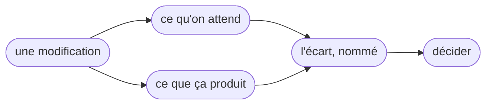
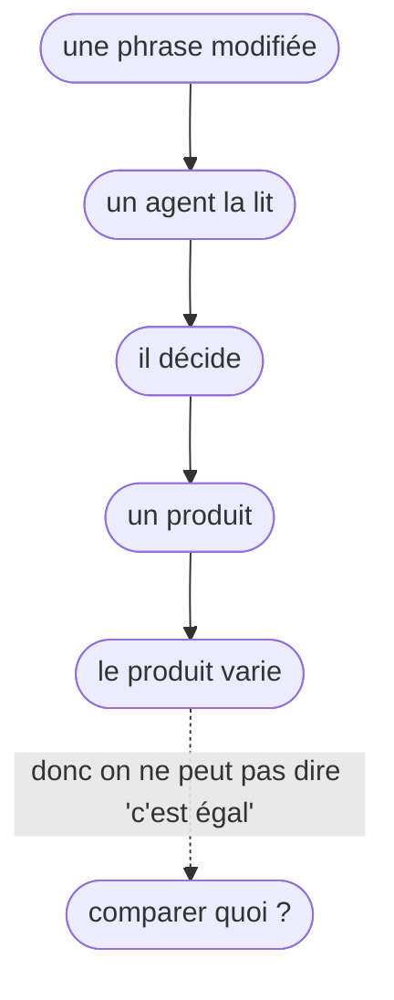

# MEGA-PROMPT — Prouver qu'une modification du framework AIDD fait ce qu'elle annonce

> **Ce que tu reçois** : le dépôt git du framework, ce document, et la machine sur laquelle tu
> tournes.
>
> **Ce qui n'est pas fourni avec** : aucun dispositif, aucun terrain préparé, aucun runner garanti,
> aucune clé, aucun crédit. Le dispositif, c'est toi qui le construis, et il est **versionné** :
> hors de ce dépôt, dans un dépôt git à lui (§5, §10). Le §6 dit comment **constater** le terrain,
> le §7 comment **constater** le runner et ce que tu rends quand il n'y en a pas.
>
> **Ce que ce document est** : un besoin, un contexte, des intentions, et **la forme de ce que tu
> rends** (§10). Il ne prescrit pas la mécanique du dispositif : cette partie est à toi. Il prescrit
> ce qui doit être mesuré, nommé et prouvé.
>
> **Ce que tu rends se lit à deux endroits.** Le dispositif et ses exécutions vivent chez lui, dans
> son propre dépôt (§10) ; le compte-rendu que lit la personne qui relit est **commité dans la pull
> request du framework** (§10, `ECART.md`). Un verdict qu'il faut aller chercher hors du dépôt n'a
> pas été rendu.
>
> **Deux règles de forme, non négociables.** (1) Toute affirmation que tu avances sur le dépôt porte
> **la commande qui l'établit**, ou la mention `SUPPOSÉ(<source>)`. Un chiffre recopié d'un
> document, d'un journal ou d'une mémoire est un `SUPPOSÉ`, même s'il y est écrit comme un fait.
> (2) Si tu penses qu'une annexe a tort, écris-le. Une annexe n'est pas une vérité.
>
> **Un mot, une chose.** Le **dispositif** est l'ensemble que tu construis, hors du dépôt, qui prend
> le framework pour objet sous test et nomme l'écart. Ce mot ne désigne rien d'autre : ni le harnais
> d'évaluation déjà présent dans le dépôt, ni un « protocole », ni un « moteur ». Un **cas** est un
> attendu écrit avant le run, un contexte de départ et un produit observé. Un **écart** est ces deux
> côtés, plus la différence, nommée. Un **contrôle négatif** est un cas dont on sait qu'il doit être
> signalé. L'**état A** est un état où un runner fonctionne ; l'**état B**, un état où aucun ne
> fonctionne (§7).

---

## 1. Le besoin

**Une personne modifie le framework. Elle veut savoir si sa modification fait ce qu'elle croit, et
elle veut le prouver à quelqu'un d'autre.**

Pas à un outil. Pas à une machine. **À une autre personne** — celle qui relira sa pull request et
qui n'a aucune raison de la croire sur parole.

C'est le besoin entier, et il tient en une phrase : **transformer une conviction privée en fait
partagé.** Avant, la personne sait ce qu'elle a voulu faire et ne peut pas le montrer. Après, elle
peut.



## 2. Ce qui rend le sujet difficile

Le framework n'est pas fait que de texte : il a **deux surfaces**, et elles ne se démontrent pas de
la même façon. Les mesurer avant de choisir pour laquelle on construit.

```text
find cli/src -type f | wc -l                                    → 400
git ls-files | grep -cE '^cli/tests/.*\.(test|spec)\.[tj]s$'    → 530
git ls-files 'cli/tests/fixtures/*' | wc -l                     → 320
git ls-files | grep -cE '^scripts/.*\.(test|spec)\.[tj]s$'      → 51
ls .github/workflows/*.yml | wc -l                              → 9
cd cli && npx vitest run --project=architecture                 → 26 fichiers, 140 tests
cd cli && npx vitest run --project=unit                         → 320 fichiers, 4 503 tests
find plugins -name '*.md' | wc -l                               → 458
find plugins -name '*.md' -exec cat {} + | wc -l                → 16 413 lignes
```

**Une surface est déjà outillée, et elle se démontre par des moyens ordinaires.** Le CLI se compile
(`tsup`, budget de bundle déclaré dans `cli-ci.yml`), 530 fichiers de test existent pour lui, la
suite est découpée en quatre projets (`unit`, `architecture`, `integration`, `e2e`, dans
`cli/vitest.workspace.ts`), seize commandes `test:mutation` sont déclarées dans `cli/package.json`
pour quinze périmètres dans `cli/mutation-scopes.json`. Une ligne de code cassée y est vue sans
modèle.

**L'autre surface n'a aucune de ces prises.** 458 fichiers markdown, 16 413 lignes, dont le sens
dépend de quelqu'un qui lit. Dire « rien n'est compilé » du dépôt est faux ; dire « aucune de ces
phrases n'est exécutée » reste vrai. Modifier une phrase, c'est modifier le comportement du lecteur,
donc ce qu'il produit.

Et sur cette seconde surface, ce qui est mesuré sans lire un skill comme un comportement porte sur
des formes, pas sur du sens : la structure des fichiers, leurs liens, les chemins qu'ils citent,
l'architecture des dossiers.

Les dix-huit contrôles du `pre-commit` sont déclarés dans `lefthook.yml`. Quatorze ne réécrivent
rien ; quatre sont des correcteurs qui modifient des fichiers (`summarize-plugin-catalogs`,
`summarize-telemetry-prompts-doc`, `sync-readme-counts`, `context-reference-form`). Les quatorze
premiers, lancés à la main le 2026-10-14 sur la révision `fe48de12`, donnent **douze verts et deux
rouges**, et les deux rouges ont **une seule cause** :

```text
node scripts/validate-json.mjs <json suivis, hors cli/tests/fixtures> → 84 fichiers, 0 erreur
node scripts/validate-yaml.mjs <yml suivis, hors assets>      → 23 fichiers, 0 erreur
node --test 'scripts/__tests__/**/*.test.js'                  → 548/549, « not ok 393 : the repository's own prose names no path that does not exist »
<51 SKILL.md> : name: et description: dans les 10 premières lignes → 0 manquant
node scripts/check-skill-argument-hints.mjs                   → 0 défaut
node scripts/check-architecture-rules.js                      → 350 fichiers gouvernés, aucune violation
node scripts/check-context-imports.js                         → 0
node scripts/check-referenced-paths.js                        → 3 chemins morts
node scripts/check-doc-duplication.js                         → 0 phrase dupliquée sur 48 fichiers
node scripts/check-markdown-links.js --ignore cli/tests/fixtures --ignore cli/aidd_docs/tasks → 0 lien cassé sur 796 fichiers
cd cli && pnpm lint                                           → biome : 1007 fichiers, 0 erreur, 1 avertissement
cd cli && pnpm test:arch                                      → 26 fichiers, 140 tests
cd cli && pnpm typecheck                                      → 0 erreur
node scripts/check-cli-type-honesty.mjs                       → 0
```

Les trois chemins morts sont `README.md:181` → `.kilo/kilo.jsonc`, `docs/ARCHITECTURE.md:105` →
`.aidd/config.json`, `docs/FAQ.md:70` → `.aidd/config.json` : le contrôle de liens les signale, et
le test `scripts/__tests__/check-referenced-paths.test.js:60` échoue sur la même liste. Un
dispositif qui ne saurait pas laquelle des deux surfaces une modification touche conclut sur la
mauvaise : les deux ne se démontrent pas de la même façon.

Ce qui reste est le sujet entier : **savoir si une promesse est vraie quand un modèle lit la
skill.** Aucun de ces moyens ne le dit.



Il y a un pont à construire entre deux mondes : **une intention exprimée en mots**, et **un effet
observable**.

### Les trois questions que ce pont doit trancher

Elles sont ouvertes, aucune n'a de réponse acquise, et le §11 exige que tu dises ce que tu en as
fait.

**L'attendu est écrit avant d'avoir vu le produit.** C'est la seule façon d'éviter que la personne
écrive l'attendu en fonction de ce qu'elle obtient, ce qui ne prouverait rien. Mais ce qui s'écrit
avant ne peut pas décrire précisément un résultat qu'on n'a pas encore vu. C'est une tension réelle,
pas une difficulté technique.

**Deux rôles, ou un seul.** Quelqu'un qui écrit l'attendu et quelqu'un qui juge le résultat ne
devraient pas être le même esprit : celui qui a fait le travail trouve que le travail est bon. Mais
« quelqu'un d'autre » veut dire une autre personne, ou la même exécutée deux fois dans deux contextes
séparés, ou un mécanisme. Le mot ne suffit pas.

**Un résultat qui varie n'est pas un résultat qu'on peut comparer.** « Le rapport contient trois
lacunes » est vérifiable même si la formulation change. « Le rapport est bon » ne l'est pas. Où passe
la frontière entre ce qui est testable et ce qui ne l'est pas, personne ne l'a tracée pour ce
framework.

## 3. À qui ça sert

**La personne qui modifie.** Elle écrit ce qu'elle attend, lance le dispositif, lit l'écart. Elle
doit pouvoir le faire sans apprendre un métier, et sans que ça prenne plus longtemps que sa
modification.

**La personne qui relit.** Elle lit l'écart et tranche. Elle doit comprendre en quelques minutes ce
qu'elle regarde, sans connaître le dispositif, et pouvoir le contester. Elle lit ce qui est commité
dans la pull request : elle ne clonera pas le dispositif pour se faire un avis, et elle a le droit
de ne pas y croire.

Ce sont les deux seuls utilisateurs. Si un élément du dispositif ne sert aucun des deux, il n'a pas
sa place.

## 4. Le contexte : ce que le framework est, et ce qu'il fait déjà

Le dépôt déclare lui-même son but, et ce n'est pas le nôtre :

> « Durable memory plus fixed workflows make **the same request produce comparable work twice**. »
> — la déclaration d'intention du dépôt, retrouvable par
>   `grep -rn "comparable work twice" --include='*.md' .`

Ce qui existe déjà, mesuré :

```text
find plugins -name SKILL.md | wc -l                              → 51 skills
find plugins -path '*/actions/*.md' | wc -l                      → 173 actions
grep -rl 'read its file in' plugins --include=SKILL.md | wc -l   → 27 skills
grep -rl '^argument-hint: text' plugins --include=SKILL.md | wc -l → 1 skill
node -e "const a=require('./scripts/skill-eval/cases.json');const r=Array.isArray(a)?a:a.cases;console.log(r.length,[...new Set(r.map(x=>x.skill))].length,r.filter(x=>x.expect&&x.expect.judge).length)"   → 11 4 5
```

- **27 skills sur 51** contiennent la phrase qui demande à l'agent de lire le fichier d'action avant
  d'agir. Une phrase est une mention, pas un comportement : rien ne l'y oblige, et c'est une
  convention de politesse, pas une garantie. Une part importante de l'intelligence du framework est
  écrite dans des fichiers que rien ne force à ouvrir.
- **1 skill sur 51** porte `argument-hint: text`, ce qui suggère qu'il ne produit pas un fichier mais
  une réponse en conversation. C'est une mention, encore une fois : la pièce 6 de l'annexe A4 dit ce
  qu'une mention vaut, et ce n'est pas une invocation. Si c'est vrai, cette skill n'a pas
  d'artefact à comparer.
- **11 cas** comportementaux existent, sur **4 skills sur 51**, dont **5 portent un critère de
  jugement**. Le vocabulaire du besoin est déjà dans ces données : un cas a un `setup`, un `prompt`,
  un `expect`. Il n'a jamais manqué de format.

Ce harnais a des défauts, dont un sérieux — un contrôle non fait compte comme un contrôle réussi.
**L'annexe A2 le décrit ; ne le recopie pas.** Cet existant est de la **matière et un objet
d'étude**, pas un moteur : le dispositif n'a pas le droit d'en dépendre (§5, « Il vit à côté, pas
dedans »).

## 5. Les intentions

Ce ne sont pas des critères d'évaluation. Ce sont les raisons pour lesquelles ce travail en vaut la
peine. Une solution qui les violerait serait une autre solution, pas une meilleure.

**L'écart est nommé, pas noté.** « Conforme / non conforme » ne suffit pas. Quel attendu, quel
produit, quelle différence. Quelqu'un doit pouvoir lire l'écart et dire « oui, c'est bien ça » ou
« non, tu as mal compris ».

**On doit pouvoir se tromper.** Quelqu'un doit pouvoir écrire un attendu faux, et le dispositif doit
pouvoir le montrer. Un dispositif qui ne se trompe jamais est un dispositif qui ne mesure rien. Le
contrôle négatif du §10 est là pour ça : il faut une casse dont on sait qu'elle doit sortir.

**La preuve doit être rejouable.** Une autre personne, sur la même pull request, doit pouvoir refaire
la même opération depuis le même point de départ, et retrouver soit le même écart, soit aucun écart,
ce qui est une information. Le §8 dit ce que cette promesse ne couvre pas : on rejoue un départ, pas
une réponse.

**La personne qui modifie garde la main.** C'est elle qui écrit ce qu'elle attend. Le dispositif ne
décide pas de ce qui est acceptable, il montre ce qui s'est passé.

**Ça doit marcher sans payer.** Ni clé, ni abonnement, ni service payant. Un dispositif qui coûte de
l'argent par exécution ne sera pas utilisé deux fois. Le §7 en fait une précondition mesurée, pas un
souhait.

**Ça doit marcher dans un vrai projet.** Pas sur un exemple de laboratoire. Le contexte change le
comportement : ce qui est vrai dans un bac à sable peut être faux dans un dépôt qui a de l'histoire,
des conventions, des fichiers du même nom.

**Il vit à côté, pas dedans, et il est versionné.** Le dispositif vit **hors de ce dépôt**, dans un
**dépôt git à lui** : un dossier nu à côté ne se rejoue par personne, et un dispositif que personne
ne peut récupérer ne rend aucune preuve. Sa révision fait partie de chaque exécution qu'il produit
(§10), et la commande qui le clone est dans son `DEVICE.md`. Il emprunte le moins possible au
framework. Il l'appelle comme **objet sous test** — une révision donnée, installée dans un endroit
jetable — et n'exige de lui **aucune modification**. Ni ses hooks, ni son harnais d'évaluation, ni
sa télémétrie, ni son vocabulaire, ni ses fichiers ne sont des pièces du dispositif.
Un dispositif qui doit modifier le framework pour le mesurer n'est plus un dispositif, c'est une
refonte : c'est exactement la fuite que décrit A2, qui a déposé 51 `SKILL.md` dans un dépôt qu'on ne
mesurait pas.

## 6. Le terrain

Un dispositif a besoin d'un endroit où s'exercer. Il **peut** en exister un, hors de ce dépôt : un
projet consommateur, dans un répertoire voisin.

**Constate-le, ne le suppose pas.** Au moment où un relevé a été fait, le projet voisin `/home/giak/projects/audio-sync-tool` portait :

```text
git -C /home/giak/projects/audio-sync-tool rev-parse --short HEAD   → 416ec1f
git -C /home/giak/projects/audio-sync-tool status --porcelain | wc -l → 0
git -C /home/giak/projects/audio-sync-tool ls-files | wc -l         → 307
git -C /home/giak/projects/audio-sync-tool ls-files | grep -cE '\.(ts|tsx|js|mjs|cjs|jsx|py|go|rs|java|rb|php|c|h|cpp|cs|swift|kt)$' → 153, dont 100 hors dossiers de test
```

Ce relevé est daté et porte sur un chemin qui n'existe pas forcément chez toi : au dernier relevé,
le même chemin sortait `1` en `--porcelain` au lieu de `0`, et ne portait aucun `SKILL.md`, aucun
`.aidd/`, aucun `.opencode/`. Une mesure périmée reste une mesure à refaire. **Si aucun projet
consommateur réel n'est présent, choisis-en un autre, écris pourquoi, et garde-le.** Ce qui ne se
remplace pas, c'est la contrainte de nature : un dépôt avec de l'histoire, des conventions et des
fichiers du même nom. Une fixture fabriquée pour le test ne la reproduit pas.

**La contrainte qui compte** : le même point de départ à chaque exécution. Pas forcément le même
résultat — impossible — mais le même **départ** : même révision du framework, même révision du
projet, mêmes fichiers. C'est ce départ que la rejouabilité du §5 couvre.

**Un avertissement qui n'est pas théorique.** Ce dépôt peut porter des traces de tentatives
antérieures. Ne les confonds pas avec des invariants du produit, et ne les recopie pas sans les
mesurer.

## 7. Le runner : une session d'opérateur, et ce que tu rends quand elle manque

**Le runner est une session ouverte par l'opérateur, pas un binaire à trouver.** C'est la décision
qui gouverne ce paragraphe. État mesuré un jour donné, sur une machine donnée, non remesuré depuis :

```text
claude -p "PONG"                        → « Not logged in · Please run /login »
opencode run --standalone --auto        → échec faute de modèle local
avec un modèle distant gratuit          → « TPM: Limit 8000, Requested 9168 » au démarrage, avant le prompt
```

Reprends ces trois lignes à ton compte, avec leurs commandes, avant de construire quoi que ce soit.
Elles ne sont pas là pour te faire renoncer : elles établissent qu'aucun runner sans interaction ne
répond ici, donc qu'il n'y a pas de commande à brancher. **Le runner, c'est la session que
l'opérateur ouvre** : elle reçoit la demande, lit le skill, et produit. L'indépendance des rôles ne
dépend donc d'aucune capacité de spawn — c'est l'opérateur qui ouvre, et c'est lui qui sépare
l'auteur de l'attendu du juge (§11, question 4).

**État A — une session d'opérateur est disponible.** Tu peux produire une démonstration qui a
tourné. Déclare avant de lancer : quelle session joue le runner et qui l'ouvre, **la demande exacte**
qui lui est remise (le texte, tel quel), la preuve que la session a répondu, le nombre de cas, le
nombre d'échanges que ça consomme, et où le produit brut de chaque cas est conservé. Un chiffre qui
décide de quelque chose se mesure avant la décision. Ce qui est rejouable est le **départ** : la même
demande remise à une autre session, ou à la même dans un contexte neuf. La réponse, elle, ne se
rejoue pas (§8).

**État B — aucune session d'opérateur n'est disponible.** C'est un résultat recevable, pas un échec,
et il n'autorise pas à inventer une sortie. Tu rends alors, en plus de ce qui ne dépend pas d'un
run : la précondition mesurée (la session demandée, qui devait l'ouvrir, et la réponse obtenue ou
son absence), la spécification de ce qui aurait été exécuté, et la liste de ce qui reste à faire
pour passer en état A. **Ne fabrique jamais un produit observé.**

Dis dans les deux cas lequel des deux états tu as atteint, et pourquoi.

## 8. Ce que le dispositif ne saura pas, et doit dire

Trois choses. Chacune doit apparaître dans la sortie du dispositif, **à l'endroit du rapport où
elle s'applique** (§10), pas dans une note de bas de page. Les écrire est une exigence, pas une
excuse. Le dernier paragraphe de ce chapitre n'est pas une quatrième limite : c'est ce que les trois
imposent à la forme de la phrase de verdict.

**Il ne sait pas si l'attendu était juste.** Quelqu'un peut écrire « cette lacune doit être classée
`blocker` » alors que `blocker` n'est pas la bonne sévérité. Le dispositif comparera, trouvera un
écart, et l'écart sera réel — mais il ne dira pas *qui* a tort. C'est la limite structurelle de
l'approche, et elle est irréductible : celui qui écrit l'attendu n'a pas le droit de voir le produit,
celui qui voit le produit ne peut pas dire si l'attendu était juste.

**Il ne sait pas si le produit observé vient du skill ou des circonstances.** Un skill peut produire
la bonne sortie pour une mauvaise raison. Un modèle différent peut produire une mauvaise sortie pour
la bonne raison.

**Il ne rejoue pas un échec.** On peut repartir du même point ; on ne peut pas rejouer la même
réponse. Un échec observé n'est pas archivé comme l'est un test dans un script classique.

**Ce que la phrase de verdict a le droit d'affirmer.** Ces trois limites ont une conséquence sur la
forme de la sortie, et elle est contraignante : la phrase de verdict (§10, `output.json`) énonce
qu'un produit observé **s'écarte ou non de l'attendu écrit**, et rien de plus. Elle ne dit ni que la
modification est fautive, ni que l'attendu était juste, ni que l'effet vient du skill plutôt que des
circonstances. « Au vu de l'attendu écrit, le produit fait X ; l'attendu disait Y » est une réponse ;
« la modification ne marche pas » n'en est pas une. C'est cette forme que lit la question 2 du §11 :
elle demande une comparaison, pas une attribution — l'attribution reste à la personne qui relit.

## 9. Ce qui a déjà été tenté, et ce qu'on en sait

Huit tentatives ont eu lieu avant ce document — `SUPPOSÉ(aidd_docs/MEGA-PROMPT-TEST-AIDD-journal.md)` :
ce chiffre vient d'un document, il n'est pas mesuré ici. Ce qu'elles ont produit n'a pas tenu, et
c'est dit dans l'annexe A sans enjoliver.

Ce qui en reste, et qui est peut-être le résultat le plus utile de tout ce travail : **le vocabulaire
du besoin existe déjà dans les données** (§4). Ce qui manquait était quelqu'un pour décider qui
écrit l'attente, et comment savoir qu'elle est juste.

Ce que ces tentatives ont coûté, et qu'il faut savoir avant d'en refaire une : **trois chiffres au
moins ont été produits faux puis réfutés**, et aucun ne l'a été par relecture. « Deux endroits où un
contrôle non fait passe pour un contrôle réussi » : il y a bien deux `ok: true, skipped: true`, mais
un seul peut changer un verdict. « 152 fichiers de code métier », à propos de
`/home/giak/projects/audio-sync-tool` (§6) : 153 fichiers portant une extension de code, dont 100
hors dossiers de test. « Onze travaux » de littérature : la liste en portait sept. Chaque fois,
c'est la commande qui a tranché.

Un journal plus long que ce document existe à côté de lui, là où il a été écrit. **Rien ici n'en
dépend** : ce qui suit est mesuré, ou porte la mention `SUPPOSÉ(<source>)`.

## 10. Le contrat de sortie

C'est la partie que ce document prescrit, et elle est aussi contraignante que les mesures. Ce que
tu rends vit à deux endroits, et les deux comptent autant : **le dispositif chez lui**, dans son
propre dépôt git, et **le compte-rendu dans la pull request du framework**, à l'emplacement où ce
dépôt range ses enregistrements de tâche. `git init` suffit si la personne qui relit travaille sur
la même machine ; pour toute autre, il faut un remote, ou l'archive des sources du dispositif
jointe à la pull request — sans quoi la question 1 du §11 se répond « non ».

**Ce que tu rends, avec sa forme :**

- **`DEVICE.md`** — le dispositif tenant sur une page : au plus 900 mots. Ce qu'il fait, ce qu'il ne
  fait pas, qui fait quoi, la commande exacte qui le lance, **la demande exacte remise à la session
  d'opérateur qui joue le runner** (§7) et ce qui en revient, et **la commande qui le clone**. La
  personne qui relit doit pouvoir lancer le dispositif et lire un écart sans avoir rien écrit, et
  la personne qui doute doit pouvoir récupérer la révision exacte qui a produit la sortie.
- **`BOUNDARY.md`** — la frontière : les chemins du framework que le dispositif lit, la révision
  qu'il installe, ceux qu'il ne lit pas, et la preuve écrite que **aucun fichier du dispositif
  n'appartient au framework** — ses propres `git ls-files` (le dispositif est un dépôt) confrontés à
  `git ls-files` du framework **en paires chemin + contenu** (`git ls-files -s`), l'intersection des
  paires vide. Ni le chemin seul ni le contenu seul ne décident : deux dépôts qui portent chacun leur
  `AGENTS.md` et leur `README.md` partagent ces deux chemins sans qu'aucun fichier appartienne à
  l'autre, et deux fichiers vides partagent leur contenu sans rien partager du tout — seule une paire
  identique est le même fichier, et elle vaut appartenance. Et que le framework n'a pas été modifié :
  `git -C <framework> status --porcelain` avant et après, identiques. Y figure aussi la révision du
  dispositif : `git -C <dispositif> rev-parse --short HEAD`.
- **`CASES/<cas>.expected.json`** — les attendus, écrits **avant** le premier run, et figés avant :
  identifiant, la demande faite au skill, le contexte de départ (révision du framework, révision du
  projet, fichiers), l'attendu en une phrase vérifiable, **et les attendus que tu as écartés comme
  non testables, avec le critère qui te l'a fait écarter**. Le figement est daté et vérifiable : le
  contenu de `CASES/` est commité ou haché avant que le premier run n'ait lieu, et le run enregistre
  cette empreinte. C'est la seule preuve possible du « écrit avant d'avoir vu le produit », et c'est
  ce que lit la question 3 du §11.
- **`runs/<horodatage>-<framework@rev>-<dispositif@rev>/output.json`** — le rapport d'écart, un
  objet par cas :
  `{ cas, attendu, produit_brut (chemin du fichier ou de la sortie conservée), difference (la
  différence nommée, en clair), verdict (conforme | écart | non concluant), limites (§8 : mord |
  ne mord pas | non évaluable), ecarte_comme_non_testable }`, et une **phrase de verdict** par
  exécution : ce que le dispositif conclut de la modification testée, en une phrase. Le nom du
  dossier porte les deux révisions, sans quoi la sortie ne dit pas ce qui l'a produite.
- **`NEGATIVE.md`** — le contrôle négatif : la casse volontaire que tu as introduite (une phrase de
  skill retournée, par exemple), le cas qui doit la signaler, la sortie brute qui la signale — ou la
  raison documentée pour laquelle ce contrôle ne peut pas être construit. **Une raison documentée
  n'est pas un contrôle fait** : elle se rend, elle s'écrit, et elle laisse la question 6 du §11 sans
  réponse — donc, en état A, le travail n'est pas fini. Un dispositif qui n'a jamais été vu en train
  de signaler une casse connue n'a rien prouvé.
- **`REFUSED.md`** — ce que tu as refusé de construire, et pourquoi. Aussi utile que le reste.
- **`LIMITS.md`** — les limites rencontrées, nommées, pas contournées en silence, et pour chaque
  trace de tentative antérieure trouvée dans le dépôt : lue ou non, réutilisée, étendue ou déclarée
  obsolète.
- **`ATTEMPT.md`** — en état B seulement : la précondition mesurée (la session demandée, qui devait
  l'ouvrir, la réponse obtenue ou son absence), ce qui aurait été exécuté, et ce qui manque pour
  passer en état A.

**Et, côté framework, dans la pull request — ce que lit la personne qui relit :**

- **`ECART.md`**, commité à l'emplacement où ce dépôt range ses enregistrements de tâche
  (`aidd_docs/tasks/<année_mois>/<date_slug>/`, à côté de `plan.md` et `validation.md`), avec les
  sorties brutes citées conservées à côté de lui. Il tient seul : la phrase de verdict, l'écart de
  chaque cas, les limites qui mordent, la preuve du contrôle négatif, la révision du framework, la
  révision du dispositif **et la commande qui le clone**, la commande qui refait le run, et ce qui
  n'a pas été fait. Contester doit être possible sans cloner quoi que ce soit.

**La forme que le dépôt impose à `ECART.md`** : les chemins cités s'écrivent en `backticks`, jamais
en lien markdown, et le fichier n'ajoute aucun lien. `check-markdown-links.js` parcourt tous les
`.md` hors liste fermée (`.git`, `node_modules`, `worktrees`, `.specstory`, `.stryker-tmp`,
`.e2e-build`) et n'honore pas `.gitignore` : un lien mort dans le compte-rendu fait tomber un
contrôle du framework. En revanche `check-referenced-paths.js` ne lit que `docs` et
`aidd_docs/memory`, et `check-doc-duplication.js` que `docs`, `aidd_docs/memory`, les README : un
compte-rendu rangé sous `aidd_docs/tasks` peut donc nommer des chemins qui n'existent que chez le
dispositif, et citer le présent document, sans faire rougir personne.

**Ce que la sortie ne fait jamais** : écrire un produit observé qui n'a pas été produit ; noter à la
place de nommer ; laisser un cas se déclarer vert alors qu'aucun contrôle n'a eu lieu ; faire passer
une raison documentée pour un contrôle fait. Si un contrôle n'a pas été fait, le verdict est `non
concluant`, et il compte comme tel.

## 11. Les questions de fin

Huit questions, et pour chacune, l'artefact qui la prouve. **En état A**, une seule réponse « non »
signifie que ce n'est pas fini, quoi qu'il soit dit sur une démonstration. **En état B**, les
questions qui supposent un run se répondent par « non, faute de runner », et c'est le résultat : le
compte-rendu se rend quand même.

1. **Quelqu'un qui n'a rien écrit du dispositif peut-il le récupérer, le faire tourner et lire
   l'écart ?** → `DEVICE.md` : la commande qui clone, la révision, la commande qui lance, et un run
   refait depuis zéro par quelqu'un d'autre, ou par toi dans un contexte neuf.
2. **La sortie répond-elle en une phrase à « cette modification fait-elle ce qu'elle annonce ? »**
   → `runs/*/output.json` : le champ de phrase de verdict de chaque exécution — une comparaison
   entre l'attendu écrit et le produit observé, jamais une attribution de faute (§8).
3. **Quel attendu a été écrit avant de voir le produit, et qu'est-ce qui le prouve ?**
   → `CASES/` et l'empreinte antérieure au premier run.
4. **Qui a joué l'auteur de l'attendu et qui a joué le juge, et quelle séparation a été réellement
   réalisée ?** → `DEVICE.md` : nomme-la, dis ce qu'elle achète, et si c'est la même personne dans
   deux contextes séparés, dis-le au lieu de le laisser deviner.
5. **Où as-tu tracé la frontière du testable, et quels attendus as-tu écartés ?**
   → `CASES/` : le champ des attendus écartés et le critère du refus.
6. **Le dispositif a-t-il signalé une casse volontaire, et comment le sait-on ?**
   → `NEGATIVE.md` et sa sortie brute ; une raison documentée à la place du contrôle laisse cette
   question sans réponse, et la réponse est alors « non ».
7. **Aucun fichier du dispositif n'appartient au framework, et le framework est-il intact ?**
   → `BOUNDARY.md` : l'intersection des paires chemin + contenu, vide, et les deux
   `git status --porcelain`.
8. **Le compte-rendu tient-il dans la pull request, et suffit-il à contester le verdict sans
   cloner le dispositif ?** → `ECART.md` commité, ses sorties brutes citées, et les deux révisions
   avec la commande de clonage. C'est la question que pose la personne qui relit ; les sept
   précédentes n'existent que pour elle.

Les trois questions du §2 se répondent là, et nulle part ailleurs : la **3** pour « l'attendu écrit
avant d'avoir vu le produit », la **4** pour « deux rôles, ou un seul », la **5** pour « où passe la
frontière du testable ». Une réponse qui ne renvoie à aucun artefact n'est pas une réponse.

---

## Annexe A — Matière

> **Rien de cette annexe n'est une consigne.** Ces chiffres ont été relevés un jour donné, sur une
> machine donnée. Ils servent à ne pas découvrir de travers ce qui est déjà connu, pas à décider.
> Aucun énoncé de cette annexe ne crée d'obligation : les obligations sont aux §6, §7, §10 et §11.

### A1 — La littérature, en une page

Sept travaux, lus dans leurs **résumés** — ce qui est une limite : un résumé peut sur-promettre.

- **Chronicle** (arXiv 2609.20625) : enregistrer une exécution à ses frontières non déterministes
  permet de la rejouer. Coût de l'enregistrement : 23 µs par franchissement, soit 0,008 % d'un appel
  modèle de 300 ms. Le rejeu complet n'appelle pas le modèle et est stable sur 20 répétitions.
- **Tests métamorphiques pour LLM** (arXiv 2511.02108) : 191 relations collectées pour des tâches de
  traitement du langage, 36 implémentées, ~560 000 tests. Présenté comme le moyen de lever le
  problème de l'oracle sans jeu de données étiqueté.
- **PROGRESS** (arXiv 2607.27359) : un oracle tiré du système sous test enregistre les défauts déjà
  présents comme comportement attendu. Le test par propriétés donne un oracle indépendant : 328
  défauts sur 562 détectés, contre aucun pour la génération de tests de régression.
- **Auto-vérification** (arXiv 2609.38812) : sur dix agents, la vérification est quasi universelle,
  mais **61,4 % seulement** des candidats incorrects sont détectés, et **49,4 %** des erreurs
  détectées sont réparées. La faiblesse est dans la détection, pas dans l'intention.
- **ArrivalBench** (arXiv 2610.02363) : une exécution unique certifie 86 à 100 % des pipelines ; la
  ré-exécution trouve **7 à 79 %** de ces pipelines **silencieusement faux**.
- **Fiabilité d'un juge** (arXiv 2602.00521) : calibrer un juge se fait sur deux dimensions — la
  cohérence quand on change le prompt, et l'alignement sur un jugement humain.
- **FlakyGuard** (arXiv 2511.14002) : 47,6 % des tests instables réparés automatiquement, 51,8 % des
  correctifs acceptés par des développeurs.

**Le point commun** : « ça a marché une fois » ne prouve rien, et « on a réparé jusqu'à ce que ça
passe » ne prouve rien non plus.

### A2 — L'existant, et ses défauts

Le harnais du §4 vit dans `scripts/skill-eval.mjs`, avec ses cas dans
`scripts/skill-eval/cases.json`. Sa forme : `setup` (le projet jetable), `prompt` (la demande),
`expect` (l'attendu, avec des assertions de fichier, de contenu, ou de sortie standard).

Trois défauts vérifiés dans le code :

1. **Un contrôle non fait compte comme un contrôle réussi.** Cinq cas sur onze portent un critère de
   jugement ; sans `--judge`, ils sortent verts dès que leurs autres assertions passent. C'est le
   pire défaut possible : il est invisible, et il est dans le code, pas dans la documentation.

   ```text
   grep -n 'skipped: true' scripts/skill-eval.mjs   => l.100 et l.153
   ```

   Seule **l.100** peut changer un verdict. **l.153** est poussé à l'intérieur de `if (broke)`
   (`l.151`), quand le cas est déjà rouge, et les agrégats sont `checks.some((k) => !k.ok)`
   (`l.150` par cas, `l.181` pour le total) : cette ligne ne peut pas rendre un cas vert. Un
   emplacement, pas deux.

2. **Le juge ne reçoit que la sortie brute du programme.** `scripts/skill-eval.mjs:102` :
   `evidence = [ctx.stdout, ...(expect.judgeFiles || []).map((n) => fileText(n) || "")].join("\n\n")`.
   Ni le projet de départ (`setup.files`), ni les références de la skill, ni le fichier produit :
   dans quatre des cinq cas jugés, `judgeFiles` est absent ou vide, donc le juge ne reçoit que
   `stdout`. Il tranche une question de qualité sans les textes qui en portent les critères. Les
   références absentes du juge vont de 891 à 14 765 octets selon le cas — pour `03-shadow-areas`,
   la rubrique de sévérité seule pèse 3 432 des 9 848 octets de références.

3. **Rien ne garde la copie jetable, et le résolveur de racine lit `$PWD` avant `cwd`.** Le harnais
   écrit dans un dossier temporaire et n'exige rien de la suite : aucun `git status --porcelain`
   avant et après. Un second mécanisme, hors du harnais, est dans le CLI :
   `cli/src/runtime/project-root/project-root.ts:3-7` rend `$PWD` quand il diffère de
   `process.cwd()` et que ce chemin existe. **Mais il n'est branché que sur le menu interactif** :
   `grep -rn "resolveProjectRoot()" cli/src` ne renvoie que sa définition
   (`project-root.ts:3`) et **un seul appel**, `cli/src/presentation/commands/menu.ts:35`,
   tandis qu'`aidd setup` passe par `parseGlobalOptions`
   (`cli/src/presentation/commands/global-options.ts:17`, `projectRoot: process.cwd()`) comme les
   autres sous-commandes et l'entrée du CLI (`cli.ts:59`, `cli.ts:82`). `aidd setup` installe donc
   dans le **répertoire courant du shell**, pas dans le `$PWD` du shell : la cible est prévisible, et
   `$PWD` ne mord que sur le menu lancé sans sous-commande. Une version antérieure de ce document
   affirmait l'inverse ; la commande ci-dessus la réfute, et
   `git log --oneline 016feafb..HEAD -- cli/src/presentation/commands/setup.ts cli/src/runtime/project-root/project-root.ts`
   ne montre aucun changement depuis la session où l'observation a été faite. Effet observé une fois,
   non remesuré ici et **de cause non établie** : 51 `SKILL.md`, `.aidd/`, `.opencode/`,
   `opencode.json` et deux lignes de `.gitignore` déposés dans un dépôt voisin qu'on ne mesurait
   pas. Ce que ça impose n'est donc pas « méfie-toi de `$PWD` », mais : **connaître le `cwd` exact de
   chaque installation, et relever `git status --porcelain` avant et après dans l'arbre visé.**

**Ce qu'il fait bien** : un runner absent ne produit pas de faux vert, et le taux de réussite est
affiché comme un taux, pas comme un verdict.

### A3 — Sept pistes

Sept pistes ont été envisagées. **Une piste n'est pas un choix** : aucun classement n'est proposé
ici, et l'ordre de cette liste ne porte aucun ordre de préférence.

1. **Assertions de contrat** — comparer le produit à un contrat (chemin, section, champ obligatoire)
   plutôt qu'à un texte. Déterministe, coût nul.
2. **Propriétés métamorphiques** — l'attendu est une propriété du produit, pas une valeur. Détecte
   une vraie casse, et coûte une injection par cas.
3. **Taux sur N exécutions** — ce qui varie n'est pas testable. Tranche le stock sans effort humain.
4. **Calibration du juge** — sortie connue bonne, sortie connue mauvaise ; s'il se trompe, il ne
   compte pas.
5. **Séparation de l'auteur et de l'exécutant** — celui qui formule l'attendu ne voit pas le produit.
6. **Le contributeur comme oracle** — on ne mesure pas la qualité d'un skill, mais l'entente entre
   l'auteur et l'exécution.
7. **Ne rien automatiser** — le contributeur décrit, un agent exécute, un humain compare.

Trois jugements ont été faits pour préférer les unes aux autres, dans une version antérieure de ce
document. Ils peuvent être faux, et ils sont donnés ici pour ça :

- *« une injection par cas » est acceptable* — si on ne modifie qu'un skill à la fois, le coût ne se
  voit pas ; le reproche « trop lourd » vise le stock entier, pas l'usage réel.
- *« trois exécutions suffisent à trancher le stock »* — une skill instable peut être parfaitement
  correcte et simplement bavarde. C'est une heuristique.
- *« l'oracle à deux entrées tient »* — suppose que le contributeur sache écrire un attendu
  discriminant. **Rien ne le démontre.**

### A4 — Sept pièges déjà payés

1. Observer une fois ne sert à rien au moment où l'on modifie : sans rejouabilité, le dispositif ne
   sert qu'à son propre jour.
2. Une tâche trop facile ne prouve rien, une tâche trop bruitée ne prouve rien non plus.
3. Un contrôle qui réussit sans avoir rien mesuré est le piège le plus rentable.
4. Un journal de conversation perd des tours et ne distingue pas une invocation d'une citation.
5. L'observateur et le juge ne sont pas la même chose ; quand ils le sont, le plafond baisse.
6. Mesurer des mentions n'est pas mesurer des invocations.
7. Un seuil écrit d'avance est une devinette ; une variance non mesurée ne justifie aucun seuil.

Et la règle qui les résume : **un chiffre qui décide de quelque chose se mesure avant la décision,
pas après.**

### A5 — Ce que l'héritage peut contenir

Le dépôt peut porter des traces de tentatives antérieures : dossiers de travail, harnais, campagnes.
Elles ne sont pas des modes d'emploi, et aucune posture n'est imposée ici : les ignorer, les lire
pour décider, ou les lire et copier sont trois façons de faire. Le §10 demande seulement, pour
chaque trace trouvée, ce que tu en as fait. Mesure ce qu'elles affirment avant de t'en servir :
celles qui ont produit ce document portaient au moins un chiffre périmé et au moins un résultat
annoncé comme réussi sans avoir été exécuté — le §9 en nomme trois, avec leur réfutation.

---

Bonne chasse. Si tu trouves une voie que ces sept pistes n'ont pas envisagée, c'est exactement ce
qu'on attend.
