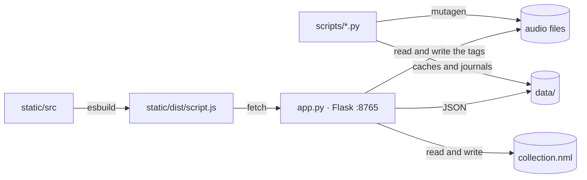

# Architecture

The macro technical shape: the stack, how the pieces fit, and the decisions behind them. Point to the code, do not restate it.

## Stack

- Python 3.12 + Flask: the backend, one file (`app.py`), JSON in and out.
- Vanilla TypeScript, no framework. esbuild bundles `static/src/script.ts` into a single `static/dist/script.js`; `build.js` owns the entry point and esbuild follows the imports from there.
- `wavesurfer.js` is the only runtime npm dependency, for the cue editor waveform. Everything else in `package.json` is dev tooling.
- `mutagen` for the tags, `ffmpeg` to decode for the server-side beat analysis (the `wave` stdlib covers `.wav` alone).

## How it fits together

The frontend never touches the filesystem: it asks the backend, and the backend owns the disk.

## Key decisions

- **No frontend framework** (EPIC-036, decided on measurement): the verdict was taken after a perf study, because a framework fights the pixel-level control the keyboard-first UX needs.
- **CSS in layers, and the import order is the cascade.** `static/styles/pages/index.css` aggregates the `@import`s; reordering them changes the cascade. Tokens live only in `tokens.css`, cross-page families in `components.css`, a page's own rules in `static/styles/pages/<page>.css`.
- **Keyboard bindings live in the code, never in the HTML.** `static/src/commands/*.ts` declare them with a `label` and a `group`; the `?` legend is generated from them and a bijection test fails the build if a labelled shortcut does not exist or an existing one is unlabelled. Edit the commands, never `templates/index.html`.
- **Tag writes go through one journal, and it is the only undo.** `data/year_apply_journal.jsonl` and `data/style_apply_journal.jsonl` are shared by the palette routes and by `apply_years.py` / `apply_styles.py`, so `--undo` on the script cancels a write made from the browser.
- **The disk is the authority.** Before writing a tag the file is re-read, and an existing value is never overwritten. The route that writes also patches the scan index, so the screen never shows the value from before the write.
- **A year is written only when two independent providers agree.** A single source, or a source contradicting the others, goes to human review, and the human's export overrides the consolidation.
- **A remix must name its remixer.** The first parenthesised segment that names someone is the credit; without it no year is proposed, because the original's year would otherwise land on the remix.
- **Never delete audio.** Everything that leaves Source Data is moved to `<source>/_trash/<date>/`.
- **Core helpers are extracted only against a demonstrated duplication.** A module under `static/src/core/` exists only if it replaces at least two written implementations, with the tests green before and after; every new module goes through an EPIC.

## Gotchas

- **`app.py` is a 2 350-line monolith with 33 routes** (scan, copy, tags, NML, playlists, beatgrid). EPIC-055 plans the split into blueprints; until then a route change lands in a very large file.
- **The template is not the bundle.** Flask compiles `templates/index.html` at load, with debug off: after editing the template, restart the app. The JS and the CSS reload on a refresh alone, served with an mtime cache-buster.
- **`npm run build` is mandatory before any measurement in the browser** — a harness launched without a rebuild measures the previous bundle.
- **Destination paths are built without normalisation.** A root that ends with `/` gives `…/style//techno_1990` on purpose: normalising breaks the index patch, the reveal and the twin exclusion.
- **The Escape stack has an order**: context menu → modal → filter → expanded folder → audio. It is an explicit, tested pile, not a fallback chain.
- **In the TypeScript sources the imports carry the `.js` extension** (NodeNext), even when the file is `.ts`. The same goes for `vi.mock('./api.js', …)` on `api.ts`.
- **The suite must survive a random order.** Two files were flaky because `state.filters` was not reset between tests; that is why CI runs the shuffled suite and three fixed seeds.
- **`.wma` is not read** by `get_audio_meta`, so it is excluded from the years pipeline.
- **A scroll container keeps `padding-top: 0`.** The spacing of a sticky header lives inside the painted background of the sticky element itself, or the rows paint over it.
