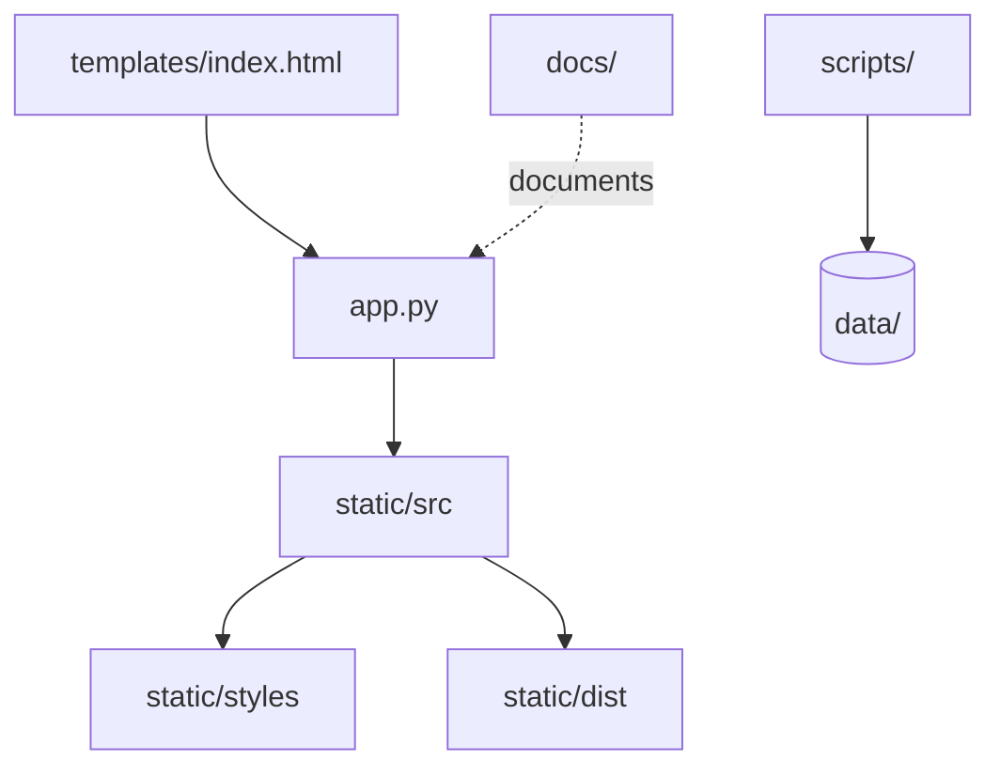

# Codebase Map

The macro layout: the top-level areas and what each holds. A map to navigate, not the full tree.

## Areas

- `app.py`: the Flask server — routes, scan, copy, tag writing, NML, playlists, beatgrid. One file, 2 350 lines.
- `analysis.py`: the server-side kick and phase detection, pure Python DSP.
- `nml.py`: reading and writing Traktor's `collection.nml` — index, match, add, export, beatgrid.
- `templates/index.html`: the whole UI skeleton — pages, modals, toolbar. Static sections are adopted by their title when the template is older than the bundle, never erased.
- `static/src/`: the frontend, TypeScript. `commands/` (the keyboard registry), `render/` (one component factory per page), `core/` (the shared helpers), and the domain modules (styles, duplicate detection, filters).
- `static/styles/`: CSS in layers — `tokens.css`, `base.css`, `components.css`, `pages/`, aggregated by `pages/index.css`.
- `static/dist/`: the esbuild output. Gitignored, a build artefact, never edited.
- `scripts/`: the Python tooling — year collection, consolidation, tag application, and the headless proof harnesses that settle UI questions by measuring a real browser.
- `data/`: the user's runtime state. Gitignored, and never touched without an explicit request (see `database.md`).
- `docs/superpowers/`: specs, plans, reports and the EPIC register — the traceability trail of every change.
- `test_*.py` at the root: the backend suite. The frontend tests are co-located in `static/src/`.
- `AGENT.md`: the project's own rulebook (data safety, surgery rules, work rules). Read it before touching anything.

## Entry points

- `app.py` serves the app on port 8765 and renders `templates/index.html`.
- `static/src/script.ts` is the frontend entry point; `build.js` bundles it. The import order of the command modules in `script.ts` is the keyboard matrix order — it matters.
- `npm start` kills the port, rebuilds and launches Flask.
