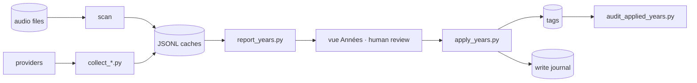

# Data

The data and ML side: sources, pipelines, and models.

## Sources

- The corpus is the user's collection: the audio files themselves, scanned for their path, year, duration, codec and genre.
- The years come from the external providers, cached in `data/*.jsonl`, one line per key (`artiste\ttitre`).

## Pipeline

## Models

- There is no trained model. The decision rules are the model: two independent providers must agree before a year is written, a provider has to name the remixeur, and the release date of an album is never taken for the year of the first release.
- The style suggestion is a weighted score over four signals — the path segment of the épars, the artist neighbourhood in the source, the session history of the sub-folder, the aliased ID3 genre — kept when the confidence reaches 0.30.

## Reproducibility

- The caches are the record of what was queried: incremental, resumable, never re-queried. A key that returned `none` is kept, and can be re-thrown on demand.
- Every write is journalled before it happens, in `data/year_apply_journal.jsonl`. `--undo` restores exactly the frames that were written, and the same journal is written by the palette route, so the script undoes the browser too.
- A dry run is the default; `--apply` is the deliberate switch.
