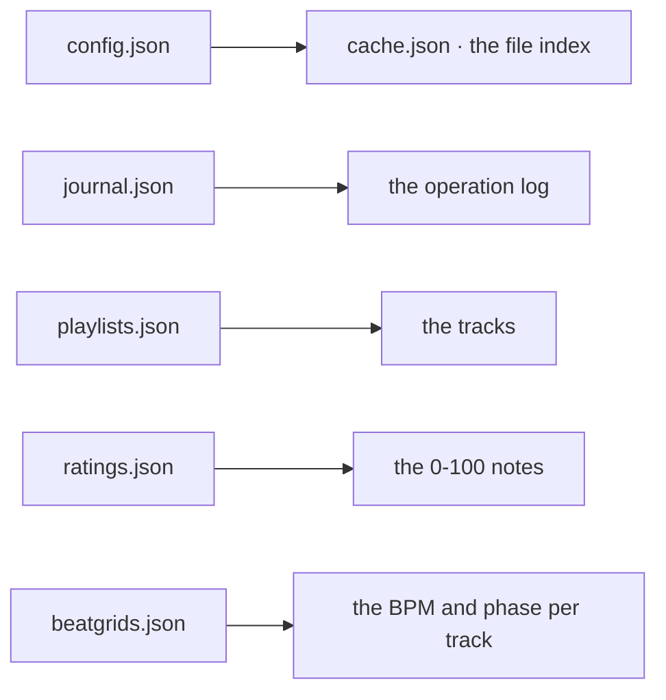

# Database

The data store: its type, the main entities, and the conventions. The macro model, not the full schema.

## Setup

- No database server and no ORM: the state is JSON under `data/` (gitignored), written by `app.py` itself. `load_json` and `save_json` in `app.py` are the whole data layer.
- The writes are atomic (temporary file, then replace), and a corrupt file falls back to the default and journals the incident instead of answering a 500.

## Main entities

- `config.json` holds the profiles: the `source_data` root and the `epars_dirs`, plus the index of the active profile.
- `cache.json` is the scan index, keyed by file name, with the year, duration, codec and genre of each file.
- `journal.json` is append-only: a timestamp, an action, a detail and a status (`copied`, `moved`, `moved-to-trash`, `deleted`, `scan`, `config`).
- The year caches (`*.jsonl`), the write journals (`*_apply_journal.jsonl`), `year_review.json` and `year_audit.json` live in the same folder, and are described in `data.md`.

## Conventions

- No migration tool and no schema: the shape is the code. Adding a field means updating the reader and the writer together, and every read is defensive (`load_json(path, default)`).
- `data/` belongs to the user, not to the project. It is never deleted and never overwritten without an explicit confirmation; `AGENT.md` %DATA-SAFETY lists the files that need one.
- A path change in the configuration invalidates the scan cache, which is rebuilt on the next scan.
