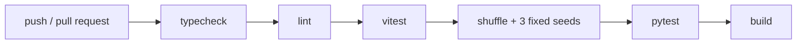

# Deployment

Where the project runs and how it ships: CI/CD, environments, and release.

## Pipeline

- GitHub Actions, one workflow: `.github/workflows/ci.yml`. It runs on push and on pull request against `main`, and can be dispatched by hand.
- There is no deploy step: the app is a local tool. The job is a gate, not a delivery.

## Environments

- One: the developer's machine. `npm start` kills whatever holds port 8765, rebuilds the bundle and launches Flask, which answers on `http://localhost:8765`.
- The backend and the frontend are the same process: Flask renders `templates/index.html` and serves the bundled assets.

## Release

- Nothing is packaged and nothing is published. A release is a git tag on `main`.
- There is no rollback procedure for the collection, and there does not need to be one: a removal is a move to `_trash/`, never a deletion.
