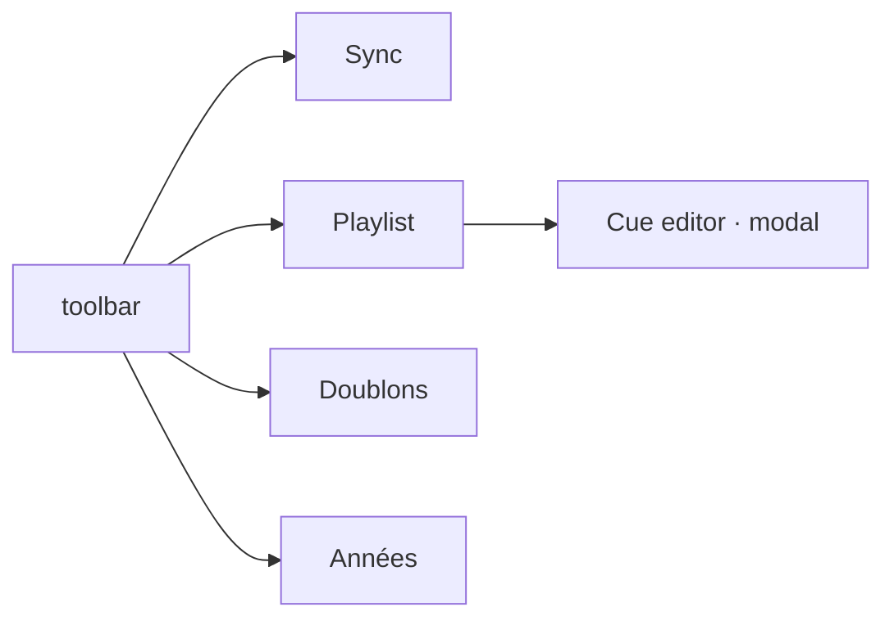

# Navigation

How the user moves through the app: routing and the page structure.

## Routing

- One client router, `static/src/router.ts`: `state.page` is `sync | playlist | dups | years`, and `goPage()` is the only thing that changes it. `playlistMode` is derived from the page, never set on its own.
- The four layouts are mutually exclusive: a page shows its layout and hides the others, and one toolbar button carries `.active` at a time.
- The cue editor is not a page: it is a modal opened from a playlist row.
- Every key binding is scoped by context — page, active panel, playlist focus, active modal, filter input focused, context menu open — and the registry resolves the first matching binding.
- The Escape stack is explicit and tested: context menu → modal → filter → expanded folder → audio. A modal dialogue blocks everything below it, and the context menu is a state of its own rather than a modal.

## Structure

