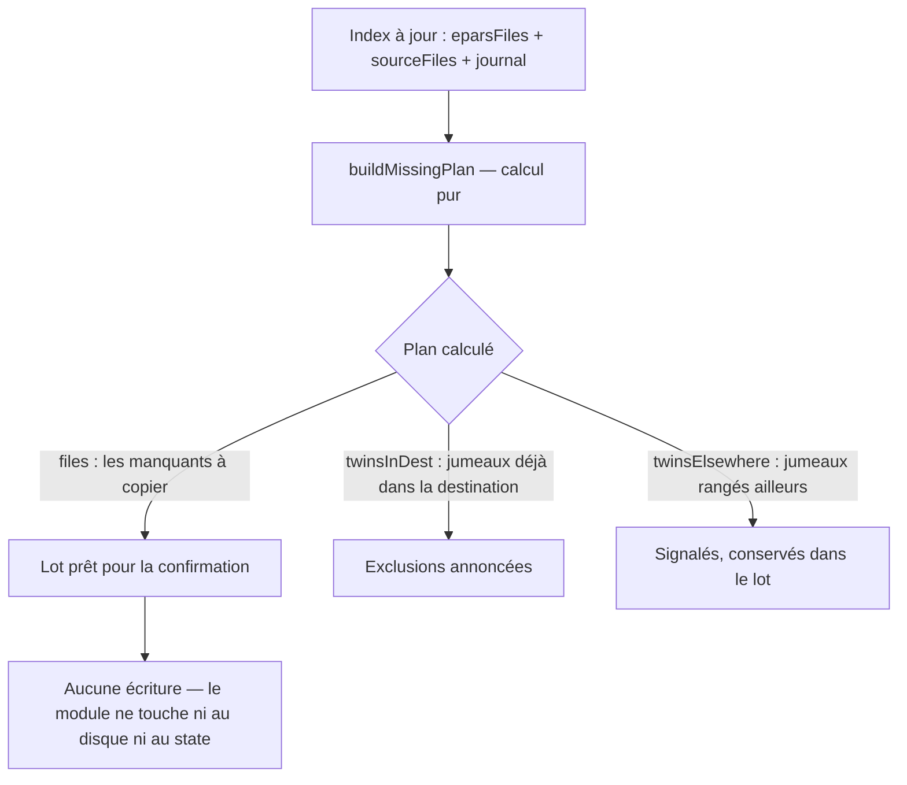
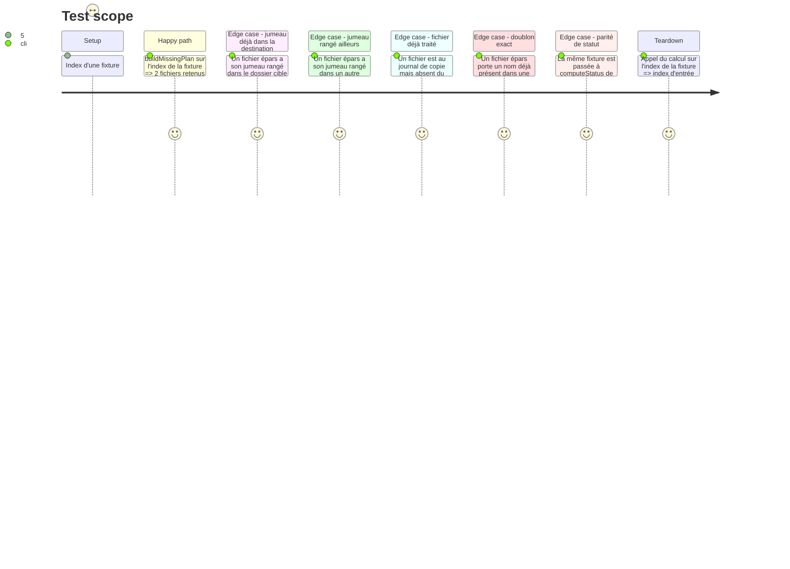

# Instruction: Domaine pur des fichiers manquants

## Architecture projection

> Tree of the final files. ✅ create · ✏️ modify · ❌ delete

```txt
.
└── static/src/
    ├── missing.ts        ✅ create — sélection pure des fichiers manquants + exclusions du lot
    └── missing.test.ts   ✅ create — tests unitaires (vitest) de la sélection et de ses exclusions
```

## User Journey



## Test Scope



## Tasks to do

### `1)` Créer `static/src/missing.ts`

> Une fonction pure qui répond à « quels fichiers manquent, lesquels sont exclus du lot, lesquels sont à
> signaler » — sans DOM, sans `state`, sans disque.

1. Types : `MissingFile { filename: string; eparDir: string; fullpath: string }` et
   `MissingPlan { files: MissingFile[]; twinsInDest: string[]; twinsElsewhere: string[] }`.
2. `buildMissingPlan(eparsFiles, sourceFiles, journal, dupMatches, destDir): MissingPlan`
   — tous les paramètres sont reçus en argument (pas d'import de `state`) :
   - pré-calculer une **seule fois** le journal (`getJournalFiles(journal)` de `utils.ts`) et l'ensemble des
     noms présents dans les racines source ;
   - pour chaque dossier épars et chaque fichier, Statut = `doublon` si le nom est dans les racines source,
     `traite` si le nom est dans le journal, `nouveau` sinon — **ordre de priorité identique à
     `computeStatus`** (`utils.ts`) ; ne garder que `nouveau` ;
   - `fullpath = `${eparDir}/${relPath}`` ;
   - jumeau = `dupMatches.get(fullpath)?.sourceFullPath` : s'il commence par `${destDir}/` → `twinsInDest`
     (**exclu** du lot) ; sinon s'il existe → `twinsElsewhere` (**conservé**, à signaler) ;
   - trier `files` par `(eparDir, filename)` — résultat déterministe, indispensable aux tests.
3. `countMissingFiles(eparsFiles, sourceFiles, journal): number` — même statut `nouveau`, sans les exclusions
   (le label du bouton annonce la taille du lot **index entier**, pas la vue filtrée).
4. Ne jamais muter les structures reçues ; ne jamais écrire dans `state`.

### `2)` Créer `static/src/missing.test.ts`

> Les cas qui décident du contenu du lot — la fixture est écrite à la main, pas générée.

1. Cas nominal : 5 fichiers épars → 2 sont absents de la source et du journal → `files` contient ces 2,
   dans l'ordre `(eparDir, filename)`, avec `fullpath` = `eparDir/relPath`.
2. Doublon exact (nom déjà dans une racine source) → hors lot.
3. Traité (au journal, absent de la source) → hors lot.
4. Jumeau dans le dossier cible → absent de `files`, présent dans `twinsInDest`.
5. Jumeau dans un autre dossier de la source → présent dans `files`, présent dans `twinsElsewhere`.
6. Déterminisme : deux appels successifs sur le même index rendent un résultat identique (égalité des tableaux).
7. Non-mutation : l'objet `eparsFiles` de la fixture est identique avant et après l'appel (comparaison
   structurelle sur `JSON.stringify`).
8. Test de **parité** : pour chaque fichier d'une seconde fixture, le statut calculé par `missing.ts`
   est identique à celui de `computeStatus` (`utils.ts`) — le module ne peut pas diverger du statut officiel.
9. `countMissingFiles` renvoie le nombre de `nouveau` de l'index, filtre ignoré (fixture avec un fichier
   « filtré » conceptuel : le compte ne dépend d'aucun filtre).

## Test acceptance criteria

| Task | Acceptance criteria                                                                                                                                 |
| ---- | --------------------------------------------------------------------------------------------------------------------------------------------------- |
| 1    | `buildMissingPlan` ne lit ni le DOM ni `state` : les entrées sont des arguments, l'appel est déterministe et ne mute aucune entrée                |
| 1    | Un fichier dont le jumeau est rangé dans le dossier cible n'apparaît jamais dans `files`                                                                  |
| 1    | Un fichier dont le jumeau est rangé ailleurs reste dans `files` et apparaît dans `twinsElsewhere`                                                          |
| 1    | Le statut retenu par `missing.ts` est identique à celui de `computeStatus` sur la fixture de parité                                                      |
| 2    | La suite `npx vitest run static/src/missing.test.ts` passe ; `npx vitest run` complet reste vert (aucune régression)                                    |
| 2    | `countMissingFiles` renvoie le nombre de fichiers `nouveau` de l'index, indépendamment de tout filtre                                                      |
