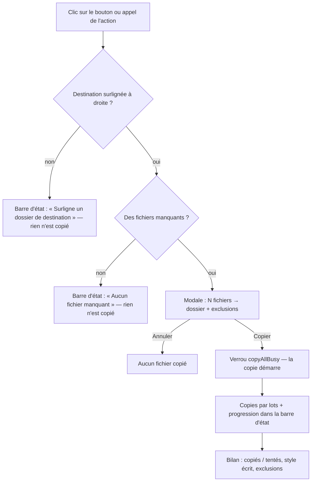
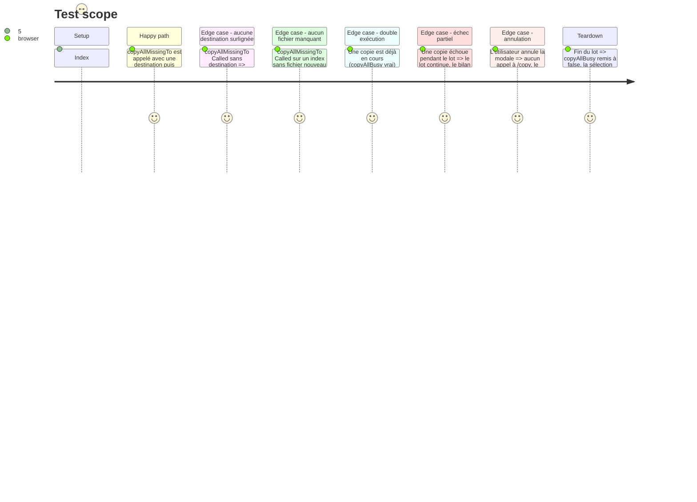

# Instruction: Action de lot confirmée (copie, verrou, progression)

## Architecture projection

> Tree of the final files. ✅ create · ✏️ modify · ❌ delete

```txt
.
└── static/src/
    ├── actions.ts        ✏️ modify — focusedSourceDir() + copyAllMissingTo() : plan, confirmation, copies, verrou, progression
    ├── state.ts          ✏️ modify — copyAllBusy : verrou anti double-exécution (même grammaire que replaceBusy)
    └── actions.test.ts   ✏️ modify — tests de l'action (modale, verrou, bilan, échec partiel)
```

## User Journey



## Test Scope



## Tasks to do

### `1)` `static/src/state.ts` — verrou anti double-exécution

> Un clic répété sur un bouton de masse ne doit pas lancer deux lots.

1. Ajouter `copyAllBusy: boolean` à l'interface `AppState` et l'initialiser à `false` — **même grammaire que
   `replaceBusy`** (verrou d'action de masse déjà en place, aucun validateur de proxy à ajouter).
2. Ne toucher à rien d'autre dans `state.ts` (aucune réassignation du reste de l'état).

### `2)` `static/src/actions.ts` — l'action de lot

> Un point d'entrée unique : il calcule le lot, demande la confirmation, copie, et rend compte.

1. `focusedSourceDir(): string | null` (exporté) — lit la destination courante dans la colonne de droite :
   `#source-container .focused` → `.directory` le plus proche → `dataset.dirpath`.
   **Mêmes règles que le F5 simple** (`executeCopy`, l. 404-410) — mais `executeCopy` **n'est pas modifié**
   (`S1` : signature et comportement intacts) ; le helper est un ajout neutre.
2. `copyAllMissingTo(destDir: string | null): Promise<void>` (exporté) :
   - **garde** : si `state.copyAllBusy` → `setStatus('Copie en cours…')` et retour immédiat (pas de modale) ;
   - **destination** : si `destDir` est vide → `setStatus('Surligne d\'abord un dossier de destination à droite (Tab puis ↑↓).')`
     et retour — aucune écriture ;
   - **lot** : `buildMissingPlan(state.eparsFiles, state.sourceFiles, state.journal, state.dupMatches, destDir)`
     (module `missing.ts`, phase 1) ; si `plan.files` est vide → `setStatus('Aucun fichier manquant à copier.')` et retour ;
   - **confirmation** : `confirmCopyDialog(buildCopyDialogSpec([{ destName, destCreated: !destExists(destDir),
     filenames: plan.files.map(f => f.filename), destDir }], { styleConsent: styleConsentShort(destDir) ?? undefined,
     exclusions: lignes d'exclusion }), onConfirm, 'Copier N fichiers')`
     — `destExists` et `styleConsentShort` sont déjà dans ce module (pas de duplication) ;
     exclusions = `twinsInDest` (« déjà rangé dans le dossier cible ») et `twinsElsewhere` (« homonyme déjà rangé
     ailleurs ») en lignes discrètes, sur le modèle de l'aperçu `e` ;
   - **copie** (dans `onConfirm`) : `state.copyAllBusy = true`, puis le lot est coupé en tranches de 50 et
     chaque tranche passe par `copyFilesTo(destDir, tranche)` — **le moteur de copie existant, sans duplication**
     (`copyFilesTo` reste inchangé : `S1`) ; entre deux tranches, `setStatus('✓ x/N copiés…')` rend la progression
     visible (sans elle, un lot de milliers de fichiers passe en silence) ;
   - **bilan** : `setStatus` (guidage) avec le compte copié/tenté, la note de style renvoyée par `copyFilesTo`,
     et le nombre d'échecs s'il y en a ; `showToast` (confirmation d'action, canal séparé de la barre d'état) ;
   - **`finally`** : `state.copyAllBusy = false` — le verrou est relâché même en cas d'exception.
3. Aucun appel HTTP nouveau : le seul endpoint touché est `POST /copy`, **déjà utilisé** par les trois flux
   de copie existants. Aucun changement de backend.

### `3)` `static/src/actions.test.ts` — tests de l'action

> Le contrat de l'action : ce qui est copié, ce qui ne l'est pas, et ce qui est dit.

1. Aucune destination → pas de modale, pas d'appel à `/copy`, message d'aide dans `#status-text`.
2. Aucun fichier manquant → pas de modale, pas d'appel à `/copy`.
3. Lot de 2 fichiers + 1 jumeau en destination → la spec de la modale porte une **seule** ligne évidence
   (« 2 fichiers → dossier »), les exclusions en notes, et le bouton de confirmation porte le compte.
4. Confirmation → `copyFilesTo` appelé avec la destination et **tous** les fichiers du lot ; le nombre de
   fichiers copiés rapporté dans le bilan est exact.
5. Annulation → aucun appel à `/copy`, `copyAllBusy` relâché.
6. Double exécution (verrou actif) → refus immédiat, aucune modale.
7. Échec partiel → le bilan annonce moins de copiés que de tentés, et le lot a continué.
8. Progression : la barre d'état porte un compte intermédiaire pendant le lot.

## Test acceptance criteria

| Task | Acceptance criteria                                                                                                                                        |
| ---- | ------------------------------------------------------------------------------------------------------------------------------------------------------------ |
| 1    | `state.copyAllBusy` existe, vaut `false` au repos et se lit comme `replaceBusy`                                                                            |
| 2    | Sans destination surlignée, l'action n'ouvre aucune modale et ne déclenche aucun appel à `/copy`                                                              |
| 2    | Sans fichier manquant, l'action n'ouvre aucune modale et ne déclenche aucun appel à `/copy`                                                                   |
| 2    | La modale affiche une ligne évidence unique « N fichiers → dossier » et les exclusions en lignes discrètes                                                      |
| 2    | Après confirmation, exactement les fichiers du lot sont demandés à `POST /copy`, vers la destination choisie                                                  |
| 2    | Un second appel pendant la copie est refusé et ne déclenche aucun appel à `/copy`                                                                             |
| 2    | Le bilan affiche le nombre de fichiers copiés, le nombre total, et signale les échecs s'il y en a                                                              |
| 2    | Après la fin du lot, `copyAllBusy` vaut `false`                                                                                                               |
| 3    | `npx vitest run static/src/actions.test.ts` passe ; `npm run typecheck` et `npm run lint` sont verts ; `npm test` complet reste vert (aucune régression) |
