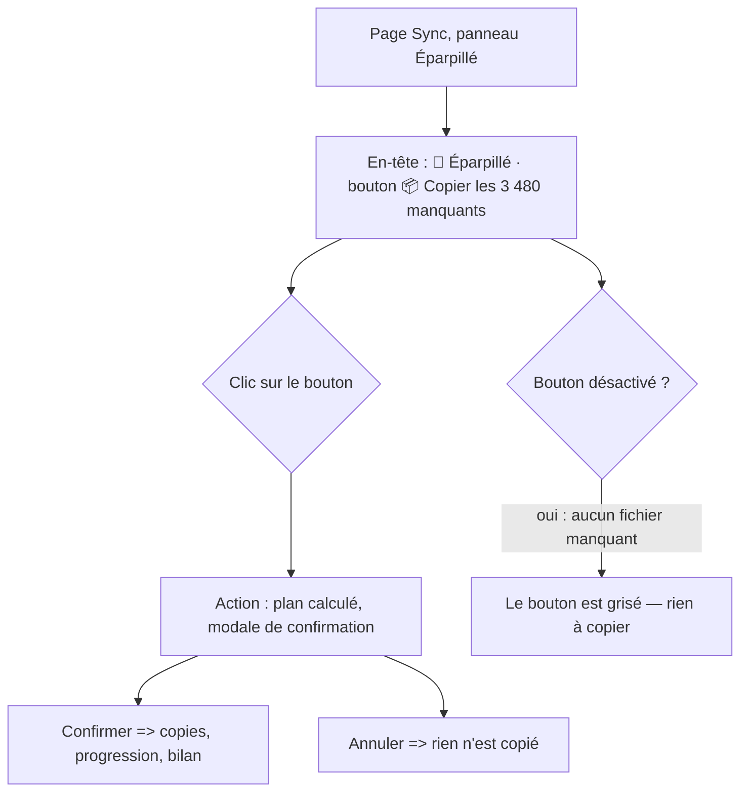
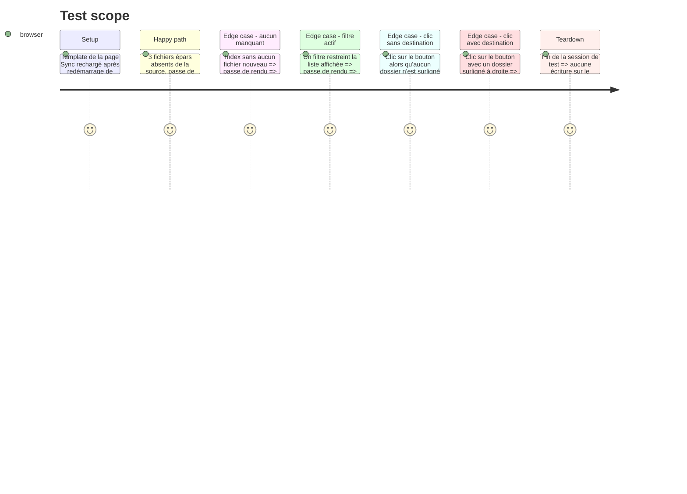

# Instruction: Bouton « Copier les N manquants » sur la page Sync

## Architecture projection

> Tree of the final files. ✅ create · ✏️ modify · ❌ delete

```txt
.
├── templates/
│   └── index.html                    ✏️ modify — bouton #btn-copy-missing dans l'en-tête du panneau Éparpillé
├── static/styles/pages/
│   └── sync.css                      ✏️ modify — style .panel-copy-btn (même grammaire visuelle que .panel-add-btn)
└── static/src/
    ├── script.ts                     ✏️ modify — branchement du clic : destination focalisée → copyAllMissingTo
    ├── render/
    │   ├── eparsUI.ts                ✏️ modify — libellé « N manquants » + état désactivé, compte index entier
    │   └── eparsUI.test.ts           ✏️ modify — fixture du bouton + assertions du libellé et de l'état
```

## User Journey



## Test Scope



## Wireframe

```txt
┌────────────────────────────────────────────────────────────────────────────────────┐
│ (1) En-tête de l'application                                                    │
│  Audio Sync Tool │ 📦 Sync │ 🎵 Playlist │ ↔ Doublons │ 📅 Années │ 🎛 Cue Editor  │
│                          (2) Toolbar : ⚙️ Config │ 🔄 Scan │ 📋 Journal │ ❓     │
├─────────────────────────────────┬──────────────────────────────────────────────────┤
│ (3) Panneau Éparpillé           │ (4) Panneau Source Data                           │
│  ┌───────────────────────────┐  │  ┌──────────────────────────────────────────┐    │
│  │ 📂 Éparpillé (5 092)      │  │  │ 📂 Source Data (1 604)              ➕   │    │
│  │        (5) 📦 Copier les   │  │  └──────────────────────────────────────────┘    │
│  │        3 480 manquants    │  │  (6) Filtre Source Data                          │
│  └───────────────────────────┘  │  ┌──────────────────────────────────────────┐    │
│  (7) Compteurs : ✓ 12 traité   │  │ (7) Arbre des dossiers (cible du bouton)    │    │
│      ● 3 480 reste ○ 120       │  │     techno_acid_1990  ← dossier surligné    │    │
│  (8) Filtre Éparpillé          │  │     techno_1995                             │    │
│  ┌───────────────────────────┐  │  └──────────────────────────────────────────┘    │
│  │ (9) Table des fichiers     │  │                                                  │
│  │     épars                 │  │                                                  │
│  └───────────────────────────┘  │                                                  │
├─────────────────────────────────┴──────────────────────────────────────────────────┤
│ (10) Barre d'état : guidage, progression, bilan                                 │
└────────────────────────────────────────────────────────────────────────────────────┘
```

1. En-tête : navigation entre les pages — inchangé.
2. Toolbar : outils globaux (Config, Scan, Journal, Raccourcis) — inchangé.
3. Panneau de travail des fichiers éparpillés.
4. Panneau de destination (arborescence des dossiers rangés).
5. **Bouton « 📦 Copier les N manquants »** — *nouveau*. Ancré à droite de l'en-tête du panneau Éparpillé,
   frère du bouton `➕` du panneau Source Data ; le compte N est celui de l'**index entier** (filtre ignoré) ;
   grisé quand N = 0 ; le tooltip énonce la destination (dossier surligné à droite) et l'ignorance du filtre.
6. Chip de filtre Source Data — inchangé.
7. Dossier surligné à droite = destination du bouton (comme pour le F5).
8. Compteurs du panneau Éparpillé — inchangés (ils suivent la vue filtrée).
9. Table des fichiers éparpillés — inchangée.
10. Barre d'état : guidage, progression du lot, bilan.

## Tasks to do

### `1)` `templates/index.html` + `static/styles/pages/sync.css` — le bouton

> Le point d'ancrage existe déjà : le bouton `➕` du panneau Source Data.

1. Dans le `<h2>` du panneau gauche (`#panel-left`), après `<span id="epars-header-count">`, insérer :
   `<button id="btn-copy-missing" class="panel-copy-btn" disabled title="Copier tous les fichiers manquants (hors Source Data) vers le dossier surligné à droite — le filtre est ignoré">📦 Copier les manquants</button>`
2. `.panel-copy-btn` dans `static/styles/pages/sync.css` — **même grammaire visuelle que `.panel-add-btn`**
   (float right, fond `var(--bg-hover)`, bordure `var(--border-panel)`, 12 px, hover `var(--bg-focus)`) ;
   aucune nouvelle variable de couleur (**tokens.css n'est pas touché** — règle CSS du projet).
3. ⚠ Après cette modification de `templates/index.html`, **redémarrer l'app** (`npm start`) : le template est
   figé dans le process Flask, le navigateur exécuterait sinon le nouveau bundle contre l'ancien HTML
   (avertissement du README).

### `2)` `static/src/render/eparsUI.ts` — libellé et état du bouton

> Le bouton annonce la taille réelle du lot — pas celle de la vue filtrée.

1. Pendant la passe de rendu de `renderEpars`, mettre à jour le bouton `#btn-copy-missing` :
   libellé `📦 Copier les N manquants` où **N = `countMissingFiles(state.eparsFiles, state.sourceFiles, state.journal)`**
   (index entier, filtre ignoré — module `missing.ts`, phase 1) et attribut `disabled` mis quand N = 0.
2. Ne **pas** changer les compteurs de `#epars-status-line` ni `#epars-header-count` : ils suivent la vue
   filtrée, ce qui est le comportement existant.
3. Le libellé est construit avec `plural()` de `core/format.ts` (règle du projet : pas de pluriel fait main).

### `3)` `static/src/script.ts` — branchement du clic

> Un clic = destination focalisée + action de lot.

1. Importer `copyAllMissingTo` et `focusedSourceDir` depuis `actions.js`.
2. Brancher le clic sur `#btn-copy-missing` (même forme que le bouton `➕`, l. 104) :
   `void copyAllMissingTo(focusedSourceDir())` — sans destination focalisée, l'action affiche son message
   d'aide (phase 2) : le bouton n'a pas à se désactiver quand aucun dossier n'est surligné.

### `4)` `static/src/render/eparsUI.test.ts` — tests du bouton

> Le libellé et l'état sont la partie visible de la feature.

1. Ajouter le bouton à la fixture DOM du test (à côté de `#epars-header-count` et `#epars-status-line`).
2. Index avec 3 fichiers `nouveau` → le libellé contient « 3 » et le bouton est actif.
3. Index sans fichier `nouveau` → le bouton est désactivé.
4. Index avec un filtre actif → le libellé annonce le compte de l'index entier (pas celui de la vue filtrée).

## Test acceptance criteria

| Task | Acceptance criteria                                                                                                                                 |
| ---- | --------------------------------------------------------------------------------------------------------------------------------------------------- |
| 1    | Le bouton existe dans l'en-tête du panneau Éparpillé, à droite du compte, et partage la grammaire visuelle du bouton `➕` (même famille de classes CSS)   |
| 1    | Aucune variable de couleur nouvelle n'est introduite (`tokens.css` inchangé)                                                                           |
| 2    | Le libellé du bouton annonce le nombre de fichiers `nouveau` de l'index, filtre actif ou non                                                            |
| 2    | Le bouton est désactivé quand l'index ne contient aucun fichier `nouveau`                                                                             |
| 3    | Un clic sur le bouton appelle l'action avec le dossier surligné à droite                                                                              |
| 3    | Un clic sans dossier surligné n'ouvre aucune modale et affiche un message d'aide                                                                     |
| 4    | `npx vitest run static/src/render/eparsUI.test.ts` passe ; `npm test` complet reste vert ; après redémarrage de l'app, le bouton est visible dans le navigateur |
