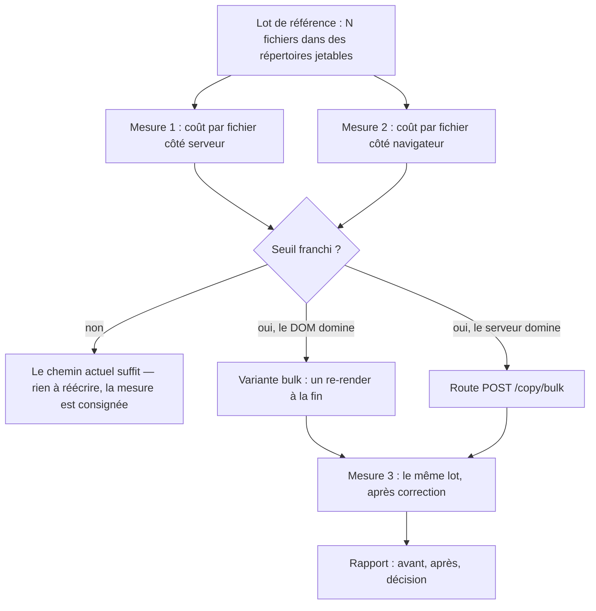
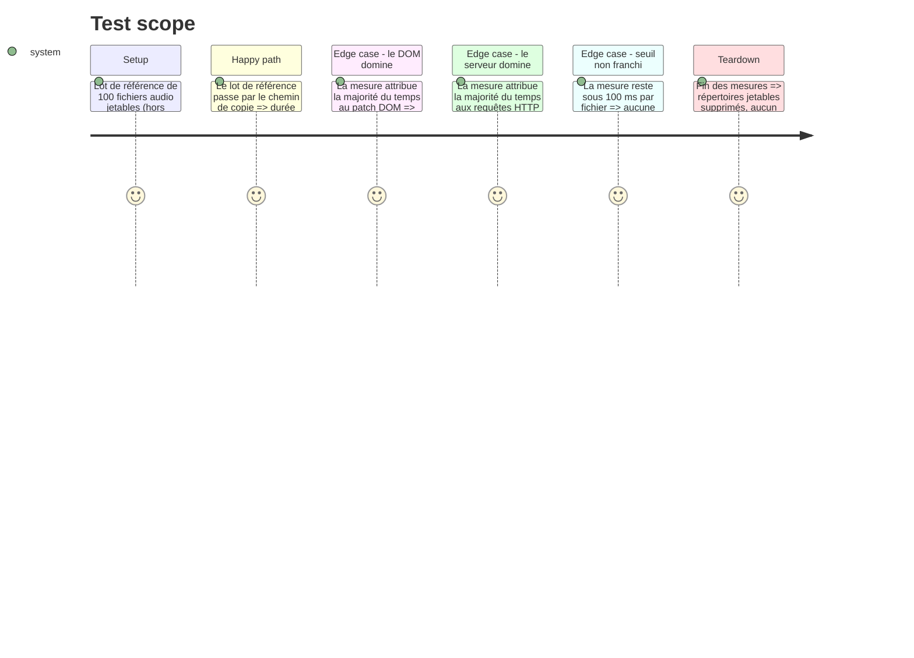

# Instruction: Viabilité à l'échelle (mesure, puis chemin rapide si la mesure le justifie)

## Architecture projection

> Tree of the final files. ✅ create · ✏️ modify · ❌ delete

```txt
.
├── static/src/
│   ├── actions.ts          ✏️ modify (conditionnel) — variante « bulk » : un re-render au lieu d'un patch DOM par fichier
│   └── actions.test.ts      ✏️ modify (conditionnel) — tests de la variante bulk
├── app.py                  ✏️ modify (conditionnel) — POST /copy/bulk : une requête, boucle serveur, un journal
├── test_app.py             ✏️ modify (conditionnel) — tests de la route bulk
└── docs/superpowers/reports/
    └── 2026-10-21-lot-manquants-perf.md   ✅ create — mesure avant / après, répartition HTTP vs DOM, décision
```

## User Journey



## Test Scope



## Tasks to do

### `1)` Mesurer avant de corriger

> Aucune correction ne part d'une intuition : la décision sort d'une mesure reproductible.

1. **Serveur** : mesurer le coût d'un `POST /copy` réel — copies, écriture du style, relecture des tags,
   écriture du journal et du cache — sur un lot de 100 fichiers **jetables** (répertoires temporaires,
   jamais la collection de l'utilisateur — `△DATA-SAFETY`).
2. **Navigateur** : mesurer le coût du chemin de copie côté interface sur le même lot — boucle de tranches,
   `copyFilesTo` (patch d'index + `patchEparsFileAfterCopy` + `patchSourceFileAfterCopy`) et re-render final.
   Le poste suspect est connu : `patchEparsFileAfterCopy` rescane **tous** les spans épars à chaque fichier
   copié (`static/src/domPatches.ts`, l. 34-42) → coût O(fichiers × fichiers).
3. Consigner les deux mesures (durée totale, durée par fichier, répartition des postes) dans
   `docs/superpowers/reports/2026-10-21-lot-manquants-perf.md`.
4. **Seuil de décision, écrit dans le rapport** : au-delà de **100 ms par fichier** (soit plus de 10 s pour
   100 fichiers), le chemin de copie doit être accéléré ; en deçà, il est **conservé tel quel** (KISS).

### `2)` Chemin rapide — seulement si le seuil est franchi

> Une seule voie, choisie par le poste qui domine.

1. **Si le DOM domine** (variante frontend, zéro backend, prioritaire) : une copie de lot qui n'appelle plus
   `patchEparsFileAfterCopy` / `patchSourceFileAfterCopy` **par fichier**, mais met à jour l'index
   `state.sourceFiles` puis déclenche **un seul** re-render event-driven à la fin (la mécanique existante :
   `state.sourceFiles = { …state.sourceFiles }` → `sourceFiles:changed` → rendu). Le comportement visible
   doit rester identique : même bilan, mêmes compteurs, même journal.
2. **Si le serveur domine** (route backend) : `POST /copy/bulk` — une requête, une boucle serveur, un journal.
   Elle réutilise **exactement** le code de `POST /copy` (mêmes garde-fous : `os.makedirs`, `_collision_dst`,
   écriture du style des deux côtés, journal, cache) — jamais une réimplémentation. `app.py` est earmelé
   pour un découpage (EPIC-055) : le route est écrit de façon à s'en détacher facilement.
3. Tests : un test qui vérifie qu'un lot de N fichiers produit N entrées de journal et N copies, et que la
   variante bulk donne **le même état final** que le chemin actuel (même index, même journal).

### `3)` Re-mesurer et consigner

1. Rejouer la mesure sur le même lot de 100 fichiers après la correction.
2. Consigner dans le rapport : mesure avant, mesure après, poste dominant, décision, seuil appliqué.
3. Le rapport est la **preuve** de la phase : sans lui, la phase n'est pas terminée.

## Test acceptance criteria

| Task | Acceptance criteria                                                                                                                                           |
| ---- | -------------------------------------------------------------------------------------------------------------------------------------------------------------------------------------------------------------------------- |
| 1    | Le rapport existe et contient : durée totale, durée par fichier, répartition des postes (serveur / DOM), pour un lot de 100 fichiers jetables                     |
| 1    | La mesure s'est faite sur des répertoires jetables : aucun fichier de la collection de l'utilisateur n'a été écrit ni déplacé                                                  |
| 1    | Le seuil de décision (100 ms par fichier) est écrit dans le rapport                                                                                             |
| 2    | Si le seuil n'est pas franchi : aucun changement du chemin de copie n'est livré, et le rapport dit pourquoi                                                                                                                     |
| 2    | Si le seuil est franchi : la variante livrée donne le même état final (index + journal) que le chemin actuel, et le test le prouve                                                                                                |
| 3    | La mesure après correction est consignée dans le rapport ; si une correction a eu lieu, la durée par fichier du lot de 100 est inférieure ou égale à 50 ms                    |
| 3    | `npm test` et `./venv/bin/python -m pytest -q` restent verts après les corrections éventuelles                                                                                                                              |
