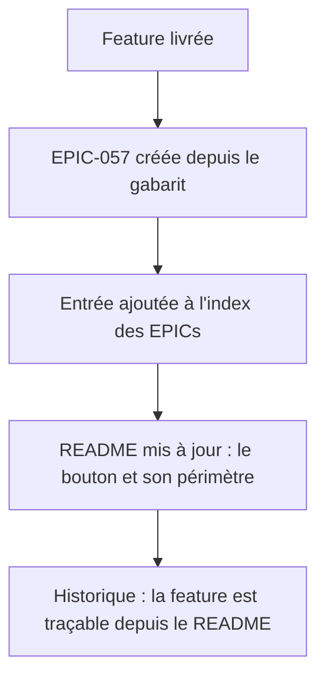
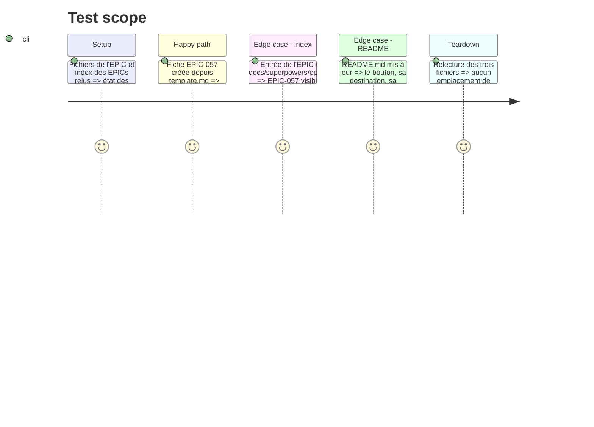

# Instruction: Traçabilité — EPIC-057 + documentation

## Architecture projection

> Tree of the final files. ✅ create · ✏️ modify · ❌ delete

```txt
.
└── docs/
    └── superpowers/
        ├── epics/
        │   ├── EPIC-057-copie-tous-les-manquants.md   ✅ create — fiche EPIC (objectif, tâches, fichiers, validation, commits, décisions)
        │   └── README.md                               ✏️ modify — entrée d'index de l'EPIC-057
        └── ../../README.md                              ✏️ modify — le bouton, son périmètre, sa confirmation, son interaction avec le filtre
```

## User Journey



## Test Scope



## Tasks to do

### `1)` Créer `docs/superpowers/epics/EPIC-057-copie-tous-les-manquants.md`

> Le registre central du dépôt l'exige : toute évolution a sa fiche.

1. Partir de `docs/superpowers/epics/_template.md` (structure obligatoire : Objectif · Contexte & découvertes ·
   Tâches · Fichiers impactés · Validation · Traçabilité (commits) · Décisions · Notes / Risques).
2. Numéro **057** — le registre s'arrête à EPIC-056 (`docs/superpowers/epics/README.md`), jamais réutilisé.
3. Objectif : « un bouton copie en un geste tous les fichiers éparpillés absents de Source Data vers le
   dossier surligné, après confirmation explicite ».
4. Contexte & découvertes : reprendre les faits mesurés dans le code — le moteur `copyFilesTo` existe déjà,
   la modale structurée sait déjà afficher « N fichiers → dossier », `/copy` crée le dossier et ne peut pas
   écraser, `computeStatus` définit le statut `nouveau`, et le patch DOM par fichier est le poste de coût
   à surveiller (mesuré en phase 4).
5. Tâches cochables : une ligne par phase du plan (1 à 5), avec le état réel à la livraison.
6. Fichiers impactés : le tableau des fichiers modifiés/créés, avec le rôle de chacun.
7. Validation : les cinq lignes du gabarit (`npm run typecheck`, `npm test`, `npm run lint`, `npm run build`,
   `./venv/bin/python -m pytest -q`) — cochées **seulement** si elles passent.
8. Traçabilité : une ligne par commit, avec le message réel (`git log`).
9. Décisions : reprendre les décisions du plan (destination = dossier surligné, lot = index entier,
   confirmation obligatoire, zéro backend, pas de raccourci en P1, jumeaux exclus/annoncés).
10. Notes / Risques : la limite « le filtre ne restreint pas le lot », le double-clic protégé par le verrou,
    et le raccourci clavier renvoyé en **P2** (backlog de l'EPIC, pas livré dans P1).

### `2)` `docs/superpowers/epics/README.md` — entrée d'index

1. Ajouter la ligne `EPIC-057` dans la table d'index, après `EPIC-056` : lien vers le fichier, titre,
   statut (`🔵 En cours` à la livraison de la feature, `🟢 Livré` quand les phases sont soldées),
   priorité et docs liées.
2. Respecter le format des lignes existantes (cinq colonnes, même largeur de tableau) — le README est lu
   comme un registre, pas comme une prose.

### `3)` `README.md` — le contrat utilisateur

> Le README est le contrat de l'app : la feature y est décrite comme le reste.

1. **Fonctionnalités** : bullet « Sync » — mentionner le bouton « copier tous les manquants ».
2. **Page Sync** : une sous-section courte (« Copier tous les manquants ») qui dit :
   - ce que le bouton copie (les fichiers éparpillés absents de Source Data — LED bleue) ;
   - **où** il les copie (le dossier surligné dans Source Data, comme le F5) ;
   - que la copie est **confirmée** dans la modale avant d'écrire (et que le nombre de fichiers y est annoncé) ;
   - que **le filtre ne réduit pas** le lot (le filtre filtre l'affichage, pas l'index).
3. **Limites connues** : si la phase 4 a imposé un garde-fou (seuil de lot, lot non annulable en cours de
   route), le dire ici — une limite non écrite est une limite découverte par l'utilisateur.
4. Ne pas réécrire le reste du README : la feature s'yrange, elle ne le réécrit pas.

## Test acceptance criteria

| Task | Acceptance criteria                                                                                                                                   |
| ---- | ---------------------------------------------------------------------------------------------------------------------------------------------------------------------------------------------------------------------- |
| 1    | La fiche EPIC-057 existe, suit la structure de `_template.md` et ne laisse aucun emplacement vide                                                                                                                     |
| 1    | Les six sections du gabarit sont remplies : objectif, contexte & découvertes, tâches, fichiers impactés, validation, traçabilité, décisions, notes/risques                              |
| 1    | Les cases de validation ne sont cochées que si les commandes correspondantes sont réellement passées                                                                                                                     |
| 2    | L'index `docs/superpowers/epics/README.md` contient une ligne EPIC-057, avec le même format que les lignes voisines                                                                                                        |
| 3    | Le README décrit le bouton, sa destination, la confirmation obligatoire et le fait que le filtre ne restreint pas le lot                                                                                                    |
| 3    | Aucun autre contenu du README n'est modifié (diff limité à la section Sync et, le cas échéant, aux limites connues)                                                                                                         |
