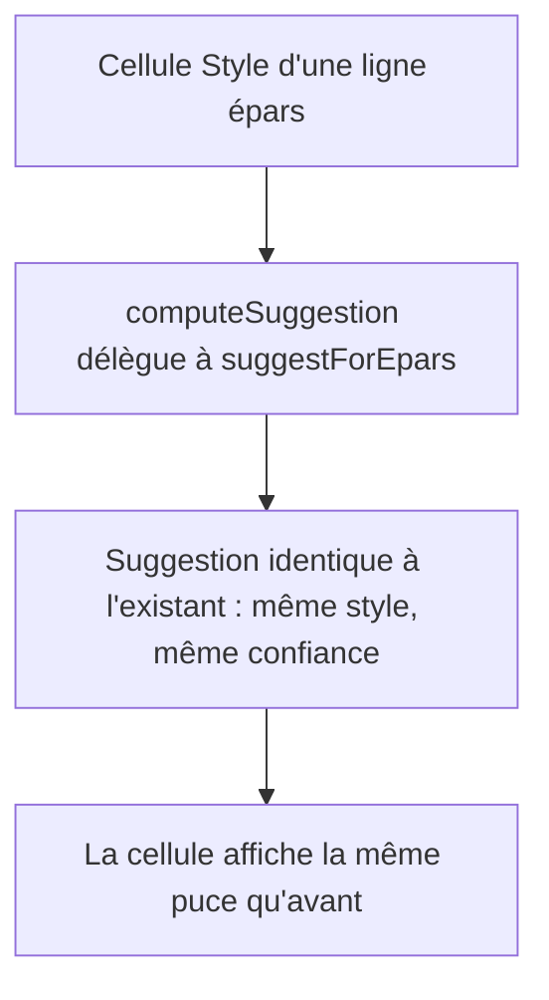
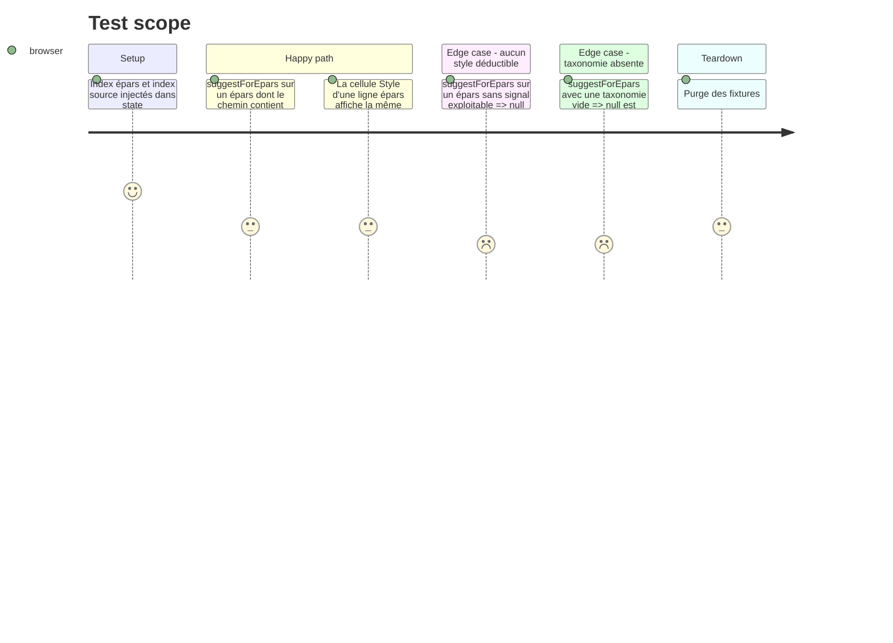

# Instruction: Colle de suggestion partagée (DRY)

## Architecture projection

> Tree of the final files. ✅ create · ✏️ modify · ❌ delete

```txt
.
└── static/src/
    ├── styleSuggest.ts          ✏️ + suggestForEpars(...) — colle pure : relPath épars,
    │                                     artiste, styles de session, taxonomie, index source
    ├── styleSuggest.test.ts     ✏️ tests de la colle (suggestion identique à l'ancien calcul)
    └── render/
        └── styleCell.ts         ✏️ computeSuggestion délègue à suggestForEpars
```

## User Journey



## Test Scope



## Tasks to do

### `1)` Extraire la colle de suggestion dans `styleSuggest.ts`

> Un seul endroit calcule « quel style pour ce fichier épars ».

1. Ajouter à `static/src/styleSuggest.ts` une fonction pure `suggestForEpars(fullpath, entry, ctx)` : `ctx` porte `eparsFiles`, `styleChoices`, `taxonomy`, `sourceIndex` — aucun accès à `state`, aucun DOM.
2. La fonction retrouve l'entrée épars (`findEparsEntry`), l'artiste (`parseArtistTitle`), les styles de session du même sous-dossier épars, puis appelle `suggestStyle` — le moteur et ses poids ne changent pas.
3. Le seuil de confiance reste celui de `styleSuggest.ts` ; ne pas introduire de second seuil.

### `2)` Faire déléguer `styleCell.ts`

> Comportement identique, une seule implémentation.

1. Remplacer le corps de `computeSuggestion` (fonction privée de `render/styleCell.ts`) par un appel à `suggestForEpars`, en passant `state.eparsFiles`, `state.styleChoices`, `currentTaxonomy()` et `state.sourceIndex`.
2. Ne toucher ni au rendu de la cellule, ni aux classes CSS, ni aux tooltips.
3. Le chip « Suggéré (n %) » reste identique.

### `3)` Tester la colle

> Le contrat du module pur est couvert.

1. Ajouter dans `static/src/styleSuggest.test.ts` les cas : segment de chemin, voisinage artiste, historique de session, genre ID3, ex æquo, score nul, taxonomie vide.
2. Vérifier qu'un cas croisé (chemin + artiste) combine les poids comme avant.
3. Lancer `npm test` puis `npm run typecheck` et `npm run lint` : aucun test existant ne doit changer de résultat.

## Test acceptance criteria

| Task | Acceptance criteria                                                                                                                       |
| ---- | ------------------------------------------------------------------------------------------------------------------------------------------ |
| 1    | `suggestForEpars` est exportée par `styleSuggest.ts`, ne référence ni `state` ni le DOM, et rend la même suggestion que l'ancien calcul pour les 4 signaux. |
| 2    | La cellule Style épars affiche exactement la même puce (style, confiance, tooltip) qu'avant le refactor ; `styleCell.test.ts` passe sans modification.  |
| 3    | `npm test` (1 230 tests) et `npm run typecheck` sont verts ; la nouvelle couverture de `styleSuggest.test.ts` exercise au moins un cas par signal. |
