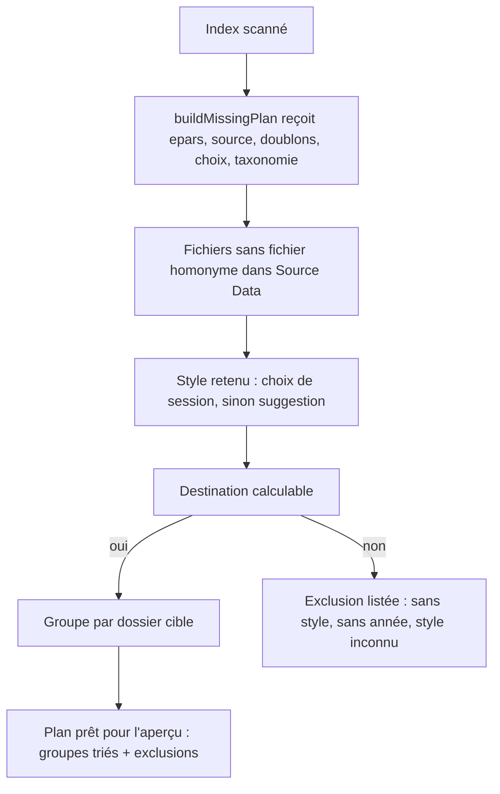
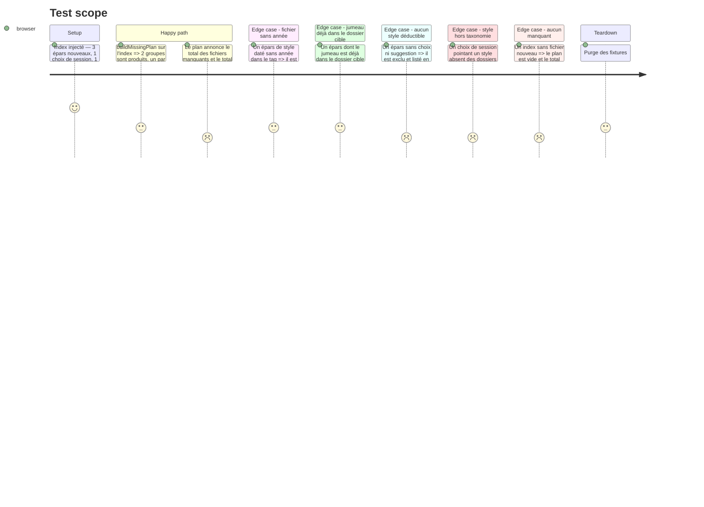

# Instruction: Moteur du plan « manquants » (pur)

## Architecture projection

> Tree of the final files. ✅ create · ✏️ modify · ❌ delete

```txt
.
└── static/src/
    ├── missingPlan.ts          ✅ buildMissingPlan(ctx) — groupes par dossier cible + exclusions
    │                                 countMissing(ctx) — décompte global des manquants (étiquette du bouton)
    └── missingPlan.test.ts     ✅ tests unitaires du plan (aucun DOM, aucun state)
```

## User Journey



## Test Scope



## Tasks to do

### `1)` Écrire le module pur `missingPlan.ts`

> Une seule fonction, entrée explicite, sortie stable.

1. Définir `MissingPlanContext` : `eparsFiles`, `sourceFiles`, `dupMatches`, `styleChoices`, `taxonomy`, `sourceIndex` — rien d'autre, aucune lecture de `state`.
2. Définir la sortie `MissingPlan` : `groups` (un groupe par dossier cible, trié par nom de dossier), `noSuggestion`, `noYear`, `twinInDest`, `unknownStyle` (chemins concernés), `totalMissing`, `totalPlanned`.
3. `buildMissingPlan(ctx)` : pour chaque entrée épars, ne retenir que les fichiers de statut `nouveau` (absents de Source Data et non traités au journal — même règle que `computeStatus`).
4. Style retenu : choix de session d'abord, sinon suggestion ; puis destination via `destFor(tax, style, yearOf(entry), tranche)`.
5. Exclusions, dans cet ordre : style déductible absent → `noSuggestion` ; style hors taxonomie → `unknownStyle` ; style daté sans année ni tranche forcée → `noYear` ; jumeau (`dupMatches`) déjà dans le dossier cible → `twinInDest`.
6. Chaque groupe porte le dossier cible, la liste des fichiers (nom, dossier épars, chemin complet) et la part de fichiers choisis à la main versus suggérés.
7. Exporter aussi `countMissing(ctx)` : le même décompte de fichiers `nouveau` sur l'index complet, sans calcul de suggestion — c'est lui qui alimente l'étiquette du bouton (le compteur de la ligne d'état est borné au filtre actif).

### `2)` Écrire les tests unitaires

> Le plan est la décision centrale : ses tests sont la preuve.

1. Couvrir : fichier manquant retenu, fichier déjà dans Source Data ignoré, choix de session prioritaire sur la suggestion, suggestion utilisée quand aucun choix, destination calculée depuis l'année du tag, dossier horodaté créé marqué comme à créer.
2. Couvrir chaque exclusion : sans style, style inconnu, sans année, jumeau déjà rangé.
3. Couvrir le regroupement : deux fichiers vers le même dossier forment un groupe, l'ordre des groupes suit le nom du dossier.
4. Couvrir le cas limite : un choix de session sur un fichier dont l'entrée épars a disparu de l'index est ignoré silencieusement.
5. Couvrir `countMissing` : il compte les fichiers `nouveau` de l'index complet, filtre ignoré, et il vaut zéro quand il n'y en a pas.
6. Aucun `state`, aucun DOM dans le module ni dans ses tests.

## Test acceptance criteria

| Task | Acceptance criteria                                                                                                                            |
| ---- | ----------------------------------------------------------------------------------------------------------------------------------------------- |
| 1    | `buildMissingPlan` ne référence ni `state` ni le DOM ; ses entrées et sorties sont des interfaces exportées de `missingPlan.ts`.                        |
| 1    | Un épars `nouveau` sans choix mais avec suggestion est planifié vers le dossier calculé depuis le style suggéré et l'année du tag.                     |
| 1    | Un épars `doublon` ou `traite` n'apparaît jamais dans les groupes.                                                                              |
| 2    | Chaque exclusion a au moins un test : sans style, style inconnu, sans année, jumeau déjà rangé.                                                    |
| 2    | Deux fichiers visant le même dossier forment un seul groupe ; les groupes sont triés par nom de dossier.                                          |
| 2    | `countMissing` renvoie le nombre de fichiers absents de Source Data sur l'index complet, sans tenir compte du filtre.                             |
| 2    | `npm test` est vert, le nouveau fichier `missingPlan.test.ts` passe seul et avec la suite complète.                                               |
