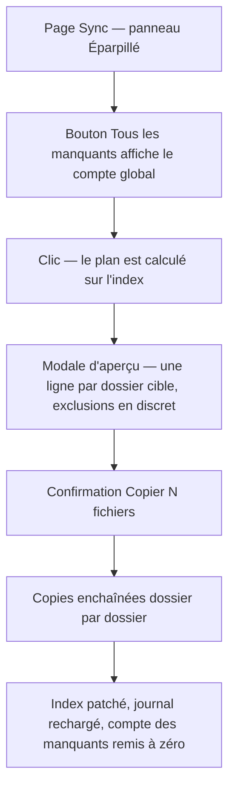
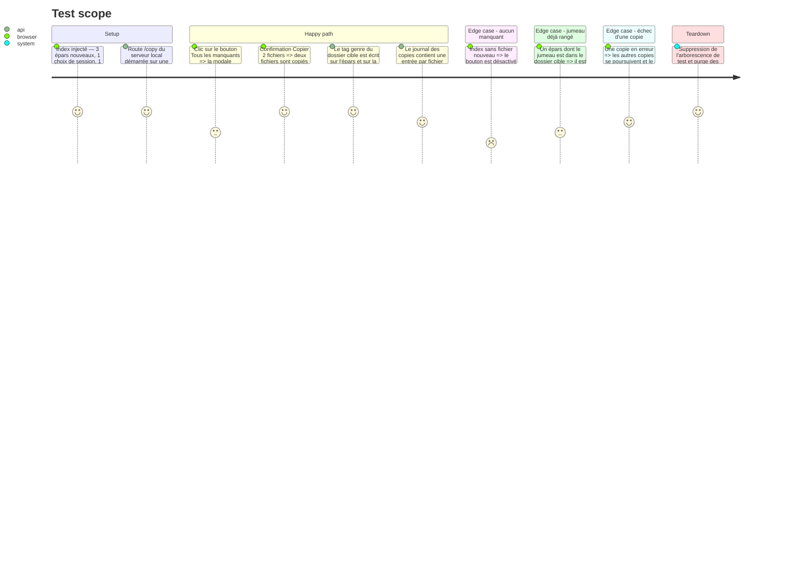

# Instruction: Bouton + aperçu + copie des manquants

## Architecture projection

> Tree of the final files. ✅ create · ✏️ modify · ❌ delete

```txt
.
├── templates/
│   └── index.html               ✏️ bouton #btn-copy-missing dans l'en-tête du panneau Éparpillé
├── static/src/
│   ├── missingPlan.ts           ✏️ countMissing(ctx) — décompte global des manquants (étiquette du bouton)
│   ├── render/
│   │   ├── eparsUI.ts           ✏️ libellé + état du bouton (compte, désactivation, clic)
│   │   ├── missingCopy.ts        ✅ aperçu (modale de copie) + application (copies par dossier cible)
│   │   └── missingCopy.test.ts   ✅ tests jsdom de l'aperçu et de l'application
│   └── styles/pages/
│       └── sync.css             ✏️ règle .panel-copy-btn (bouton de l'en-tête de panneau)
```

## User Journey



## Test Scope



## Wireframe

```txt
┌────────────────────────────────────────────────────────────────────────────┐
│ (1) Header : Audio Sync Tool · pages · outils                             │
├───────────────────────────────┬────────────────────────────────────────────┤
│ (2) Panneau Éparpillé         │ (3) Panneau Source Data                    │
│ ┌───────────────────────────┐ │ ┌────────────────────────────────────────┐ │
│ │ Éparpillé (5 092)  (4)   │ │ │ Source Data (1 604)          ➕       │ │
│ │ 📥 Tous les manquants (3)│ │ │ (5) Arbre des dossiers source        │ │
│ └───────────────────────────┘ │ │     techno_hard_1995/ …               │ │
│ (6) Ligne d'état épars       │ └────────────────────────────────────────┘ │
│ (7) Liste des fichiers       │                                            │
└───────────────────────────────┴────────────────────────────────────────────┘

┌── Modale d'aperçu (copyDialog) ────────────────────────────────────────┐
│ (1) Titre « Copier tous les manquants »                                │
│ (2) Résumé : 2 fichiers → 1 dossier                                    │
│ (3) Preuves : « 2 fichiers → techno_hard_1995 ➕ »                      │
│ (4) Notes : styles suggérés, exclusions, filtre actif éventuel         │
│ (5) Actions : [Annuler] [Copier 2 fichiers]                            │
└────────────────────────────────────────────────────────────────────────┘
```

1. Header : barre d'outils existante, aucune modification.
2. Panneau Éparpillé : colonne de gauche, la liste des fichiers épars.
3. Panneau Source Data : colonne de droite, l'arborescence de destination.
4. Bouton « 📥 Tous les manquants (N) » dans l'en-tête du panneau Éparpillé, à côté du compte de fichiers — N = fichiers absents de Source Data dans tout l'index ; le bouton est désactivé quand N vaut 0.
5. Arbre Source Data : les dossiers cibles se revealed après copie, comme le flux F5.
6. Ligne d'état épars : compteurs traité / reste / doublon ; le compteur « reste » est borné au filtre actif, le bouton donne le compte global.
7. Liste épars : les lignes copiées passent en « traité » (LED verte) au fil des copies.

## Tasks to do

### `1)` Poser le bouton (template + CSS + état)

> Un bouton stable, dans l'en-tête du panneau, qui annonce le compte global.

1. `templates/index.html` : ajouter `<button id="btn-copy-missing">` dans le `<h2>` du panneau Éparpillé, à côté de `#epars-header-count` ; le titre explicite l'action (« Copier tous les fichiers absents de Source Data vers leur dossier cible »).
2. `static/styles/pages/sync.css` : créer la règle `.panel-copy-btn` dans le fichier qui porte déjà l'en-tête de panneau et `.panel-add-btn` — pas de nouveau token, pas de variable dupliquée.
3. `static/src/render/eparsUI.ts` : après le rendu, mettre à jour le libellé du bouton avec le nombre de fichiers manquants (countMissing sur l'index complet, pas le compteur filtré de la ligne d'état), le désactiver quand le compte vaut 0, et brancher le clic sur `openMissingCopyPreview()`.
4. Ne pas placer le bouton dans `#epars-status-line` : cette ligne est reconstruite en `innerHTML` par `patchEparsFileAfterCopy` après chaque copie, le bouton y serait effacé.

### `2)` Écrire le module `render/missingCopy.ts`

> Aperçu d'abord, copie ensuite — rien ne part sans que l'utilisateur ait vu où.

1. `openMissingCopyPreview()` : construire le plan via `buildMissingPlan` (index courant, taxonomie, suggestions), puis ouvrir la modale de copie existante `confirmCopyDialog` avec une ligne par dossier cible (`buildCopyDialogSpec`), les exclusions en notes discrètes, et la mention du filtre actif s'il y en a un.
2. Le label de confirmation porte le nombre exact de fichiers à copier ; si le plan est vide, le bouton n'ouvre rien et la barre d'état explique pourquoi (aucun manquant, aucun style déductible, aucun choix).
3. `applyMissingPlan(plan)` : enchaîner `copyFilesTo(dossier, fichiers)` dossier par dossier — même chemin que l'aperçu `e`, échec d'un fichier sans arrêt du lot.
4. Après application : retirer des choix de session les fichiers copiés, rafraîchir les cellules Style (`refreshStyleCells`), mettre à jour le récap de la ligne d'état, recharger le journal (déjà fait par `copyFilesTo`) et afficher un toast « N/M copiés ».
5. Ne pas exporter les styles vers `/styles/review` : la copie écrit déjà le genre dans les tags ; l'export sert au flux « revue puis application » de la palette.

### `3)` Tester l'aperçu et l'application

> Le comportement observable est vérifié sans toucher au disque réel.

1. `static/src/render/missingCopy.test.ts` : le bouton s'ouvre sur le plan, la modale liste une ligne par dossier cible, les exclusions apparaissent en notes, un plan vide n'ouvre pas de modale.
2. Le cas d'application : un clic sur « Copier » déclenche un `POST /copy` par fichier, dans l'ordre des groupes, et l'index source est patché.
3. Le cas d'échec : un `POST /copy` en erreur n'arrête pas les copies suivantes et le résumé annonce le nombre réellement copié.
4. Lancer `npm test`, `npm run typecheck`, `npm run lint`, puis `./venv/bin/python -m pytest -q` (le backend n'est pas modifié : `test_app.py` couvre déjà l'écriture du style à la copie).

## Test acceptance criteria

| Task | Acceptance criteria                                                                                                                          |
| ---- | --------------------------------------------------------------------------------------------------------------------------------------------- |
| 1    | Le bouton affiche le nombre de fichiers absents de Source Data dans tout l'index et il est désactivé quand ce nombre vaut 0.                     |
| 1    | Le bouton survit à une copie : il reste présent et à jour après le patch DOM du panneau Éparpillé.                                            |
| 2    | Un clic ouvre un aperçu qui nomme, pour chaque dossier cible, le nombre de fichiers qui y vont, et qui liste les exclusions.                     |
| 2    | Aucune copie n'est partie tant que la confirmation n'a pas été donnée ; le label de confirmation porte le nombre exact de fichiers.               |
| 2    | Après confirmation, chaque fichier est copié dans son dossier cible et l'entrée correspondante de l'index source existe ; le toast annonce le total. |
| 2    | Un échec de copie n'interrompt pas le lot ; le toast annonce le nombre réellement copié sur le nombre prévu.                                     |
| 3    | `npm test` (1 230 tests + les nouveaux) et `npm run typecheck` sont verts ; `./venv/bin/python -m pytest -q` reste vert.                            |
