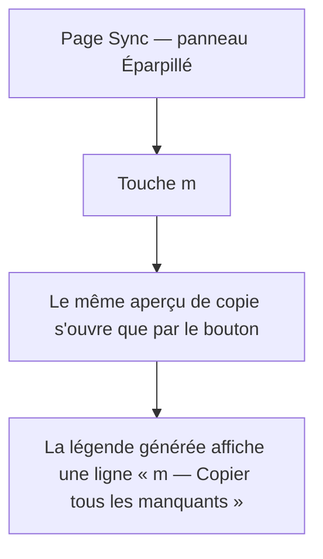
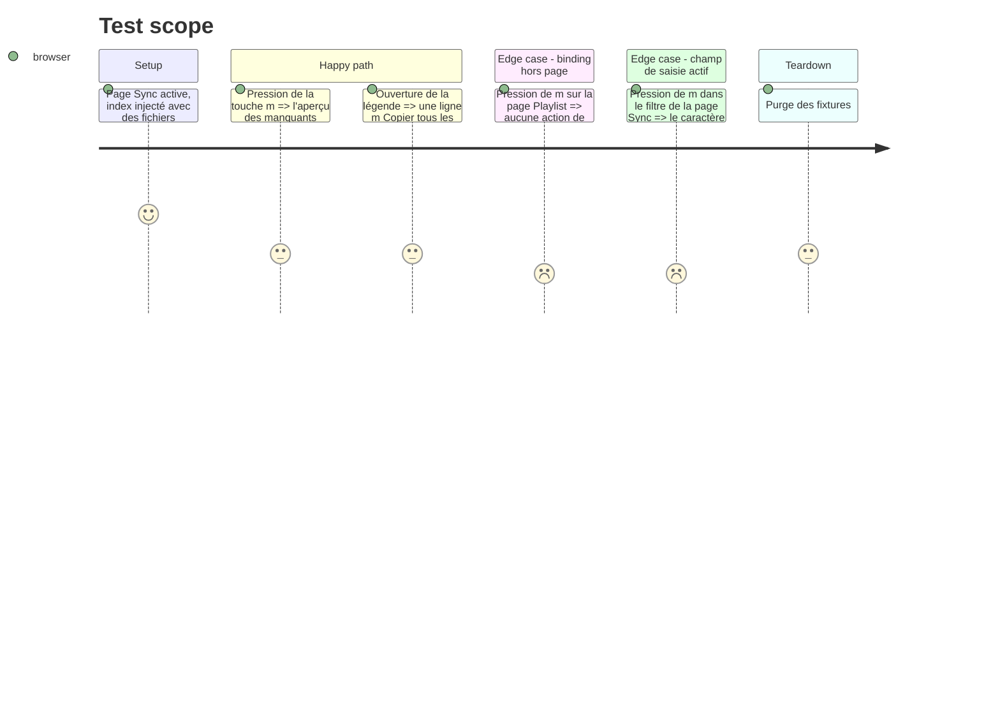

# Instruction: Raccourci clavier `m` + légende générée

## Architecture projection

> Tree of the final files. ✅ create · ✏️ modify · ❌ delete

```txt
.
└── static/src/commands/
    ├── copy.ts                 ✏️ binding « m » — Copier tous les manquants (page sync)
    └── keyboardMatrix.test.ts  ✏️ cellule de la matrice pour la touche m + invariants
```

## User Journey



## Test Scope



## Tasks to do

### `1)` Déclarer le binding

> Un raccourci se déclare dans le registre, jamais dans le HTML ni dans le README.

1. Dans `static/src/commands/copy.ts`, déclarer un binding `m` : `page: 'sync'`, `isInput: false`, `activeModal: null`, `isContextMenuOpen: false`, `group: 'sync'`, libellé court « Copier tous les manquants », handler appelant `openMissingCopyPreview`.
2. Les index de la matrice sont dérivés par `findIndex` sur le registre : l'ajout ne décale pas les index calculés. Le risque réel est le *shadowing* (le premier binding qui matche gagne) — vérifier que `m` ne masque aucun binding existant et qu'aucun binding existant ne masque `m` en page Sync.
3. La touche `m` n'est bindée nulle part ailleurs (page sync uniquement) : aucune collision avec `g`, `e`, `a`, `r`, `n`, `l`.
4. Ne rien écrire dans `templates/index.html` ni dans le README pour la touche : la légende est générée depuis les bindings labellisés.

### `2)` Étendre la matrice clavier

> Le contrat de la matrice est une barrière CI : pas de binding mort, pas de binding shadowé.

1. Dans `static/src/commands/keyboardMatrix.test.ts`, ajouter la cellule `sync: m copie tous les manquants` avec le contexte attendu (page sync, aucun modale, aucun champ de saisie) et l'index du binding.
2. Ajouter les cas de non-régression : `m` hors page sync → aucun binding ; `m` dans le filtre → caractère saisi, aucune interception.
3. Lancer `npm test` (dont la matrice et la bijection de la légende) puis `npm run typecheck` et `npm run lint`.

## Test acceptance criteria

| Task | Acceptance criteria                                                                                                                                          |
| ---- | ----------------------------------------------------------------------------------------------------------------------------------------------------------------------------------------------------- |
| 1    | La touche `m` ouvre exactement le même aperçu que le bouton, en page Sync, et ne fait rien sur les autres pages ni dans un champ de saisie.                  |
| 1    | La légende générée contient une ligne « m » portant le libellé « Copier tous les manquants » dans la section Sync ; le test de bijection reste vert.          |
| 2    | `commands/keyboardMatrix.test.ts` comporte la cellule de la touche `m` et les deux cas de non-régression ; les cinq invariants structurels restent verts.       |
| 2    | `npm test`, `npm run typecheck` et `npm run lint` sont verts ; aucun index de binding existant n'a bougé.                                                       |
