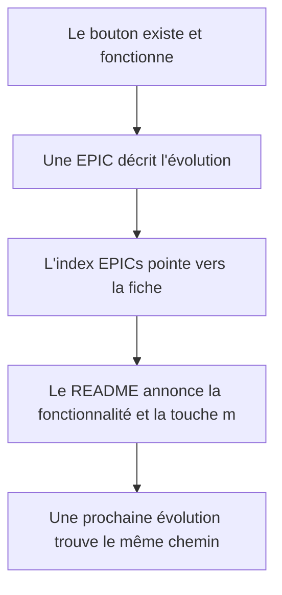
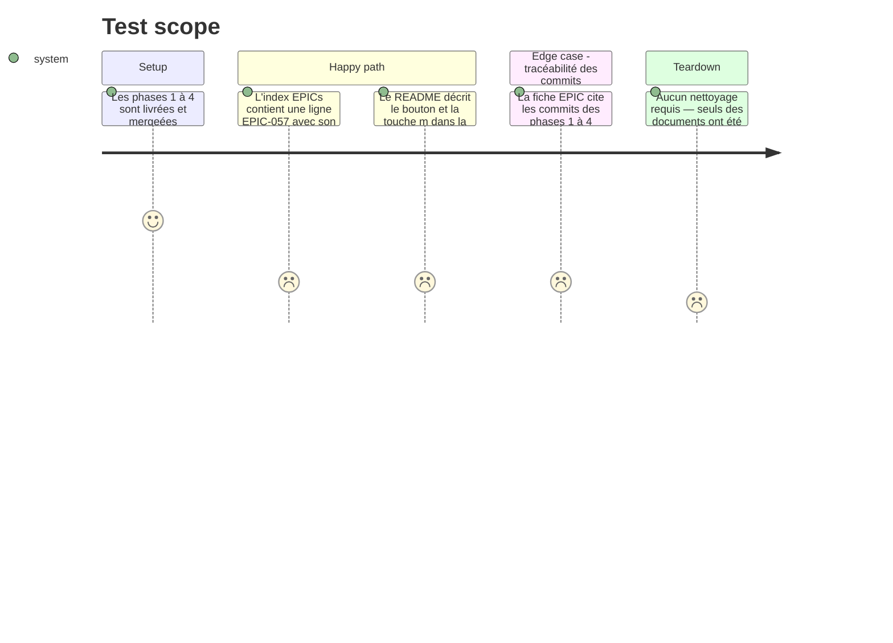

# Instruction: EPIC-057 + index EPICs + README

## Architecture projection

> Tree of the final files. ✅ create · ✏️ modify · ❌ delete

```txt
.
├── docs/superpowers/epics/
│   ├── EPIC-057-copier-tous-les-manquants.md   ✅ fiche d'évolution (objectif, tâches, fichiers, validation, décisions)
│   └── README.md                               ✏️ index : une ligne EPIC-057
└── README.md                                   ✏️ fonctionnalités Sync + tableau des raccourcis page Sync
```

## User Journey



## Test Scope



## Tasks to do

### `1)` Écrire la fiche EPIC-057

> Toute évolution du projet se trace dans une EPIC, avec ses commits et ses tests.

1. Créer `docs/superpowers/epics/EPIC-057-copier-tous-les-manquants.md` sur le modèle des EPICs récentes : objectif, périmètre, tâches cochables, fichiers impactés, validation (tests ajoutés et commande de vérification), décisions (destination = choix puis suggestion, aperçu obligatoire, aucune route backend), limites connues (la suggestion écrit un genre dans les tags, annulable via `apply_styles.py --undo`), traçabilité (commits des phases 1 à 4).
2. Vérifier le numéro : le registre va jusqu'à EPIC-056 (découpage du monolithe) ; 057 est le suivant libre, jamais réutilisé.
3. Reprendre le gabarit `_template.md` du registre si les EPICs récentes s'en écartent.

### `2)` Mettre à jour l'index des EPICs

> L'index est unique : toute nouvelle EPIC y entre.

1. Ajouter la ligne EPIC-057 dans `docs/superpowers/epics/README.md` : titre, statut (🔵 En cours ou 🟢 Livré selon l'état réel à la livraison), priorité, lien vers la fiche.
2. Ne pas toucher aux lignes existantes.

### `3)` Mettre à jour le README

> Le README est le contrat produit : la fonctionnalité doit y être lisible sans le code.

1. Dans la section « Fonctionnalités », sous la puce **Sync**, décrire le bouton « Tous les manquants » : ce qu'il range, la règle de destination (choix de session puis suggestion), l'aperçu obligatoire et l'annulation possible des écritures de tags via le journal partagé.
2. Dans le tableau « Raccourcis — Page Sync », ajouter la ligne **m** → « Copier tous les manquants (aperçu puis copie) ».
3. Ne pas réécrire les autres sections ; le README reste un contrat, pas un rapport de session.

## Test acceptance criteria

| Task | Acceptance criteria                                                                                                                                       |
| ---- | ---------------------------------------------------------------------------------------------------------------------------------------------------------------------------------------------------------------------- |
| 1    | La fiche EPIC-057 existe, suit le format des EPICs récentes et cite les commits des phases 1 à 4 ainsi que les commandes de validation exécutées.          |
| 2    | L'index `docs/superpowers/epics/README.md` contient une ligne EPIC-057 pointant vers la fiche, avec un statut cohérent avec l'état réel.                     |
| 3    | Le README décrit le bouton et la touche `m` ; le tableau des raccourcis de la page Sync contient la ligne **m**.                                             |
| 3    | Aucun autre fichier du dépôt n'est modifié par cette phase (`git diff --stat` ne liste que les trois fichiers de la projection).                            |
