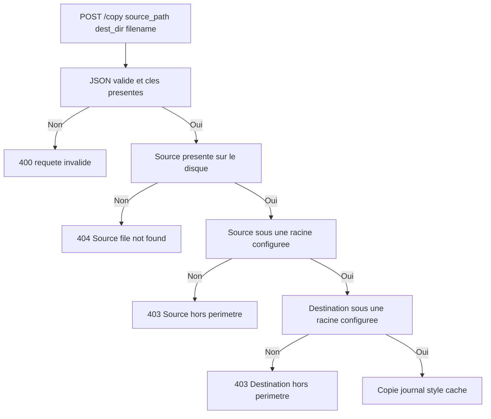
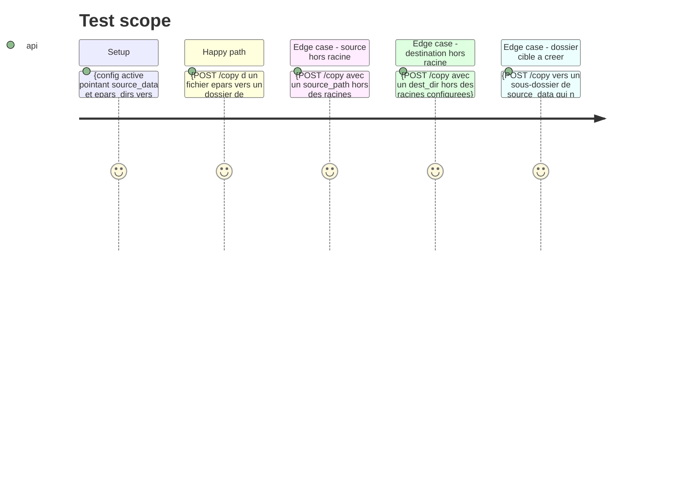

<!-- Fill or omit these sections; never add, rename, or reorder one. -->

# Instruction: Confinement du chemin de `POST /copy`

## Architecture projection

> Tree of the final files. ✅ create · ✏️ modify · ❌ delete

```txt
.
├── app.py       ✏️ is_path_allowed sur la source ET la destination de /copy (403 explicite, avant toute écriture)
└── test_app.py  ✏️ 3 tests pytest : source hors racine, destination hors racine, flux légitime intact
```

## User Journey



## Test Scope

<!-- Required for every phase. Keep Setup, Happy path, any qualifying Edge cases, and any required Teardown in this one journey. -->



## Tasks to do

### `1)` Refuser une source hors des racines configurées

> `/copy` doit appliquer le même confinement que `/move`, `/delete` et `/mkdir`.

1. Dans `app.py`, route `/copy` (l. 747) : après le contrôle `os.path.exists(src)` (l. 768), ajouter `if not is_path_allowed(src): return _resp(False, _src=src, error='Source path outside allowed directories'), 403`.
2. Ne rien changer à l'ordre des contrôles existants : JSON manquant → 400, clé manquante → 400, source absente → 404.
3. Ne toucher ni au journal, ni à l'écriture du style, ni au patch du cache : le chemin légitime doit rester identique bit à bit.

### `2)` Refuser une destination hors des racines configurées

> Le dossier cible est choisi par le client : sans confinement, `/copy` peut écrire n'importe où.

1. Ajouter `if not is_path_allowed(os.path.join(dst_dir, filename)): return _resp(False, error='Destination path outside allowed directories'), 403` **avant** `_collision_dst` et `os.makedirs`.
2. Vérifier que `os.path.realpath` résout un chemin qui n'existe pas encore : un dossier cible à créer reste autorisé sous `source_data`.
3. Conserver `os.path.basename(filename)` : le nom de fichier ne doit jamais pouvoir porter un segment de chemin.

### `3)` Couvrir les trois cas en pytest

> Le confinement est une garantie : sans test, elle regresse au premier refactor.

1. Dans `test_app.py`, ajouter un test qui refuse une source hors racine (403, aucun fichier créé).
2. Ajouter un test qui refuse une destination hors racine (403, aucun dossier créé).
3. Ajouter un test qui prouve que le flux légitime reste vert : copie épars → `source_data`, journal `copied`, style écrit sur l'épars et sur la copie.
4. Ne modifier aucun test existant : `pytest` doit passer en totalité.

## Test acceptance criteria

<!-- Each criterion is an observable behavior, not a command. -->

| Task | Acceptance criteria                                                                                                                                       |
| ---- | --------------------------------------------------------------------------------------------------------------------------------------------------------- |
| 1    | Une copie dont la source est hors des racines configurées répond 403, ne crée aucun fichier et ne journalise rien.                                          |
| 2    | Une copie dont la destination est hors des racines configurées répond 403 et ne crée aucun dossier.                                                        |
| 2    | Une copie vers un sous-dossier inexistant de `source_data` répond 200 et crée le dossier.                                                                    |
| 2    | Une copie légitime épars → `source_data` répond 200, écrit le style du dossier cible sur l'épars et sur la copie, et journalise une entrée `copied`.             |
| 3    | `pytest` passe en totalité, sans un seul test existant modifié.                                                                                            |
