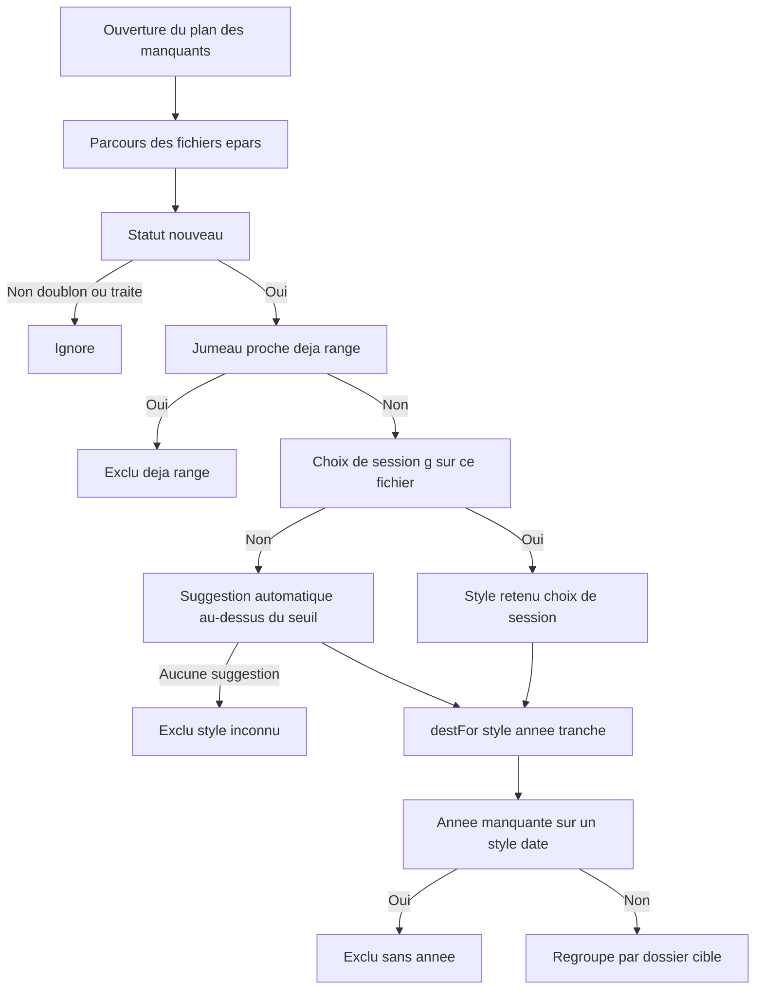
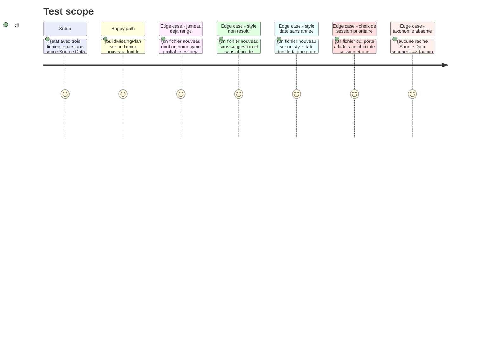

<!-- Fill or omit these sections; never add, rename, or reorder one. -->

# Instruction: Le plan « manquants » — calcul pur

## Architecture projection

> Tree of the final files. ✅ create · ✏️ modify · ❌ delete

```txt
.
├── static/src/render/missingBatch.ts      ✅ create — plan pur : collecte des manquants, routage par style, exclusions, formatage
├── static/src/render/missingBatch.test.ts ✅ create — tests unitaires du plan (collecte, routage, priorité du choix de session, exclusions)
└── static/src/render/styleCell.ts         ✏️ exporter computeSuggestion (aujourd'hui privée) pour réutiliser le calcul de suggestion
```

## User Journey



## Test Scope

<!-- Required for every phase. Keep Setup, Happy path, any qualifying Edge cases, and any required Teardown in this one journey. -->



## Tasks to do

### `1)` Collecter les fichiers manquants

> « Manquant » a déjà une définition dans le code : le statut `nouveau`.

1. Dans `static/src/render/missingBatch.ts`, créer `collectMissingFiles()` : pour chaque racine épars et chaque fichier, ne garder que ceux dont `computeStatus(filename, state.sourceFiles, state.journal)` vaut `nouveau`.
2. Exclure de ce lot les fichiers dont le chemin complet figure dans `state.dupMatches` : leur jumeau proche est déjà rangé, les copier créerait un doublon.
3. Renvoyer pour chaque fichier `{ filename, eparDir, fullpath }` — la même forme que `EparsSelection` et que les groupes de `stylePreview.ts`.

### `2)` Router chaque fichier vers son dossier cible

> Le dossier cible est une fonction du style et de l'année : la mécanique existe déjà.

1. Résoudre le style : `state.styleChoices.get(fullpath)` d'abord (décision humaine de la session), sinon `computeSuggestion(fullpath, entry)` de `styleCell.ts`.
2. Appeler `destFor(tax, style, yearOf(entry), tranche)` avec la taxonomie de `currentTaxonomy()` ; un style absent de la taxonomie donne `null`.
3. Regrouper les fichiers par `dest.dir` et trier les groupes par nom de dossier, comme `buildRangementPlan` le fait déjà.
4. Respecter la convention de chemin de `destFor` : la racine est jointe telle quelle (double slash assumé quand la config porte un slash final) — ne jamais normaliser.

### `3)` Lister les exclusions

> Une exclusion non dite devient un fichier perdu.

1. Exposer trois compteurs de chemins exclus : `noYear` (style daté sans année), `unknownStyle` (style absent des dossiers existants), `alreadyRanged` (jumeau proche déjà rangé).
2. Écrire `formatMissingPlan(plan)` : une ligne par dossier cible (avec le badge `➕` quand le dossier sera créé), puis une ligne par catégorie d'exclusion, dans le style de `formatPlan`.
3. Ne jamais exclure un fichier pour une raison non listée : tout fichier écarté du lot doit apparaître dans une des trois catégories.

### `4)` Réutiliser le calcul de suggestion existant

> Recopier la logique de suggestion créerait deux vérités qui divergeraient.

1. Dans `static/src/render/styleCell.ts`, exporter `computeSuggestion` (fonction privée aujourd'hui) — aucune signature modifiée, aucun appelant impacté.
2. Importer cette fonction dans `missingBatch.ts` plutôt que de recalculer le score de suggestion.
3. Ajouter `static/src/render/missingBatch.test.ts` : collecte, routage, priorité du choix de session, et les quatre cas d'exclusion.

## Test acceptance criteria

<!-- Each criterion is an observable behavior, not a command. -->

| Task | Acceptance criteria                                                                                            |
| ---- | ------------------------------------------------------------------------------------------------------------------------------------------------------------------------------ |
| 1    | Un fichier au statut `doublon` ou `traité` n'apparaît jamais dans le lot.                                     |
| 1    | Un fichier dont un homonyme probable est déjà rangé n'apparaît jamais dans le lot.                              |
| 2    | Un fichier porteur d'un choix de session va dans le dossier de ce style, même si la suggestion automatique en propose un autre. |
| 2    | Un fichier sans choix de session va dans le dossier du style suggéré, la tranche étant déduite de l'année du tag.   |
| 2    | Deux fichiers de même style et de même tranche atterrissent dans le même groupe, et les groupes sont triés par nom de dossier. |
| 3    | Tout fichier écarté du lot est compté dans `noYear`, `unknownStyle` ou `alreadyRanged`.                          |
| 3    | `formatMissingPlan` nomme chaque dossier cible et chaque catégorie d'exclusion.                                 |
| 4    | `npm test` passe : le nouveau fichier de test est vert et aucun test existant n'est modifié.                     |
