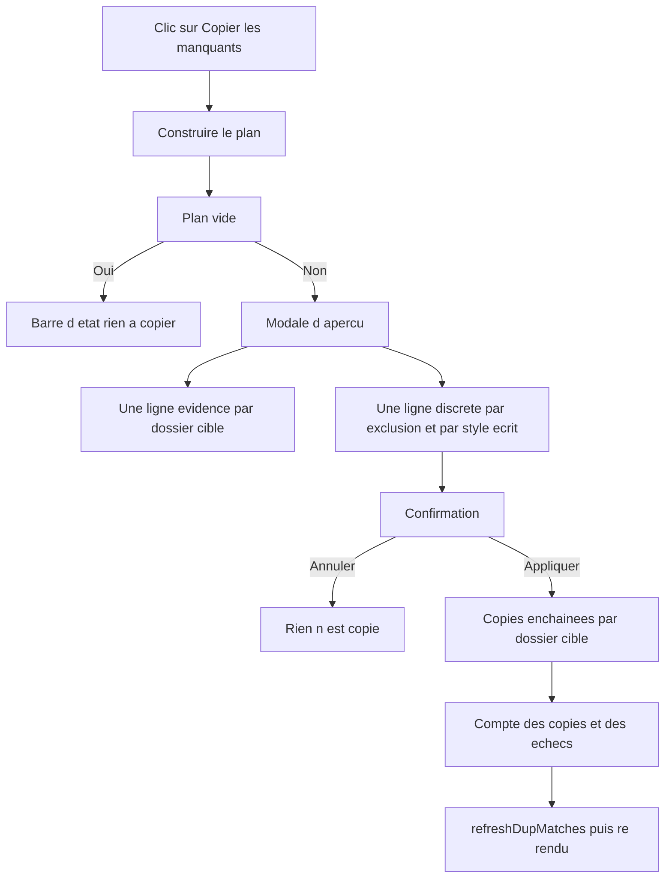
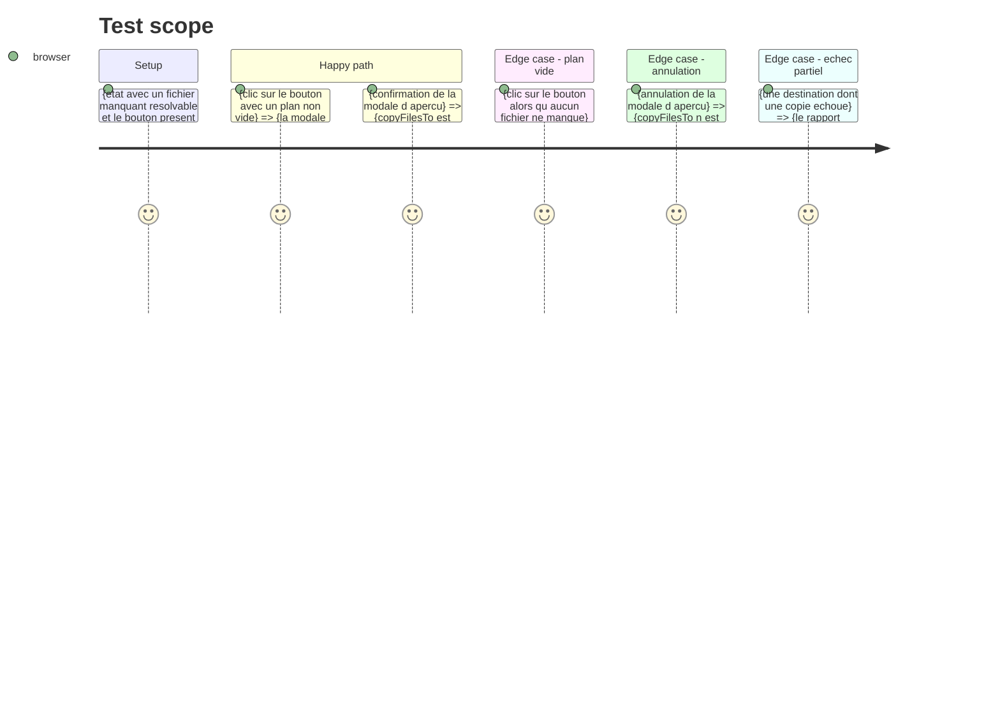

<!-- Fill or omit these sections; never add, rename, or reorder one. -->

# Instruction: Bouton, aperçu et application du lot

## Architecture projection

> Tree of the final files. ✅ create · ✏️ modify · ❌ delete

```txt
.
├── templates/index.html              ✏️ bouton « Copier les manquants » dans l'en-tête du panneau Éparpillé (l. 32)
├── static/styles/pages/sync.css      ✏️ style du bouton dans la famille .panel-add-btn (l. 92)
├── static/src/script.ts              ✏️ branchement du clic sur le bouton (à côté du bouton ➕, l. 104)
└── static/src/render/missingBatch.ts  ✏️ openMissingBatchPreview() et applyMissingPlan() (réutilisent copyFilesTo et confirmCopyDialog)
```

## User Journey



## Test Scope

<!-- Required for every phase. Keep Setup, Happy path, any qualifying Edge cases, and any required Teardown in this one journey. -->



## Wireframe

<!-- UI phase only. No UI => omit the section, don't invent one. -->

```txt
┌────────────────────────────────────────────────────────────────────────────┐
│ (1) En-tête du panneau Éparpillé                                           │
│   📂 Éparpillé (5 092)                     [ ⇪ Copier les manquants ]      │
├────────────────────────────────────────────────────────────────────────────┤
│ (2) Barre d'état des fichiers épars (inchangée)                            │
│   ✓ 412 traité   ● 318 reste   ○ 96 doublon   ↔ 27 homonyme                │
├────────────────────────────────────────────────────────────────────────────┤
│ (3) Liste des fichiers épars (inchangée)                                  │
│   ● track.mp3   1996   MP3 320kbps   4:12                                 │
└────────────────────────────────────────────────────────────────────────────┘

Modale d'aperçu — la même que celle de l'aperçu « e »

┌────────────────────────────────────────────────────────────────────────────┐
│ (4) Preuve d'action — une ligne évidence par dossier cible                │
│   128 fichiers → techno_acid_1990                                        │
│    94 fichiers → techno_acid_1995                                        │
│    12 fichiers → italo_disco ➕ sera créé                                  │
├────────────────────────────────────────────────────────────────────────────┤
│ (5) Conséquences en discret                                               │
│   ⤷ 27 déjà rangés — ignorés                                             │
│   ? 14 styles inconnus des dossiers actuels — ignorés                     │
│   ⚠ 9 sans année — ignorés (g puis chiffre pour trancher)                 │
│   Style « techno_acid » écrit sur l'épars et la copie · année intacte      │
├────────────────────────────────────────────────────────────────────────────┤
│ (6) Actions                        [ Annuler ]   [ Copier 234 fichiers ]    │
└────────────────────────────────────────────────────────────────────────────┘
```

1. En-tête du panneau Éparpillé : le nouveau bouton, à côté du compte de fichiers — il porte sur ce que la colonne liste.
2. Barre d'état des fichiers épars : le compte `● N reste` y est déjà, il annonce ce que le bouton va traiter.
3. Liste des fichiers épars : inchangée — le bouton agit sur le lot, pas sur la ligne.
4. Preuve d'action : une ligne par dossier cible, le nombre de fichiers et le badge `➕` quand le dossier sera créé.
5. Conséquences en discret : les exclusions et le fait que la copie écrira le style du dossier cible.
6. Actions : annuler, ou un libellé qui annonce le nombre de fichiers à copier.

## Tasks to do

### `1)` Le bouton

> L'action doit être atteignable sans clavier, sans toucher aux raccourcis existants.

1. Dans `templates/index.html`, ajouter le bouton dans l'en-tête du panneau Éparpillé (l. 32), après `#epars-header-count`, avec un `id` dédié et un `title` qui dit ce qu'il fait.
2. Dans `static/styles/pages/sync.css`, styler le bouton dans la famille `.panel-add-btn` (l. 92) : fond neutre, survol plus clair, `cursor: pointer`.
3. Ne pas toucher au bouton ➕ du panneau Source Data ni à la barre d'outils : le nouveau bouton appartient au panneau qui porte les fichiers manquants.
4. Le bouton reste visible même quand il n'y a rien à copier : le clic explique alors la situation dans la barre d'état, comme le fait déjà l'aperçu « e ».

### `2)` L'aperçu

> Rien n'est copié avant que l'utilisateur ait vu où.

1. Dans `static/src/render/missingBatch.ts`, ajouter `openMissingBatchPreview()` : construire le plan, et si le plan est vide, expliquer dans la barre d'état pourquoi il n'y a rien à copier.
2. Reprendre `buildCopyDialogSpec` de `render/copyDialog.ts` : un groupe par dossier cible, `destCreated` à `!dest.exists`, les lignes d'exclusion en notes discrètes.
3. Ajouter une note de consentement par destination qui déclare un style : la copie écrit ce style dans le tag de l'épars et de la copie, l'année n'est jamais touchée.
4. Ouvrir la modale avec `confirmCopyDialog` et un libellé d'action qui annonce le nombre de fichiers (`Copier 234 fichiers`).

### `3)` L'application

> Le lot s'enchaîne dossier par dossier, comme l'aperçu « e » le fait déjà.

1. Ajouter `applyMissingPlan(plan)` : pour chaque groupe, dans l'ordre, appeler `copyFilesTo(dest.dir, files)` et cumuler les copies réussies.
2. Déduire les échecs par différence — `copyFilesTo` renvoie les copies réussies, le reste a échoué — et annoncer le compte dans la barre d'état à la fin.
3. Mettre à jour la barre d'état après chaque dossier pour que l'utilisateur voie l'avancement sur un lot de plusieurs centaines de fichiers.
4. Appeler `refreshDupMatches()` à la fin du lot : l'index des homonymes est périmé après une copie en masse, la pastille « ⤷ déjà rangé » mentirait sinon.

### `4)` Le branchement et les tests

> Un bouton sans handler est un bouton mort.

1. Dans `static/src/script.ts`, brancher le clic du bouton sur `openMissingBatchPreview()`, à côté du branchement du bouton ➕ (l. 104).
2. Ne pas ajouter de raccourci clavier : la légende `?` est générée depuis les bindings labellisés et un test de bijection la verrouille.
3. Ajouter les tests : clic → modale ouverte, confirmation → `copyFilesTo` appelé une fois par dossier cible et dans l'ordre, annulation → aucun appel.
4. Respecter la granularité des passages (`AGENT.md` S4, ≤ 3 fichiers par passe) : template + CSS d'un côté, `script.ts` + `missingBatch.ts` de l'autre.

## Test acceptance criteria

<!-- Each criterion is an observable behavior, not a command. -->

| Task | Acceptance criteria                                                                                     |
| ---- | --------------------------------------------------------------------------------------------------------- |
| 1    | Le bouton est visible dans l'en-tête du panneau Éparpillé et porte un `title` qui nomme l'action.         |
| 1    | Le bouton n'apparaît sur aucune autre page : `#main-panels` est masqué hors Sync.                         |
| 2    | Un clic ouvre une modale qui nomme chaque dossier cible et son nombre de fichiers.                       |
| 2    | La modale liste chaque exclusion (déjà rangé, style inconnu, sans année) de manière lisible.             |
| 2    | Aucun fichier n'est copié avant la confirmation.                                                          |
| 3    | Après confirmation, `copyFilesTo` est appelé une fois par dossier cible, dans l'ordre des groupes.         |
| 3    | Le rapport final annonce le nombre de copies réussies et le nombre d'échecs.                              |
| 3    | Après le lot, la pastille « ⤷ déjà rangé » correspond à l'index des homonymes recalculé.                   |
| 4    | `npm run typecheck`, `npm run lint` et `npm test` passent sans qu'un test existant ait été modifié.        |
