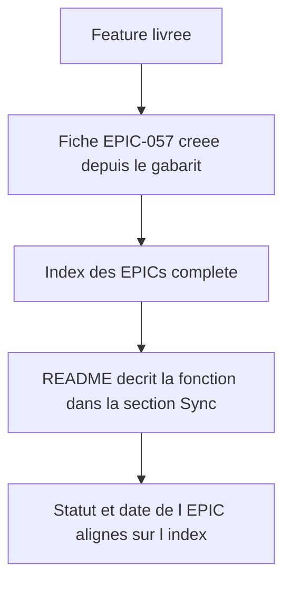
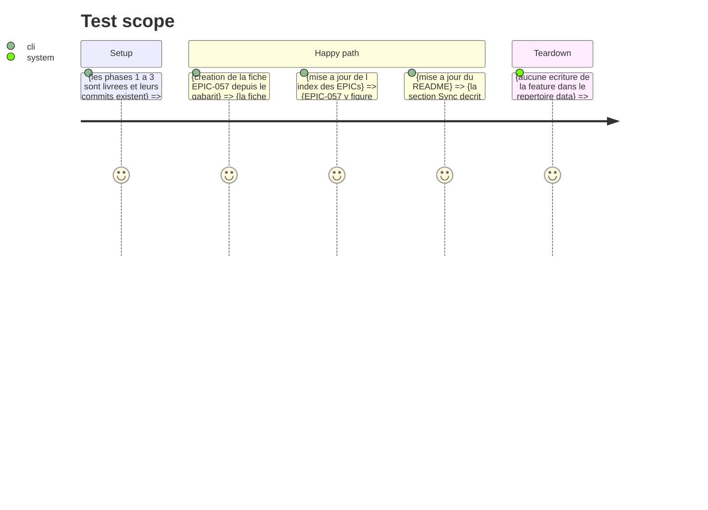

<!-- Fill or omit these sections; never add, rename, or reorder one. -->

# Instruction: Traçabilité EPIC-057 et documentation

## Architecture projection

> Tree of the final files. ✅ create · ✏️ modify · ❌ delete

```txt
.
├── docs/superpowers/epics/EPIC-057-copier-tous-les-manquants.md  ✅ create — fiche EPIC (objectif, contexte, tâches, fichiers, validation, traçabilité)
├── docs/superpowers/epics/README.md                                 ✏️ entrée d'index pour EPIC-057
└── README.md                                                        ✏️ section Sync : le bouton, ce qu'il copie, ce qu'il exclut
```

## User Journey



## Test Scope

<!-- Required for every phase. Keep Setup, Happy path, any qualifying Edge cases, and any required Teardown in this one journey. -->



## Tasks to do

### `1)` La fiche EPIC

> Toute évolution du dépôt se trace dans une EPIC.

1. Créer `docs/superpowers/epics/EPIC-057-copier-tous-les-manquants.md` depuis `_template.md` — le numéro suivant est 057 (055 et 056 existent déjà).
2. Renseigner l'objectif, le contexte (le flux de copie en lot déjà présent, le routeur de style déjà présent, le confinement manquant), les tâches cochées des phases 1 à 3, les fichiers impactés et la validation.
3. Noter les deux décisions structurantes : destination calculée par style, et confinement de `POST /copy` posé avant la feature.
4. Référencer les commits des phases 1 à 3 (`git log`) — une EPIC livrée référence ses commits.

### `2)` L'index

> L'index est la source unique du registre des évolutions.

1. Ajouter la ligne EPIC-057 dans `docs/superpowers/epics/README.md`, à la suite de EPIC-056, dans l'ordre des numéros.
2. Mettre le statut réel (`🟢 Livré` une fois les phases 1 à 3 livrées) et la date du jour, comme les autres entrées.

### `3)` Le README

> Le README décrit l'app telle qu'elle est, pas telle qu'elle était prévue.

1. Dans la section « Fonctionnalités », sous la puce **Sync**, décrire le bouton, ce qu'il copie et ce qu'il exclut.
2. Dans la section « Raccourcis clavier », ne rien ajouter : le bouton n'a pas de touche.
3. Vérifier que les comptes de tests annoncés (« 1 230 tests », « 367 tests backend ») restent exacts après l'ajout des tests des phases 1 à 3, et les corriger s'il faut.

## Test acceptance criteria

<!-- Each criterion is an observable behavior, not a command. -->

| Task | Acceptance criteria                                                                            |
| ---- | ----------------------------------------------------------------------------------------------- |
| 1    | La fiche EPIC-057 existe, suit le gabarit et porte le statut et la date réels.                   |
| 1    | La fiche référence les commits des phases 1 à 3 et la validation exécutée.                     |
| 2    | L'index des EPICs contient EPIC-057 entre EPIC-056 et la fin de la table.                       |
| 3    | La section Sync du README décrit le bouton, ce qu'il copie et ce qu'il exclut.                  |
| 3    | Le README ne mentionne aucun raccourci clavier pour cette action.                               |
| 3    | Les comptes de tests annoncés dans le README correspondent à la suite réellement exécutée.       |
