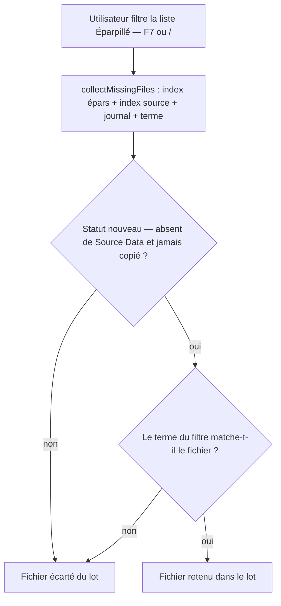
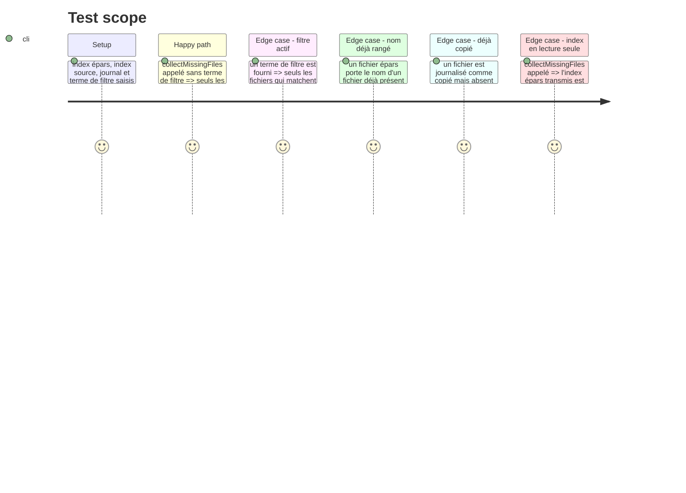

# Instruction: Socle — la sélection des fichiers manquants

## Architecture projection

> Tree of the final files. ✅ create · ✏️ modify · ❌ delete

```txt
.
└── static/src/
    └── render/
        ├── copyAllMissing.ts       ✅ create — sélection pure des fichiers manquants (statut + filtre)
        └── copyAllMissing.test.ts  ✅ create — tests unitaires de la sélection
```

## User Journey



## Test Scope



## Tasks to do

### `1)` Module de sélection

> Isoler le calcul du lot dans une fonction pure, sans DOM ni état global, pour la tester seule.

1. Créer `static/src/render/copyAllMissing.ts` :

   ```ts
   export interface MissingFile {
     filename: string;
     eparDir: string;
     fullpath: string;
   }

   export function collectMissingFiles(
     eparsFiles: Record<string, FileIndex>,
     sourceFiles: SourceFiles,
     journal: JournalEntry[],
     term = '',
   ): MissingFile[];
   ```

   - Pour chaque `[dirPath, files]` de `eparsFiles`, puis chaque `[filename, data]` :
     - **garder** si `computeStatus(filename, sourceFiles, journal) === 'nouveau'` — réutiliser `utils.ts` (`computeStatus`), ne pas re-implémenter le verdict ;
     - **garder** si `term` est vide, sinon si `matchesTokens(foldTerm(term), { name: filename, year: data.year ?? null, codec: data.codec ?? null, path: data.path, genre: data.genre ?? null })` — **exactement** les mêmes champs et le même pli que `renderEpars` (`render/eparsUI.ts`), sinon le lot et l'affichage ne verraient pas le même ensemble ;
     - `fullpath = \`${dirPath}/${data.path}\`` (le chemin relatif réel, pas le nom plat).
   - La fonction ne lit aucun module global (`state`), ne touche pas le DOM et ne mute pas ses arguments.
   - Ordre de sortie : par dossier épars puis par nom de fichier (ordre alphabétique, comme le rendu de la liste) — un lot stable est un lot lisible dans la modale.

### `2)` Tests unitaires de la sélection

> Fixer le comportement du lot avant tout branchement : un test rouge d'abord.

1. Créer `static/src/render/copyAllMissing.test.ts` :
   - **cas nominal** : trois fichiers épars, dont un dont le nom existe déjà dans Source Data et un journalisé comme copié → un seul fichier retourné ;
   - **filtre actif** : un terme non year-like (ex. `techno`) ne garde que les fichiers qui matchent (nom, chemin épars ou genre) ;
   - **filtre year-like** : un terme `1993` se comporte comme `matchesTokens` (année exacte d'abord) ;
   - **chemin réel** : `fullpath` vaut `<eparDir>/<path>` (le `path` relatif de l'entrée, pas le nom de fichier) ;
   - **non-mutation** : l'objet `eparsFiles` transmis est identique avant et après l'appel (comparaison structurelle) ;
   - **liste vide** : un index épars vide renvoie une liste vide (pas d'exception).

## Test acceptance criteria

| Task | Acceptance criteria                                                                                                                                                                                             |
| ---- | --------------------------------------------------------------------------------------------------------------------------------------------------------------------------------------------------------------- |
| 1    | Une collection contenant un fichier déjà rangé (nom identique dans Source Data) et un fichier journalisé comme copié ne contient que les fichiers absents de Source Data et jamais copiés.                                                                                  |
| 1    | Un terme de filtre actif écarte les fichiers qui ne matchent pas, et le lot retourné est identique à l'ensemble des lignes « nouveau » visibles dans la liste filtrée.                                                                                      |
| 1    | Le chemin complet retourné est la concaténation du dossier épars et du chemin relatif de l'entrée — il correspond à la valeur `data-fullpath` des lignes rendues.                                                                                             |
| 2    | Un test échoue si le module laisse un fichier déjà rangé dans le lot, si le filtre est ignoré, si le chemin est aplati ou si l'index transmis est muté.                                                                                                              |
