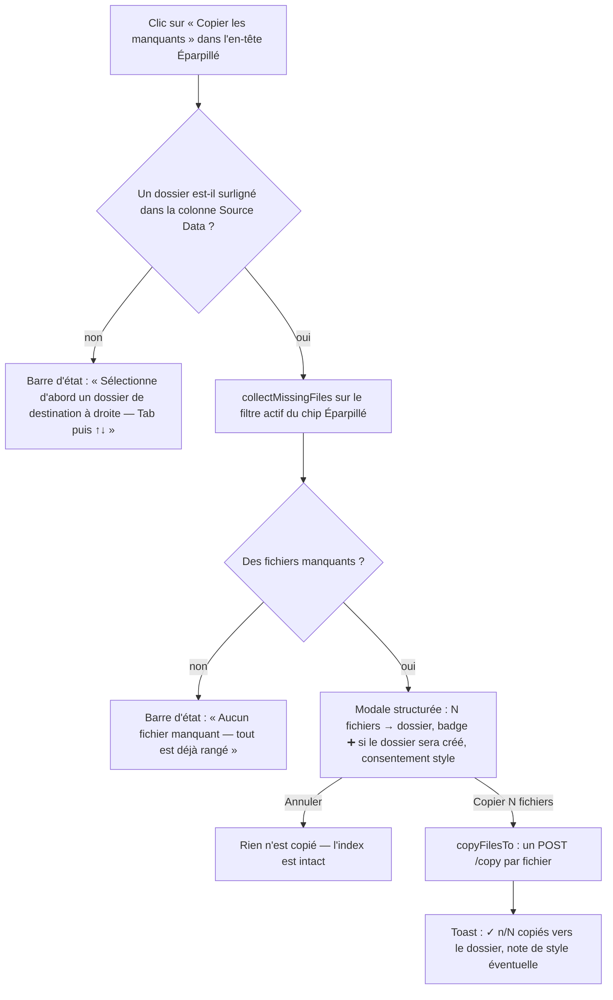
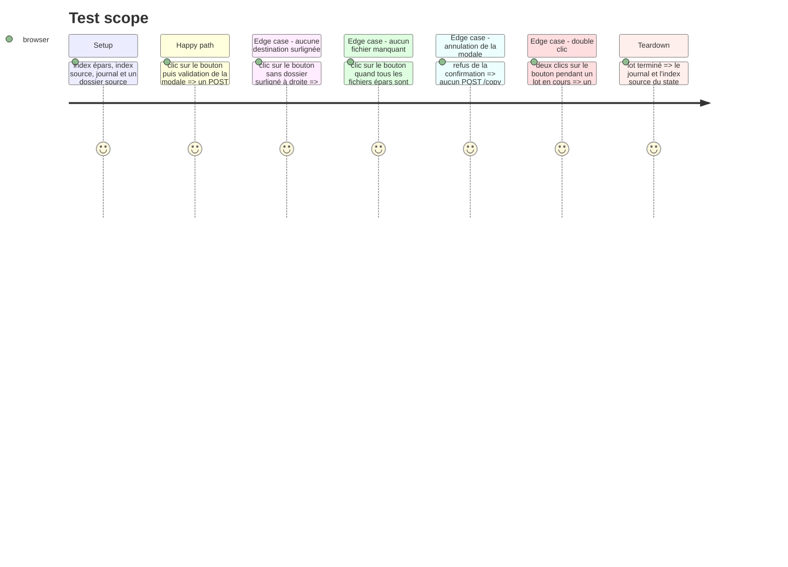

# Instruction: Bouton, destination, confirmation, exécution du lot

## Architecture projection

> Tree of the final files. ✅ create · ✏️ modify · ❌ delete

```txt
.
├── templates/
│   └── index.html                 ✏️ modify — bouton « Copier les manquants » dans l'en-tête du panneau Éparpillé
└── static/src/
    ├── actions.ts                  ✏️ modify — `destExists` devient exporté (comportement inchangé)
    ├── script.ts                   ✏️ modify — branchement du clic sur le flux
    └── render/
        ├── copyAllMissing.ts       ✏️ modify — destination, spec de la modale, exécution du lot
        └── copyAllMissing.test.ts  ✏️ modify — tests du flux (destination, refus, confirmation, annulation)
```

## User Journey



## Test Scope



## Wireframe

```txt
┌────────────────────────────────────────────────────────────────────────────┐
│ (1) Toolbar : Sync · Playlist · Doublons · Années     ⚙️ Config 🔄 📋 ❓   │
├─────────────────────────────────┬──────────────────────────────────────────┤
│ (2) En-tête Éparpillé           │ (3) En-tête Source Data                  │
│   📂 Éparpillé (5 092)          │   📂 Source Data (1 604)         [ ➕ ]   │
│            [ ⬇️ Copier les      │                                          │
│              manquants ]        │                                          │
├─────────────────────────────────┼──────────────────────────────────────────┤
│ (4) Barre d'état épars          │ (5) Arbre Source Data                    │
│   ✓ 0 traité ● 12 reste ○ 3 ↔ 4 │   ▾ techno_hard_1990   ← dossier surligné │
├─────────────────────────────────┤     …                                    │
│ (6) Liste Éparpillé             │                                          │
│   ▶ artist - title.mp3  ●       │                                          │
└─────────────────────────────────┴──────────────────────────────────────────┘

┌── Modale de copie (au-dessus de la page) ──────────────────────────────────┐
│ (7) 12 fichiers  →  techno_hard_1990                                      │
│     Style « techno_hard » écrit sur l'épars et la copie · année intacte    │
│                                    [ Copier 12 fichiers ]  [ Annuler ]     │
└────────────────────────────────────────────────────────────────────────────┘
```

1. Toolbar : navigation entre pages et outils — le bouton ne s'y joint pas (la page Sync est déjà active).
2. En-tête Éparpillé : le compte de fichiers, et le bouton qui porte la nouvelle action — même emplacement et même style (`.panel-add-btn`) que le bouton ➕ du panneau de droite.
3. En-tête Source Data : le compte de fichiers rangés et le bouton de création de dossier — le modèle repris pour le bouton du panneau gauche.
4. Barre d'état épars : « ● 12 reste » = le nombre de fichiers manquants **déjà filtré** — le bouton annonce donc le même chiffre que l'écran.
5. Arbre Source Data : le dossier surligné est la destination du lot ; c'est le geste que le bouton transforme en action.
6. Liste Éparpillé : les lignes « nouveau » (LED bleue) que le bouton va copier ; la LED passe au gris « doublon » au fil de la copie.
7. Modale de copie : l'évidence (N fichiers → un dossier, badge « ➕ sera créé » si le dossier n'existe pas) et le consentement style en discret — la porte unique avant l'écriture.

## Tasks to do

### `1)` Exposer le calcul d'existence du dossier

> La modale doit dire si `/copy` va créer le dossier — la réponse existe déjà.

1. Dans `static/src/actions.ts`, passer `destExists` en `export function destExists` — **aucun changement de comportement**, les appelants actuels (`executeCopy`) sont inchangés.

### `2)` Destination, lot, modale et exécution

> Un seul point d'entrée : lire la destination, calculer le lot, passer par la modale, copier.

1. Dans `static/src/render/copyAllMissing.ts`, ajouter :

   ```ts
   export function resolveDestinationDir(): string | null;
   export function openCopyAllMissing(): void;
   ```

   - `resolveDestinationDir()` — lit `#source-container .focused` ; si l'élément focusé est une **ligne de fichier**, prendre son `closest('.directory')` (le dossier parent sert de destination) ; renvoyer `dataset.dirpath` ou `null`. **Même règle que le F5 simple** (`executeCopy`) : la destination ne dépend pas du panneau actif.
   - `openCopyAllMissing()` :
     - destination absente → `setStatus('Sélectionne d\'abord un dossier de destination à droite (Tab puis ↑↓).')` et retour, **aucune copie** ;
     - lot vide → `setStatus('Aucun fichier manquant à copier — tout est déjà rangé.')` et retour ;
     - sinon `buildCopyDialogSpec([{ destName, destCreated: !destExists(destDir), filenames, destDir }], { styleConsent: styleConsentShort(destDir) ?? undefined })` puis `confirmCopyDialog(spec, onConfirm, \`Copier ${plural(files.length, 'fichier')}\`)` ;
     - le terme passé à `collectMissingFiles` est `getFilterTerm('sync-epars')` — le filtre actif borne le lot.
   - `runCopyBatch(destDir, files)` — garde `busy` au niveau du module (anti double-exécution, sur le modèle de `state.replaceBusy`) ; bouton désactivé pendant l'opération, **toujours réactivé** en `finally` ; `await copyFilesTo(destDir, files)` ; toast `✓ n/N copiés vers <dossier>` + note de style ; la sélection multiple est vidée par `copyFilesTo` (comportement existant, non modifié).
   - Le toast passe par `showToast`, la guidance par `setStatus` — les canaux ne se croisent pas (`core/feedback.ts`).

2. Effet de bord à connaître et à annoncer dans la modale : `/copy` écrit le style déclaré par le dossier cible **sur l'épars et sur la copie** (EPIC-043). Le consentement condensé `styleConsentShort(destDir)` s'en charge ; l'année n'est jamais touchée.

### `3)` Le bouton et son branchement

> L'en-tête du panneau Éparpillé accueille le bouton ; le clic appelle le flux.

1. `templates/index.html` — dans le `<h2>` du panneau gauche, après `#epars-header-count` :

   ```html
   <button id="btn-copy-missing" class="panel-add-btn" title="Copier tous les fichiers manquants (LED bleue) vers le dossier surligné à droite">⬇️ Copier les manquants</button>
   ```

   La classe `.panel-add-btn` existe déjà (`static/styles/pages/sync.css`) : **aucun CSS à ajouter**. Le bouton ➕ du panneau Source Data est le modèle (même classe, même emplacement dans le `<h2>`).

2. `static/src/script.ts` — brancher le clic :

   ```ts
   (document.getElementById('btn-copy-missing') as HTMLElement | null)?.addEventListener('click', () => openCopyAllMissing());
   ```

   Import direct de `./render/copyAllMissing.js` (comme `openDupsMode` / `openYearsMode`) — **pas** de passage par le barrel `render/index.ts`, pour ne pas créer de cycle d'import avec `actions.ts`.

3. ⚠ Après la modification de `templates/index.html`, **redémarrer l'app** (`npm start`) : Flask compile le template au chargement, un simple rafraîchissement exécuterait le nouveau bundle contre l'ancien HTML (README, « Utilisation »).

### `4)` Tests du flux

> Le refus, la confirmation, l'annulation et le double-clic sont les quatre comportements qui protègent l'utilisateur.

1. Dans `static/src/render/copyAllMissing.test.ts`, ajouter :
   - **destination absente** → aucun `POST /copy`, un message explicite dans la barre d'état ;
   - **aucun fichier manquant** → aucun `POST /copy`, un message explicite ;
   - **confirmation** → un `POST /copy` par fichier du lot, avec `source_path`, `dest_dir` et `filename` conformes ; les lignes concernées passent de la classe `nouveau` à `doublon` ;
   - **annulation** → aucun `POST /copy`, l'index source est inchangé ;
   - **double-clic** → un second clic pendant le lot ne déclenche pas un second lot ;
   - **style** → la destination qui déclare un style fait apparaître le consentement dans la modale.

## Test acceptance criteria

| Task | Acceptance criteria                                                                                                                                                                          |
| ---- | --------------------------------------------------------------------------------------------------------------------------------------------------------------------------------------------- |
| 1    | `destExists` est utilisable depuis un autre module sans duplication de logique, et son comportement sur un dossier existant, un dossier absent et un dossier hors racine reste inchangé.                    |
| 2    | Sans dossier surligné dans la colonne Source Data, le clic ne déclenche aucune copie et la barre d'état indique comment en choisir un.                                                          |
| 2    | Sans fichier au statut « nouveau », le clic ne déclenche aucune copie et la barre d'état indique que tout est déjà rangé.                                                                   |
| 2    | La modale énumère le lot (nombre de fichiers, nom du dossier, badge « ➕ sera créé » si le dossier n'existe pas, consentement style) avant toute écriture.                                 |
| 2    | Après validation, chaque fichier du lot est copié vers le dossier surligné et sa ligne épars passe de « nouveau » à « doublon ».                                                                |
| 2    | Après annulation, aucun fichier n'est copié et l'index source reste inchangé.                                                                                                                 |
| 3    | Le bouton est visible dans l'en-tête du panneau Éparpillé, sans nouvelle règle CSS, et un clic déclenche le flux décrit ci-dessus.                                                             |
| 3    | Deux clics rapides ne produisent qu'un seul lot de copies.                                                                                                                                 |
| 4    | Un test échoue si le flux copie sans confirmation, si le double-clic déclenche deux lots, si le filtre actif n'est pas respecté, ou si la destination retenue n'est pas le dossier surligné.          |
