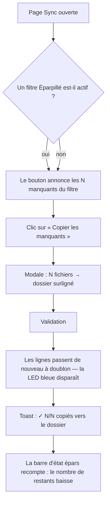
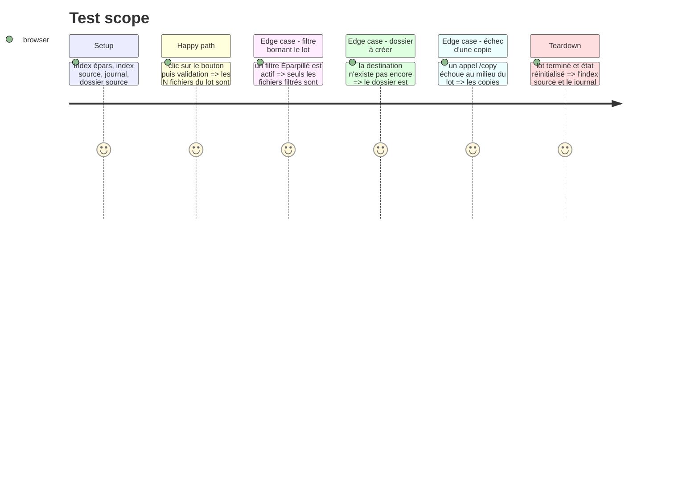

# Instruction: Preuve bout-en-bout, documentation, traçabilité

## Architecture projection

> Tree of the final files. ✅ create · ✏️ modify · ❌ delete

```txt
.
├── README.md                                         ✏️ modify — section « Page Sync » : le bouton et son comportement
├── scripts/
│   └── validate-build.js                              ✏️ modify — signature du bundle : le bouton est bien embarqué
├── docs/superpowers/
│   └── epics/
│       ├── EPIC-057-copier-tous-les-manquants.md      ✅ create — traçabilité de l'évolution (convention du dépôt)
│       └── README.md                                  ✏️ modify — entrée d'index de l'EPIC
└── static/src/
    └── render/
        └── copyAllMissing.test.ts                      ✏️ modify — test d'intégration du lot complet (POST /copy mocké)
```

## User Journey



## Test Scope



## Tasks to do

### `1)` Preuve d'intégration du lot complet

> Les tests unitaires prouvent la sélection et le refus ; il manque la preuve que le lot entier se-copy correctement.

1. Dans `static/src/render/copyAllMissing.test.ts`, ajouter un test d'intégration :
   - fixture de plusieurs dossiers épars, un dossier source surligné, `/copy` intercepté ;
   - clic sur le bouton → modale → validation → **un appel par fichier**, dans l'ordre du lot, avec les bonnes charges (`source_path` = chemin épars complet, `dest_dir` = dossier surligné, `filename`) ;
   - après le lot : `state.sourceFiles` porte une entrée par fichier copié, `state.journal` est rechargé, les lignes épars ne portent plus la classe `nouveau` ;
   - un échec de `/copy` au milieu du lot : les copies suivantes sont tentées, le compte `n/N` du toast est exact, aucun échec ne passe sous silence ;
   - filtre actif : seuls les fichiers filtrés sont copiés, les autres restent au statut `nouveau`.

### `2`) Preuve de build

> Le bundle embarqué doit porter le bouton — sinon la page affichera un template sans action.

1. Dans `scripts/validate-build.js`, ajouter aux signatures attendues :

   ```js
   { label: 'copyAllMissing (bouton manquants)', sig: 'btn-copy-missing' },
   ```

   L'identifiant du bouton est référencé par le bundle (`getElementById('btn-copy-missing')`) : son absence dans `static/dist/script.js` fait échouer `npm run build`.

### `3`) Documentation utilisateur

> Le README décrit les pages et leurs gestes : le nouveau bouton y a sa place.

1. Dans `README.md` :
   - section « Fonctionnalités », puce **Sync** : ajouter la copie en lot des fichiers manquants vers le dossier surligné ;
   - section « Page Sync » (tableau des raccourcis) : aucune ligne ajoutée — le bouton n'a pas de raccourci ; le signaler dans la phrase d'introduction du tableau plutôt que par une ligne vide ;
   - section « Limites connues » : le lot ne retire pas les homonymes probables (la pastille « ⤷ déjà rangé » reste le signal), et un lot écrit le style du dossier cible sur chaque fichier copié (EPIC-043).

### `4)` Traçabilité EPIC (convention du dépôt)

> `AGENT.md` : toute évolution/amélioration → une EPIC + une entrée à l'index.

1. Créer `docs/superpowers/epics/EPIC-057-copier-tous-les-manquants.md` à partir de `_template.md` :
   - objectif, contexte (le geste F5 est un clic par fichier ; le lot le rend reachable en une action) ;
   - tâches cochables reprenant les trois phases ;
   - fichiers impactés, validation (typecheck, vitest, pytest, lint, build), décisions, risques (lot long sur un corpus de plusieurs milliers de fichiers, écritures de style en nombre équivalent) ;
   - **Docs liées** : le plan de ce dossier (`aidd_docs/tasks/2026_10/2026_10_21_copier-tous-les-manquants/plan.md`).
2. Ajouter l'entrée correspondante dans `docs/superpowers/epics/README.md` (tableau d'index), statut **⚪ Backlog** tant que la fonctionnalité n'est pas livrée.

## Test acceptance criteria

| Task | Acceptance criteria                                                                                                                                                                                        |
| ---- | ---------------------------------------------------------------------------------------------------------------------------------------------------------------------------------------------------------- |
| 1    | Le test d'intégration échoue si le lot ne déclenche pas exactement un appel `/copy` par fichier, si un appel porte un chemin ou une destination fausse, ou si l'index source n'est pas mis à jour après le lot.        |
| 1    | Le test d'intégration échoue si un échec de copie interrompt le lot, si le compte `n/N` annoncé diffère du nombre réel de copies réussies, ou si le filtre actif n'a pas borné le lot.                    |
| 2    | `npm run build` échoue si le bundle ne contient pas la référence au bouton.                                                                                                                                  |
| 3    | Le README décrit le bouton, sa destination (le dossier surligné), le filtre qui le borne et les deux limites assumées (homonymes probables non exclus, écriture du style par copie).                |
| 4    | Le fichier EPIC existe sous le numéro suivant, l'index `docs/superpowers/epics/README.md` contient une entrée qui le nomme, et l'EPIC pointe vers le plan de ce dossier.                                          |
