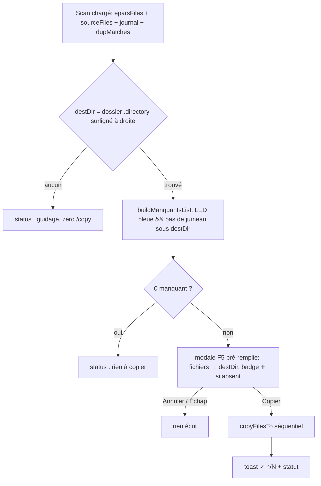
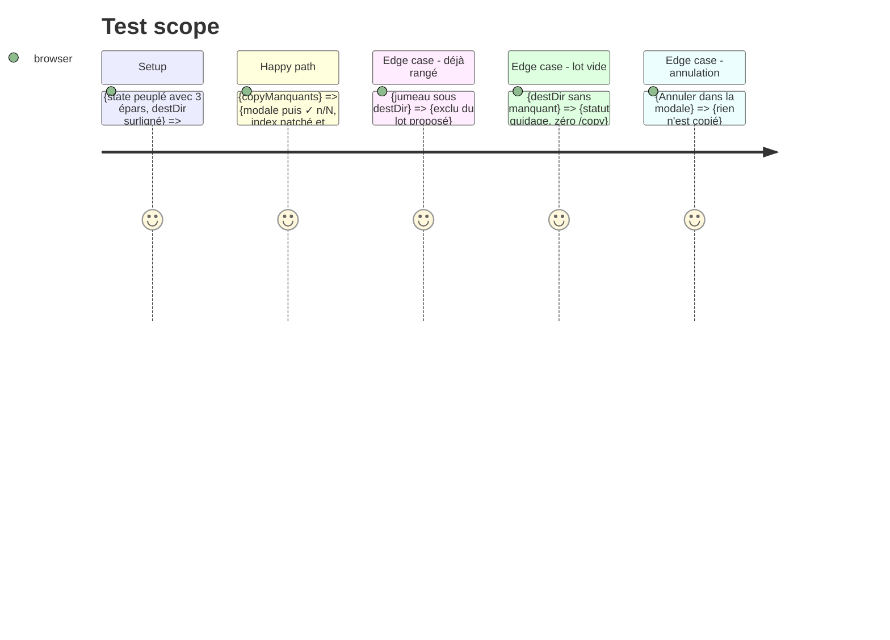

# Instruction: Cœur du lot — calculer les manquants et copier

## Architecture projection

> Tree of the final files. ✅ create · ✏️ modify · ❌ delete

```txt
.
├── static/
│   └── src/
│       └── render/
│           ├── bulkCopy.ts        ✅ create — buildManquantsList (pur) + copyManquants (lot confirmé)
│           └── bulkCopy.test.ts   ✅ create — caractérisation du calcul et du flux (jsdom, stub api)
```

## User Journey



## Test Scope



## Tasks to do

### 1) `buildManquantsList(destDir)` — calcul pur

> Dire quels épars sont copiables sans doublon vers le dossier cible.

1. Parcourir `state.eparsFiles` (fullpath = `${eparDir}/${entry.path}`, convention `dupDetect`/`copyFilesTo`).
2. Garder `computeStatus(nom, state.sourceFiles, state.journal) === 'nouveau'`.
3. Exclure si `state.dupMatches.get(fullpath)?.sourceFullPath` pointe sous `destDir` (garde de `buildRangementPlan`, EPIC-034), comparaison à slashes plié·e·s (`destExists`, EPIC-050) ; renvoyer `{ files, excluded }` et rester pur (aucun DOM, aucune écriture).

### 2) `copyManquants()` — lot confirmé

> Enchaîner modale F5 réutilisée → copies séquentielles → compte rendu.

1. `destDir` depuis le dossier surligné de droite (`#source-container .focused` → `.directory`, même sélecteur que `executeCopy`).
2. Zéro cible → `setStatus` de guidage, retour.
3. Lot vide → `setStatus` de guidage, retour, zéro `/copy`.
4. `buildCopyDialogSpec([{ destName, destCreated: !destExists(destDir), filenames, destDir }], { styleConsent: styleConsentShort(destDir) ?? undefined })` + `confirmCopyDialog(spec, cmd)` — gabarit du batch F5.
5. `cmd` : `await copyFilesTo(destDir, files)` (patch index, journal rechargé, sélection vidée) puis `setStatus('✓ ' + copied.length + '/' + files.length + ' copiés vers ' + destDir)` + `showToast` — canaux respectés (dialog = décision, toast = confirmation, status = guidage).
6. Aucune variante simultanée en attente (lot mono-destination, séquentiel comme l'aperçu E).

## Test acceptance criteria

| Task | Acceptance criteria                     |
| ---- | --------------------------------------- |
| 1    | Un épar LED bleue sans jumeau sous `destDir` figure dans la liste ; un LED grise (`doublon`) ou verte (`traite`) n'y figure jamais ; un LED bleue dont le jumeau est sous `destDir` est exclu (listé dans `excluded`). |
| 1    | `buildManquantsList` ne touche ni le DOM ni l'api (pur, testable isolément). |
| 2    | Sans dossier surligné à droite : statut de guidage, zéro appel `/copy`. |
| 2    | Avec cible : la modale F5 s'ouvre avec les noms de fichiers du lot (badge ➕ si le dossier sera créé) ; Annulation = zéro écriture ; Confirmer = `copyFilesTo` appelé avec (destDir, lot complet), compte rendu `✓ n/N` affiché, sélection épars vidée, journal rechargé. |
