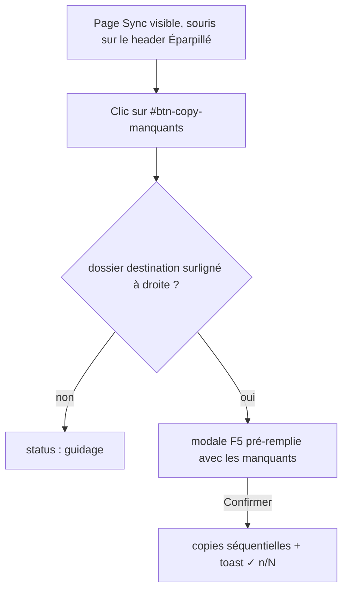
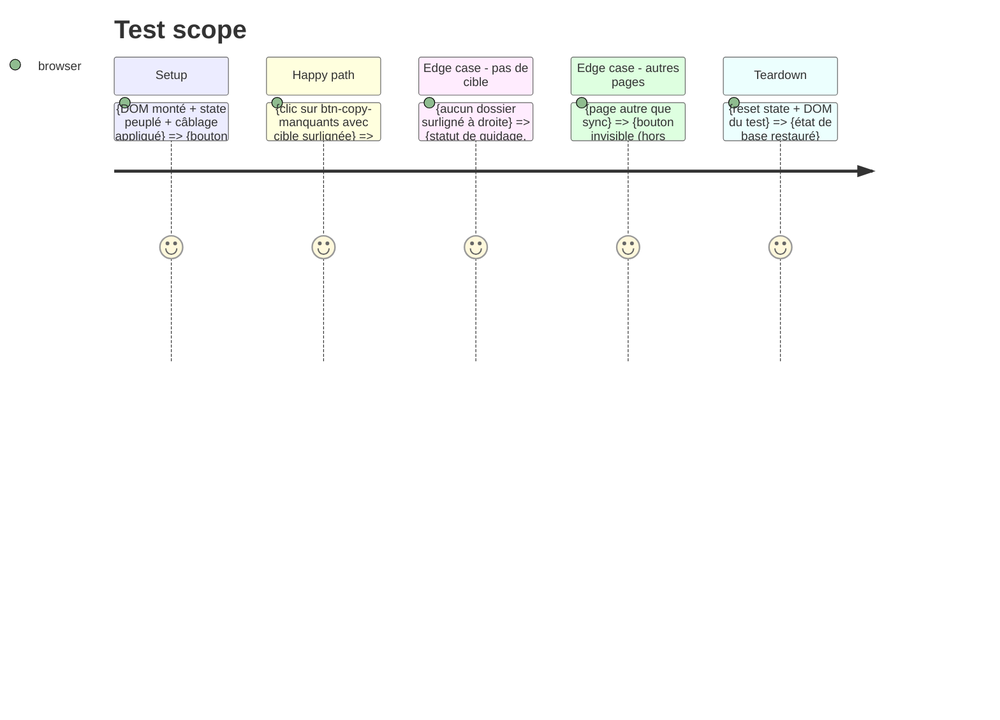

# Instruction: Bouton « copier tous les manquants » dans le header Éparpillé

## Architecture projection

> Tree of the final files. ✅ create · ✏️ modify · ❌ delete

```txt
.
├── templates/index.html                    ✏️ modify — bouton #btn-copy-manquants dans le h2 du panneau Éparpillé
├── static/
│   ├── src/
│   │   ├── script.ts                       ✏️ modify — import du module + câblage addEventListener au boot
│   │   └── render/
│   │       ├── bulkCopy.ts                 ✏️ modify — export initBulkCopyButton() (câblage du clic)
│   │       └── bulkCopy.test.ts            ✏️ modify — caractérisation du clic bouton (jsdom)
```

## User Journey



## Test Scope



## Wireframe

```txt
┌────────────────────────────────────────────────────────────────┐
│ (1) Toolbar : 📦 Sync · 🎵 Playlist · ↔ Doublons · 📅 Années   │
├───────────────┬────────────────────────────────────────────────┤
│ (2) Éparpillé │ (3) Source Data                                │
│   (n · k ↔)   │   (n)                                   [➕]   │
│ [⚡ Copier     │ [filtre]                                       │
│   manquants]  │  ○ techno_acid_1990                            │
│ [filtre]      │  ◇ house_2019                                  │
│  ○ _techno    │                                                │
│    □ z.mp3 ●  │                                                │
│    □ y.mp3 ●  │                                                │
├───────────────┴────────────────────────────────────────────────┤
│ (5) #status-text                                               │
└────────────────────────────────────────────────────────────────┘
```

1. Toolbar inchangée.
2. Panneau 📡 Éparpillé : le bouton placé ici (header, à côté du compteur) agit sur les fichiers **LED bleue** visibles sans jumeau dans la destination surlignée.
3. Source Data : la **destination** = dossier actuellement surligné à droite (même cible que F5).
4. Le bouton — ouvre la modale de confirmation F5 réutilisée (liste des fichiers, destination, badge ➕ si le dossier sera créé).
5. Status bar : guidage (« Tab puis ↑↓ pour choisir le dossier » si rien n'est surligné).

## Tasks to do

### 1) Le bouton dans `templates/index.html`

> Un point d'entrée visible du geste, donné à la souris qui commence côté Éparpillé.

1. Ajouter `<button id="btn-copy-manquants" title="…">` dans le h2 de `#panel-left`, à côté de `#epars-header-count` — placement symétrique de `#btn-add-dir` (Source Data, ligne 38) — label court type « Copier manquants ».
2. `title` explicite : texte « Copier tous les manquants » + définition (LED bleue sans jumeau dans le dossier surligné).
3. Aucun attribut d'outil, aucune classe `page-btn` : le bouton vit dans le panneau, disparaît donc hors page Sync.

### 2) Câblage au boot

> Le clic mène à `copyManquants()` sans nouveau handler monolithique.

1. Exporter `initBulkCopyButton()` depuis `render/bulkCopy.ts`.
2. Dans `script.ts`, importer en fin de boot et appler `initBulkCopyButton()` — même pattern que le câblage `#btn-add-dir` (`script.ts:104`), ordre des imports `commands/` intact (indice matrice stable).
3. Un seul `addEventListener`, garde `null` (no-op si élément absent) — même garde défensive que les autres câblages.

### 3) Test bouton (jsdom)

> Caractériser le geste souris de bout en bout.

1. Setup DOM des deux panneaux + state peuplé ; appliquer le câblage.
2. Clic sur `#btn-copy-manquants` avec un dossier surligné à droite → modale ouverte avec le lot.
3. Clic Annuler dans la modale → rien n'est copié (api non appelée, zéro /copy).
4. Relancer `npm test -- bulkCopy` jusqu'au vert.

## Test acceptance criteria

| Task | Acceptance criteria |
| ---- | -------------------------------- |
| 1    | Le bouton existe dans le h2 du panneau Éparpillé avec id `btn-copy-manquants` et un `title` descriptif. |
| 2    | Le clic bouton déclenche `copyManquants()` ; sans dossier surligné → statut de guidage et modale jamais ouverte. |
| 2    | Aucun autre handler n'est touché ; la matrice clavier et la légende ne changent pas (aucun binding nouveau). |
| 3    | Le test jsdom du clic (cible + modale ouverte + annulation propre) est vert dans la suite `npm test`. |
