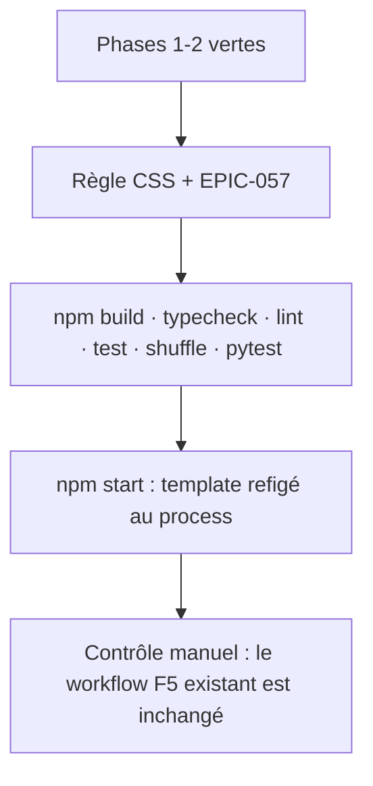
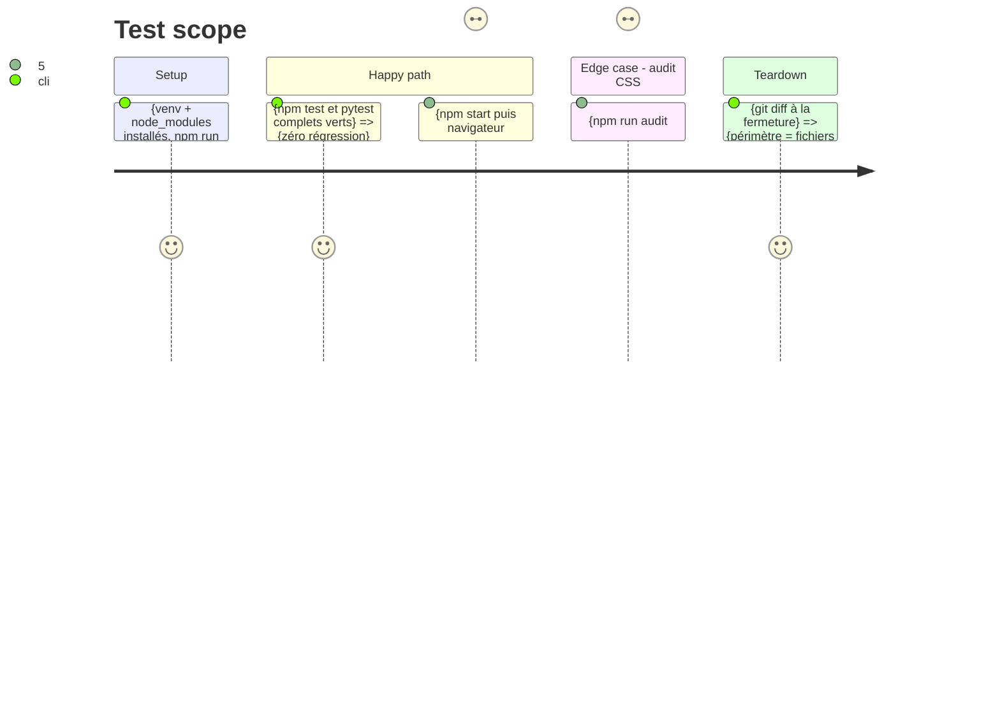

# Instruction: Style du bouton, registre EPIC-057 et validation complète

## Architecture projection

> Tree of the final files. ✅ create · ✏️ modify · ❌ delete

```txt
.
├── static/
│   └── styles/
│       └── pages/sync-main.css                       ✏️ modify — règle du bouton (section « éparpillé »)
├── docs/
│   └── superpowers/
│       └── epics/
│           ├── EPIC-057-copier-tous-les-manquants.md ✅ create — copie de _template.md remplie
│           └── README.md                             ✏️ modify — entrée à l'index
```

## User Journey



## Test Scope



## Tasks to do

### 1) Style du bouton

> Le bouton s'habille comme le reste de la page, pas comme un cas d'exception.

1. Une règle pour `#btn-copy-manquants` dans `static/styles/pages/sync-main.css` (sa section « éparpillé »), hauteur/typo cohérentes avec `#btn-add-dir`.
2. Aucune variable nouvelle dans `tokens.css`, aucune règle transversale dans `components.css` — audit : `npm run audit:css` ne doit pas référencer le bouton comme règle morte.
3. Visibilité : le bouton hérite du panneau — rien à cacher hors page Sync.

### 2) EPIC-057

> Traçabilité obligatoire : tout évolution du dépôt passe par une EPIC.

1. Copier `docs/superpowers/epics/_template.md` → `EPIC-057-copier-tous-les-manquants.md` (suivant libre ; 055/056 sont prises).
2. Remplir objectifs, fichiers touchés (alignés sur l'arborescence des phases), validation (critères des 3 phases), décisions (celles du plan).
3. Ajouter l'entrée à l'index `docs/superpowers/epics/README.md` ; statut 🟢 Livré seulement après validation complète.

### 3) Validation finale (VERIFIED COMPLIANCE)

> Preuve par les suites, jamais auto-déclarée.

1. `npm run build` (esbuild + validate-build) puis `npm run typecheck` puis `npm run lint`.
2. `npm test` (vitest complet, 53 fichiers) et `npm run test:shuffle` — puis `test:shuffle:gate` si une graine échoue.
3. `./venv/bin/python -m pytest -q` — 367 tests verts, aucun changement backend.
4. `npm start` : redémarrage obligatoire (template modifié — Flask le compile au chargement), puis contrôle manuel du cycle bouton souris + d'un F5 existant classique pour vérifier que rien n'a bougé.
5. `git diff` de contrôle : le périmètre ne dépasse pas l'arborescence cumulée des 3 phases.

## Test acceptance criteria

| Task | Acceptance criteria |
| ---- | -------------------------------- |
| 1    | Le bouton rendu évoque la même échelle que `#btn-add-dir` et `npm run audit:css` ne montre aucune classe morte nouvelle. |
| 2    | `docs/superpowers/epics/EPIC-057-copier-tous-les-manquants.md` existe d'après le template et figure à l'index du registre. |
| 3    | Vitest (1 230 tests) + `test:shuffle` + pytest (367 tests) tous verts ; build + typecheck + lint passés ; le cycle manuel souris (modale → annuler → confirmer) suit le workflow F5 dans l'app relancée après redémarrage. |
| 3    | `git diff` limité aux fichiers des 3 phases ; aucune retouche à data/, aucun refacto hors scope (W3). |
