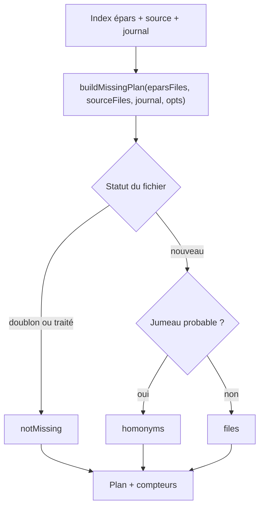
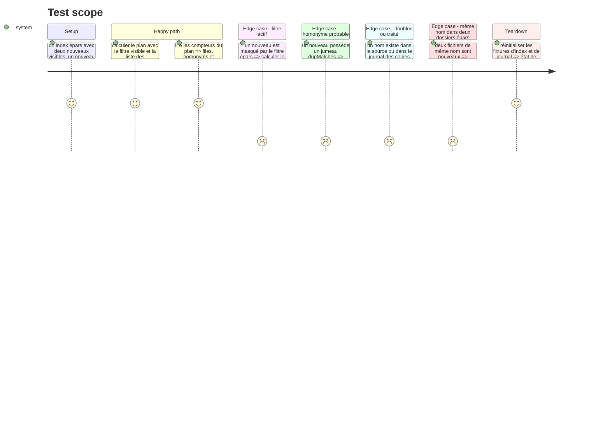

# Instruction: le lot se calcule

## Architecture projection

> Tree of the final files. ✅ create · ✏️ modify · ❌ delete

```txt
.
└── static/src
    ├── missingFiles.ts        ✅
    └── missingFiles.test.ts   ✅
```

## User Journey



## Test Scope



## Tasks to do

### `1)` Le contrat du plan

> Un calcul pur, sans DOM ni réseau, qui dit ce qui part et ce qui reste.

1. Créer `static/src/missingFiles.ts` avec `MissingFile` (`filename`, `eparDir`, `fullpath`), `MissingOptions` (`visible?: ReadonlySet<string>`, `homonyms?: ReadonlySet<string>`) et `MissingPlan` (`files`, `homonyms`, `notMissing`).
2. Exporter `buildMissingPlan(eparsFiles, sourceFiles, journal, opts = {})` : parcourir les dossiers épars triés puis les noms triés, et construire `fullpath` avec la convention existante `` `${eparDir}/${entry.path}` ``.
3. Si `opts.visible` est fourni et ne contient pas `fullpath`, sauter le fichier sans le compter : le filtre épars définit le périmètre, pas une exclusion.
4. Classer avec `computeStatus(filename, sourceFiles, journal)` : tout statut autre que `nouveau` va dans `notMissing` (le statut est global au nom de fichier, comme le compteur `● N reste`).
5. Classer `opts.homonyms.has(fullpath)` dans `homonyms` avant `files` : un jumeau probable est une revue humaine, pas une copie de masse.
6. Ne pas normaliser de chemin et ne pas lire le disque : le module ne connaît ni destination, ni DOM, ni route.
7. Ajouter un commentaire de module qui nomme les trois exclusions et renvoie à `README.md` (homonymes, doublons, traités).

### `2)` Les preuves du calcul

> Chaque exclusion est un test, pas une intention.

1. Créer `static/src/missingFiles.test.ts` avec des fixtures locales (`eparsFiles`, `sourceFiles`, `journal`) et des `Set` explicites pour `visible` et `homonyms`.
2. Couvrir : nouveau inclus, nouveau hors filtre absent, doublon exact dans `notMissing`, traité (journal `copied`) dans `notMissing`, homonyme dans `homonyms`, plan vide, ordre stable dossiers puis noms.
3. Couvrir le cas d'un même nom présent dans deux dossiers épars : les deux entrées sont classées par le statut global du nom, aucune déduplication n'est inventée.
4. Vérifier que `opts` omis traite tous les nouveaux visibles (aucun filtre, aucun homonyme).
5. Garder le test pur : aucun `fetch`, aucun `document`, aucune écriture de fichier.

## Test acceptance criteria

| Task | Acceptance criteria                                                                 |
| ---- | ----------------------------------------------------------------------------------- |
| 1 | Seuls les `nouveau` visibles sans jumeau probable entrent dans `files`              |
| 1 | Un doublon exact ou un fichier déjà traité est dans `notMissing`, jamais dans `files` |
| 1 | Un homonyme probable est dans `homonyms`, jamais dans `files`                        |
| 1 | Un nouveau masqué par le filtre n'apparaît dans aucune liste                        |
| 2 | Le plan vide est un résultat normal, sans exception                                 |
| 2 | L'ordre des fichiers est stable (dossier puis nom)                                  |
| 2 | `npm run typecheck`, `npm run lint` et `npm test` passent sans nouveau backend       |
