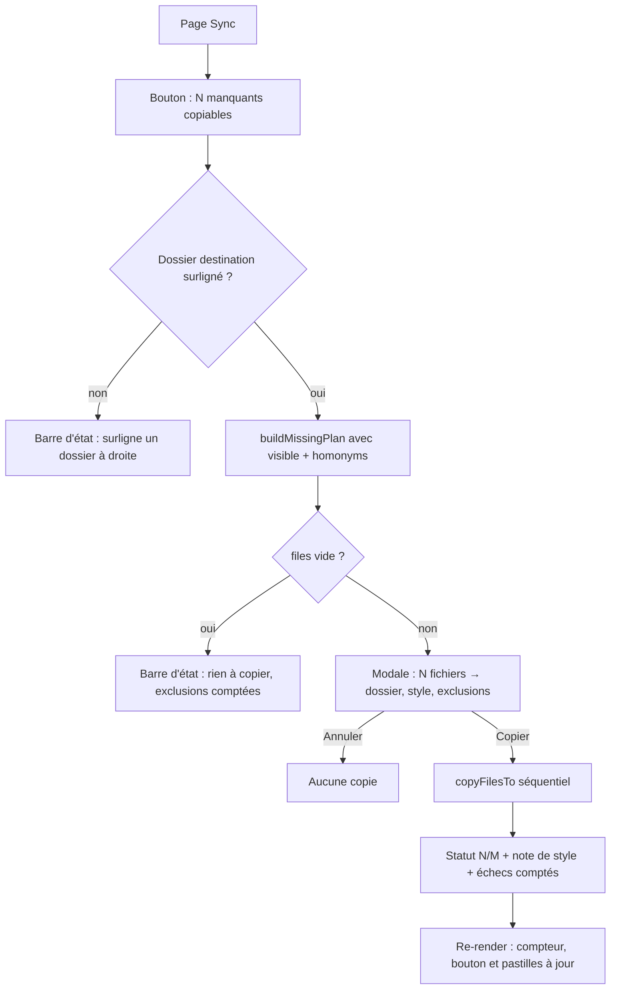
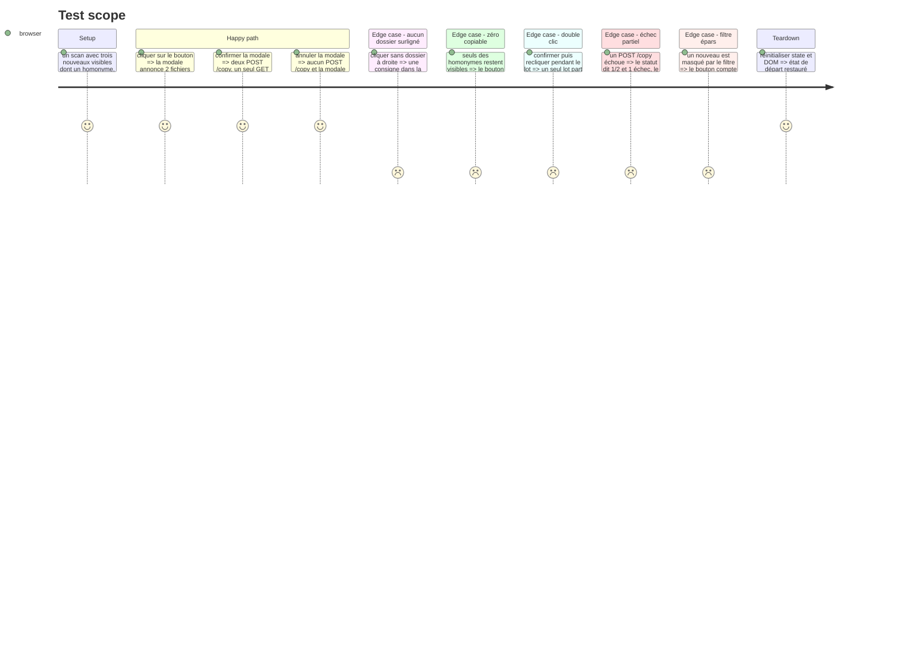

# Instruction: le bouton copie, confirme et rend compte

## Architecture projection

> Tree of the final files. ✅ create · ✏️ modify · ❌ delete

```txt
.
├── templates/index.html                    ✏️
├── static
│   ├── styles/pages/sync.css               ✏️
│   └── src
│       ├── actions.ts                      ✏️
│       ├── copyMissing.test.ts             ✅
│       ├── script.ts                       ✏️
│       ├── state.ts                        ✏️
│       └── render
│           ├── eparsUI.ts                  ✏️
│           └── eparsUI.test.ts             ✏️
```

## User Journey



## Test Scope



## Wireframe

```txt
┌──────────────────────────────────────────────────────────────────────────────┐
│ (1) Toolbar : 📦 Sync · 🎵 Playlist · ↔ Doublons · 📅 Années     ⚙️ 🔄 📋 ❓ │
├───────────────────────────────────────┬──────────────────────────────────────┤
│ (2) 📂 Éparpillé (5 092)              │ (5) 📂 Source Data (1 604)       [+] │
│     [📥 Copier 35 manquants]          │ (6) [Filtrer dossiers + fichiers…]   │
│ (3) ✓ 12 traité · ● 42 reste · ○ 3   │ (7) 📂 techno_acid_1990      ◀ focus │
│ (4) [Filtrer nom, année, codec…]      │       📂 techno_1990                 │
│     📂 _techno                        │       📂 hardcore_1990               │
│       ☐ track-a.mp3  …                │                                      │
└───────────────────────────────────────┴──────────────────────────────────────┘
```

1. Toolbar : inchangée.
2. Header gauche : titre, total, et le bouton des manquants aligné à droite, même famille que `➕`.
3. Status line : inchangée, elle garde le `● N reste` qui inclut les homonymes.
4. Filtre gauche : définit les fichiers visibles, donc le périmètre du bouton.
5. Header droit : inchangé.
6. Filtre droit : garde la destination consultable.
7. Dossier surligné : la destination du lot, comme pour F5.

```txt
┌──────────────────────────────────────────────────────────────────┐
│ (1) Copier 35 fichiers                                           │
│ (2) 35 fichiers → techno_acid_1990 ➕                            │
│ (3) Style « techno_acid » écrit (épars + copie) · année intacte  │
│ (4) 7 homonymes probables laissés de côté · à arbitrer           │
│ (5) 3 doublons ou traités ignorés                                │
│                                      [Annuler]   [Copier 35]     │
└──────────────────────────────────────────────────────────────────┘
```

1. Titre de la modale.
2. Ligne d'action : le nombre exact du lot et la destination.
3. Conséquence de style, seulement si le dossier déclare un style.
4. Exclusions d'homonymes, comptées.
5. Exclusions de doublons/traités, comptées, puis les deux actions.

## Tasks to do

### `1)` Le bouton dans le header

> Le compte des copiables se lit avant le clic, sans toucher au compteur existant.

1. Dans `templates/index.html`, ajouter après `#epars-header-count` un bouton `#btn-copy-missing` avec la classe `panel-add-btn panel-copy-btn`, l'attribut `hidden` et un titre qui nomme la destination et les exclusions.
2. Dans `static/src/render/eparsUI.ts`, compter pendant la boucle de rendu existante les `status === 'nouveau'` dont le `fullpath` n'est pas dans `state.dupMatches` ; importer `plural` depuis `../core/format.js`.
3. Après la boucle, mettre à jour le bouton : `hidden` si `countNouveau === 0`, sinon texte `📥 Copier ${plural(countCopiable, 'manquant')}`, `disabled` si `countCopiable === 0` ou `state.copyMissingBusy`.
4. Laisser `#epars-status-line` intact : le compteur `● N reste` continue d'inclure les homonymes, c'est le bouton qui dit combien sont copiables.
5. Dans `static/src/render/eparsUI.test.ts`, couvrir : deux nouveaux dont un homonyme → « 1 manquant » ; zéro nouveau → bouton masqué ; zéro copiable → bouton désactivé ; verrou occupé → bouton désactivé.

### `2)` Le geste

> Le bouton emprunte le flux F5 : destination, modale, copies, notes.

1. Dans `static/src/state.ts`, ajouter `copyMissingBusy: boolean` à côté de `replaceBusy`, valeur initiale `false`.
2. Dans `static/src/actions.ts`, extraire une fonction privée `focusedDestDir()` de `executeCopy` (dossier `.focused`, ou parent `.directory` d'une ligne fichier) et faire utiliser ce helper à `executeCopy` sans changer son comportement.
3. Exporter `copyMissing()` : garde `state.copyMissingBusy`, résolution de la destination avec consigne si absente, collecte des `fullpath` visibles depuis `#epars-container .file[data-fullpath]`, puis `buildMissingPlan(state.eparsFiles, state.sourceFiles, state.journal, { visible, homonyms: new Set(state.dupMatches.keys()) })`.
4. Si `plan.files` est vide, écrire un statut qui compte les exclusions (`homonyms`, `notMissing`) et sortir sans modale.
5. Construire une spec `buildCopyDialogSpec` à un groupe (`destName`, `destCreated: !destExists(destDir)`, `filenames`, `destDir`), avec `styleConsentShort(destDir)` et les lignes d'exclusion (`plural` pour homonymes et doublons/traités) ; confirmer via `confirmCopyDialog(..., 'Copier N fichiers')`.
6. Au confirm : poser `state.copyMissingBusy = true`, désactiver le bouton, écrire `⏳ Copie de N fichiers vers …`, `await copyFilesTo(destDir, files)`, appeler `refreshDupMatches()`, puis un statut `✓ c/N copiés vers …` avec la note de style et `N - c` échecs ; dans `finally`, relâcher le verrou et réactiver le bouton.
7. Dans `static/src/script.ts`, brancher `#btn-copy-missing` sur `copyMissing`, à côté de `#btn-add-dir`.
8. Créer `static/src/copyMissing.test.ts` : aucun dossier → consigne et zéro modale ; plan vide → statut et zéro copie ; spec de modale conforme (N, style, exclusions) ; annulation → zéro POST ; confirmation → un POST par fichier et un seul GET `/journal` ; échec partiel → statut N/M et bouton réactivé ; double clic → un seul lot.

### `3)` Le style du bouton

> Une règle de page, pas un token neuf.

1. Dans `static/styles/pages/sync.css`, ajouter `.panel-copy-btn` (marge à gauche, `white-space: nowrap`, état `:disabled` lisible) en réutilisant les variables et la famille `.panel-add-btn`.
2. Ne pas toucher `tokens.css` : aucune variable nouvelle n'est nécessaire.
3. Vérifier que le header du panneau gauche ne passe pas à la ligne à 1 366 px et que le bouton reste lisible à 2 560 px.

### `4)` Le lot de 300

> La taille réelle du corpus ne doit pas multiplier les rechargements de journal.

1. Dans `static/src/copyMissing.test.ts`, monter un plan de 300 fichiers et un mock d'API qui répond `ok: true` à `/copy` et renvoie un journal à `/journal`.
2. Confirmer le lot et compter : 300 POST `/copy`, exactement un GET `/journal`, 300 entrées copiées, verrou relâché, bouton réactivé.
3. Vérifier qu'aucun fichier n'est copié deux fois et que le statut final dit 300/300.
4. Ne pas ajouter de progression fichier par fichier : `copyFilesTo` n'a pas de hook, et le besoin n'est pas mesuré ; le statut « copie en cours » et le bouton désactivé suffisent.

## Test acceptance criteria

| Task | Acceptance criteria                                                                   |
| ---- | ------------------------------------------------------------------------------------- |
| 1 | Le bouton affiche le nombre de manquants copiables, homonymes exclus                   |
| 1 | Sans nouveau visible, le bouton est masqué ; avec zéro copiable, il est désactivé      |
| 2 | Sans dossier surligné, une consigne s'affiche et aucune modale ne s'ouvre             |
| 2 | La modale montre le N exact, la destination, le consentement de style et les exclusions |
| 2 | Annuler ne produit aucun POST `/copy`                                                 |
| 2 | Confirmer copie le plan via `copyFilesTo`, avec un seul GET `/journal`                |
| 2 | Un double clic ne lance qu'un lot ; un échec partiel donne N/M et réactive le bouton  |
| 3 | La règle CSS vit dans la couche page, aucun token ajouté                              |
| 4 | 300 fichiers donnent 300 POST `/copy` et un seul GET `/journal`                        |
| Tous | `npm run typecheck`, `npm run lint`, `npm test` et `npm run build` passent            |
