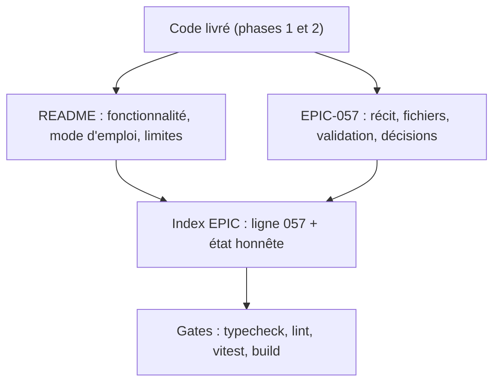
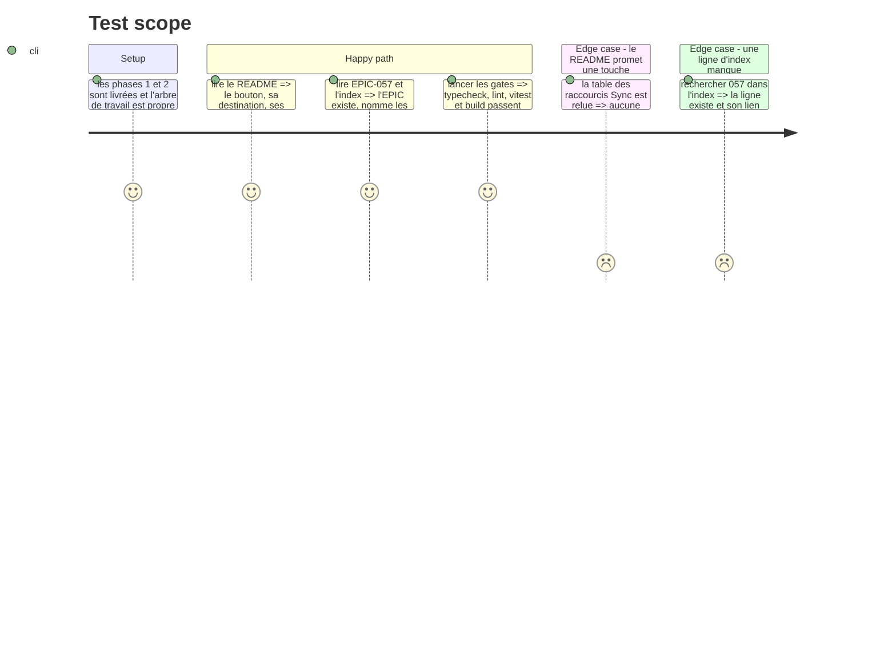

# Instruction: le contrat et la trace

## Architecture projection

> Tree of the final files. ✅ create · ✏️ modify · ❌ delete

```txt
.
├── README.md                                      ✏️
└── docs/superpowers/epics
    ├── EPIC-057-copier-tous-les-manquants.md      ✅
    └── README.md                                  ✏️
```

## User Journey



## Test Scope



## Tasks to do

### `1)` Le README dit le geste et ses limites

> La documentation décrit ce que le bouton fait, et surtout ce qu'il ne fait pas.

1. Dans la section **Fonctionnalités**, ajouter un bullet Sync : bouton « copier tous les manquants », destination = dossier Source Data surligné, confirmation, homonymes probables exclus.
2. Après **Workflow F5**, ajouter une sous-section **Copier tous les manquants** : surligner le dossier à droite, cliquer le bouton, lire la modale (N, destination, style, exclusions), confirmer ; le dossier destination reste plié et le focus ne bouge pas.
3. Dans **Limites connues**, écrire : les homonymes ambre sont laissés à l'arbitrage (page Doublons ou F5), les doublons/traités sont exclus, le bouton n'a pas de raccourci, et un lot long n'affiche pas de progression fichier par fichier.
4. Rappeler que `templates/index.html` a changé : redémarrer l'app (`npm start`) avant toute mesure navigateur, comme l'avertissement existant.

### `2)` EPIC-057

> Une évolution = une EPIC, avec ses preuves.

1. Copier `docs/superpowers/epics/_template.md` vers `docs/superpowers/epics/EPIC-057-copier-tous-les-manquants.md`.
2. Remplir l'objectif, les tâches, les fichiers impactés, les décisions (destination focusée, homonymes exclus, bouton sans touche, réutilisation de `copyFilesTo`) et la validation (tests vitest ajoutés, gates).
3. Au moment de l'écriture, statut `🔵 En cours` ; ne passer à `🟢 Livré` que si les gates passent et que le commit est connu. Ne pas inventer de hash ni de nombre de tests.
4. Ne pas modifier les EPIC voisines : la traçabilité de cette évolution vit dans son fichier et dans l'index.

### `3)` L'index

1. Dans `docs/superpowers/epics/README.md`, ajouter la ligne `EPIC-057` à la fin du tableau, avec un titre court et un lien vers le fichier.
2. Donner le statut réel (🔵 ou 🟢) et, dans la colonne doc liée, pointer vers `aidd_docs/tasks/2026_10/2026_10_25_copier-tous-les-manquants/plan.md`.
3. Mettre à jour la phrase « Dernières livraisons » seulement si le statut est 🟢 ; sinon laisser la mention existante et l'EPIC en cours.

### `4)` La gate finale

1. Lancer `npm run typecheck`, `npm run lint`, `npm test` et `npm run build`.
2. Lancer `./venv/bin/python -m pytest -q` : aucun test backend ne doit changer, le lot n'ajoute aucune route.
3. Vérifier `git diff --stat` : seuls les fichiers de la projection (plus les tests et la doc) apparaissent.
4. Ne pas modifier `data/`, ne pas supprimer de fichier audio, ne pas lancer de scan réel pour la documentation.

## Test acceptance criteria

| Task | Acceptance criteria                                                                 |
| ---- | ----------------------------------------------------------------------------------- |
| 1 | Le README décrit le bouton, la destination, les exclusions, l'absence de raccourci et le redémarrage |
| 2 | EPIC-057 existe, nomme les fichiers/tests/décisions et son statut est honnête        |
| 3 | L'index contient une ligne 057 dont le lien mène au fichier EPIC                    |
| 4 | Typecheck, lint, vitest, build et pytest passent ; le diff reste dans le périmètre   |
