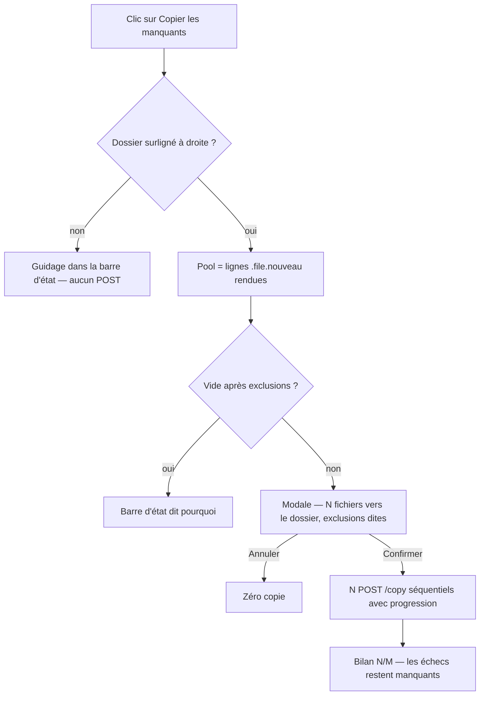
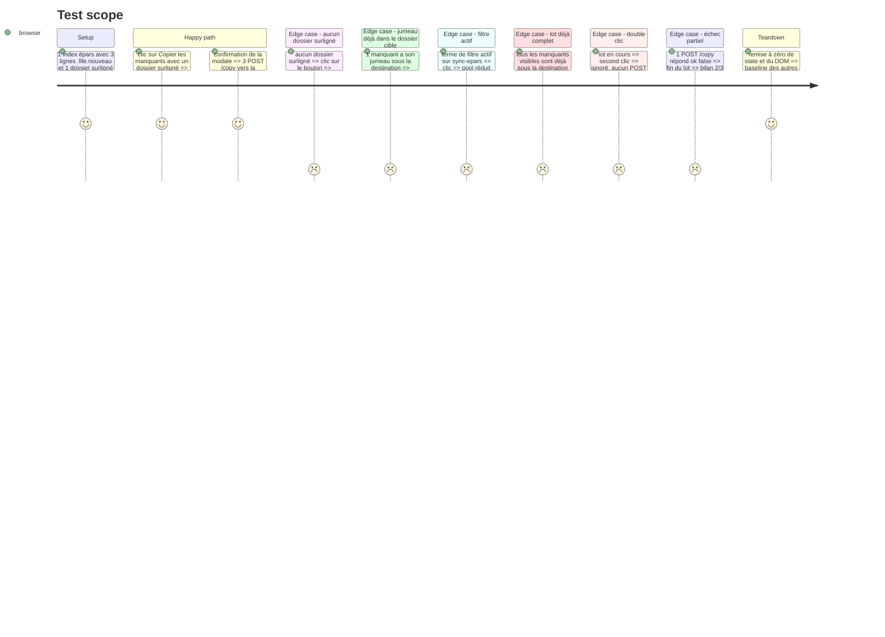

# Instruction: Copie du lot — cible, pool visible, bilan (logique + tests)

## Architecture projection

> Tree of the final files. ✅ create · ✏️ modify · ❌ delete

```txt
.
└── static/src/
    ├── actions.ts       ✏️  focusedDestDir() extrait, copyAllMissing(), onProgress? sur copyFilesTo
    └── actions.test.ts  ✏️  describe copyAllMissing — pool, exclusions, garde, échec partiel
```

## User Journey



## Test Scope



## Tasks to do

### `1)` Extraire la résolution du dossier destination

> Une seule règle pour F5 et pour le lot : la destination est le dossier surligné à droite.

1. Relire `executeCopy` (`static/src/actions.ts`, bloc « Dossier cible ») : `.focused` de `#source-container` → le dossier lui-même, ou son `.directory` ancêtre quand le focus est sur une ligne fichier.
2. Ajouter `function focusedDestDir(): string | null` (non exportée) qui porte exactement cette règle ; `dataset.dirpath` absent ou vide → `null`.
3. Remplacer le bloc équivalent dans `executeCopy` par l'appel — messages et comportement inchangés.
4. `grep -rn "closest('.directory')" static/src/actions.ts` : un seul point de résolution.

### `2)` `copyAllMissing()` — pool, exclusions, modale

> Ce que l'écran montre part, vers le dossier surligné, après une confirmation qui dit tout.

1. Ajouter `let bulkCopyBusy = false` au niveau du module (garde anti double-exécution, même esprit que `state.replaceBusy`).
2. `export function copyAllMissing(): void` — retour immédiat si `bulkCopyBusy`.
3. Destination : `focusedDestDir()` ; `null` → `setStatus("Mets d'abord en surbrillance un dossier à droite (Tab puis ↑↓), puis clique « Copier les manquants ».")` et sortir.
4. Pool : `document.querySelectorAll('#epars-container .file.nouveau')` → `{ filename: dataset.filename, eparDir: dataset.epardir, fullpath: dataset.fullpath }` ; ignorer les entrées incomplètes. Aucun nouveau prédicat de filtre : le rendu est la seule autorité sur « visible ».
5. Pool vide → `setStatus` avec la cause (filtre actif ou aucun manquant visible).
6. Exclusions : retirer les fichiers dont `state.dupMatches.get(fullpath)?.sourceFullPath` commence par `${destDir}/` (même règle que `buildRangementPlan` / `twinInDest`) et les compter.
7. Tout exclu → `setStatus` (« … sont déjà dans <dossier> ») et sortir — pas de modale vide.
8. Construire `buildCopyDialogSpec([{ destName, destCreated: !destExists(destDir), filenames, destDir }], { styleConsent: styleConsentShort(destDir) ?? undefined, exclusions })`. Notes : les jumeaux exclus (`⤷ N déjà rangé(s) dans ce dossier — ignoré(s)`, `plural` de `core/format`), `Filtre « <terme> » actif — seuls les manquants visibles sont copiés` si `getFilterTerm('sync-epars')`, et `N copies séquentielles — pas d'annulation en cours de lot`.
9. `confirmCopyDialog(spec, run, `Copier les ${plural(files.length, 'fichier')}`)` — même modale que F5 et l'aperçu `e`.
10. `run` : `bulkCopyBusy = true`, `#btn-copy-missing` désactivé s'il existe, `await copyFilesTo(destDir, files, onProgress)` dans un `try/finally` (garde et bouton rendus dans tous les cas), puis `refreshDupMatches()` **une fois**.
11. Bilan : `✓ <copiés>/<total> fichiers copiés vers <nom><styleNote>` ; si des fichiers n'ont pas été copiés, ajouter ` · <k> restés manquants — relancer réessaie`.

### `3)` Progression sans toucher aux appelants

> Un lot de milliers de copies séquentielles muettes donne l'impression d'un écran mort.

1. `copyFilesTo(destDir, files, onProgress?: (done: number, total: number) => void)` — paramètre **optionnel** uniquement.
2. Appeler `onProgress?.(copied.length, files.length)` après chaque fichier traité (copié ou non).
3. Ne modifier aucun appelant existant (`executeCopy`, `applyRangementPlan`) ; consigner le `grep` des appelants dans la phase.
4. Dans `copyAllMissing`, le callback écrit `setStatus(`Copie des manquants — ${fmtCount(done)}/${fmtCount(total)}…`)`.

### `4)` Tests jsdom du lot

1. Dans `static/src/actions.test.ts`, ajouter un `describe('copyAllMissing')` avec un DOM réel : `#epars-container` + lignes `td.file.nouveau[data-filename][data-epardir][data-fullpath]`, `#source-container` + `.directory.focused[data-dirpath]`.
2. Cas nominal : la spec passée à `confirmCopyDialog` porte 1 groupe (destination, `filenames`, `destCreated`) ; après confirmation, N appels `api('/copy', …)` avec le bon `dest_dir`.
3. Cas « aucun dossier surligné » : zéro `/copy`, message contenant « surbrillance ».
4. Cas « jumeau déjà sous la cible » (`state.dupMatches` peuplé) : fichier exclu, note d'exclusion présente dans la spec, N-1 copies.
5. Cas « filtre actif » : `state.filters['sync-epars']` non vide → note « filtre actif » dans la spec.
6. Cas « échec partiel » : un `/copy` en `ok: false` → bilan « 2/3 » et mention des restés manquants.
7. Cas « double appel » : deuxième appel pendant le lot → aucun POST additionnel.
8. Lancer `npx vitest run static/src/actions.test.ts`.

## Test acceptance criteria

| Task | Acceptance criteria |
| ---- | ------------------- |
| 1... | `executeCopy` copie vers le même dossier qu'avant (les tests existants d'`executeCopy` passent sans modification) et `focusedDestDir` est le seul endroit qui lit `.focused` dans `actions.ts`. |
| 2... | Avec un dossier surligné et 3 lignes manquantes, une seule modale s'ouvre, annonçant « 3 fichiers → <dossier> » ; l'annulation ne produit aucune copie ; la confirmation produit exactement 3 `/copy` vers ce dossier et un bilan « 3/3 ». |
| 2... | Sans dossier surligné, ou avec un pool vide, ou avec tous les manquants déjà dans la cible : aucun `/copy`, aucune modale, et un message d'état qui dit la cause. |
| 2... | Un manquant dont le jumeau est sous la destination n'est pas copié et apparaît dans les exclusions de la modale ; les autres le sont. |
| 3... | Pendant le lot, la barre d'état progresse (« Copie des manquants — 2/3… ») ; `executeCopy` et `applyRangementPlan` n'ont subi aucune modification d'appel. |
| 4... | `npx vitest run static/src/actions.test.ts` est vert, y compris en ordre aléatoire (`vitest run --sequence.shuffle`). |
