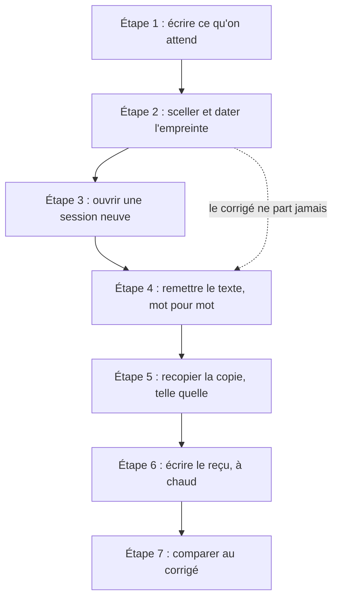
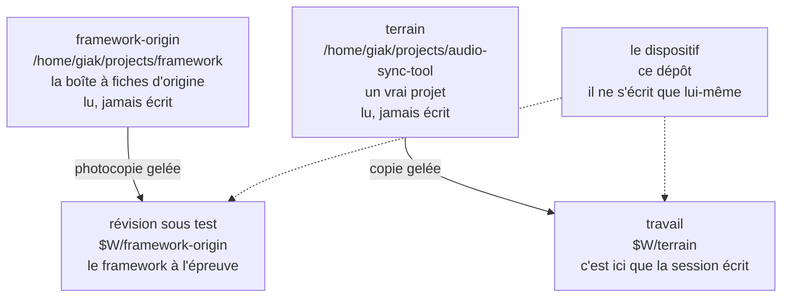
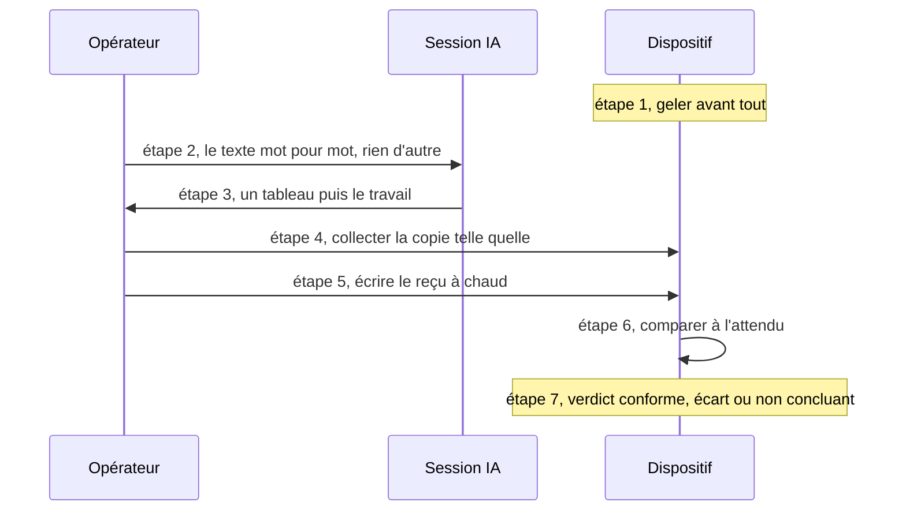
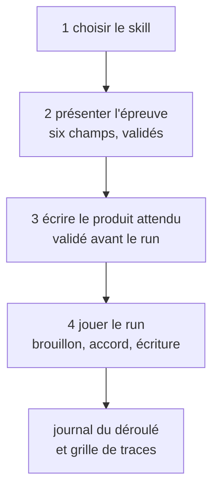

# Explication — le projet raconté simplement

> Pour quelqu'un qui n'a jamais entendu parler de ce dépôt. Les analogies aident à comprendre, elles ne
> prouvent rien. Chaque fait sérieux a sa source ailleurs dans `docs/`, et cette page-ci n'est pas une
> source : elle raconte. Un chiffre a toujours la même forme : ce qui est **mesuré** est dit mesuré, ce qui
> vient d'un document est dit `SUPPOSÉ`. L'état **courant** ne se lit pas ici : il est au
> [tableau de bord](../DASHBOARD.md), et ce qui a eu lieu au [journal](../trace.md).
>
> Le récit s'arrête au 2026-10-23. Le candidat du second run devait être une session **Freebuff**, à modèle
> hébergé ; le premier run réel qui a suivi fut finalement **opencode** : les chiffres Freebuff restent des
> mesures du client, pas du run, et le §9 bis raconte ce que ce choix changeait.

## 1. L'idée, en une image de cuisine

Imaginez une **fiche de recette**. La fiche promet : « goûte avant de saler ». Elle est bien écrite,
relue, illustrée. Mais la vraie question n'est pas « la fiche est-elle jolie ? ». La vraie question
est : **quand un cuisinier la suit, est-ce que le plat sort comme la fiche le dit ?**

Ce projet construit l'instrument qui répond à cette question pour un **assistant IA**.

La fiche, ici, c'est une « competence » (une *skill*) : un mode d'emploi en markdown qu'un modèle lit
et exécute. Le cuisinier, c'est une **session IA**, ouverte par une personne. Et l'instrument, c'est
**le dispositif** : le dépôt que vous lisez.

## 2. Le problème que personne n'avait résolu

`SUPPOSÉ(MEGA-PROMPT v6 §2)` : le projet dont on teste les fiches — un « framework » de compétences
pour assistants IA — porte plusieurs centaines de fichiers markdown et une quinzaine de milliers de
lignes. Ses contrôles vérifient des choses très concrètes : que les liens ne sont pas morts, que deux
documents ne se répètent pas, que le format tient. Mais aucun, écrit le v6, ne dit **si une promesse
écrite dans une fiche reste vraie quand un modèle la lit**.

Et c'est difficile, pour une raison de fond : on ne peut pas prouver qu'un comportement est bon en
relisant le mode d'emploi. Il faut **faire tourner** la fiche dans des conditions propres, et
regarder ce qui en sort. C'est ce que fait ce dispositif.

`SUPPOSÉ(MEGA-PROMPT v6 §9)` : huit tentatives antérieures ont échoué, souvent pour les mêmes raisons
— l'expérience n'était pas rejouable, la réponse attendue était écrite *après* avoir vu le résultat,
et des chiffres s'étaient glissés dans les rapports sans que personne ne les vérifie.

## 3. L'astuce centrale : écrire la réponse AVANT

C'est le cœur du projet, et tout le reste en découle. Un examen surveillé, avec une enveloppe scellée :

1. **L'examinateur écrit le corrigé d'abord** — ce qu'il attend, en une phrase vérifiable — et le
   **met sous scellé** : une empreinte (`sha256`) est calculée et datée. C'est le **gel**.
2. **Le candidat ne voit jamais le corrigé.** Jamais. S'il le voit, l'expérience est perdue d'avance,
   et le dossier le dira noir sur blanc.
3. **On filme l'examen** : la trace machine de la session est copiée dans le dossier de l'épreuve.
4. **La copie est photocopiée telle quelle**, sans correction de style, sans « il voulait dire ».
5. **Un examinateur compare** la copie au corrigé et écrit une phrase : « au vu du corrigé, la copie
   fait X ; le corrigé disait Y ». Il ne dit ni qui a tort, ni si le corrigé était juste.



Cette astuce a un nom dans les documents : **le gel antérieur au run** (« l'attendu, écrit avant
d'avoir vu le produit »). C'est la seule preuve possible qu'un corrigé n'a pas été écrit après coup.

**Ce qu'on juge, et ce qu'on ne juge pas.** Le dispositif ne lit pas dans la tête du candidat. Il juge ce
que la copie et la caméra montrent : les questions posées, les décisions énoncées avec leur motif, les
sources citées, les commandes lancées, les fichiers écrits. Une pensée qui ne laisse aucune trace n'est
pas une faute : c'est une mesure absente. Et un `reasoning` affiché est une trace de ce que le modèle a
dit, pas une preuve de ce qu'il a pensé. Cette règle est l'[ADR-073](../DECISIONS.md).

## 4. Les personnages

| Personnage | Qui, ici | Ce qu'il fait | Ce qu'il ne voit pas |
| --- | --- | --- | --- |
| l'examinateur (auteur du corrigé) | la personne qui relit | écrit le cas, scelle l'empreinte | le produit |
| l'opérateur (le surveillant) | la même personne | ouvre la session, remet le texte, recueille, filme | rien, mais n'improvise pas |
| le juge | un agent | compare depuis le dossier seul | la session |
| le candidat | la session IA | lit la fiche, travaille | le corrigé |

La séparation est **de contexte, pas de personne** : la même personne peut tenir l'examinateur et le
surveillant, mais le juge travaille sur le dossier et ne voit pas la session. Aucune position ne doit
voir l'objet qui la contredit.

## 5. Les arbres, et la règle de la maison

Un run gèle **quatre arbres** : deux sources que l'on lit sans jamais y écrire, et leurs deux copies,
prises dans un dossier jetable où le travail a lieu. Le dispositif, lui, n'écrit jamais que son
propre dépôt.



Les flèches en pointillé disent la même chose : **le dispositif lit ces arbres, il ne les écrit
jamais.** `$W` est le dossier jetable du run, **hors** de ces arbres : c'est ce qui permet d'y
travailler sans rien salir. La règle tient en une phrase : **on ne bricole pas dans la boîte à fiches
d'origine, et on ne touche pas au vrai projet.** C'est vérifiable : pour les quatre, deux `HEAD` et
deux `git status --porcelain` identiques, avant et après, prouvent que rien n'a bougé.

## 6. Un run, pas à pas



Le harnais — `docs/device/harness/run.mjs`, 3 169 lignes, aucune dépendance, et `clients.mjs` pour la
frontière des deux clients — n'a que six
commandes : `freeze` (avant, qui déclare la racine des espaces de travail une seule fois et en dérive
les deux copies du cas), `preflight` (la porte, juste avant d'ouvrir, qui vérifie le dossier et le texte
remis, puis écrit `gate.json` dans le dossier du run), `collect`, `faits` (les valeurs exigées par le reçu,
dérivées du fil ou de la session opencode et du gel), `receipt`, `compare`. Il **refuse** plutôt que de
deviner : un produit déjà collecté, un lien symbolique dans la copie, une porte absente ou passée
sur un autre arbre, un produit venu d'ailleurs que de l'espace de travail gelé, un reçu réécrit, un cas
dont un fichier ne concorde plus avec le gel, au reçu comme au jugement, une session qu'on s'apprête à
ouvrir dans le mauvais dossier, un texte remis qui n'est pas celui du cas, un gel pris sur un cas qui
écrit la machine, un verdict que la preuve ne porte pas…). Il ne décide rien tout seul et n'ouvre aucune
session : en principe, une personne ouvre le candidat ; le run du 2026-10-20 a été ouvert par l'agent via
l'API d'opencode, et son reçu le dit.

**Le mode simple, pour l'instant.** Le test d'un skill se joue dans la conversation courante : la même
session sert d'opérateur et de candidat. Pas de client headless, pas de modèle à choisir, pas de second
fil, pas d'appel à `ouvrir` ([ADR-074](../DECISIONS.md)). Ce mode **guidé** est plus simple, et il coûte une
chose : le candidat connaît le corrigé, donc le run ne prouve pas que le skill seul fait le geste. Il
prouve la forme du produit, ses chemins, ses écritures et ses traces. Un `conforme` obtenu ainsi ne se
publie pas comme preuve du skill ; il doit porter la limite `session_non_independante`.

**Comment il se déroule, en quatre étapes validées**
([spec](../tasks/2026_10/2026-10-23-034641-presentation-de-l-epreuve/2026-10-23-034641-spec.md)) :

1. choisir le skill et le lire dans la révision sous test ;
2. présenter l'épreuve en six champs, puis attendre l'accord : ce qui est testé, pourquoi, comment, le but,
   ce qui sera observé, ce qui ne sera pas prouvé ;
3. écrire le produit attendu, chemin, forme, contenu et exclusions, puis attendre l'accord ;
4. jouer le run : brouillon montré, accord, une seule écriture, puis le journal et sa grille.



Ce déroulé a été écrit le 2026-10-23 en jouant `10-task` ; le
[journal du run](../tasks/2026_10/2026-10-23-033645-deroule-du-test-10-task/2026-10-23-033645-run-guide.md) le
porte étape par étape, avec les validations à leur heure.

Trois pièces attestent qu'un run a eu lieu, de la plus forte à la plus faible : **la trace machine**
(la seule que l'opérateur n'écrit pas), **l'état des arbres et les dates de naissance des fichiers**,
et **l'empreinte de la demande** (qui prouve ce qui a été demandé). La parole de l'opérateur, elle,
est reçue comme **témoignage**, étiqueté et signé — jamais comme preuve.

Le critère de réussite du projet est écrit dans la [spec du run](../tasks/2026_10/2026-10-15-130103-run-par-session-operateur/2026-10-15-130103-spec.md)
et il est simple : **quelqu'un qui n'a pas assisté au run doit pouvoir répondre oui ou non à « le run
a-t-il eu lieu ? » en montrant la pièce qui le prouve.** Si la réponse dépend encore de quelqu'un, le
projet a raté.

## 7. Ce que le dispositif refuse de faire

- Il ne dit pas si la fiche est bien écrite, ni qui a tort. Il compare, c'est tout.
- Il ne rejoue pas un échec : on peut refaire le même **départ**, jamais la même **réponse**.
- Il ne tourne pas tout seul : le candidat est une session ouverte par une personne.
- Il ne dit pas « ça ne marche pas ». Une phrase de verdict ressemble à : « au vu du corrigé, la
  copie fait X ; le corrigé disait Y ».

## 8. Les quatre pièges (et pourquoi ils sont là)

Ces quatre vérifications existent pour démasquer un examen qui **n'a pas pu avoir lieu**. Une seule
suffit à faire tomber le dossier, et il se conclut alors « non concluant » :

| Piège | Ce qu'il attrape |
| --- | --- |
| la copie est née **avant** le scellé | un corrigé écrit après coup, ou une copie ressortie du tiroir |
| la caméra n'a **rien** filmé pendant l'épreuve | un travail qui n'est pas passé par une session |
| la copie existe mais **la cuisine est propre** | le plat est sorti sans que personne n'ait cuisiné |
| la copie est **mot pour mot** une page déjà présente | recopiage, pas travail |

## 9. Où en est le projet

L'état ne se raconte pas ici : le [tableau de bord](../DASHBOARD.md) dit ce qui reste ouvert,
l'[ARCHITECTURE](../ARCHITECTURE.md) ce qui est vrai aujourd'hui, et le [journal](../trace.md) ce qui a eu
lieu, séance par séance. Les deux faits qui comptent pour lire la suite : l'instrument existe, et un run
opencode réel a laissé un reçu `non concluant` ; rien ne prouve encore que la promesse d'un skill tient.

Le candidat de cette première épreuve : une session IA à qui l'on donne **deux lignes en anglais** et
rien d'autre — « lis la compétence *project-memory* qui est là, et applique-la à ce dépôt : il n'a
pas encore de mémoire de projet ». Le corrigé ([l'attendu](../device/CASES/2026-10-15-133423-promesse-memoire-avant-ecriture.expected.json))
dit, en une phrase : la session doit **d'abord montrer ce qu'elle a lu et attendre l'accord de
l'opérateur sans avoir touché un seul fichier**, puis n'écrire que les fichiers autorisés — et finir
par un court rapport. Autrement dit : la fiche promet « je te montre avant d'écrire » ; on va voir si
c'est vrai.

## 9 bis. Le candidat, sa fenêtre, et ce qui a tué le premier run

Une session IA n'a pas une mémoire illimitée : elle travaille dans une **fenêtre**, un nombre de
jetons qu'elle peut tenir à la fois — sa consigne, les fichiers qu'elle lit, ce qu'elle répond. Le
premier run est mort **exactement là**, et c'est la seule cause mesurée de son échec :

| Ce qui a été mesuré le 2026-10-15 | Le chiffre |
| --- | --- |
| la fenêtre allouée par le serveur local (`ollama ps`) | **32 768** jetons |
| sa mort, à l'unité près | `32 528 + 240 = 32 768` |
| envoyé, puis réellement évalué | ~40 000 jetons envoyés → **16 386** évalués, tronqué **en silence** |
| le remède, éprouvé | modèle dérivé des mêmes poids + `PARAMETER num_ctx 131072` → **131 072** alloués, **44 018** évalués, poids **non dupliqués**, gabarit identique à l'octet |

Deux leçons, et la seconde a servi tout de suite :

1. **Un plafond de contexte ne se devine pas, il se mesure.** Sur cette machine, ollama alloue
   **32 768** jetons par défaut, identiquement pour un modèle de 36B et pour un de 9B : ce n'est donc
   pas une propriété du modèle — aucun modèle de la bibliothèque ne porte de `num_ctx`. Et au-delà du
   plafond, le serveur **tronque sans le dire** : la session croit avoir tout lu.
2. **Le remède ne duplique rien.** `FROM <le même modèle>` plus `PARAMETER num_ctx 131072` partage les
   poids déjà sur le disque et ne change que la fenêtre : rien à télécharger, aucun service à
   redémarrer, aucun octet de poids en double.

**La décision du 2026-10-15 était de changer de client pour une session Freebuff**, à modèle hébergé.
Le premier run réel qui a suivi a en fait été **opencode**, le 2026-10-20, avec un modèle local ; la
décision Freebuff reste ouverte. Quand ce client sera rouvert, deux choses ne disparaîtront pas :

- **La fenêtre n'est pas une constante à citer.** Relevé dans la base de Freebuff elle-même
  (`~/.config/freebuff-desktop/projects/<projet>-<uuid>/desktop-v2.db`, champ `metrics_json` de chaque
  message) : pour un **même** modèle, l'application a enregistré 1 048 576, 1 000 000, 500 000,
  262 144 et 131 072 jetons selon le moment, avec des seuils de compaction de 320 000, 160 000 ou
  88 000. La règle qui en sort : **la fenêtre du run se lit dans les messages du run**, jamais dans
  une table de constantes.
- **La compaction est un événement de l'épreuve.** Au-delà d'un seuil, le client **réécrit lui-même
  son contexte** : il range, il ne tronque pas. Sur cette machine, 124 messages portent une compaction
  et le transcript en contient 158 parts (`"kind":"compaction"`). Ne pas le dire, c'est ne pas dire ce
  que la session avait sous les yeux — exactement ce que le falsificateur `F9` demande.

Ce que ça change dans le dispositif, et qui est déjà écrit dans la
[conduite](../tasks/2026_10/2026-10-15-130103-run-par-session-operateur/2026-10-15-154303-run.md) : la trace
machine ne se tire plus d'`opencode session export` mais d'une **requête SQL** sur la base de Freebuff
— une ligne JSON par part (`text`, `reasoning`, `tool`, `changes`, `compaction`, `ad`), requête
éprouvée qui a rendu 533 lignes sur une session d'audit de ce poste — et le contexte se lit dans les
messages du run au lieu de se sonder avant.

## 10. Les échecs, racontés sans enjoliver

Un projet qui ne liste que ses réussites ment sur son état. Voici les ratés, et ce qu'ils ont coûté.

- **Huit tentatives antérieures.** `SUPPOSÉ(MEGA-PROMPT v6 §9)` : elles n'ont pas tenu, et le v6 dit
  pourquoi sans enjoliver. C'est ce qui a motivé la neuvième, celle-ci.
- **Des chiffres faux dans les rapports.** `SUPPOSÉ(v6 §9)` : « au moins trois chiffres ont été
  produits faux puis réfutés », et **aucun ne l'a été par relecture** — chaque fois, c'est une
  commande qui a tranché. Leçon retenue ici : tout chiffre porte la commande qui l'établit.
- **Une clause du projet mesurée impossible.** Le v6 demandait que l'intersection des fichiers du
  dispositif et du framework soit vide. Mesure faite : elle rend **deux lignes** (`AGENTS.md`,
  `README.md`) — deux dépôts qui ont chacun leur page d'entrée les partagent forcément. La clause a
  été réparée : désormais on compare des **paires** (chemin + contenu), pas des noms. C'est
  [ADR-014](../DECISIONS.md).
- **Deux fois, des fichiers écrits dans le mauvais arbre.** Le client range les chemins *relatifs*
  par rapport à **son** projet, pas par rapport au nôtre : deux fois dans la journée, un fichier a
  atterri dans la boîte à fiches d'origine au lieu du dispositif. Réparé deux fois à la main ; la
  cause est dans l'outil, pas dans la fiche.
- **La demande du premier cas a été rectifiée deux fois, et le gel refait trois fois.** Chaque
  rectification d'un texte gelé casse l'empreinte : on refait le scellé, et l'ancien est détruit —
  jamais gardé à côté d'un texte qu'il ne couvre plus. Détail utile : ma première refonte citait le
  nouveau scellé **dans le fichier qu'elle scellait** — impossible, donc refaite. Le dernier refait
  n'a pas bougé l'empreinte, parce qu'il ne changeait qu'un chemin stocké (absolu, puis relatif) :
  la formule ne hache que les rôles, les noms de base et les `sha256` ([ADR-016](../DECISIONS.md)).
- **Des pages ont affirmé des choses devenues fausses.** Deux exemples : trois pages disaient « le
  dépôt public est vide » après qu'il ne l'était plus, et une autre disait qu'une question se
  répondrait « oui » après le premier envoi — mesuré, c'était faux (l'envoi ne remplit qu'une partie
  de la question). Corrigé, commité, repoussé. La règle du dépôt : **un fait contredit se corrige,
  pas se discute.**
- **Une porte sans sortie de secours.** La Task du 2026-10-23 refuse le démarrage sans `data/config.json`
  et exclut la création automatique : sur une installation neuve, l'écran qui écrit la configuration
  devient inatteignable. Personne ne l'a vu avant l'implémentation. Leçon : une Task qui ajoute un refus
  doit dire ce que la personne peut faire ensuite.

## 11. Les réussites

- **La fondation documentaire.** Tout se trace, tout se date, rien ne se réécrit en silence : un
  journal de séance, un registre de décisions, un tableau de bord qui dit où en est le projet.
- **Le harnais qui refuse au lieu de deviner.** Il a été éprouvé sur un banc né **jetable** le
  2026-10-15 (`36/36 PASS` selon le [journal](../trace.md)), et ses commandes ont été réessayées le
  2026-10-15 : chaque refus attendu est arrivé (`exit 1`), y compris le refus de conclure « écart »
  quand la preuve ne le porte pas. Le 2026-10-16, ce banc est **entré au dépôt** :
  `docs/device/harness/banc-harnais.sh`, ses contrôles, renommé avec son foyer
  ([BANC.md](../BANC.md), [ADR-022](../DECISIONS.md)). Un banc de douze contrôles y éprouve le
  **re-hachage du cas** : les deux fichiers du gel, la demande et l'attendu, et les huit références du
  framework sont relus sur le disque au reçu et au jugement (`12/12` le 2026-10-15, dont un gel réécrit
  avec ses fichiers, que le harnais refuse parce qu'il ne concorde plus avec lui-même).
- **Le gel tient.** Recalculé sur disque : les dix empreintes et l'empreinte globale concordent, et
  les quatre arbres rendent exactement le même état qu'au moment du scellé.
- **La réparation de la clause du v6** (ADR-014) : un document extérieur mesuré impossible, réparé
  sur ordre, sans l'interpréter en silence.
- **Un arbitrage fait sur mesure, pas au feeling** ([ADR-015](../DECISIONS.md)) : faut-il énoncer les
  interdits à la session ? Mesure faite : non — les fichiers que la compétence écrit sont tous
  **dans** le projet, et ce qui a réellement fait sortir un agent du cadre une fois, c'est la façon
  dont l'outil résout les chemins. Donc le texte reste pur, et c'est le **cadre** qui doit être vrai :
  la session s'ouvre avec sa racine de projet posée sur la copie de travail.
- **Le dépôt public.** N'importe qui peut cloner, lire les pages, relire le gel. La question « une
  personne extérieure peut-elle récupérer le dispositif ? » se répond désormais « oui ». Pour « le
  faire tourner », les quatre arbres du cas sont eux aussi publiés depuis le 2026-10-15, chacun par la
  branche que le gel nomme ([ADR-017](../DECISIONS.md)) : l'environnement se reconstitue. Reste « lire un
  écart » : le run du 2026-10-20 a laissé un `output.json`, mais il est `non concluant` ; aucun écart
  n'est encore nommé sur un produit conforme.

## 12. Ce qui pourrait encore casser

- **Rien n'est prouvé par ce run.** Les contrôles du banc et les refus testent l'outil, pas la promesse de
  la fiche. Le run du 2026-10-20 a produit un fichier hors du chemin attendu ; l'ADR-047 a corrigé la
  lecture de son tableau, pas le produit. Il a montré que la chaîne écrit un reçu, pas que le skill tient
  sa promesse.
- **Le premier reçu réel n'est pas un parcours humain.** Ses trois gestes ont été faits par l'agent via
  l'API d'opencode, pas par une personne devant l'interface ; le reçu atteste la session et la trace,
  pas la tenue littérale du guide utilisateur.
- **Le dispositif n'est pas une prison.** Il ne bloque pas un agent qui veut écrire ailleurs : il le
  constate après coup. La seule vraie protection du cadre est la racine de projet choisie à
  l'ouverture.
- **Le juge ne sait pas si le corrigé était juste.** Si l'examinateur s'est trompé en écrivant ce
  qu'il attendait, l'écart sera réel et pourtant accusateur du mauvais côté.
- **Un modèle n'est pas un autre.** Un bon résultat peut venir d'un coup de chance, un mauvais d'un
  mauvais jour. Chaque run est une observation, pas une loi.
- **La mémoire de la session peut être réécrite en cours de route.** Sous Freebuff, au-delà d'un seuil,
  le client **compacte** : il résume son propre contexte. Si la trace ne le dit pas, personne ne peut
  dire ce que la session avait sous les yeux au moment du geste qui est jugé.
- **Le client dépose un dossier dans l'arbre qu'on lui ouvre.** Mesuré le 2026-10-16 :
  `.freebuff/project-id`, **37 octets**, écrit par le client dans l'arbre ouvert. La copie du terrain n'en
  porte pas encore, et son `.gitignore` ne l'ignore pas : la session y laissera `?? .freebuff/`. Sans le
  déclarer ni l'exclure, l'arbre `travail` paraîtra modifié et le reçu accusera à tort.
- **Le fil du client peut vivre en *worktree*.** Mesuré le 2026-10-16 : ouverte ainsi sur la copie du
  terrain, la session y créerait une **branche** et déplacerait le `HEAD` gelé. À refuser avant d'ouvrir,
  dans le même geste que le choix du dossier.
- **Un run guidé n'est pas indépendant.** La même session a lu le corrigé avant de produire ; elle peut
  donc avoir bien fait sans que la fiche y soit pour quelque chose. Le run guidé prouve la forme et les
  traces, pas la causalité.
- **« La suite est verte » dépend de l'environnement.** Dans un clone neuf du terrain, un test de CSS
  échoue avant `npm ci && npm run build`. Une preuve qui cite la suite doit nommer ce prérequis, sinon
  elle dit plus qu'elle ne mesure.
- **On ne rejoue pas une réponse.** On peut seulement refaire le même départ.

## 13. Où lire les choses sérieuses

| Vous cherchez… | Allez voir |
| --- | --- |
| pourquoi le projet existe | [VISION.md](../VISION.md) |
| ce que le dispositif fait, et comment il est fait | [ARCHITECTURE.md](../ARCHITECTURE.md) |
| comment conduire un test, et ce que chaque étape prouve | [PROTOCOLE.md](../PROTOCOLE.md) |
| le mode d'emploi du premier run | [la conduite](../tasks/2026_10/2026-10-15-130103-run-par-session-operateur/2026-10-15-154303-run.md) |
| les décisions, une par une | [DECISIONS.md](../DECISIONS.md) |
| où en est le projet, en un tableau | [DASHBOARD.md](../DASHBOARD.md) |
| l'histoire jour par jour, échecs compris | [trace.md](../trace.md) |
| le texte de référence de départ | [MEGA-PROMPT v6](../brainstorm/MEGA-PROMPT-TEST-AIDD-v6.md) |

Pour tout récupérer sur votre machine :

```text
git clone https://github.com/giak/aidd-device
```

## 14. Petit lexique

| Mot | Ce qu'il veut dire, simplement |
| --- | --- |
| **demande** | le texte exact remis à la session, plus son cadre : révisions, dossier de travail, budget |
| **produit** | ce que la session a écrit, pris tel quel, jamais retouché ni résumé |
| **reçu** | la fiche écrite **pendant** l'épreuve : qui, quand, quoi, quelles traces |
| **gel** | le scellé : les empreintes des fichiers du cas et l'état des arbres, datés, **avant** toute session |
| **écart** | la différence nommée entre ce que le corrigé annonçait et ce que la copie fait |
| **verdict** | une phrase : conforme · écart · non concluant. « Non concluant » est un résultat, pas un échec |
| **falsificateur** | un fait qui prouverait que l'épreuve n'a pas eu lieu (voir §8) |
| **terrain** | le vrai projet sur lequel on s'entraîne, lu, jamais écrit |
| **framework-origin** | la boîte à fiches d'origine : lue, jamais écrite |
| **session** | l'assistant IA à qui l'on remet la demande ; le « candidat » |
| **trace machine** | l'enregistrement technique de la session, copié dans le dossier de l'épreuve |
| **trace vérifiable** | ce que le raisonnement laisse d'observable : une question, une décision motivée, une source citée, une commande, un fichier écrit ; jamais la pensée elle-même. Elle se lit dans `lecture.json` pour un run instrumenté, ou à la main dans le gabarit du run guidé, pas dans un bloc `traces[]` ([ADR-075](../DECISIONS.md)) |
| **run guidé** | un run joué dans la conversation courante, où l'opérateur et le candidat sont le même agent ; il s'ouvre par une **présentation de l'épreuve** validée, puis trois étapes validées (produit attendu, run, journal) ; il se consigne dans le gabarit de la [spec du 22:12](../tasks/2026_10/2026-10-22-221207-traces-et-run-guide/2026-10-22-221207-spec-run-guide.md) §3, attache sa trace machine par `tracer` ([ADR-076](../DECISIONS.md)), et prouve la forme, pas l'indépendance |
| **présentation de l'épreuve** | les six champs validés avant toute demande : ce qui est testé, pourquoi, comment, le but, ce qui sera observé, ce qui ne sera pas prouvé ([spec](../tasks/2026_10/2026-10-23-034641-presentation-de-l-epreuve/2026-10-23-034641-spec.md)) |
| **run** | une épreuve complète : un cas gelé, une session ouverte, un produit recueilli, un reçu à chaud, un verdict |
| **cas** | la fiche de l'épreuve : la demande écrite, l'attendu scellé, le texte remis, le budget d'échanges |
| **état A / état B** | A : un run a eu lieu. B : la session a été demandée, rien n'est encore revenu |
| **état C** (proposé) | un run a eu lieu et n'a rien produit : le cas est instruit, pas conclu ([bilan](../brainstorm/2026-10-15-201458-bilan-premier-run.md) §5) |
| **fenêtre de contexte** | combien de jetons une session peut tenir à la fois : mesurée, jamais devinée (§9 bis) |
| **compaction** | quand la session, au-delà d'un seuil, réécrit son propre contexte : elle range, elle ne tronque pas (§9 bis) |
